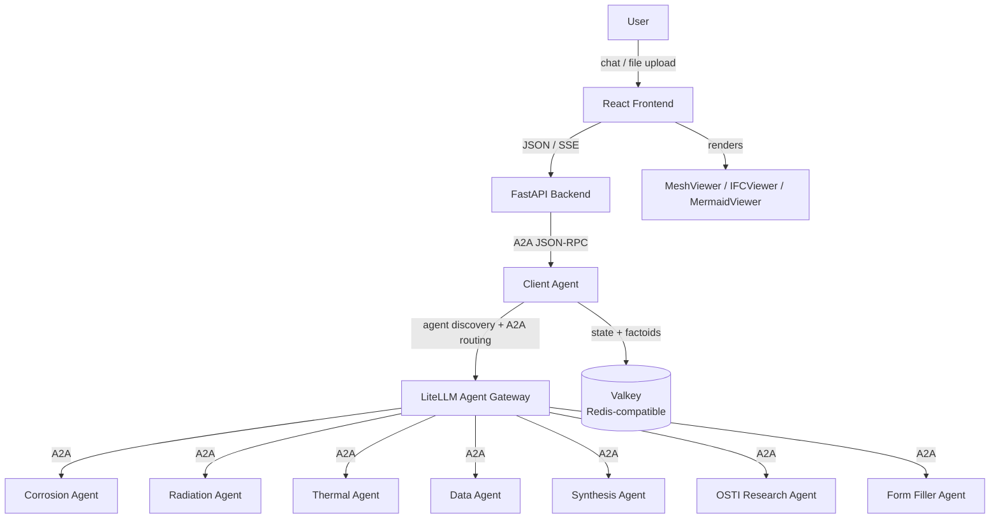

# Prometheus Platform

A multi-agent analysis platform for nuclear engineering. Users interact through a React chat UI (served by a FastAPI backend) that routes queries to specialist agents via a central client-agent orchestrator. The platform supports 3D visualization (Exodus, STL, IFC), multi-step analysis workflows, conversation state, and a DeepLynx-backed artifact catalog.

## Architecture



**Request flow:** A user sends a message in the React frontend, which posts it to the FastAPI backend over its JSON/SSE contract. The backend forwards it as an A2A JSON-RPC request to the client-agent, which classifies the query, discovers relevant specialist agents through LiteLLM's agent directory, collects any missing parameters, builds an execution plan, and dispatches work through LiteLLM's A2A gateway. Results (including artifacts) flow back through the client-agent and backend to the frontend for rendering.

## Prerequisites

- Docker and Docker Compose
  - **Windows:** run the stack from a WSL2 distro, not from Windows directly. See
    [Windows + WSL2 setup](docs/docs/windows-wsl2-setup.md) for enabling WSL2
    integration in Docker Desktop before continuing below.
- [PAT](https://github.inl.gov/settings/tokens/new) for `containers.github.inl.gov` (to pull the `prometheus_api` base image) — 90 days is the recommended expiration
- [uv](https://docs.astral.sh/uv/) and Python — only required to run the Python components outside Docker:
  - Backend: **3.12+**
  - Client-agent: **3.12+**
  - Infrastructure tests: **3.13+**
- Node.js + npm — only required to run the React `frontend/` dev server outside Docker
- `make` and `openssl` — on a minimal distro/WSL image these may not be preinstalled
  (RHEL-based: `sudo dnf groupinstall "Development Tools"` and `sudo dnf install openssl`)

## Quickstart

### 1. Configure environment

```bash
cp .env.example .env
# Required: AGENT_SECRET, REDIS_PASSWORD, BACKEND_JWT_SECRET,
#           LITELLM_MASTER_KEY, LITELLM_DB_PASSWORD, LITELLM_LOCAL_PORT,
#           ADMIN_DB_PASSWORD, and the API keys referenced by the selected
#           LLM_CONFIG_PROFILE
# Optional: DEEPLYNX_*, HTTP_PROXY / HTTPS_PROXY / NO_PROXY
```

To fill in the random-secret values in one pass instead of editing each by hand:

```bash
python3 -c "
import re, secrets, pathlib
path = pathlib.Path('.env')
text = path.read_text()
for var in ['ADMIN_DB_PASSWORD', 'AGENT_SECRET', 'REDIS_PASSWORD', 'BACKEND_JWT_SECRET', 'LITELLM_MASTER_KEY', 'LITELLM_DB_PASSWORD']:
    text = re.sub(rf'^{var}=.*', f'{var}={secrets.token_hex(16)}', text, flags=re.M)
path.write_text(text)
"
```

If you haven't generated multi-user identity signing keys yet (see
[Multi-user setup](docs/docs/dev-docs/multi-user-setup.md)), set
`USER_IDENTITY_REQUIRED=false` in `.env` — otherwise agents reject every
request with `No 'userToken' found in message metadata` because the backend
has no `USER_IDENTITY_PRIVATE_KEY` to mint one.

#### Choose an LLM profile

`LLM_CONFIG_PROFILE` tells the agents which LLM provider to use. Set it in `.env`; if you do not change it, the default is `registry`.

```dotenv
LLM_CONFIG_PROFILE=registry
```

Choose one of the following values and fill in the matching API key in `.env`:

| Value | What it uses | Additional variable to fill in |
|---|---|---|
| `registry` | The LiteLLM proxy included with this project. This is the default and the simplest option for most users. | `ANTHROPIC_API_KEY` |
| `anthropic` | Anthropic directly, without using LiteLLM for model requests. | `ANTHROPIC_API_KEY`; also `EMBEDDING_API_KEY` if an agent uses embeddings |
| `openai` | OpenAI directly for model and embedding requests. | `OPENAI_API_KEY` |
| `inl_hpc` | INL HPC's OpenAI-compatible model service. | `INL_HPC_API_KEY` |
| `inl_litellm` | INL's hosted LiteLLM service. | `INL_LITELLM_API_KEY` |
| `amsc` | The American Science Cloud I2 model service. | `AMSC_I2_API_KEY` |

For example, to use OpenAI:

```dotenv
LLM_CONFIG_PROFILE=openai
OPENAI_API_KEY=<your-openai-api-key>
```

Advanced users can set `LLM_CONFIG_FILE` to a custom LLM configuration YAML file. It overrides `LLM_CONFIG_PROFILE`, must be available inside every agent container, and requires any environment variables referenced by that file.

### 2. Authenticate to the container registry

The `prometheus_api` base image is pulled from INL's Github with a [PAT](https://github.inl.gov/settings/tokens/new):

The PAT (Personal Access Token) requires `read:packages` permissions. 90 days is the recommended expiration.

```bash
export GITHUB_PAT=<your-token>
echo $GITHUB_PAT | docker login containers.github.inl.gov \
  --username <your-github-username> \
  --password-stdin
```

### 3. Start the stack

```bash
make up      # build + start everything (detached)
make logs    # tail all services (SERVICE=<name> to filter)
make ps      # show running services
```

`make up` runs `make generate` first, which scans `agents/*/docker-compose.yml` and writes `docker-compose.agents.yml`. **Do not hand-edit that file** — re-run `make generate` after adding or removing an agent (or use `make ng-up` to skip regeneration).

Launch and restart targets clear LiteLLM's Postgres volume before starting services. This removes stale LiteLLM agent registrations while preserving Valkey conversation and artifact state.

The first run also builds every agent image and pulls the `prometheus_api` base
image, so it's slower than later runs — expect roughly **5 to 15 minutes**
depending on your connection and machine. Use `make up-fg` instead of `make up`
to watch that build/startup happen in the foreground rather than waiting on a
detached container with no output.

`make ps` once everything is healthy looks like:

```
NAME                  IMAGE                                     SERVICE               STATUS
admin-db              postgres:16-alpine                        admin-db              Up (healthy)
agent-valkey          valkey/valkey-bundle:9.1.0                 redis                 Up
backend               prometheus_platform-backend                backend               Up (healthy)
client-agent          prometheus_platform-client-agent           client-agent          Up
form-filler-agent     prometheus_platform-form-filler-agent      form-filler-agent     Up
frontend-dev          prometheus_platform-frontend-dev           frontend-dev          Up
litellm-db            postgres:16-alpine                         litellm-db            Up (healthy)
litellm-proxy         ghcr.io/berriai/litellm:v1.92.0            litellm               Up (healthy)
osti-research-agent   prometheus_platform-osti-research-agent    osti-research-agent   Up
synthesis-agent       prometheus_platform-synthesis-agent        synthesis-agent       Up
```

Services and host ports:

| Service | URL / Port | Role |
|---|---|---|
| React frontend | http://localhost:5150 (dev profile, default) / 8080 (prod profile) | Entry point |
| Backend (FastAPI) | http://localhost:8600 (`BACKEND_PORT`) | JSON/SSE API + auth/sessions |
| Client agent | internal only; http://localhost:8001 in system-test mode | Orchestrator |
| LiteLLM gateway | http://localhost:9977 (`LITELLM_LOCAL_PORT`) | Agent registry + LLM proxy |
| Valkey | localhost:6379 | Redis-compatible state, status, artifact metadata |
| Postgres (LiteLLM) | internal only | Persistent agent registrations |

### Stop or reset the stack

```bash
make down              # stop everything (down-v also drops volumes)
make clear-litellm-db  # stop services + remove only LiteLLM's Postgres volume
```

### Log in

Upon first startup, you will be prompted to create a username and password. Save these credentials as you will need them when you log in.

If you forget your password while running the project locally, start the platform and clear its local user accounts:

```bash
make up
make clear-admin-users
```

The `make clear-admin-users` command deletes all local user accounts. Refresh the application afterward; you will be prompted to create a new username and password. If you use `make up-fg` instead of `make up`, leave it running and run `make clear-admin-users` from a second terminal in the project directory.

## Local frontend development (hot reload)

The React frontend supports hot reload against an already-running Compose stack:

```bash
# 1. Start the stack. The backend is published on 8600 regardless of PROFILE.
#    Use PROFILE= to skip the containerized frontend so it doesn't hold port 5150.
make PROFILE= up

# 2. Run the Vite dev server locally.
cd frontend
make install
make dev           # http://localhost:5150
```

The Vite dev server proxies `/api` to the backend at `VITE_BACKEND_URL` (default `http://localhost:8600`), which maps to the containerized backend.

## Full-system tests

Full-system tests exercise the same LLM-driven planning, parameter requests, specialist agents, and artifacts as the frontend. They never start or reconfigure Docker. Start the full platform with the client-agent host port enabled, then run the suite separately:

```bash
make PROMETHEUS_SYSTEM_TESTING=true up
make test-system
```

`tests/system/prometheus.py` provides concise test helpers for starting a chat, prompting, submitting requested parameters, approving plans, inspecting typed artifacts, and making LLM-judged semantic assertions. It wraps the lower-level lifecycle stream and production artifact APIs in `tests/system/a2a_client.py`.

## Configuration

Backend settings come from `backend/app/config.yml` (override the path with `PROMETHEUS_CONFIG_PATH`):

| Key | Description |
|-----|-------------|
| `agent-url` | Client-agent A2A endpoint (default: `http://localhost:8001`). Overridden by `CLIENT_AGENT_URL`. |
| `agent-secret` | Bearer token for agent auth. Overridden by `AGENT_SECRET`. |
| `redis-url` | Redis connection URL for session/conversation state. Overridden by `REDIS_URL`. |
| `jwt-secret` | Session-cookie signing key. Overridden by `BACKEND_JWT_SECRET`. |
| `debug` | Enable debug features |
| `auto-approve-steps` | Skip manual approval between workflow steps |
| `workflow-suggestions` | Chat suggestions shown on startup |

The React app itself is configured through `frontend/config.ts` and `VITE_*` environment variables (e.g. `VITE_BACKEND_URL`).

Notable environment variables (see `.env.example` for the full list):

| Variable | Purpose |
|---|---|
| `LLM_CONFIG_PROFILE` | Installed agent LLM mapping: `registry`, `inl_hpc`, `inl_litellm`, `amsc`, `anthropic`, or `openai` |
| `LLM_CONFIG_FILE` | Optional custom YAML path inside the agent container; overrides `LLM_CONFIG_PROFILE` |
| `PROMETHEUS_SYSTEM_TESTING` | When `true`, Make includes the Compose override that publishes the client-agent on `CLIENT_AGENT_PORT` |
| Provider API keys | Credentials referenced by the selected profile; see `.env.example` |
| `AGENT_SECRET_REQUIRED` | Enforce Bearer auth on specialist agents (default `true`) |
| `LOCAL_CERT_FILE` / `CERT_FILE` | CA bundle path on host / inside containers |
| `HTTP_PROXY` / `HTTPS_PROXY` / `NO_PROXY` | Corporate proxy settings |

### Optional integrations (work in progress)

**DeepLynx** — storage catalog for artifact payloads and `deeplynx://` URI resolution (required for the artifact-debug-agent and a handful of specialist flows). Configure with `DEEPLYNX_BASE_URL`, `DEEPLYNX_KEY`, `DEEPLYNX_SECRET`, `DEEPLYNX_ORG_ID`, `DEEPLYNX_PROJECT_ID`. Instructions to configure a local DeepLynx server can be found [here](docs/docs/local-deeplynx.md).

**OIDC single sign-on** — alternative to the local-users login. Providers are *not* configured by environment variable: an admin registers each one at runtime through the in-app admin UI (`POST /api/admin/oidc-providers`), which stores it in admin-db with the client secret encrypted at rest. Login then lives at `GET /api/auth/login/{provider_id}`. See `docs/docs/dev-docs/multi-user-setup.md`.

## Project structure

```
prometheus_platform/
  Makefile                  # Top-level orchestration (Compose, generate, tests)
  docker-compose.yml        # Core infra: Valkey, LiteLLM, Postgres, client-agent, backend, frontend
  docker-compose.agents.yml # Auto-generated from agents/*/docker-compose.yml — do not edit
  litellm_config.yaml       # LiteLLM proxy config (model_list, master key, db url)
  scripts/
    generate-agents-compose.sh
  backend/
    app/                    # FastAPI app: routers, services, contract, config
    tests/
  frontend/                 # React + Vite single-page app
    src/                    # App, components, viewers, lib (backend contract adapter)
    public/                 # Static assets, custom-element JSX, IFC/VTK JS bundles
    Dockerfile              # dev (Vite) + prod (nginx) build stages
    nginx/                  # prod nginx template (SPA, /api proxy via $BACKEND_UPSTREAM, /healthz)

  agents/
    client-agent/           # A2A orchestrator
    osti-research-agent/    # OSTI literature search
    form-filler-agent/      # Dynamic form completion
    artifact-debug-agent/   # Artifact handling test agent
    (debug) corrosion-agent/        # Corrosion analysis specialist
    (debug) radiation-agent/        # Radiation damage specialist
    (debug) thermal-agent/          # Thermal analysis specialist
    (debug) material-data-agent/    # Material data retrieval
    (debug) synthesis-agent/        # Report synthesis

  tests/                    # Infrastructure / integration tests for the full stack
  docs/                     # Project documentation (Zensical site)
```

## Development

### Frontend (`frontend/Makefile`)

```bash
cd frontend

make install     # npm install
make dev         # Vite dev server on port 5150 (hot reload)
make build       # Production bundle → dist/
make lint        # eslint
make typecheck   # tsc
make check       # lint + typecheck
```

The Vite dev server proxies `/api` to the backend (`VITE_BACKEND_URL`, default `http://localhost:8600`). React unit tests live alongside the source as `src/**/*.test.ts`.

### Per-agent

Each agent has its own `pyproject.toml`; the client-agent additionally ships a `tests/` suite. Run from the agent directory:

```bash
cd agents/client-agent
uv sync
PYTEST_DISABLE_PLUGIN_AUTOLOAD=1 uv run python -m pytest -p pytest_asyncio.plugin tests
```

### Infrastructure tests (`tests/`)

```bash
make test-static       # Static checks of compose, env vars, ports — no Docker needed
make test-integration  # Hits running containers (start the stack first via make up)
make test-infra        # Both
```

## Troubleshooting

_TBD — common issues and fixes will be collected here as they come up._

## Documentation

- [Windows + WSL2 setup](docs/docs/windows-wsl2-setup.md) - installing and verifying Docker Desktop's WSL2 integration before running `make up`
- [Architecture](docs/docs/dev-docs/architecture.md)
- [Client-agent developer guide](agents/client-agent/README.md)
- [Adding agents](docs/docs/dev-docs/adding-agents.md)
- [Artifacts](docs/docs/dev-docs/artifacts.md)
- [Multi-user setup](docs/docs/dev-docs/multi-user-setup.md) - identity JWTs, credential broker, running single-user without signing keys
- [Visualization plugins](docs/docs/dev-docs/visualization-plugins.md)
- [Migration guide](docs/docs/dev-docs/migration.md) - what changed from the original projects and why
- [Self-hosted DeepLynx](docs/docs/local-deeplynx.md) - roll out your own DeepLynx instance and connect the platform to it
