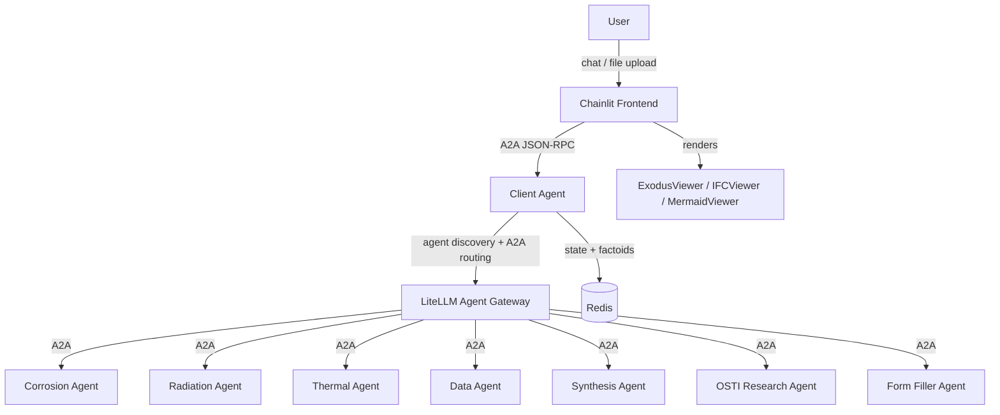

# Prometheus Platform

A multi-agent analysis platform for nuclear engineering. Users interact through a Chainlit chat UI that routes queries to specialist agents via a central client-agent orchestrator. The platform supports 3D visualization (Exodus, IFC), multi-step analysis workflows, conversation state, and a DeepLynx-backed artifact catalog.

## Architecture



**Request flow:** User sends a message in Chainlit. The frontend forwards it as an A2A JSON-RPC request to the client-agent. The client-agent classifies the query, discovers relevant specialist agents through LiteLLM's agent directory, collects any missing parameters, builds an execution plan, and dispatches work through LiteLLM's A2A gateway. Results (including artifacts) flow back through the client-agent to the frontend for rendering.

## Prerequisites

- Docker and Docker Compose
- INL HPC credentials for `mooseharbor.hpc.inl.gov` (to pull the `prometheus_api` base image)
- INL CA bundle PEM file (for HTTPS to internal services)
- [uv](https://docs.astral.sh/uv/) and Python — only required if you run components outside Docker:
  - Frontend pins **Python 3.12** (`>=3.12,<3.13`)
  - Client-agent: **3.12+**
  - Infrastructure tests: **3.13+**

## Quickstart

### 1. Configure environment

```bash
cp .env.example .env
# Required: ANTHROPIC_API_KEY, AGENT_SECRET, REDIS_PASSWORD, CHAINLIT_AUTH_SECRET,
#           LITELLM_MASTER_KEY, LITELLM_DB_PASSWORD, LITELLM_LOCAL_PORT
# Optional: DEEPLYNX_*, OAUTH_OKTA_*, HTTP_PROXY / HTTPS_PROXY / NO_PROXY
```

### 2. Provide CA certificates

Place your CA bundle at `certs/ca-bundle.pem`. It is mounted into every container at `/etc/ssl/certs/ca-bundle.pem`

If building for INL, follow the INL ServiceNow knowledge base article - https://servicenow.inl.gov/ess?id=kb_article_view&sys_id=78a82f9293adba90c36eb7986cba1072

### 3. Authenticate to the container registry

The `prometheus_api` base image is pulled from INL's HPC harbor:

```bash
docker login mooseharbor.hpc.inl.gov
# Username: HPC username
# Password: HPC password
```

### 4. Start the stack

```bash
make up      # build + start everything (detached)
make logs    # tail all services (SERVICE=<name> to filter)
make ps      # show running services
make down    # stop everything (down-v also drops volumes)
make clear-litellm-db  # stop services + remove only LiteLLM's Postgres volume
```

`make up` runs `make generate` first, which scans `agents/*/docker-compose.yml` and writes `docker-compose.agents.yml`. **Do not hand-edit that file** — re-run `make generate` after adding or removing an agent (or use `make ng-up` to skip regeneration).

Launch and restart targets clear LiteLLM's Postgres volume before starting services. This removes stale LiteLLM agent registrations while preserving Redis conversation and artifact state.

Services and host ports:

| Service | URL / Port | Role |
|---|---|---|
| Chainlit UI | http://localhost:8500 | Entry point |
| Client agent | http://localhost:8001 | Orchestrator |
| LiteLLM gateway | http://localhost:9977 (`LITELLM_LOCAL_PORT`) | Agent registry + LLM proxy |
| Redis | localhost:6379 | State, status, artifact metadata |
| Postgres (LiteLLM) | internal only | Persistent agent registrations |

### Log in

Default credentials (defined in `frontend/config.yml`):

- Username: `prometheus`
- Password: `prometheus`

## Local frontend development (hot reload)

The frontend supports hot reload against an already-running Compose stack:

```bash
# 1. Start the stack via Compose (see Quickstart) — leaves agents, Redis,
#    and LiteLLM running.
# 2. Stop just the containerized frontend so it doesn't fight for port 8500.
docker stop chainlit-frontend

# 3. Run the frontend locally with uv.
cd frontend
uv sync --group dev
make run-local    # http://localhost:8500
```

The local frontend uses the `agent-url` from `frontend/config.yml` (default `http://localhost:8001`), which maps to the containerized client-agent.

For deployment on the HPC host, `make run` (from `frontend/`) starts Chainlit on `c500-prometheus.hpc.inl.gov:6100`.

## Configuration

Frontend settings come from `frontend/config.yml` (override the path with `PROMETHEUS_CONFIG_PATH`):

| Key | Description |
|-----|-------------|
| `agent-url` | Client-agent A2A endpoint (default: `http://localhost:8001`). Overridden by `CLIENT_AGENT_URL`. |
| `agent-secret` | Bearer token for agent auth. Overridden by `AGENT_SECRET`. |
| `redis-url` | Redis connection URL for memory browsing. Overridden by `REDIS_URL`. |
| `debug` | Enable debug features in the UI settings panel |
| `auto-approve-steps` | Skip manual approval between workflow steps |
| `workflow-suggestions` | Chat suggestions shown on startup |
| `local-users` | Username/password pairs for local auth |

Notable environment variables (see `.env.example` for the full list):

| Variable | Purpose |
|---|---|
| `MODEL_NAME` | Claude model name (default `claude-sonnet-4-6`) |
| `AGENT_SECRET_REQUIRED` | Enforce Bearer auth on specialist agents (default `true`) |
| `LOCAL_CERT_FILE` / `CERT_FILE` | CA bundle path on host / inside containers |
| `HTTP_PROXY` / `HTTPS_PROXY` / `NO_PROXY` | Corporate proxy settings |

### Optional integrations (work in progress)

**DeepLynx** — storage catalog for artifact payloads and `deeplynx://` URI resolution (required for the artifact-debug-agent and a handful of specialist flows). Configure with `DEEPLYNX_BASE_URL`, `DEEPLYNX_KEY`, `DEEPLYNX_SECRET`, `DEEPLYNX_ORG_ID`, `DEEPLYNX_PROJECT_ID`.

**OAuth via Okta** — alternative to the local-users login. Configure with `OAUTH_OKTA_CLIENT_ID`, `OAUTH_OKTA_CLIENT_SECRET`, `OAUTH_OKTA_DOMAIN`, `OAUTH_OKTA_AUTHORIZATION_SERVER_ID`, and `CHAINLIT_URL`.

## Project structure

```
prometheus_platform/
  Makefile                  # Top-level orchestration (Compose, generate, tests)
  docker-compose.yml        # Core infra: Redis, LiteLLM, Postgres, client-agent, frontend
  docker-compose.agents.yml # Auto-generated from agents/*/docker-compose.yml — do not edit
  litellm_config.yaml       # LiteLLM proxy config (model_list, master key, db url)
  scripts/
    generate-agents-compose.sh
  certs/                    # CA bundle(s) mounted into containers

  frontend/
    main.py                 # Chainlit app entry point
    config.yml              # Application configuration
    components/             # Message handling, file processing, settings
    utils/                  # Settings loader, A2A client, conversation state client
    plugins/                # Visualization plugin wrappers (exodus, ifc, mermaid, ...)
    public/elements/        # Custom React components (JSX)
    public/js/              # Bundled JS for IFC and VTK viewers
    tests/

  agents/
    client-agent/           # A2A orchestrator
    osti-research-agent/    # OSTI literature search
    form-filler-agent/      # Dynamic form completion
    artifact-debug-agent/   # Artifact handling test agent
    (debug) corrosion-agent/        # Corrosion analysis specialist
    (debug) radiation-agent/        # Radiation damage specialist
    (debug) thermal-agent/          # Thermal analysis specialist
    (debug) material-data-agent/    # Material data retrieval
    (debug) synthesis-agent/        # Report synthesis

  shared/
    a2a_protocol.py         # Pydantic models for A2A protocol (mounted into every agent)

  tests/                    # Infrastructure / integration tests for the full stack
  docs/                     # Project documentation (Zensical site)
```

## Development

### Frontend (`frontend/Makefile`)

```bash
cd frontend

make run-local   # Start Chainlit locally on port 8500 (hot reload)
make run         # Start Chainlit on the HPC host (c500-prometheus.hpc.inl.gov:6100)
make test        # Run pytest
make lint        # Ruff linter
make format      # Ruff formatter check
make fix         # Auto-fix lint + format
make check       # All checks (lint + format + typecheck)
```

Run a single test:

```bash
uv run pytest tests/test_chat.py       # By file
uv run pytest -k test_name             # By name
```

### Per-agent

Each agent has its own `pyproject.toml`; the client-agent additionally ships a `tests/` suite. Run from the agent directory:

```bash
cd agents/client-agent
uv sync
uv run pytest
```

### Infrastructure tests (`tests/`)

```bash
make test-static       # Static checks of compose, env vars, ports — no Docker needed
make test-integration  # Hits running containers (start the stack first via make up)
make test-infra        # Both
```

## Troubleshooting

_TBD — common issues and fixes will be collected here as they come up._

## Documentation

- [Architecture](docs/docs/dev-docs/architecture.md)
- [Client-agent developer guide](agents/client-agent/README.md)
- [Adding agents](docs/docs/dev-docs/adding-agents.md)
- [Artifacts](docs/docs/dev-docs/artifacts.md)
- [Visualization plugins](docs/docs/dev-docs/visualization-plugins.md)
- [Migration guide](docs/docs/dev-docs/migration.md) — what changed from the original projects and why
