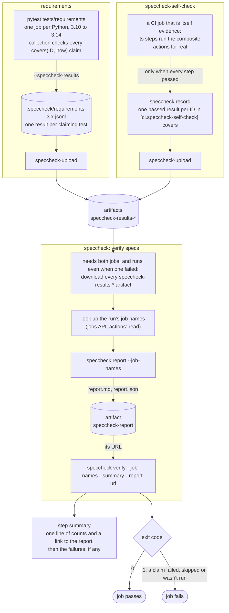

# speccheck

Checks a folder of SDD specs against the test runs that prove them. A requirement counts as met
only when a test (or CI job) that claims it **ran and passed** in CI. A docstring or a comment that
mentions an ID is not evidence.

## What speccheck does

- **Every requirement points at its proof.** A test claims the requirements it proves, and says
  how it proves each one. The report lists, for every requirement, each test or CI job that claims
  it, how, and how it came out in each job.
- **CI fails when a promise isn't kept.** A claimed requirement with no passing result fails the
  workflow's last job, as does (on `devel`) a requirement nothing claims, or a job that should have
  reported and didn't.
- **Reviewers get a report, and a short summary.** The full report is a markdown artifact, linked
  from the run's step summary, which lists only what failed.

### What the report looks like

One requirement's section, from speccheck's own report in CI:

```markdown
### SPC-REQ-004-01 ✅ passed

> A results file MUST be JSON Lines: a header with `schema` `speccheck-results/1`, the producer, …

In [`common/speccheck/specs/004-results-files.md:12`](…/blob/<commit>/common/speccheck/specs/004-results-files.md#L12)

#### Test [`test_a_run_writes_json_lines_with_a_versioned_header`](…/test_004_results_files.py#L103) in `common/speccheck/tests/requirements/test_004_results_files.py`

**How:** an inner run writes a header and one result line whose keys match the JSON Schema shipped in the package

- ✅ passed in [speccheck: requirements python 3.10](…/job/125570969662)
- ✅ passed in [speccheck: requirements python 3.11](…/job/125570970001)
- …
```

Above the requirements, the report has a table of every spec with its counts, and each spec opens
with its Purpose and a table of its requirements, failures first.

## Terms

- **Requirement:** one bullet in a spec, with an ID such as `SPC-REQ-004-01`.
- **Claim:** a test's `@pytest.mark.covers(ID, how)`, or a CI job's entry in the config's
  `[ci.<job>]` table. It says that this test or job proves that requirement, and how.
- **Producer:** something that writes results: a test run (`[producers.<name>]`) or a CI job
  (`[ci.<job>]`). A producer may be limited to some specs, and lists the workflows it runs in.

## Covering a requirement

From a spec bullet to a local check that passes, in a small project with one spec.

### 1. Write the requirement

A spec folder holds `000-index.md`, linking every spec, and one `NNN-short-name.md` per spec:

```markdown
# 001 - Greeting

status: implemented

## Purpose

The `greet` command says hello.

## Requirements

- GRT-REQ-001-01: `greet NAME` MUST print `Hello, NAME!` and exit 0.
- GRT-REQ-001-02: `greet` with no name MUST exit 2 and say a name is needed.
```

- The first line is `# NNN - Name`, and one `status:` line (`draft` or `implemented`) comes before
  the first `##`.
- A requirement is a bullet `- <prefix>-REQ-NNN-XX: text` (or `BEH` for behaviour), where `NNN` is
  the spec's number. It may wrap onto lines indented two spaces.
- A requirement is implemented, so a test must claim it, or it ends with
  `(unimplemented: <reason>)`, such as `(unimplemented: plan step 3)`, and needs no claim until
  it is done. The reason is required. There is no "untested": behaviour that exists gets a test.

The full rules are in "Reference", "Spec format".

### 2. Point speccheck at the spec folder

`speccheck.toml` next to the folder (or `[tool.speccheck]` in the project's `pyproject.toml`) names
the folder, its ID prefix, and the producers that may prove it:

```toml
specs = "specs"
id-prefix = "GRT"

[producers.greeter-tests]
workflows = ["test"]
```

The pytest options turn on the plugin's checks and say which producer this run is:

```ini
[pytest]
speccheck_config = speccheck.toml
speccheck_producer = greeter-tests
```

**The producer name must match in three places:** the `[producers.<name>]` table, the
`speccheck_producer` ini option, and `SPECCHECK_PRODUCER` in the CI job. The environment variable
wins over the ini option.

### 3. Claim it in a test

```python
import pytest


@pytest.mark.covers("GRT-REQ-001-01", "runs `greet Ada` and checks it prints `Hello, Ada!` with exit code 0")
def test_greets_by_name(): ...


@pytest.mark.covers("GRT-REQ-001-02", "runs `greet` with no name and checks it exits 2 saying a name is needed")
def test_needs_a_name(): ...
```

- **One mark per ID, saying how the test proves it.** A test that proves two requirements has two
  marks, each with its own explanation.
- **A mark goes on one test only:** a plain test function, or one `pytest.param` of the test's
  single `parametrize`, so each case says what it proves:

  ```python
  @pytest.mark.parametrize(
      ("body", "outcome"),
      [
          pytest.param(
              "assert False",
              "failed",
              marks=pytest.mark.covers("SPC-REQ-005-02", "a claiming test that fails makes the requirement failed"),
              id="failed",
          ),
          pytest.param(
              'pytest.skip("no")',
              "skipped",
              marks=pytest.mark.covers("SPC-REQ-005-02", "a skipped claiming test isn't evidence"),
              id="skipped",
          ),
      ],
  )
  def test_a_claim_that_didnt_pass_fails_verify(project, body, outcome): ...
  ```

  Not on a class or a module, and not on a parametrized function.
- **Each explanation is said once:** no two claims share one, and none is a placeholder (`TODO`),
  the ID, or a requirement's own text.
- **Collection checks all of this, locally too,** and stops pytest with what to fix:

  ```text
  ERROR: speccheck: 1 claim(s) the spec folder doesn't allow:
  tests/test_greet.py:9: tests/test_greet.py::test_needs_a_name: the explanation for GRT-REQ-001-02 is a placeholder ('TODO'); say how the test proves it
  ```

The full rules are in "Reference", "Claim rules".

### 4. Check it locally

A plain `pytest` checks the claims but writes no results. To check the spec folder as CI does,
collect into a results file and run `check` on it:

```sh
pytest --collect-only -q --speccheck-results=.speccheck/collect.jsonl
speccheck check .speccheck/
```

With one requirement claimed and one not:

```text
specs/001-greeting.md:12: GRT-REQ-001-02 is not claimed; add `@pytest.mark.covers("GRT-REQ-001-02", "<how it proves it>")` to a test that proves it, or end it with `(unimplemented: <reason>)` in the spec if a plan delivers it later
speccheck check: 2 requirements: 1 unclaimed, 1 claimed; reported: greeter-tests; 1 problem
```

And once both are claimed, exit 0:

```text
speccheck check: 2 requirements: 2 claimed; reported: greeter-tests
```

`check` needs no test to run, since a collect-only run sees every claim. `verify` does the same and
also wants each claim to have passed, so it needs a real run's results. While a spec is half
written, `pytest -o speccheck_config=` runs the tests without the claim checks, as long as the run
asks for no results file: with `--speccheck-results` or `SPECCHECK_RESULTS` set, the checks that
need no specs (the mark's shape, the explanation, repeats) still run. (`pytest -p no:speccheck`
isn't a way round that: it unregisters the `covers` marker, which `--strict-markers` then rejects.)

### What counts as evidence

Claim a requirement only from a test that proves its observable behaviour: what a user of the thing
sees, such as a command's output and exit code, a file it writes, or a response. A unit test of a
helper claims nothing, even when the helper exists for a requirement. It proves the helper, not the
promise. speccheck keeps the two apart in its own tests, and a project can do the same:

| | `tests/unit/` | `tests/requirements/` |
|---|---|---|
| Tests | one module at a time, mirroring the package | one spec per file, through the public interface |
| `covers` marks | none (collection fails on one) | every test (collection fails without one) |
| Coverage | the only suite measured, held at 100% | not measured |
| In CI | the `unit` job | the `requirements` job, whose results file is the evidence |

Coverage then says how much code the unit tests exercise, and the report says which promises are
kept. Neither one can stand in for the other. Whether a test really proves what it claims is a
review question: speccheck sees that it claims an ID, says how, and passed. Read the explanation
against the test.

## In CI

**Not supported yet outside this repo.** The actions are local (`./.github/actions/...`), and
`speccheck-install` installs from `$GITHUB_WORKSPACE/common/speccheck`, so this section works only
in the prometheus_core monorepo. An agent in its own repo can run speccheck locally (see "Covering
a requirement"), but has no CI setup yet.

How a requirement gets proven in a workflow, using speccheck's own
[`speccheck.yml`](../../.github/workflows/speccheck.yml) as the example. Its `unit` and `coverage`
jobs claim nothing, so they aren't shown:



- **Claim:** a test says what it proves with `@pytest.mark.covers(ID, how)`. A CI job claims in
  the config's `[ci.<job>]` table and records it as its last step, so it only counts if the job
  got that far.
- **Collect:** each test job writes a results file and uploads it as `speccheck-results-<name>`.
- **Check:** the final job reads every results file, writes the report with each result named by
  its job, uploads it, then runs `verify`, whose exit code is the job's. `--complete` (on `devel`)
  also fails on a producer that didn't report.

### Set up a workflow

In each job that runs claiming tests:

```yaml
    env:
      SPECCHECK_PRODUCER: sdk-python
      SPECCHECK_JOB_ID: ${{ job.check_run_id }}     # so the report links the job, not just the run
      SPECCHECK_RESULTS: ${{ github.workspace }}/.speccheck/sdk-python-${{ matrix.python }}.jsonl
    steps:
      - run: uv run --frozen pytest
      - uses: ./.github/actions/speccheck-upload
        if: ${{ !cancelled() }}
        with:
          name: sdk-python-${{ matrix.python }}
```

A job that is itself the evidence (`[ci.<job>]` in the config) records as its last step, which
runs only when the steps before it passed:

```yaml
      - uses: ./.github/actions/speccheck-install
      - run: speccheck record --config sdk/pyproject.toml
      - uses: ./.github/actions/speccheck-upload
        if: ${{ !cancelled() }}
        with:
          name: sdk-install
```

And at the end of the workflow, which needs `actions: read` and `contents: read`:

```yaml
  speccheck:
    needs: [sdk-python, sdk-install]
    if: ${{ !cancelled() }}
    runs-on: ubuntu-26.04
    steps:
      - uses: actions/checkout@...
        with:
          persist-credentials: false
      - uses: ./.github/actions/speccheck-verify
        with:
          config: sdk/pyproject.toml
          complete: ${{ github.event_name != 'pull_request' }}
```

- **`speccheck-install`** puts the `speccheck` command on `PATH` (with `uv tool install`, from the
  checkout), and leaves the job's own environment alone. It builds the wheel with the build
  backend pinned by hash in `build-constraints.txt`, since `uv.lock` doesn't cover build
  requirements. A job that runs `pytest` in its own uv
  environment doesn't need it: the plugin comes with the project's dev dependencies.
- **`speccheck-upload`** uploads `.speccheck/` (or `path`) as `speccheck-results-<name>`, kept 30
  days, and fails the job when there is nothing to upload.
- **`speccheck-verify`** downloads every `speccheck-results-*` artifact of the run, looks up the
  run's job names, writes the report and uploads it as `speccheck-report` (kept 90 days), then runs
  `verify` and fails with it. It needs no secrets. Without `actions: read` it warns, and names
  results by producer.

### Reading the report and the step summary

**The report** (`report.md` in the `speccheck-report` artifact) has a table of the specs, then per
spec its Purpose and a status table, then a section per requirement: its full text (without the
unimplemented suffix, whose reason is shown beside the status and under the text), a link to its
line in the spec, and a subsection per claim (a claiming test or job with its explanation), with
how it proves the requirement and one line per job that ran it, by the job's display name. In CI, requirements and tests link to
their lines at the commit the run tested. `report.json` holds the same data.

**The step summary** is one line of counts linking the report, then one entry per problem, and
nothing else. On a pass it is the line alone:

```markdown
**speccheck:** 1 problem. 48 requirements: 1 failed, 40 passed, … Full report: [speccheck-report](…)

- `specs/004-results-files.md:12: SPC-REQ-004-01 has no passing result: …`
```

**Each requirement has one status:**

| Status | Means | Fails |
|---|---|---|
| `passed` | at least one claiming result passed (one is enough, in any producer or job) | no |
| `failed` | claimed, and no claiming result passed: failed, error, skipped, xfailed, xpassed, deselected or collected | `verify` |
| `not run` | claimed only by producers that didn't report in these inputs; or, in `verify`, claimed by nothing while a test producer that may claim it hasn't reported | `verify --complete` |
| `unclaimed` | nothing claims it, and it isn't unimplemented. In `verify`, only once every test producer that may claim it has reported | `check`, `verify` |
| `claimed` | (`check` only) claimed; outcomes aren't looked at | no |
| `unimplemented` | the spec ends it with `(unimplemented: <reason>)`, and nothing claims it | no |

An unimplemented requirement that is claimed is a problem: remove the suffix.

### Adopting it in a project

What surprises a project moving onto speccheck:

- **A half-migrated suite breaks local pytest.** With `speccheck_config` set, collection checks
  every claim in the spec folder on every run. One bad claim stops pytest before any test runs,
  even `pytest tests/x.py::one`. Migrate a whole spec at a time, and use `pytest -o speccheck_config=`
  meanwhile, with no `SPECCHECK_RESULTS` set (with one, the shape checks still run).
- **Docstring and comment citations stop counting, without a word.** Only
  `@pytest.mark.covers(ID, how)` counts. Until a test carries the marker, its requirement is
  unclaimed and `verify` fails on it, but nothing points at the old citation.
- **Every claim needs its own explanation.** A parametrized test whose citation covered every case
  needs a `pytest.param(..., marks=...)` per case, each saying something different. Class and
  module marks move down to the tests.
- **A CI job's ID is its producer.** `record` takes the job from `$GITHUB_JOB`, the job's key in the
  workflow, and looks it up as `[ci.<job>]`. Renaming the job without the config entry makes
  `record` fail.
- **A workflow needs both pieces:** the upload in each producing job, and the final job, with
  `needs:` on every producer, `if: ${{ !cancelled() }}`, and `speccheck-verify`. Without the final
  job nothing checks the results.
- **The old checker's settings move to the config.** A spec's `tests:` line and the index's
  `id-prefix:` line are `lint` problems that say where each setting lives now.

### Installing it

Python 3.10 or newer. At runtime it needs only the standard library, plus `tomli` on 3.10.
Installing it registers the pytest plugin, which does nothing until it is configured: until the
project sets `speccheck_config` or a run asks for a results file, no claim is checked, even its
shape, so a project with a `covers` marker of its own is unaffected.

**In this repo**, a project adds it as a path dev dependency, so its `uv.lock` changes:

```toml
[dependency-groups]
dev = ["prometheus-speccheck"]

[tool.uv.sources]
prometheus-speccheck = { path = "../common/speccheck" }
```

**In an agent, don't use a path source:** the agent's Docker build and a clone of the agent repo
alone don't have `common/`, and `uv sync --locked` fails on it. Use a git source pinned to a commit
or tag instead (the dev group isn't installed in the image, so the build never fetches it), or run
it with `uvx` and no dependency at all:

```toml
[tool.uv.sources]
prometheus-speccheck = { git = "https://github.com/idaholab/prometheus_core", subdirectory = "common/speccheck", rev = "<commit or tag>" }
```

**As a command on its own,** `uv tool install ./common/speccheck` puts `speccheck` on `PATH`. In
CI, the `speccheck-install` action does that.

## Reference

The details. The source of truth is speccheck's own specs, in [`specs/`](specs/000-index.md).

### Commands and options

| Command | Reads | Fails (exit 1) when |
|---|---|---|
| `lint` | the spec folder | a spec breaks the format |
| `check [RESULTS...]` | specs, config, results files (a collect-only run is enough) | a requirement that isn't unimplemented has no claim; a claim names a malformed or unknown ID, or one its producer may not claim; a claimed requirement is still marked unimplemented |
| `verify [RESULTS...]` | the same, from a real run | everything `check` fails on, plus a claimed requirement with no passing result, and no results file read at all. With `--complete`, also a producer that didn't report, and a requirement nothing that reported claims |
| `report [RESULTS...]` | the same as `verify` | never on the requirements; writes the full markdown report to stdout or `--output FILE`, or `--json` |
| `record` | config, the CI environment | the job has no `[ci.<job>]` entry (exit 2) |

- `RESULTS` are results files, or folders searched for `*.jsonl`. Symlinks aren't followed: one
  given as an input is a `results-symlink` problem, and one inside a folder is skipped.
- `--complete --workflow NAME` (on `verify` and `report`) expects only the producers that list that
  workflow.
- `--job-names FILE` (on `verify` and `report`) is a JSON object from a job's ID to its display
  name, to name each result's job. It is optional; without it a result is named by its producer. A
  file that isn't such an object is a usage error.
- `--summary FILE` (on `lint`, `check` and `verify`) appends the step summary. `--report-url URL`
  links the report from it, only when it is an artifact URL of this run's own repository, such as
  the `artifact-url` output of `actions/upload-artifact`.
- Global options work before or after the command: `--config PATH` (default `speccheck.toml` here,
  then `[tool.speccheck]` in `pyproject.toml`), `--json`, `--quiet`, `--verbose`, `--version`.
- Exit codes: 0 fine, 1 problems, 2 usage or config error.

### Output and --json

Problems go to stderr as `path:line: message`, so editors and CI logs link them, and each message
says what to do. The last line is a summary, such as
`speccheck verify: 58 requirements: 1 failed, 57 passed; reported: speccheck-requirements; 1 problem`.

With `--json`, stdout is exactly one object, on every exit path:

```json
{
  "schema_version": 1,
  "command": "verify",
  "ok": false,
  "problems": [{"path": "specs/002-config.md", "line": 18, "message": "SPC-REQ-002-04 has no passing result: ...", "code": "failed"}],
  "counts": {"failed": 1, "unclaimed": 0, "not run": 0, "claimed": 0, "passed": 57, "unimplemented": 0},
  "requirements": [
    {"id": "SPC-REQ-002-04", "spec": "002", "status": "failed", "text": "...", "reason": null, "waiting_on": [],
     "evidence": [{"test": "tests/requirements/test_002_config.py::test_the_prefix", "kind": "test", "file": "tests/requirements/test_002_config.py", "line": 70,
                   "root": "common/speccheck", "outcome": "failed", "producer": "speccheck-requirements", "job": "requirements",
                   "job_name": "speccheck: requirements python 3.12", "url": "https://..."}],
     "path": "common/speccheck/specs/002-config.md", "line": 18}
  ],
  "producers": {"reported": ["speccheck-requirements"], "missing": []}
}
```

- `ok` is true exactly when the command exits 0. `report` exits 0 whatever is wrong, so its `ok`
  is true even with `problems`; read `problems` (or use `verify`) to know whether anything is wrong.
- A usage or config error has `"error": {"code": "usage", "message": "..."}` instead (a bare
  `speccheck --json` is one).
- Each problem's `code` is a stable name for its kind, listed below. The `message` wording can
  change; the `code` doesn't.
- `"line": 0` means the problem has no line (a whole file, or the config).
- The two `path` fields have different bases. `problems[].path` is relative to the folder the
  command ran in, so it opens from there. `requirements[].path` is from the repository's root, for
  links, and is `null` outside a git repository. To match a problem to its requirement, use the
  ID in the message, or `requirements[].id`, not the paths.
- `requirements[].text` is the requirement's text without its unimplemented suffix, and `reason` is
  the suffix's reason, or `null` when it has none.
- Fields are only added within a `schema_version`.

#### Problem codes

Every code a problem can have. A rules test fails when the code gains one this table doesn't list.

| Code | Means |
|---|---|
| `bullet-malformed` | a line starts like an ID but isn't `- <prefix>-REQ-NNN-XX: text` |
| `bullet-wrong-spec` | an ID's number isn't its spec's |
| `id-duplicate` | an ID appears twice in the folder |
| `text-duplicate` | two requirements have the same text |
| `reason-missing` | a requirement ends with `(unimplemented)` or an empty reason |
| `spec-file-name` | a file in the folder isn't `NNN-short-name.md` |
| `spec-title` | a spec's first line isn't `# NNN - <name>` |
| `spec-empty` | an `implemented` spec has no requirements |
| `status-missing` | a spec has no `status:` line |
| `status-invalid` | the `status:` isn't `draft` or `implemented` |
| `status-repeated` | a spec has a second `status:` line |
| `index-missing` | `require-index` is on and there's no `000-index.md` |
| `index-link-missing` | the index doesn't link a spec |
| `tests-line-gone` | a spec still has the old `tests:` line; it moved to the config |
| `id-prefix-line-gone` | the index still has the old `id-prefix:` line; it moved to the config |
| `unclaimed` | nothing claims a requirement that should be |
| `failed` | every result that claims a requirement failed, errored, was skipped or didn't run |
| `not-run` | with `--complete`, the producers that may claim a requirement didn't report |
| `unimplemented-stale` | a requirement marked `(unimplemented: ...)` is claimed; remove the suffix |
| `claim-invalid` | a result claims an ID that is malformed, unknown, or not the producer's to claim |
| `config-claim-invalid` | a `[ci.<job>] covers` entry claims an ID like that |
| `how-duplicate` | two claims give the same explanation |
| `producer-undeclared` | a results file comes from a producer the config doesn't declare |
| `producer-missing` | with `--complete`, a declared producer sent no results |
| `no-results` | `verify` read no results file at all |
| `results-missing` | an input path doesn't exist |
| `results-symlink` | an input is a symlink, which isn't followed |
| `results-unreadable` | an input can't be read |
| `results-too-large` | a results file is over the size limit |
| `results-line-too-long` | a line in a results file is over the length limit |
| `results-empty` | a results file is empty |
| `results-not-utf8` | a results file isn't UTF-8 |
| `results-not-json` | a line in a results file isn't JSON |
| `results-invalid` | a line doesn't match `speccheck-results/1` |

A usage or config error isn't a problem: it is the `error` object, whose `code` is `usage`.

### Spec format

- **Files.** `NNN-short-name.md`, whose first line is `# NNN - Name`. Any other `.md` file in the
  folder is a problem. With `require-index` (the default), `000-index.md` must link every spec as a
  markdown link, such as `[004](004-results-files.md)`; a mention in prose doesn't count.
- **Header.** One `status:` line above the first `##`: `draft` or `implemented`. An
  `implemented` spec needs at least one requirement; a `draft` spec's requirements are checked
  like an `implemented` spec's.
  Other header lines (`sources:`, `depends-on:`) are free text.
- **Purpose.** A `## Purpose` section, when there is one, is shown under the spec's heading in the
  report.
- **Bullets.** `- <prefix>-REQ-NNN-XX: text` or `- <prefix>-BEH-NNN-XX: text`, where `NNN` is the
  spec's number. The prefix comes from the config, or is absent when `id-prefix = ""`. A bullet may
  wrap onto lines indented two spaces. A line that starts like an ID in any other form (`*`, bold,
  nested, missing prefix) is a problem, so it can't go unseen.
- **Unique.** IDs are unique across the folder, and so is the text of every requirement (compared
  without the unimplemented suffix, ignoring case, whitespace and a trailing full stop).
- **Unimplemented.** A requirement whose text ends with `(unimplemented: <reason>)` needs no claim
  yet; the reason, such as a plan step, is required. A full stop may come before or after the
  suffix, and it may wrap with the bullet. Anywhere else in the text it is ordinary text, as is
  any other trailing `(word: ...)`. Remove the suffix when a test claims the requirement.
- Fenced code blocks are skipped.

### Config

One config per spec folder: `speccheck.toml`, or `[tool.speccheck]` in a project's `pyproject.toml`.
Paths are relative to the config file, and an unknown key is an error.

```toml
specs = "specs"                 # the spec folder
id-prefix = "SPC"               # IDs are SPC-REQ-NNN-XX; "" for bare IDs
require-index = true            # 000-index.md must link every spec

[producers.speccheck-requirements]      # a test run that provides evidence
specs = "all"                   # or ["001", "004"]: the specs it may claim
workflows = ["speccheck"]       # the workflows it runs in, for verify --complete --workflow

[ci.speccheck-self-check]       # a CI job (by its job id) that is itself evidence
workflows = ["speccheck"]

[ci.speccheck-self-check.covers]  # each ID it claims, and how the job proves it
SPC-REQ-007-03 = "the job uploads its results and checks that an empty folder fails the upload"

[report]
title = "speccheck requirements"
```

A `[ci.<job>]` entry claims at least one ID and can't share a name with a producer, and its
explanations follow the same rules as a test's. A results file from an undeclared producer is a
problem, and its results don't count.

### Claim rules

When the plugin is configured (`speccheck_config` is set, or the run asks for a results file with
`--speccheck-results` or `SPECCHECK_RESULTS`), collection fails, whatever tests were selected:

- on a mark that isn't exactly two strings, the ID and the explanation;
- on a mark on a class or module, on the function of a parametrized test, and on a claiming test
  with two `parametrize`s or a parametrized fixture (`marks=` on a `pytest.param` takes a list
  when one case proves several requirements);
- on an explanation that, with its whitespace collapsed (line breaks included), is empty, over
  1000 characters, the ID itself, or a placeholder (`TODO`, `TBD`, `FIXME`, `...`, `-`);
- on a test that claims one ID twice, and on two claims in the session with the same explanation.

With `speccheck_config` set it also fails on a malformed or unknown ID, on one the
producer may not claim, on an explanation that is the text of any requirement in the folder, and
when no producer is set (`SPECCHECK_PRODUCER` or `speccheck_producer`), rather than skip the
which-specs check. With only a results file asked for, just the checks that need no specs run.
With neither, the plugin checks nothing and writes nothing. No test's outcome ever changes.

These failures come as pytest's usage error (exit 4): one `speccheck: N claim(s) the spec folder
doesn't allow:` line, then one `file:line: test: what to do` line per problem. They have no
`--json` and no `code`, and the run writes no results file. To get them from `check` with codes
(`claim-invalid`), collect with `pytest --collect-only -o speccheck_config= --speccheck-results=FILE`
while the shape is right but an ID isn't.

`check` and `verify` repeat the "same explanation" check across every results file and
`[ci.<job>]` entry; the same test in another job or attempt is the same claim. Explanations are
compared ignoring case, whitespace and a trailing full stop. The plugin registers the marker, so
`--strict-markers` accepts it. Only the marker counts: a docstring may still say what a test proves,
for the reader.

### Results files

`speccheck-results/1`, JSON Lines: a header, then one line per claiming test. The JSON Schema,
[`speccheck/schema/speccheck-results-1.schema.json`](speccheck/schema/speccheck-results-1.schema.json),
is there for runners in other languages.

```json
{"schema": "speccheck-results/1", "producer": "sdk-python", "runner": "pytest 9.2.0", "started": "2026-11-01T12:00:00Z", "root": "sdk",
 "ci": {"provider": "github", "server": "https://github.com", "repository": "idaholab/prometheus_core", "workflow": "test", "job": "sdk-python",
        "run_id": 123, "run_attempt": 1, "job_id": 456, "sha": "...", "ref": "...", "event": "push",
        "run_url": ".../actions/runs/123/attempts/1", "job_url": ".../actions/runs/123/job/456"}}
{"test": "tests/test_llm_client.py::test_chat_proxy", "file": "tests/test_llm_client.py", "line": 181,
 "covers": [{"id": "SDK-REQ-006-08", "how": "a chat call goes through the proxy URL"}], "outcome": "passed"}
```

- `covers` has one `{"id", "how"}` entry per claimed ID.
- `ci` says which CI provider ran it and where. GitHub Actions is the only provider so far: its
  block comes from `GITHUB_*`, plus `SPECCHECK_JOB_ID`. Outside CI it is null. A job can't read its
  own display name, so the final job looks the names up and passes them as `--job-names`.
- `root` is the folder the `file` paths are relative to (pytest's root), as a path from the
  repository's root: `GITHUB_WORKSPACE` in CI, else the nearest folder with a `.git`, else null.
  The report uses it to link each test to its line. When pytest runs where neither can be found,
  such as in a container with one folder of the checkout mounted, set `SPECCHECK_ROOT` to that
  folder's path in the repository (for example `SPECCHECK_ROOT=sdk`), and don't pass
  `GITHUB_WORKSPACE`, which is a host path. Run such a container as the host's user
  (`docker run --user "$(id -u):$(id -g)"`), or create the results folder on the host first:
  a root container creates it in the bind mount owned by root, which the host user can't remove
  on Docker Engine.
- The plugin writes a file only when asked (`--speccheck-results=PATH` or `SPECCHECK_RESULTS`), at
  the end of the session. An interrupted session leaves none, so `verify --complete` reports the
  producer as missing.
- A test's outcome merges its setup, call and teardown: an error in setup or teardown makes it
  `error`, a skip `skipped`, and an expected failure `xfailed`. `error` is sticky, so a flaky
  fixture can't hide behind a rerun plugin's retry. A failed call isn't: with a rerun plugin, a
  test that fails and then passes is `passed`, so a flaky test proves its requirement once it
  passes. Catching flaky tests is the rerun plugin's job. Skipped, deselected and (`--collect-only`)
  collected claims are written too, so `verify` can say "claimed but didn't run".
- Under pytest-xdist the run writes one file, with every worker's results.

A reader checks a result's explanations itself, whoever wrote the file, because a writer in
another language may not have collapsed them. The rest (what a reader rejects, size limits,
atomic writes) is in
[`specs/004-results-files.md`](specs/004-results-files.md).

### Security

- **Results files are untrusted,** since a pull request controls what its tests write. A reader
  parses JSON only, with size limits, checks every field, rejects a bad file whole, and never opens
  a path named in one.
- **Nothing speccheck prints can start a CI log command:** control characters, a leading `::` and
  `##[` are written out (see [`specs/008-command-line.md`](specs/008-command-line.md)).
- **The report and the summary can only hold text.** Everything from a results file, a spec or the
  job names is escaped, and links go only to this run's own repository: its jobs and runs, its
  files at the tested commit, and its report artifact. A report built outside CI has no links.
- **Keep secrets out of test IDs and explanations.** Both go into artifacts CI keeps for weeks, and
  nothing scrubs them. Give a parameter built from a fixture or an environment value (a token, a
  URL with credentials) a fixed `id=` or `ids=`.
- `speccheck-verify` needs `contents: read` and `actions: read` only, and no secrets.

### For maintainers

- The design and its decisions: [`plan/design.md`](plan/design.md), and the plan steps in
  [`plan/`](plan/README.md).
- speccheck's own requirements: [`specs/`](specs/000-index.md), proven by `tests/requirements/`
  (one file per spec) and checked by speccheck itself in
  [`speccheck.yml`](../../.github/workflows/speccheck.yml). Its unit tests are in `tests/unit/`,
  and rules about the code base in `tests/rules/`.
