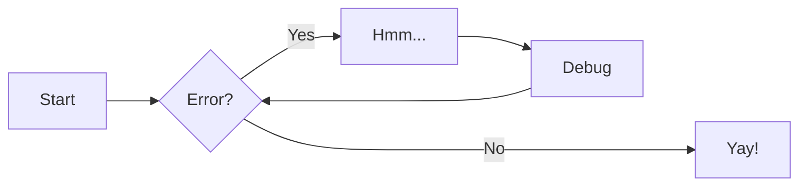

# Contributing to Prometheus Docs

This guide covers how to set up your local environment, write and preview docs, and use the available markdown features.

## Getting Started

### Prerequisites

- Python 3.12+
- [uv](https://docs.astral.sh/uv/) package manager

### Local Development

```bash
# Install dependencies
uv sync

# Start the local dev server with hot-reload
uv run zensical serve

# Build the site for production
uv run zensical build --clean
```

The dev server watches for changes in `docs/` and reloads automatically. The production build outputs static HTML to `site/`.

### Project Structure

```
docs/           # Markdown source files — all content goes here
site/           # Generated output (do not edit)
zensical.toml   # Site configuration (theme, features, palettes)
```

### Adding a New Page

1. Create a new `.md` file in the `docs/` directory
2. Add frontmatter at the top with an icon (optional):
    ```yaml
    ---
    icon: lucide/file-text
    ---
    ```
3. Preview locally with `uv run zensical serve`

### Deployment

Pushing to `main` triggers the GitHub Actions workflow which builds and deploys to GitHub Pages automatically. No manual deployment is needed.

## Writing Style

- Use sentence case for headings
- Keep pages focused on a single topic
- Link to the [Zensical docs](https://zensical.org/docs/) for feature details rather than duplicating their documentation

## Markdown Reference

### Basic Syntax

```
# H1 Header
## H2 Header
### H3 Header

**bold text**
*italic text*
~~strikethrough~~
`inline code`

[Link text](https://example.com)

```

### Lists

```
Unordered:
- Item 1
- Item 2
  - Nested item

Ordered:
1. First item
2. Second item
3. Third item
```

### Tables

```
| Header 1 | Header 2 | Header 3 |
|----------|----------|----------|
| Row 1    | Data     | Data     |
| Row 2    | Data     | Data     |
```

### Code Blocks

````
```python
def greet(name):
    print(f"Hello, {name}!")
```
````

Code blocks support syntax highlighting, line highlighting (`hl_lines`), titles, and [code annotations](https://zensical.org/docs/authoring/code-blocks/#code-annotations).

Inline highlighting is also available: `#!python print("Hello!")`.

### Admonitions

```
!!! note
    This is a note admonition.

!!! warning
    This is a warning admonition.
```

!!! note

    This is a **note** admonition. Use it to provide helpful information.

!!! warning

    This is a **warning** admonition. Be careful!

Collapsible blocks use `???` instead of `!!!`:

```
??? info "Click to expand"
    Hidden content here.
```

### Content Tabs

```
=== "Python"

    ` `` python
    print("Hello from Python!")
    ` ``

=== "Rust"

    ` `` rs
    println!("Hello from Rust!");
    ` ``
```

=== "Python"

    ``` python
    print("Hello from Python!")
    ```

=== "Rust"

    ``` rs
    println!("Hello from Rust!");
    ```

### Diagrams

Use [Mermaid](https://zensical.org/docs/authoring/diagrams/) for diagrams:



### Formatting Extensions

- ==highlight== with `==text==`
- ^^underline^^ with `^^text^^`
- ~~strikethrough~~ with `~~text~~`
- H~2~O subscript with `~text~`
- A^T^A superscript with `^text^`
- ++ctrl+alt+del++ keyboard keys with `++key++`

### Footnotes

```
Here's a sentence with a footnote.[^1]

[^1]: This is the footnote.
```

### Task Lists

```
- [x] Completed task
- [ ] Incomplete task
```

### Icons and Emojis

Use shortcodes like `:rocket:`, `:sparkles:`, `:tada:`. See the [full list](https://zensical.org/docs/authoring/icons-emojis/).

### Math (MathJax)

MathJax is not enabled globally. To use math on a page, add this script tag at the bottom:

```html
<script id="MathJax-script" async
  src="https://unpkg.com/mathjax@3/es5/tex-mml-chtml.js"></script>
```

Then use `$$` blocks for display math or `\(` / `\)` for inline math.
