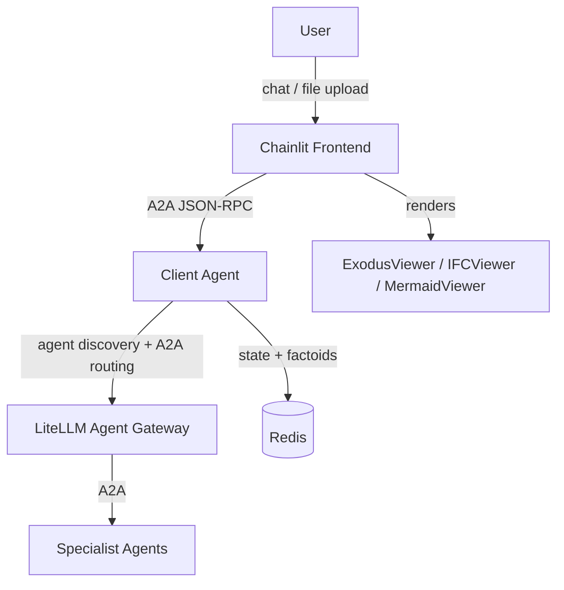

# Prometheus Platform

A multi-agent analysis platform for nuclear engineering. Users interact through a Chainlit chat UI that routes queries to specialist agents via a central client-agent orchestrator using the A2A (Agent-to-Agent) JSON-RPC 2.0 protocol.

## Architecture



The frontend communicates directly with the client-agent via A2A protocol. The client-agent discovers specialist agents from LiteLLM's agent directory, manages multi-turn conversation state in Redis, and dispatches analysis work through LiteLLM's A2A gateway.

| Service | Port | Stack |
|---------|------|-------|
| Chainlit Frontend | 8500 | Chainlit, VTK, pyyaml |
| Client Agent | 8001 | LangGraph, Claude, A2A SDK |
| LiteLLM Agent Gateway | 9977 | LiteLLM proxy + A2A routing |
| Redis | 6379 | Factoids, conversation state |

## Getting started

### Prerequisites

- Python 3.12+
- [uv](https://docs.astral.sh/uv/) package manager
- Docker and Docker Compose (for multi-agent deployment)

### Docker Compose (recommended)

```bash
cp .env.example .env
# Set: ANTHROPIC_API_KEY, AGENT_SECRET, REDIS_PASSWORD, CHAINLIT_AUTH_SECRET,
#      LITELLM_MASTER_KEY, LITELLM_DB_PASSWORD, and LITELLM_LOCAL_PORT
docker-compose up --build
```

### Local development

```bash
cd prometheus_platform/frontend && uv sync --group dev
make run        # Chainlit UI
```

Log in with `prometheus` / `prometheus`.

### Common commands

From `frontend/`:

```bash
make run        # Start Chainlit
make test       # Run pytest
make lint       # Ruff linter (report only)
make format     # Ruff formatter check
make fix        # Auto-fix lint + format
make check      # All checks (lint + format + typecheck)
```

## Configuration

The frontend reads `frontend/config.yml`:

```yaml
chat-intro: "Welcome to the Prometheus Platform."
chat-suggestion-title: "What would you like to do today?"

workflow-suggestions:
  - "Design a Rankine cycle based power generation system"
  - "Run FTL Safety Analysis"

local-users:
  - username: "prometheus"
    password: "prometheus"
    role: "user"

agent-url: "http://localhost:8001"
agent-secret: ""
redis-url: "redis://localhost:6379"
debug: true
auto-approve-steps: false
```

Override the config path with `PROMETHEUS_CONFIG_PATH=/path/to/config.yml`.

## Data flow

### Chat flow

1. User sends a message in the Chainlit UI
2. Frontend sends an A2A JSON-RPC request to the client-agent
3. Client-agent classifies the query, discovers relevant agents through LiteLLM, and collects parameters if needed
4. Specialist agents execute analysis and return results with artifacts
5. Frontend renders the response and any visualization elements

### Multi-turn conversations

The client-agent maintains conversation state in Redis. Each turn can:

- Ask follow-up questions (`status: "needs_info"`)
- Present an execution plan for approval (`status: "plan_ready"`)
- Return final results (`status: "completed"` or `status: "answer"`)

### File upload

The frontend detects file type on upload and processes locally:

- `.e` / `.exo` (Exodus) -- VTK processing, rendered with ExodusViewer
- `.ifc` -- Copied to `public/ifc-data/`, rendered with IFCViewer
- `.pdf` -- Displayed inline

## Frontend components

### Custom React elements

Located in `frontend/public/elements/`, rendered via Chainlit's `cl.CustomElement`:

| Component | Purpose |
|-----------|---------|
| `DynamicForm.jsx` | Configurable forms with validation, timeout countdown, help text |
| `IFCViewer.jsx` | 3D building model viewer (ThatOpen engine, THREE.js) |
| `ExodusViewer.jsx` | VTK-based mesh visualization with playback controls and color presets |
| `FollowUpSuggestions.jsx` | Clickable workflow suggestion cards |
| `MermaidViewer.jsx` | Diagram renderer |

### Message handler

`components/message_handler.py` routes incoming messages: file uploads are processed locally, text queries are forwarded to the client-agent via A2A.

## Code style

- Line length: 120
- Linter/formatter: ruff (rules: E, F; E501 ignored)
- Type checker: mypy
- Tests: pytest with pytest-asyncio (`asyncio_mode = "auto"`)
