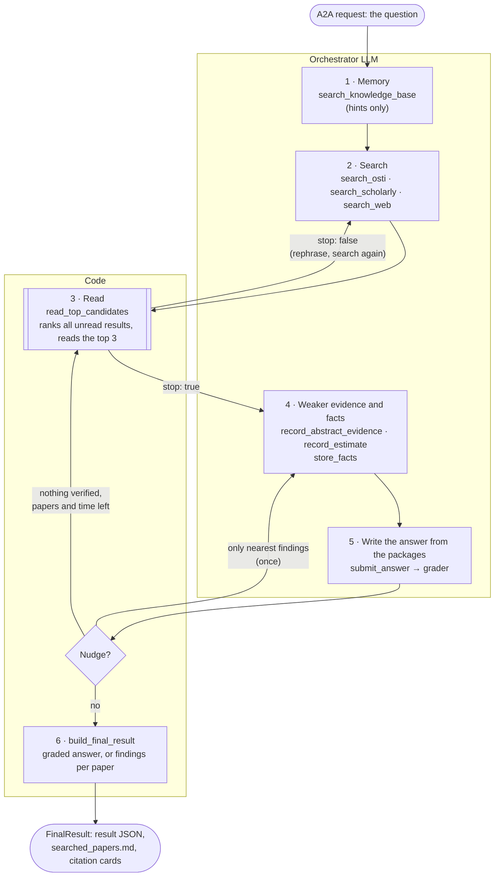
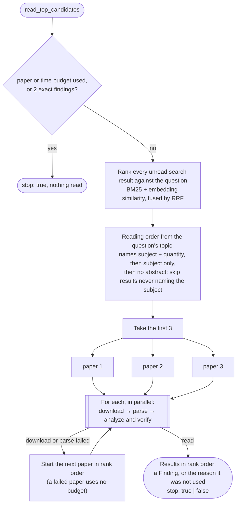
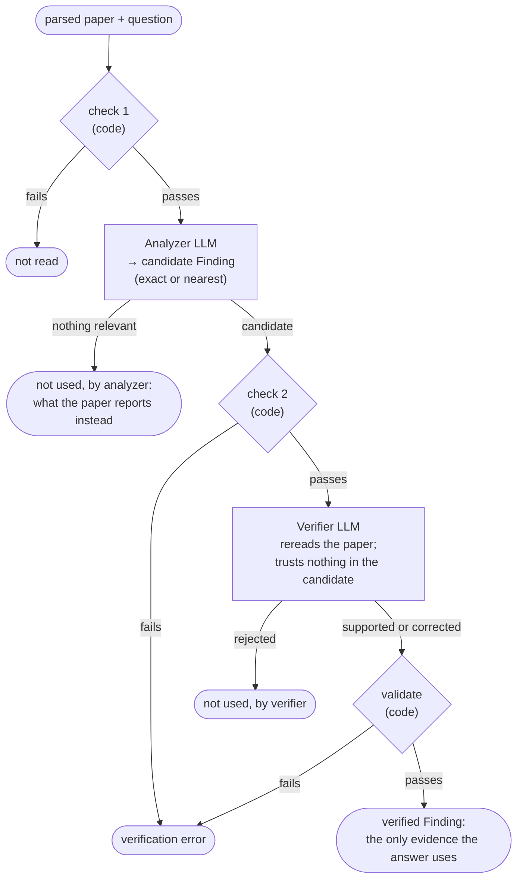

# OSTI Research Agent — architecture

How the OSTI research agent is currently structured. For the platform it
plugs into (backend agent registry, Valkey, A2A), see the repo-root `CLAUDE.md`.
For how to evaluate a change, see `evaluation.md`.

## The boundary contract

The code is split into a **transport-agnostic core** and a **thin A2A shell**:

```
a2a layer (agent.py)                 <- the ONLY file that may import prometheus_api / a2a
  └─ ResearchRunner.run(question)    <- core/runner.py: the event-stream boundary
       yields AgentEvent = ProgressEvent | FinalResult   (core/events.py)
         └─ core/deep_runner.run_deep   the deep-agent engine
```

- **`research_agent/**` imports nothing from `prometheus_api` or `a2a`.** This is
  enforced by `tests/test_import_boundary.py` (a regex over the whole package).
  The core runs on a laptop with only LLM credentials — see `cli.py`
  (`python -m research_agent "<question>" --no-redis`).
- **`ResearchRunner`** is the single seam every transport goes through. It runs
  the engine, bridges its progress to an
  `AsyncIterator[AgentEvent]`, and enforces the outer time budget
  (`total_budget_s - 30`), salvaging a `timeout_partial` `FinalResult` from
  whatever findings accumulated if the budget fires.
- **`FinalResult`** (`core/events.py`) is the wire payload. `core/adapter.py`
  serializes it to the exact JSON key set `agent.py` produced pre-refactor
  (`test_adapter.py` golden-checks this), so the frontend contract is unchanged.
- **Model routing** resolves `LLMConfig.from_env()` and uses the selected
  profile's endpoints and keys as-is. Deep Agents receives a provider-neutral
  `ChatLiteLLM` model for OpenAI-compatible and Anthropic profiles, including
  tool binding. No model temperature
  is forced by the agent; deployed profiles control supported parameters.

## Design structure

One question is one run. The work is split between an LLM and code:

- **The orchestrator LLM searches.** It decides what to search for, rewrites
  its queries, and decides when to read, following `prompts/orchestrator.md`.
- **Code decides which papers to read.** `read_top_candidates` ranks every
  search result against the question and reads the best ones, in that order.
- **Two independent LLM reviews decide what reaches the answer:** a verifier
  per paper, and a grader for the final answer. Code checks both.

Code also enforces every budget: searches, papers, and time.

### Components

| Component | Kind | Built in | Model route | Can use |
|---|---|---|---|---|
| orchestrator | deepagents graph | `core/deep_agent.build_research_agent` | `orchestrator` | the agent's tools (`tools/`) plus deepagents' filesystem tools |
| paper analyzer | deepagents graph, called from `read_top_candidates` | `core/deep_agent._build_analyzer_and_verifier` | `analyzer` | read-only `/papers/**` |
| paper verifier | deepagents graph, called from `read_top_candidates` | `core/deep_agent.build_paper_verifier` | `verifier` | read-only `/papers/**` |
| answer grader | one completion, called from `submit_answer` | `tools/answer.grade` | `verifier` | the question, the analysis packages and the answer |
| follow-up suggester | one completion | `llm_steps.suggest_followup_from_findings` | `complete` passed in by `agent.py` | nothing |
| figure VLM (off by default) | one completion per figure | `parsing/figures.py` | `vlm` | the figure image |
| Docling worker | subprocess, no LLM | `parsing/docling_worker.py` | - | the PDF |

Every role uses the `medium` flavor unless a model profile maps it elsewhere
(`core/config.py`, `core/model_profile.py`).

**The analyzer and verifier are not deepagents subagents.** The orchestrator
has no `task` tool (`_register_runtime_profiles` turns off the general-purpose
subagent, and `tests/test_deep_agent.py` checks `"task"` is absent). Both are
separate graphs that `read_top_candidates` runs from Python code, as
analyzer → check → verifier → validate, for each paper it reads. So the
orchestrator cannot choose a paper, write the analyzer's task, skip the
verifier, or see an unverified candidate; it gets back only a verified Finding
or a reason the paper was not used. `build_paper_analyzer` still returns a dict
in the deepagents subagent-spec shape, but its `name` and `description` are
not used.

### Run flow

One run, from the A2A request to the result. The orchestrator LLM searches,
code reads, and the two take turns until `read_top_candidates` returns
`stop: true` (at most 6 papers, in two batches). Everything after the final
message is code. `ResearchRunner` (`agent.py` → `core/runner.py`) wraps the
whole run in a deadline of `TOTAL_BUDGET_S` − 30 s; if it fires, the run is
cancelled and returns `timeout_partial` with the findings verified so far.



| Step | Who | What it does |
|---|---|---|
| 1 Memory | orchestrator | Looks up earlier runs. Cached answers and facts only point to sources; they are never evidence. |
| 2 Search | orchestrator | Writes the queries. Code refuses repeated queries and searches past the per-run limit (`MAX_OSTI_SEARCHES`, `MAX_SCHOLARLY_SEARCHES`). |
| 3 Read | code | Picks and reads papers; see [The read step](#the-read-step). |
| 2 again | orchestrator | When a batch returns `stop: false`, the orchestrator searches again using what each paper reported instead (for example "data at 600 °C only"), then reads the second batch. |
| 4 Weaker evidence | orchestrator, checked by code | Abstract quotes from unreadable papers, and estimates computed from cited values. Never findings. |
| 5 Answer | orchestrator, checked by code and the grader | Writes the answer from the analysis packages only and submits it with `submit_answer`; see [Answer and status](#answer-and-status). Its final message is ignored. |
| Nudge | code (`core/deep_runner.py`) | A run that stops with nothing verified, while papers and time remain, is sent back to read (at most twice). A run with only `nearest` findings is asked once for an estimate (step 4). A run with verified findings but no accepted answer is asked once to submit one, with the packages repeated. |
| 6 Final result | code | The graded answer, or the verified findings rendered per paper; see [Answer and status](#answer-and-status). |

### The read step

`read_top_candidates` (`tools/batch.py`) is the only way a paper gets read. Each
call reads one batch:



- **Ranking:** see [Search hits and ranking](#search-hits-and-ranking).
- **Budget:** at most `MAX_PAPERS_ANALYZED` (6) papers per run, so two batches.
  A paper counts once its parse starts; a failed download or parse gives the
  slot back. No new paper starts with under 90 s left (`BUDGET_FLOOR_S`).
- **Download:** OSTI results through OSTI; other results only from a PDF link a
  search returned, on a host in `DOWNLOAD_ALLOWED_DOMAINS`.
- **Parse:** Docling in a subprocess writes `/papers/<id>/` (`paper.md`,
  `tables/`, `figures/`); PyMuPDF text if Docling fails or times out.
- **Stop:** code stops reading once two papers give an `exact` finding. Whether
  their values agree is for the answer to say, and the grader checks it.
- **Packages:** every result carries `packages`, each finding verified so far
  in the run, numbered `Paper N` (`RunContext.analysis_packages`). The
  orchestrator writes the answer from these.

### Analyzing one paper

Every paper the read step parses goes through the same analysis
(`_analyze_paper` in `core/deep_agent.py`). Each paper is analyzed at most once
per run.



| Step | Checks |
|---|---|
| check 1 | The paper was parsed and its directory is under `/papers/`; a DOI and its OSTI id resolve to the same paper. |
| Analyzer | Reads `meta.json`, headings, sections, tables and figure files. |
| check 2 | The output is a valid Finding for the same `source_id` that was asked. |
| Verifier | Rereads `paper.md` and the cited tables, and treats the candidate as untrusted: supported, corrected, or rejected. |
| validate | Known verdict, `source_id` unchanged, answer and evidence present; every cited file is in this paper's directory, exists, and was read by the verifier; `paper.md` was read and cited. |

A paper not used by the analyzer or verifier is logged in `ctx.unused_papers`
with the reason, and listed after the answer in a section code builds
("Papers read without a usable finding"); an analyzer, verifier or path failure goes to
`ctx.verification_errors`, which can make the run's status `error`.

### Answer and status

```
ctx.findings → analysis packages (Paper N: title, match, answer, evidence, excerpt)
            → orchestrator writes the answer from them, calls submit_answer
            → code: ≤ MAX_ANSWER_CHARS, every Paper N names a package
              (a refusal here does not use up the revision; 3 at most)
            → grader (7 criteria in prompts/answer_grader.md; sees only the
              question, the packages and the answer; one revision allowed)
              accepted, and no finding verified since → the orchestrator's answer
              otherwise (graded twice and refused, grader error, timeout) → findings per paper
```

| Status | When |
|---|---|
| `completed` | at least one verified finding |
| `no_results` | nothing verified, and no `verification_errors` |
| `error` | nothing verified and at least one `verification_errors` entry (an analyzer, verifier or source-path failure) |
| `timeout_partial` | the runner's outer deadline fired |

### Where each kind of check happens

| Check | By | Where |
|---|---|---|
| search limits, duplicate queries | code | `RunContext.reserve_search` |
| paper and time budget (refuse with < 90 s left) | code | `RunContext.budget_reason`, called by read_top_candidates and download/parse |
| download URL came from a search, host allowlisted | code | `tools/osti.download_paper`, `download_policy.py` |
| which papers are read, in what order | code | `tools/batch.read_top_candidates`, ranking in `rerank.py` |
| candidate answers the question from the paper | analyzer | `prompts/analyzer.md` |
| candidate is supported by the paper | verifier | `prompts/verifier.md` |
| verifier output well formed, cites files it read | code | `_validated_finding`, `_validated_artifacts` |
| abstract quote verbatim, numbers in the quote | code | `tools/evidence.record_abstract_evidence` |
| estimate inputs cited, formula evaluated safely | code | `tools/evidence.check_estimate` |
| fact source has a verified finding | code | `tools/memory.store_facts` |
| answer follows the packages | grader | `prompts/answer_grader.md`, `tools/answer.parse_verdict` |
| answer length and `Paper N` range | code | `tools/answer.code_check` |

### Search hits and ranking

The agent does not score search results itself. Each API ranks its own
results; only scholarly search combines two rankings:

- **OSTI** (`osti_client.search_osti`): the API's keyword ranking; records
  without an abstract are dropped; at most 8 per search.
- **Scholarly** (`scholarly.search_scholarly`): three searches run in
  parallel, at most 6 results in all:
  1. OpenAlex keyword search (`search=`): stemmed text match on title,
     abstract and full text, plus a capped citation boost.
  2. OpenAlex semantic search (`search.semantic=`, open-access only): papers
     whose embeddings are closest in meaning to the query. Off with
     `SCHOLARLY_SEMANTIC=false`. Limited to 1 request a second, enforced by
     `OPENALEX_SEMANTIC_GATE` across every process on the host.
  3. arXiv preprints.

  Lists 1 and 2 are fused by reciprocal rank fusion (`scholarly.rrf_merge`):
  each paper scores Σ 1/(60 + rank) over the lists it appears in, so a paper
  both find ranks first, and the lists' incompatible scores (about 60 for
  keyword, about 1 for semantic) don't matter. The two rarely overlap (no
  paper in common in the top 6 for the queries tested), so fusion puts both
  kinds in front of the orchestrator. arXiv results only fill the slots left
  after that: for engineering queries arXiv often returns nothing relevant
  (particle-physics papers for "316 stainless steel creep"), and fused, its
  first hit would rank level with OpenAlex's. Duplicates are matched by DOI,
  or by normalized title.
- **Web**: the provider's order.

A source already in `ctx.search_hits` is not returned again, so a reworded
query shows the orchestrator only papers it has not seen.

Before reading, `read_top_candidates` (`tools/batch.py`, ranking in
`rerank.py`) ranks every unread, downloadable hit from all searches so far
against the research question, which no single search's ranking does. Two signals over title +
abstract, fused by RRF (Σ 1/(60 + rank)):

- **BM25** over the candidates themselves (k1 = 1.2, b = 0.75; stopwords
  dropped, numbers kept): rewards exact terms such as `316` or `400`.
- **Embedding cosine similarity** to the question, with the run's embedding
  model (the knowledge base's): rewards papers worded differently.
  Embeddings are cached per paper for the run, so a later call only embeds
  new hits. If embedding fails or takes over 20 s, BM25 alone ranks.

**Code, not the model, picks the papers.** `read_top_candidates` reads the
top 3 in that order in parallel (download, parse, analyze and verify, through
the same tools and checks as before). A paper whose download or parse fails
gives its place to the next one in that order.

**Which papers are worth reading** comes from the question's topic: one
model call per run through the run's text completion (`llm_steps.question_topic`,
prompt `prompts/question_topic.txt`, 30 s limit) names the question's *subject*
(the material, fuel, code, benchmark or method it is about, with the
variants a paper would use: 316L and 316H for 316, Alloy 718 for Inconel
718) and the asked *quantity* (thermal conductivity, fatigue life), but not
the conditions (burnup, irradiation). `rerank.reading_order` then puts the
ranked hits in tiers, keeping the rank order inside each:

1. title or abstract names the subject and the quantity;
2. names the subject only;
3. no abstract to check, but the title shares a word with the question.

A hit whose title and abstract never name the subject is skipped. Names
match as whole phrases in any word order, singular or plural, and however a
designation is written (`316L`, `316 L`, `SS 316`, `UO<sub>2</sub>`), so
"Alloy 718" matches "718 alloy" but not "alloy 617 ... 718 MPa". A question
about a class ("structural steels") or a broad field gets no subject: hits
are then kept by sharing a word with the question, as they are when the
topic call fails, and the quantity still orders them. When nothing unread
names the subject, the tool says so and asks for another search. The
progress log shows the subject in use ("Reading papers about ...").

On the November full eval this would have skipped 5 of the 6 papers the
`inconel-718-fatigue` run read (316, V-4Cr-4Ti, A709 and others, let in on
"fatigue" or "irradiation"), and 2 of the 48 papers that gave a finding
across the questions that ran: a review whose abstract names no grade of
316, and an HTGR report that writes "Modular HTGR 350". For
`uo2-thermal-conductivity` the topic is not enough: every paper it read was
about UO2, and its OSTI searches returned only one paper naming UO2 and
thermal conductivity together. The orchestrator calls it at most twice,
`MAX_PAPERS_ANALYZED` = 6 papers in all, and searches again between the two
batches using what each paper reported instead. It stops once two papers give
an `exact` finding; whether those agree is for the answer to say. The
orchestrator has no `download_paper`, `parse_paper` or `analyze_paper` tool.
The keep-going nudge lists the same papers in the same order, and is not
sent when none is left. On the
`ss316-creep-400c` question's real searches, the five papers about creep of
316 itself were found 21st to 26th of 26 and ranked 1st to 5th.

Apart from this ranking, the knowledge base is the only place that computes a score
(`knowledge.RedisKnowledgeStore`), by cosine similarity of embeddings:

- **facts**: score ≥ 0.15, top 8; the score is not passed to the orchestrator.
- **cached answer**: exact `md5(question.lower())` key, else the closest cached
  question with cosine ≥ 0.95.

Both scan at most the first 1000 keys `SCAN` returns.

### Run state

`RunContext` (`tools/context.py`) holds one run's state, shared by the tools,
`read_top_candidates` and the runner:

- inputs: config, question, `complete`, Redis caches, knowledge store,
  `run_workdir`, deadline
- search: `search_hits`, `search_queries`
- papers: `pdf_paths`, `download_failures`, `refused_hosts`, `parsed_papers`,
  `parse_failures`, `papers_attempted`
- analysis: `paper_analysis_results`, `paper_analysis_locks`,
  `invalid_paper_analysis_results`, `findings`, `unused_papers`,
  `verification_errors`
- weaker evidence and memory: `abstract_evidence`, `estimates`, `facts_stored`

`ResearchRunner` shares the `findings` and `search_hits` lists with the run, so
it can build `timeout_partial` from them after cancelling. Parsed papers live
under `run_workdir/papers/` and are deleted when the run ends; PDFs, parsed
paper directories, facts and cached answers persist in Redis (see
`runbook.md`).

### Known gaps

- **The orchestrator can change parsed papers.** `create_deep_agent` gives it
  deepagents' filesystem tools (`ls`, `read_file`, `write_file`, `edit_file`,
  `delete`, `glob`, `grep`, `execute`) on the same backend as the analyzer and
  verifier, without `permissions=`. `write_file` and `edit_file` work on the
  real files under `/papers/`, so a changed `paper.md` would be what the
  verifier checks against. Only the prompt ("NEVER read `paper.md` yourself")
  keeps it out. `execute` returns an error, because the backend has no
  sandbox. A read-only or deny rule for `/papers/**` on the orchestrator would
  close this.
- **No planning tool.** The graph has no `write_todos`, so the `todo_update`
  events `deep_runner.translate_update` handles never occur.
- **Rephrasing is prompt-driven.** No code tries an alternate query; the
  duplicate-query refusal and the nudges only push the orchestrator to.
- **Knowledge-base scans stop at 1000 keys,** in arbitrary `SCAN` order, so
  past that size some facts and cached answers are never compared.

## The engine

`core/deep_runner.py` runs a `deepagents.create_deep_agent` orchestrator
(LangGraph under the hood) whose `read_top_candidates` tool holds the analyzer
and verifier graphs. For each paper it reads, the tool first analyzes the
parsed paper, then independently verifies the candidate against that paper's
artifacts before returning anything to the orchestrator (see "Design
structure" above). The orchestrator decides what to search for and when to
read; code decides which papers. The strategy lives in
`prompts/orchestrator.md`.

The agent's original fixed pipeline (search, assess abstracts, download,
extract text, synthesize) was removed once this engine replaced it; it is in
git history before the removal if it is ever needed.

The analyzer and verifier are read-only and receive no search, download, or
parsing tools. Only verified or verifier-corrected findings enter
`RunContext.findings`, final results, timeout partials, or fact storage.
Operational verifier failures produce an error when no other finding was
verified; evidence-based rejections produce `no_results`.

### Final answer

The orchestrator writes the answer itself, from the analysis packages
`read_top_candidates` returned, and submits it with `submit_answer`
(`tools/answer.py`). Code refuses an answer longer than `MAX_ANSWER_CHARS` or
one that cites a `Paper N` with no package. A separate grader, one call on the
verifier route, then checks it against the 7 criteria in
`prompts/answer_grader.md`. The grader is given only the question, the
packages and the answer, not the orchestrator's transcript, search results or
abstracts, so anything in the answer that is not in a package fails. A
`satisfied` verdict must pass every criterion. One `Paper N` covers its
paragraph or list item, so a sentence needs its own citation only when it
draws on another package. On `needs_revision`, the gaps go back to the
orchestrator, which can submit once more (`MAX_ANSWER_ATTEMPTS` = 2 graded
answers). A code-check refusal does not use up that revision; it has its own
limit (`MAX_CODE_REFUSALS` = 3). The accepted answer is used if no finding
was verified after it; otherwise, or after a grader error, the answer is the
findings rendered per paper: each finding's answer, then its evidence, both
checked by the verifier. A statement that the packages do not report
something needs no package to say so. The orchestrator's final message is
not parsed. Every submitted answer is kept with its outcome and the grader's
gaps (`FinalResult.answer_drafts`, left out of the result JSON) for the
evaluation transcript.

### Literature artifacts

After each run `agent.py` sends two kinds of conversation artifacts, built by
`core/search_artifacts.py` from the run's search hits (carried on
`FinalResult.searched_papers`, which is excluded from the result JSON):

- `searched_papers.md` - every paper the searches returned, with its source,
  year, link, and abstract (cut to 600 characters, at most 40 papers); papers
  used as verified evidence are marked. `text/markdown`, so the report viewer
  shows it.
- one citation card per verified finding: tags `reference`/`citation`, `uri`
  set to the paper's page, `metadata.source` naming the source. No MIME type,
  so the tags route it to the reference viewer.

They live in the platform's artifact registry in Valkey (no DeepLynx) and
expire with it (`ARTIFACT_REGISTRY_TTL_SECONDS`). Sending them never fails the
run.

## Tools (deepagent engine)

Tools are thin `@tool` wrappers built per-run over a shared `RunContext`
(`tools/context.py`), which holds the config, the injected `complete`/embed
functions, the Redis-backed caches, and the mutable state a run accumulates
(`search_hits`, `pdf_paths`, `findings`, counters). Budget is enforced **at the
tools** — an over-budget tool returns a refusal string, it never raises (a
raising tool would crash the orchestrator loop; `test_tools.py` pins this).

`tools/__init__.build_tools(ctx)` assembles:

- **`tools/osti.py`** — `search_osti`, `download_paper`, `parse_paper`.
  `download_paper(source_id, url=None)` fetches an arbitrary URL when given one
  (or an `oa_pdf_url` recorded in `search_hits`), else the OSTI purl.
- **`tools/search.py`** — `search_scholarly` (OpenAlex + arXiv, keyless, always
  on) and `search_web` (provider-backed, off unless configured; the compose
  file ships a SearXNG service for it, see the runbook's "Web search").
- **`tools/rank.py`** — `rank_candidates`: every unread hit ranked against the
  question by BM25 + embedding similarity, fused by RRF (see "Search hits and
  ranking"). Built, but not given to the orchestrator: `read_top_candidates`
  ranks for itself.
- **`tools/batch.py`** — the `read_top_candidates` logic: rank, then read the
  top 3 in parallel with refill on failure.
- **`tools/memory.py`** — `search_knowledge_base` and `store_facts` over the
  embedding-backed `KnowledgeStore`.
- **`tools/evidence.py`** — `record_abstract_evidence` and `record_estimate`,
  weaker evidence checked in code and kept out of `findings`.

`core/deep_agent.build_research_agent` removes `download_paper`, `parse_paper`
and `rank_candidates` from the orchestrator's tools and appends
`read_top_candidates` (`build_read_top_candidates_tool`), which calls them and
the analyzer/verifier from code; deepagents adds its own filesystem tools.
`build_analyze_paper_tool` still builds `analyze_paper` for direct use.

### Adding a tool

1. Add a `@tool async def` inside a `build_*_tools(ctx)` factory (new file or an
   existing one), reading/writing run state through `ctx`. Enforce budget with
   `ctx.budget_reason()` and **return a string on refusal**.
2. Include the factory's output in `tools/__init__.build_tools`.
3. Add a status label in `core/deep_runner._TOOL_STATUS` so the tool call
   renders a human-readable progress line.
4. Document it for the orchestrator in `prompts/orchestrator.md` (when to use
   it, its input/output shape). The model only uses tools the prompt explains.
5. Unit-test it over a mocked `ctx` like the others in `tests/test_tools.py` /
   `tests/test_search_tools.py` — no graph needed.

### Adding a web-search provider

Implement the `WebSearchProvider` protocol in `web_search.py` (one
`async def search(query, k) -> list[dict]` returning
`{title, url, snippet, published, origin}`), wire it into `get_web_provider`
keyed off `config.web_search_provider`, add its config fields to
`core/config.py` (+ `from_env`), and add a respx test like `test_web_search.py`.
Scholarly sources (OpenAlex/arXiv) live in `scholarly.py` and follow the same
shape.

## Parsing and artifact layout

`parsing/pipeline.parse_paper_pipeline` turns a PDF into a **paper directory**
rather than one text blob. Docling runs in an isolated subprocess
(`parsing/docling_worker.py`); on failure/timeout it falls back to PyMuPDF
full-text (`method="pymupdf"`, no tables/figures, warning recorded) so consumers
always have one `paper.md` code path. Optional figure VLM analysis
(`parsing/figures.py`) is off by default (`ANALYZE_FIGURES`).

```
{workdir}/papers/{source_id}/
  paper.md                     # reading-order text with [TABLE ..]/[FIGURE ..] markers
  meta.json                    # the ParsedPaper record (parsing/artifacts.py)
  tables/table_NN.{md,csv}
  figures/fig_NN.png           # + fig_NN.json when the VLM pass ran
```

`ParsedPaper` / `TableArtifact` / `FigureArtifact` (`parsing/artifacts.py`) are
the contract; every consumer reads via them.

## Memory

The knowledge base is **shared by every user** of the platform: facts and
cached answers are not scoped per user or conversation. That is intended for
public literature; do not point this agent at private documents without adding
scoping first.

`knowledge.RedisKnowledgeStore` implements the `KnowledgeStore` protocol.
Retrieval is `SCAN` + in-process cosine over per-atomic-fact embeddings — **no
`KEYS`, no per-lookup LLM call** (the two scaling problems of the original
memory code). Embeddings come from the LiteLLM proxy (`core/llm.LiteLLMEmbedder`,
the `embedding` alias). The cached-answer path keeps the exact question-hash
fast path and adds a near-duplicate (cosine > 0.95) hit. Key prefixes are
byte-compatible with the legacy store; a missing embedding is backfilled lazily
on read (bulk: `scripts/backfill_atomic_fact_embeddings.py`). See `runbook.md` for
the key/TTL table.

Cached answers and facts are retrieval hints, not final evidence. The deep
agent must download, parse, analyze, and verify the referenced source in the
current run before using its claims in a result.

## Tests

Run with the project's canonical command (plain `uv run pytest` is broken — the
miniforge pytest lacks redis):

```
uv run --with pytest --with pytest-asyncio --with respx python -m pytest -q
```

`test_agent.py` skips without `prometheus_api`/`a2a`; golden/slow tests skip
unless `-m slow`.
