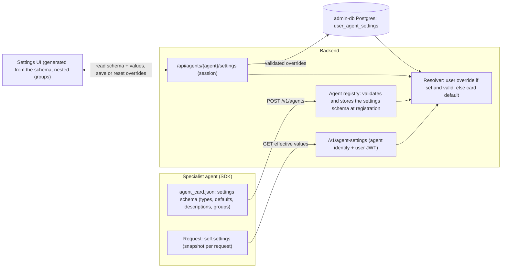
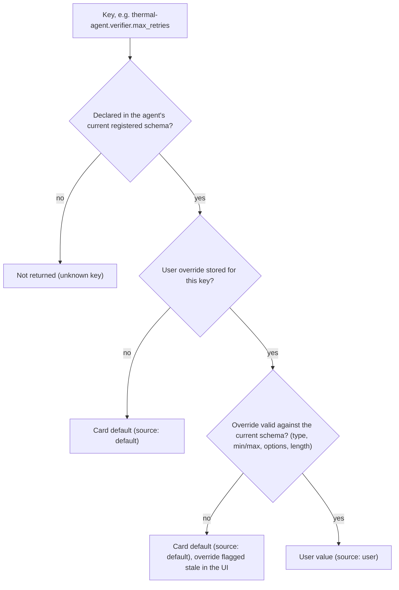
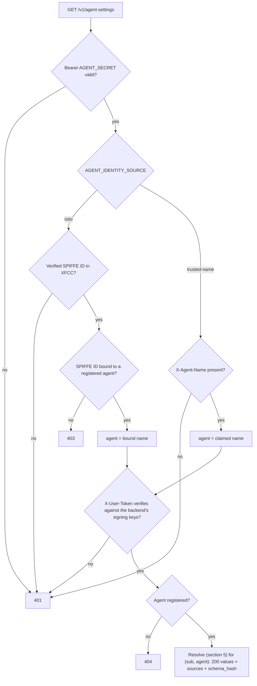
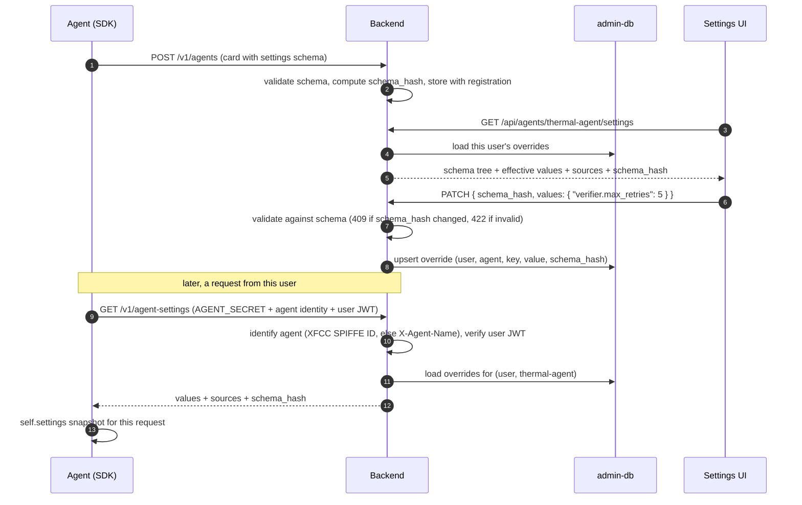
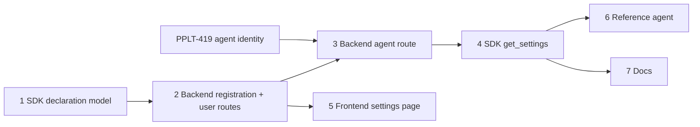

# ADR-006 Agent Settings: Declared in the Agent Card, Overridden per User

| | |
| --- | --- |
| **Number** | ADR-006 |
| **Status** | Proposed 2026-11-09. Direction decided by Daniel Schwen; details in [section 14](#14-open-decisions) open. API draft added 2026-11-19 ([section 6](#6-apis)). Not built. |
| **Approver** | Daniel Schwen |
| **Related** | [ADR-004 Agent Registry and A2A Gateway][adr-004] (§7, no agent Valkey access), [ADR-005 Agent Workload Identity (mTLS)][adr-005], [Request-Scoped Agent Objects and Backend Task State](request-scoped-agent.md), [Credential Plane for Agents](credential-plane.md), SDK spec [008](../../../sdk/specs/008-agent-app-card-auth-and-registry.md) (agent app, card, auth and registry), Jira PPLT-419 (agent caller identity) |
| **Origin** | Moved from [Confluence page 44827502][origin] (version 1, 2026-11-09). This file is now the source of truth. |

Agents declare user-tunable settings in their agent card. The platform generates
the settings UI, stores each user's overrides, and gives agents their effective
values through one backend API.

Readers: SDK, backend and frontend developers, and agent authors.

## 1. Context and problem

- Agents have behaviour that users reasonably want to tune: retry limits,
  verification on or off, output units, report detail. Today such knobs are
  **hard-coded**, read from **environment variables** (one value for every user),
  or smuggled in as **skill parameters** that the orchestrator's LLM has to fill in
  on every call.
- There is no place where a user can see what an agent can be configured to do,
  and no place to keep a choice across conversations.
- The platform's `SettingsPanel`
  ([`frontend/src/features/shell/SettingsPanel.tsx`](../../frontend/src/features/shell/SettingsPanel.tsx))
  holds hard-coded, platform-level options in component state only. Nothing is
  persisted, and nothing comes from agents.
- Agents must not read or write Valkey (ADR-004 §7, ADR-005 §2.4), so any per-user
  configuration store has to be a typed backend API.

## 2. Decision

| # | Decision |
| --- | --- |
| S-1 | **Agents declare settings in their agent card**, in a Prometheus extension field `settings`: each setting has a type, a default, a label and a description. The SDK validates the declaration when it loads the card, and the backend validates it again at registration. |
| S-2 | **Settings can be nested in groups.** A group is an object with a label, a description and child settings or groups. The UI shows each group as a **nested, labelled box**. |
| S-3 | **Keys are dotted strings**: `<agent_name>.<group>…<setting>`, for example `thermal-agent.verifier.max_retries`. `agent_name` is the registry name (the card name, lower-case, spaces as hyphens). |
| S-4 | **The platform generates the settings UI** from the declaration. Agent authors write no frontend code. |
| S-5 | **Users override settings per user.** Only overrides are stored (in the admin-db Postgres). A setting the user never changed has no row. |
| S-6 | **One SDK method fetches the effective settings from the backend.** For every declared key it returns the user's value if the user set one, otherwise the card default. |
| S-7 | **The backend resolves and validates.** It checks overrides against the schema when they are saved and again when they are resolved, and returns each value with its source (`user` or `default`). |
| S-8 | **Settings are not secrets.** The schema has no secret type. Credentials go through the credential plane. |
| S-9 | **The agent route identifies the calling agent from its mTLS identity when one is available**, and otherwise trusts the name the agent claims in the request (added 2026-11-19, [section 6.3](#63-agent-identity)). |

## 3. Architecture



- The schema travels with the agent's registration (`POST /v1/agents`), like the
  workflow and endpoint extensions do today. No new registration call.
- Overrides live in Postgres, because they are durable user preferences. The live
  agent registry in Valkey is cleared on each platform launch (ADR-004), so it
  can't hold them.
- The backend is the only component that reads overrides. Agents get resolved
  values through a typed API.

## 4. Declaring settings

### 4.1 Agent card

```json
{
  "name": "Thermal Agent",
  "settings": {
    "units": {
      "type": "enum",
      "label": "Output units",
      "description": "Unit system for reported temperatures and fluxes.",
      "options": [{"value": "si", "label": "SI"}, {"value": "us", "label": "US customary"}],
      "default": "si"
    },
    "verifier": {
      "type": "group",
      "label": "Result verifier",
      "description": "Checks each analysis result before it is returned.",
      "settings": {
        "enabled": {"type": "boolean", "label": "Verify results", "default": true},
        "max_retries": {
          "type": "integer", "label": "Maximum retries",
          "description": "How often to re-run a failed analysis.",
          "default": 3, "min": 0, "max": 10
        }
      }
    }
  }
}
```

This declares the keys `thermal-agent.units`, `thermal-agent.verifier.enabled` and
`thermal-agent.verifier.max_retries`.

### 4.2 Schema rules

| Type | Extra fields | UI control |
| --- | --- | --- |
| `boolean` | – | toggle |
| `integer`, `number` | `min`, `max`, `step`, `unit` (display only) | number input |
| `string` | `max_length` (default 1000), `multiline`, `pattern` | text input or text area |
| `enum` | `options`: list of `{value, label}` | select |
| `group` | `settings`: child settings and groups | labelled, nested box |

- Every setting requires `type`, `label` and `default`. `description` is optional
  but strongly recommended; the UI shows it as help text. A group requires `label`
  and `settings`.
- The default must be valid for its own type and limits. A card with an invalid
  default fails to load (SDK) and is rejected at registration (backend).
- Names (the object keys) match `[a-z][a-z0-9_]{0,63}`. No dots, so keys split
  unambiguously. Agent names must not contain dots either; registration rejects
  them.
- Limits: at most 4 levels of groups and 200 settings per agent.
- No secret type, no free-form JSON, no lists in the first version
  ([section 13](#13-deferred)).

## 5. Resolving values



- **Unknown keys** (an override for a setting the agent no longer declares) are
  never returned. The row is kept, so the value comes back if the setting is
  declared again, and the UI lists it under "No longer used" with a delete button.
- **Stale overrides** (a stored value that is invalid under the current schema,
  for example after a new version lowered `max`) resolve to the default. The UI
  marks the field and asks the user to pick a new value.
- **Changing a default** in a new agent version changes the effective value for
  every user who didn't override it. That is intended: "not overridden" means
  "follow the agent". Authors who want to keep old behaviour for existing users
  rename the key.

## 6. APIs

Three groups of routes, following the platform's prefix rule: browser routes under
`/api` (session cookie), agent routes under `/v1` (agent identity plus the
forwarded user JWT).

| Method | Path | Caller | Purpose |
| --- | --- | --- | --- |
| `POST` | `/v1/agents` | Agent at startup | Existing registration; now also validates the card's `settings` declaration ([6.1](#61-registration)) |
| `GET` | `/api/agents/settings` | Browser | Agents that declare settings, with this user's override count |
| `GET` | `/api/agents/{agent}/settings` | Browser | Schema tree, effective values and sources, stale and unused overrides |
| `PATCH` | `/api/agents/{agent}/settings` | Browser | Set or clear overrides |
| `DELETE` | `/api/agents/{agent}/settings` | Browser | Reset all of this user's overrides for the agent |
| `DELETE` | `/api/agents/{agent}/settings/unused/{key}` | Browser | Delete one override the agent no longer declares |
| `GET` | `/v1/agent-settings` | Agent, per request | The calling agent's effective settings for the user behind the request |

There are no admin routes in the first version ([section 13](#13-deferred)).

### 6.1 Registration

`POST /v1/agents` already carries the full agent card. The backend adds:

- **Validation** of `card.settings` against the rules in
  [section 4.2](#42-schema-rules) with the same pydantic model the SDK uses. An
  invalid declaration, or an agent name containing a dot, is rejected with `422`
  and a list of `{path, error}` entries (for example
  `{"path": "verifier.max_retries.default", "error": "above max (10)"}`). The
  agent's start-up registration fails loudly, as it does for a malformed card.
- **`schema_hash`**: `sha256:` over the canonical JSON (sorted keys, no
  whitespace) of `card.settings`. It is stored with the live registration and
  returned by every settings route. A card without `settings` has no hash and no
  settings.
- Under `AGENT_IDENTITY_SOURCE=istio`, registration already binds the caller's
  SPIFFE ID to the agent name (PPLT-419), so only the owning workload can replace
  the schema. Under `trusted-name` any holder of `AGENT_SECRET` can (see
  [section 10](#10-security)).

### 6.2 User routes (session cookie)

Every route is scoped to `claims.sub`. `{agent}` is the registry name. Keys are
relative to the agent in the path (`verifier.max_retries`). An agent that isn't
registered, or registered without settings, returns `404`.

**`GET /api/agents/settings`**

```json
{
  "agents": [
    {"agent": "thermal-agent", "label": "Thermal Agent", "settings_count": 3,
     "override_count": 1, "stale_count": 0, "unused_count": 0,
     "schema_hash": "sha256:4be1..."}
  ]
}
```

**`GET /api/agents/{agent}/settings`**

The schema comes back as an ordered tree, in card order, so the UI renders it
without its own copy of the rules. Each leaf carries its effective value.

```json
{
  "agent": "thermal-agent",
  "label": "Thermal Agent",
  "schema_hash": "sha256:4be1...",
  "tree": [
    {"key": "units", "type": "enum", "label": "Output units",
     "description": "Unit system for reported temperatures and fluxes.",
     "options": [{"value": "si", "label": "SI"}, {"value": "us", "label": "US customary"}],
     "default": "si", "value": "si", "source": "default"},
    {"key": "verifier", "type": "group", "label": "Result verifier",
     "description": "Checks each analysis result before it is returned.",
     "children": [
       {"key": "verifier.enabled", "type": "boolean", "label": "Verify results",
        "default": true, "value": true, "source": "default"},
       {"key": "verifier.max_retries", "type": "integer", "label": "Maximum retries",
        "description": "How often to re-run a failed analysis.", "min": 0, "max": 10,
        "default": 3, "value": 5, "source": "user", "updated_at": "2026-11-09T21:14:03Z"}
     ]}
  ],
  "stale": [
    {"key": "verifier.max_retries", "stored": 12, "error": "above max (10)"}
  ],
  "unused": [
    {"key": "report.detail", "stored": "full", "updated_at": "2026-10-30T08:00:00Z"}
  ]
}
```

- A stale override shows its key in `stale`, and its leaf has `source: default`
  and `"stale": true`. (The example shows both cases on one key only for brevity;
  a key is either stale or a valid `user` value, never both.)

**`PATCH /api/agents/{agent}/settings`**

```json
{"schema_hash": "sha256:4be1...", "values": {"verifier.max_retries": 5, "units": null}}
```

- `values` maps relative keys to new values. `null` deletes the override, so the
  key follows the card default again.
- `schema_hash` is the hash the UI rendered. If the agent has re-registered with a
  different schema since, the backend returns `409` with the current
  `schema_hash`, and the UI reloads the form instead of saving values validated
  against an old schema. The field is optional for scripted clients; without it
  the values are checked against the current schema only.
- All values are validated before anything is written, and the write is one
  transaction. One invalid value or unknown key rejects the whole request:
  `422` with `{"errors": [{"key": "verifier.max_retries", "error": "above max (10)"}]}`.
- Each written row records the `schema_hash` it was validated against.
- `200` returns the same body as `GET`, so the UI updates from the response.

**`DELETE /api/agents/{agent}/settings`** deletes every override this user has
for the agent, including stale and unused ones. `204`.

**`DELETE /api/agents/{agent}/settings/unused/{key}`** deletes one override that
the current schema no longer declares. `404` if the key is declared (use `PATCH`
with `null`) or has no row. `204`.

### 6.3 Agent identity

The agent route has to know **which agent** is calling, because an agent gets only
its own settings. The backend uses the agent caller dependency from PPLT-419
(`require_agent_caller`, `backend/app/agent_identity.py`), selected by
`AGENT_IDENTITY_SOURCE`:

| `AGENT_IDENTITY_SOURCE` | Where | Agent name comes from | Strength |
| --- | --- | --- | --- |
| `istio` | Kubernetes with Istio sidecars | The SPIFFE ID in the sidecar's `x-forwarded-client-cert` (the verified mTLS peer), resolved to the agent name it was bound to at registration. Any `X-Agent-Name` in the request is ignored. | Cryptographic, provided STRICT `PeerAuthentication`, no sidecar bypass, and one ServiceAccount per agent |
| `trusted-name` (default) | Docker Compose, local development | The `X-Agent-Name` header, trusted as claimed | Only as strong as the shared `AGENT_SECRET`: any agent can claim another's name |

- Under `istio`, a request without a verified SPIFFE ID is `401`, and a SPIFFE ID
  that no agent registered under is `403`. There is no fallback to the claimed
  name, so a misconfigured mesh fails closed instead of silently trusting headers.
- Under `trusted-name`, a missing or empty `X-Agent-Name` is `401`.
- In both modes `Authorization: Bearer <AGENT_SECRET>` is still required.

### 6.4 Agent route

**`GET /v1/agent-settings`**

Request headers:

| Header | Content |
| --- | --- |
| `Authorization` | `Bearer <AGENT_SECRET>` |
| `X-User-Token` | The platform user JWT the agent received in `message.metadata.userToken`, forwarded unchanged (as for the task-state API) |
| `X-Agent-Name` | The agent's registry name. Read only under `trusted-name` ([6.3](#63-agent-identity)) |

There are no query parameters: no way to name another agent or another user.

```json
{
  "agent": "thermal-agent",
  "user": "u-123",
  "schema_hash": "sha256:4be1...",
  "values": {
    "thermal-agent.units": "si",
    "thermal-agent.verifier.enabled": true,
    "thermal-agent.verifier.max_retries": 5
  },
  "sources": {
    "thermal-agent.units": "default",
    "thermal-agent.verifier.enabled": "default",
    "thermal-agent.verifier.max_retries": "user"
  },
  "resolved_at": "2026-11-09T21:20:00Z"
}
```

- The response always contains **every declared key**, with full keys, so agents
  never need their own copy of the defaults. Stale overrides resolve to the
  default with `source: default`; unused overrides are not returned.
- An agent registered without `settings` gets `200` with empty `values` and
  `sources` and no `schema_hash`. The SDK skips the call when its own card
  declares no settings.
- `Cache-Control: no-store`. The SDK snapshots once per request
  ([section 7](#7-sdk)); the backend doesn't cache per user.

Status codes:

| Code | When |
| --- | --- |
| `200` | Effective settings |
| `401` | Bad or missing `AGENT_SECRET`; no verifiable agent identity ([6.3](#63-agent-identity)); missing, invalid or expired user JWT. User-scoped agent routes fail closed without a valid identity token. |
| `403` | Under `istio`: the workload's SPIFFE ID isn't bound to any registered agent |
| `404` | The identified agent isn't registered (it must register before it serves requests) |
| `503` | admin-db unavailable. The SDK raises; the request fails ([section 7](#7-sdk)) |



- **User:** the backend verifies the user JWT against its own signing keys (the
  keys behind `/.well-known/jwks.json`) and takes `sub` from it. It never trusts a
  user id the agent reports.
- No conversation check: settings are per user and agent, not per conversation.
  The user JWT already proves the agent is working for that user in this turn.

### 6.5 Flow



## 7. SDK

```python
# Current API
async def _execute(self, params, context, event_queue):
    settings = await self.get_settings(context)
    retries = settings["verifier.max_retries"]          # relative to this agent
    units = settings["thermal-agent.units"]            # the full key works too
    if settings.source("verifier.max_retries") == "user": ...

# Request objects (Request-Scoped Agent Objects design)
class ThermalRequest(PrometheusRequest):
    async def run(self):
        if self.settings["verifier.enabled"]:          # loaded once per request
            ...
```

- `get_settings(context)` returns a read-only `AgentSettings` mapping. It accepts
  relative and full keys; an undeclared key raises `KeyError` (catches typos).
- It sends the headers of [section 6.4](#64-agent-route): `AGENT_SECRET`, the
  forwarded user token from the request's A2A metadata, and `X-Agent-Name` (always
  sent; the backend ignores it under Istio).
- **One snapshot per request.** A change the user makes mid-run doesn't change a
  running request. The SDK caches the result for the request, so repeated calls
  are free. On an INPUT_REQUIRED resume a new snapshot is taken.
- **Recorded for provenance.** The effective values and sources are added to the
  DeepLynx execution record (`settings_json`, next to `parameters_json`), so a
  result can be traced to the settings that produced it.
- **No silent fallback.** If the backend can't be reached, `get_settings` raises
  and the request fails. Falling back to card defaults would silently ignore what
  the user chose. Agents that never call `get_settings` make no settings request.
- If the returned `schema_hash` differs from the agent's own card (an old
  registration), the SDK logs a warning and uses the backend's values.

## 8. User interface

- **Entry points:** a **Settings** button on each agent card in the Agent Registry
  page, and an **Agent settings** item in the user menu that lists every agent
  with settings (`GET /api/agents/settings`).
- **Layout:** top-level settings first, then each group as a bordered box with its
  label as the title and its description under it. Nested groups are nested
  boxes, indented.
- **Each field** shows the label, the control for its type, the description as
  help text, and the default ("Default: 3"). A changed field has a **Modified**
  marker and a per-field **Reset**. Groups have **Reset group**; the page has
  **Reset all**.
- **Save** sends one `PATCH` with only the changed keys and the `schema_hash` it
  rendered. Validation errors from the backend show next to their fields; a `409`
  reloads the form with a notice that the agent was updated.
- Stale overrides are marked, and unused overrides are listed at the bottom with a
  delete button.
- The field rendering reuses the existing form-field components (the `FormField`
  rendering in [`FollowupForm.tsx`](../../frontend/src/features/chat/FollowupForm.tsx))
  where they fit.

```text
+-- Thermal Agent settings --------------------------------------------+
| Output units           [ SI            v ]   Default: SI            |
|   Unit system for reported temperatures and fluxes.                 |
|                                                                     |
| +-- Result verifier -------------------------------- (Reset group) -+|
| | Checks each analysis result before it is returned.               ||
| | Verify results         [x]                    Default: on        ||
| | Maximum retries        [ 5 ]  * Modified (Reset)  Default: 3     ||
| |   How often to re-run a failed analysis.                         ||
| +------------------------------------------------------------------+|
|                                         ( Reset all )  [ Save ]     |
+---------------------------------------------------------------------+
```

## 9. Data model

admin-db, one new table (Alembic):

| Column | Meaning |
| --- | --- |
| `user_id` | session `sub` |
| `agent_name` | registry name |
| `key` | the path relative to the agent (`verifier.max_retries`) |
| `value_json` | the override, as JSON |
| `schema_hash` | the schema it was validated against when saved |
| `updated_at` | last change |

Primary key `(user_id, agent_name, key)`. Offboarding a user deletes their rows.
The schema itself is not stored in Postgres in the first version; it comes from the
live registration (Q-2).

## 10. Security

- **Isolation:** users read and write only their own overrides (session-scoped).
  Agents read only their own settings for the requesting user (agent identity
  plus a backend-verified user JWT). Agents get no Valkey or Postgres access.
- **Agent identity:** under Istio the agent name comes from the mTLS peer
  certificate and can't be claimed. Under `trusted-name` it is self-declared, so
  any holder of `AGENT_SECRET` can read another agent's settings for a user whose
  token it holds. That is acceptable only because settings are not secrets
  (below); production runs with `istio`.
- **Validation on the server:** every value is checked against the registered
  schema when saved and when resolved, so an agent never sees a value outside its
  declared type and limits.
- **Not for secrets:** values are visible in the UI, recorded in execution records
  and may appear in logs. There is no secret type; credentials belong to the
  credential plane.
- **Not for safety controls:** a user setting must not switch off platform
  protections (approvals, credential grants, sandboxing). Agent authors decide
  which behaviour is user-tunable; the platform's own controls are never part of
  an agent's settings. Admin-locked settings are deferred
  ([section 13](#13-deferred)).
- **Schema authority:** the declaration comes from the agent's registration. Under
  `trusted-name` a workload that holds `AGENT_SECRET` could re-register an agent
  with different defaults or limits; under `istio` registration is bound to the
  workload's SPIFFE ID (PPLT-419).
- **Size limits** on the schema (settings count, depth, option count) and on values
  (string length) bound what a registration or a user can store.

## 11. Consequences

**Positive**

- Agent authors get a declared, documented, validated configuration surface
  without writing UI, storage or validation code.
- Users can see and change agent behaviour in one place, and their choices persist.
- Skill parameters stay for per-call inputs; the orchestrator's LLM no longer has
  to carry preferences on every call.
- Results are reproducible: the effective settings are in the execution record.

**Negative**

- One more backend round trip per request for agents that use settings.
- Changing a default changes behaviour for users who never overrode it; authors
  must rename keys to avoid that.
- Without Istio, the agent name on the settings route is self-declared.

## 12. Alternatives considered

- **Settings as skill parameters.** Rejected: the LLM would have to supply them on
  every call, they don't persist, and they mix preferences with per-call inputs.
- **Environment variables per agent.** Rejected: one value for every user, no UI,
  and a redeploy to change it.
- **Overrides sent with every A2A request** (the client-agent attaches them).
  Rejected: every agent call would carry every setting, the client-agent would need
  to read user preferences, and agents couldn't fetch settings outside a request.
  It would also put the values in A2A traffic that the gateway forwards.
- **JSON Schema as the declaration format.** Considered. It is standard, but its
  full expressiveness (`oneOf`, `$ref`, free-form objects) makes UI generation and
  validation harder than a small, purpose-built schema. A JSON Schema of the
  settings declaration itself is shipped for editor support.

## 13. Deferred

- Admin-defined organisation defaults and admin-locked settings.
- Per-project or per-conversation overrides.
- List and object types; conditional visibility (show a field only when another is
  on).
- Changing settings from chat ("use US units from now on").
- Rename hints (`renamed_from`) to carry an override across a key rename.

## 14. Open decisions

| # | Decision | Status |
| --- | --- | --- |
| Q-1 | Entry point in the UI: agent registry card, user menu, or both. | Proposed: both ([section 8](#8-user-interface)). |
| Q-2 | Should the backend keep the last registered schema in Postgres, so users can edit settings of an agent that isn't running? | Proposed: not in the first version; the page lists only registered agents. Revisit with the viewer registry's Postgres identity table. |
| Q-3 | Backend unreachable: fail the request, or use card defaults? | Proposed: fail ([section 7](#7-sdk)), consistent with the execution record. |
| Q-4 | Can the client-agent (orchestrator) declare settings the same way? | Proposed: yes, with the same card field. It is a trusted component but uses the same route. |
| Q-5 | Do the platform's own options in `SettingsPanel` (model, approval type) move to the same mechanism as platform-level settings? | Open. |

## 15. Implementation plan

Each step stays under about 300 changed lines, merges to `devel` on its own and
leaves the build green. Steps 1 and 2 can proceed in parallel once the schema model
of step 1 is agreed. Jira tickets are added later.

| Step | Change | Where | Depends on |
| --- | --- | --- | --- |
| 1 | Settings declaration model (pydantic) and validation in `load_agent_card`: types, defaults, groups, name grammar, limits; JSON Schema for editors; agent-name dot check; spec 008 update. | sdk | – |
| 2 | Backend: validate the declaration at registration and compute `schema_hash` (6.1); `user_agent_settings` migration; resolver; user routes (6.2); `CONTRACT.md` section; tests. | backend | 1 (shared model) |
| 3 | Backend agent route `/v1/agent-settings` (6.4) using `require_agent_caller` (6.3) plus the verified user JWT; tests for both identity sources. | backend | 2, PPLT-419 |
| 4 | SDK `get_settings()`, `AgentSettings`, per-request snapshot, `settings_json` in the execution record; `self.settings` on `PrometheusRequest` once that lands; spec update. | sdk | 3 |
| 5 | Frontend: generated settings page (nested group boxes, per-field and group reset, modified, stale and unused states, `409` reload), entry points; API client and types; Vitest tests. | frontend | 2 |
| 6 | Reference agent: thermal-agent declares settings and uses them; base-image bump. | agents | 4 |
| 7 | Docs: agent-author guide (declaring settings, key renames, what not to expose), agent template, `sdk/CLAUDE.md`. | docs, template | 4 |

**Follow-ups:** admin defaults and locks; per-project overrides; the decision on
Q-5.



[origin]: https://nstinl.atlassian-us-gov-mod.net/wiki/spaces/Prometheus/pages/44827502
[adr-004]: https://nstinl.atlassian-us-gov-mod.net/wiki/spaces/Prometheus/pages/42041369
[adr-005]: https://nstinl.atlassian-us-gov-mod.net/wiki/spaces/Prometheus/pages/43319553
