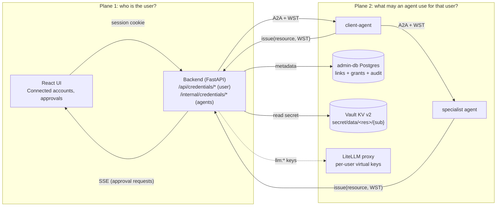
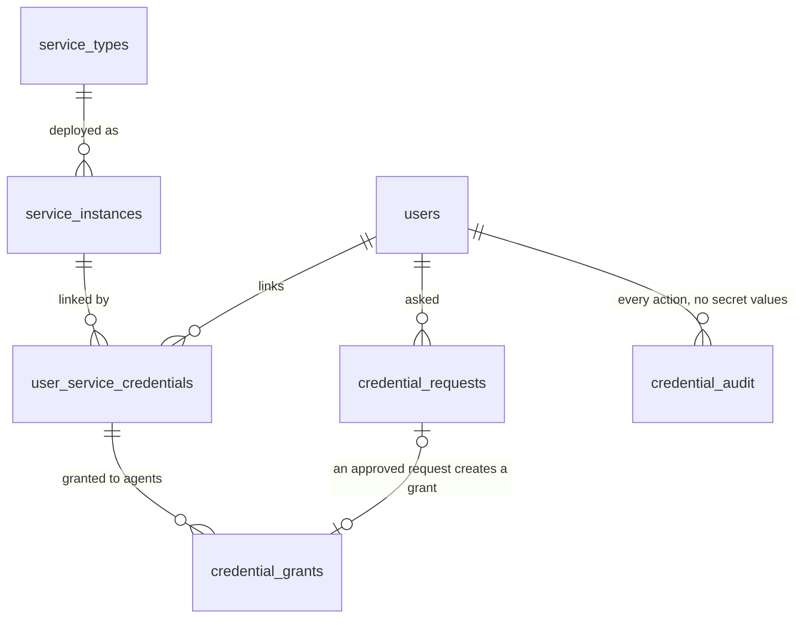
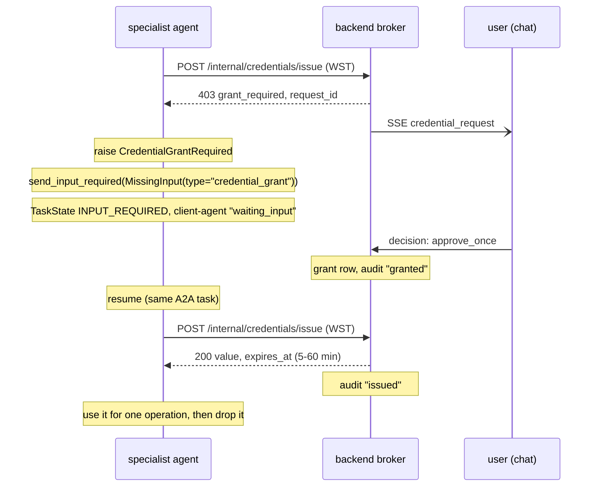
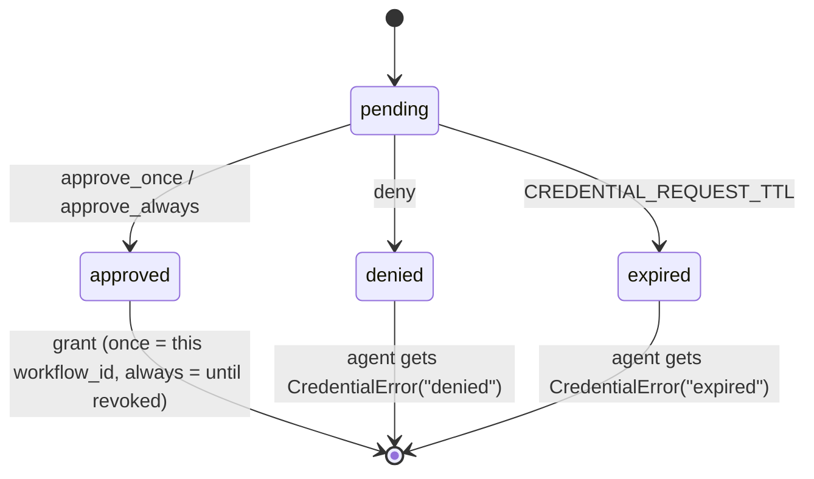
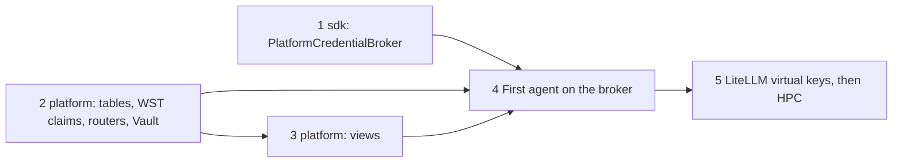
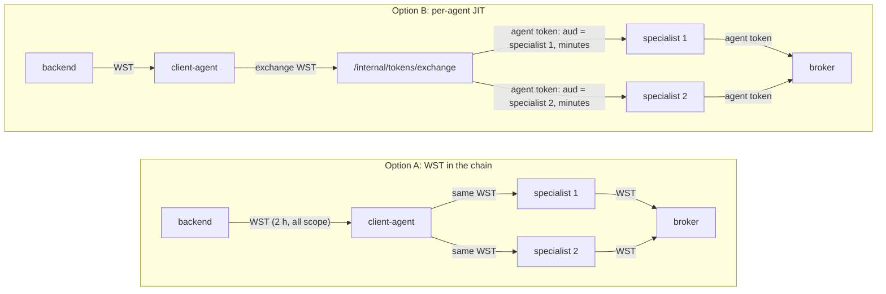

# Credential Plane for Agents

| | |
| --- | --- |
| **Status** | Design, not built. The `env` and `vault` brokers, `get_broker()`, `PrometheusAgent.get_credential()` and `ConnectionConfig.from_credential` exist today. The `platform` broker, the routes, the tables and the views are planned. |
| **Jira** | PPLT-31 builds it. |
| **Requirements** | The draft SDD spec `sdk/specs/015-credential-broker-and-grants.md` gives the requirement IDs (REQ-015-xx, BEH-015-xx) that this document cites. It isn't in the repository yet. |
| **Related** | [ADR-001 IAM][adr-001], [ADR-002 Data Management][adr-002], [ADR-003 Agent-Scoped Credentials][adr-003], [ADR-004 Agent Registry and A2A Gateway][adr-004], [ADR-005 Agent Workload Identity (mTLS)][adr-005], [User Proof Chain](user-proof-chain.md), [Mid-execution user approval](user-approval.md) |
| **Origin** | Moved from [Confluence page 38338709][origin] (version 12, 2026-11-06). This file is now the source of truth. |

This document describes the **second authentication plane** of Prometheus. A user
links their own credentials for DeepLynx, INL HPC (SLURM) and inference providers.
An agent then gets a short-lived credential for that user at run time, after the
user approves the request.

The first plane is platform login. The session cookie identifies the browser. For
each chat turn, the backend mints an RS256 identity JWT
([`backend/app/identity.py`](../../backend/app/identity.py)) and sends it to the
agents.

Readers: a platform developer who builds PPLT-31, and an agent author who calls
`get_credential()`.

## The problem today

- `prometheus_api` has a `CredentialBroker` protocol with an `env` backend and a
  `vault` backend ([`sdk/prometheus_api/credentials/`](../../../sdk/prometheus_api/credentials/)).
  The only caller is `PrometheusAgent.get_credential()`.
- No agent calls `get_credential()`. Every agent reads one shared set of DeepLynx
  and LLM keys from the environment.
- The platform has no route, table or view where a user links a credential.
  [Multi-user setup](../docs/dev-docs/multi-user-setup.md) tells users to write to
  Vault directly.

## The design in one paragraph

The backend becomes the broker that agents call (`CREDENTIAL_BROKER=platform`,
REQ-015-07). The broker checks a workflow-scoped token (WST), the agent card
declaration and the user's grant. Then it reads the secret from Vault KV for that
user. It returns a short-lived derived credential when the auth mode can mint one,
and otherwise the stored secret, in memory, as ADR-003 § 2.4 allows (see
[Credential types](#credential-types)). Users manage linked accounts in a new
**Connected accounts** view. Users approve agent requests in an inline chat card.
The **Approval Queue** view shows the pending requests. The admin-db Postgres keeps
the grant, request and audit metadata. Postgres, Valkey, logs and artifacts never
hold a secret value.

**Admins define what can be linked.** A platform administrator registers each
service type and service instance (name, base URL, auth mode, and for OAuth modes
the client ID and client secret). Users only link their own account to an instance
that an admin has registered. A user never enters an OIDC client secret and never
adds a new service or URL.

**Plane 1 is OIDC only.** Local password users are retired. Every deployment logs
in through an admin-configured OIDC provider (ADR-003 § 2.1). For development and
debugging, the stack ships a minimal local OIDC provider in place of the password
login. A login through that provider gives no upstream token that the
`idp_derived` mode can use, so `idp_derived` services are unavailable in that
setup.

## Figure 1: the two planes

**Plane 1: who is the user?**

- The browser logs in to the backend and gets a session cookie (HS256, `sid`).
- For each turn, the backend mints a WST: RS256, `sub` + `workflow_id` + `jti` +
  `scope` + `bindings`.
- The WST travels in A2A metadata: backend → client-agent → specialist.

**Plane 2: what may an agent use for that user?** The agent calls
`issue(resource, WST)` at the backend broker, which:

1. verifies the WST (signature, `exp`, `jti`, `scope`);
2. checks that the resource and scope keys are declared (agent card);
3. checks that the scope is in the allowed list (registry);
4. checks that the scope is inside the WST `bindings` (WST);
5. checks that the user linked the resource (Postgres);
6. checks that the user granted it to this agent (Postgres);
7. reads the secret (Vault KV);
8. returns a short-lived credential and writes an audit row.

Open question: ADR-001 says that the WST travels through the agent chain. PPLT-34
CONFLICT-1 says that agents never receive the WST. This design follows ADR-001
until the two pages agree (see the [analysis](#analysis-wst-in-the-agent-chain-vs-per-agent-jit-tokens-conflict-1)).



## Credential types

A platform administrator sets up every credential type. Users never add a service
type, an instance or a URL. They only link their own account to an instance that
already exists. For OAuth modes, the admin also enters the OAuth client
registration (client ID, client secret, token endpoint). Users never see the client
secret.

### Auth modes

| Auth mode | Admin configures (service instance) | User supplies at link time | Broker issues | Agent receives the long-lived secret? |
| --- | --- | --- | --- | --- |
| `idp_derived` | Upstream token endpoint, target `audience`, scopes, subject token type; the Plane 1 OIDC provider it derives from | Nothing; the link exists once the user logs in through that provider | A short-lived token for the target audience. The broker refreshes the user's stored Plane 1 token, then does an RFC 8693 token exchange (or an audience-specific token request) | No |
| `oauth_link` | Authorization and token endpoints, client ID, **client secret**, scopes | A one-time authorization-code consent redirect; the broker keeps the refresh token in Vault | A short-lived access token from a refresh | No |
| `key_secret` | Token endpoint (for example the DeepLynx token route) | Key and secret | A short-lived token that the broker gets from the service's token endpoint | No |
| `password` | Login endpoint, if the service has one | Username and password | A session or token from the service's login endpoint; if the service has no login endpoint, the stored password (served) | Only when served |
| `api_key` | Header or parameter name | The API key | The stored key (served) | Yes, in memory for one operation |
| `ssh_key` | Host | Private key, user | A derivative that the broker mints over SSH (for example `scontrol token`); the key itself is never served | No |

### Derive when possible, serve otherwise (ADR-003 § 2.4)

Following ADR-003 § 2.4, the broker returns a **derived** short-lived credential
whenever the auth mode can mint one. When a mode can't mint one (a static API key,
or a password for a service with no login endpoint), the broker **serves** the
stored secret. It goes only into the requesting agent's memory, for one operation
(REQ-015-15, amended).

Served secrets follow every other rule in this document:

- The broker still applies the full grant, declaration and scope checks first.
- It writes an `issued` audit row with `served: true`.
- The value never appears in logs, Postgres, Valkey, SSE events, artifacts or
  provenance.
- The agent drops the value after the call.

The service type registry marks each mode `derivable` or `served`, so the approval
card can tell the user when an agent gets the raw secret.

Where the platform controls the call path, the broker still prefers a handle over
the raw secret. `llm:*` keys stay LiteLLM virtual keys, so the raw provider key
never leaves Vault and the proxy.

### Current resources

| Resource | Label | Auth modes (target first) | Stored fields (Vault) | What an agent receives |
| --- | --- | --- | --- | --- |
| `deeplynx` | DeepLynx | `oauth_link` / `idp_derived` (target, ADR-003 § 2.6), `key_secret` (interim) | `key`, `secret`, `org_id`, `project_id` (interim) | `{"jwt_token", "org_id", "project_id", "base_url"}`: a short-lived DeepLynx JWT. `ConnectionConfig.from_credential` consumes it (REQ-015-05). |
| `slurm` | INL HPC (SLURM REST) | `idp_derived` (target: an Okta-signed JWT that slurmrestd accepts via `auth/jwt` + JWKS), `ssh_key` (interim) | `private_key`, `user`, `host`, `slurm_rest_url` (interim) | `{"token", "user", "slurm_rest_url"}`, the shape that the `env` broker returns today |
| `llm:<provider>` (`llm:anthropic`, `llm:openai`, `llm:inl_hpc`, `llm:inl_litellm`) | Inference provider | `api_key` | `api_key` | `{"api_key": "<LiteLLM virtual key>", "expires_at"}`, never the raw provider key (REQ-015-12) |

The backend keeps the resource registry in one table (`service_types`), with a
JSON field schema per auth mode. A new integration adds one row; no view changes
are needed.

- Each `service_types` row also holds `allowed_scopes`, the ADR-003 § 2.3
  allowed-scope list: the scope resources, and the actions per resource, that the
  platform may give to any agent for that service type. A platform administrator
  sets it. It is a security control.
- Each `service_instances` row holds the admin-set `name` and `base_uri`. These
  are the name and URL that the user sees and that the issued credential is bound
  to.

### Plane 1 token retention (for `idp_derived`)

`idp_derived` needs an upstream token.

- At login, the backend requests `offline_access` from the Plane 1 OIDC provider
  (when an `idp_derived` service exists).
- It stores the upstream refresh token in Vault at `secret/data/idp/{sub}`. That
  token never goes into the session cookie, the WST or Valkey.
- Logout revokes it, and so do unlink and offboarding.
- A derived credential can't outlive the user's upstream session, so an account
  that the IdP disables loses every derived credential at the next refresh.

Today the OIDC callback ([`backend/app/security.py`](../../backend/app/security.py))
discards the access and refresh tokens; PPLT-28 has to change that.

## Workflow-scoped token (WST)

The backend already mints a separate RS256 identity JWT for each turn. The session
cookie never reaches an agent. ADR-001 makes a WST the only credential in the
agent chain. The design turns the identity JWT into the WST with four new claims,
named as ADR-001 § 4.3.1 names them. Agents verify it unchanged, because
`verify_user_token` requires only `sub`, `exp`, `iat`, `iss` and `aud`.

```json
{
  "iss": "prometheus-platform",
  "aud": "prometheus-agents",
  "sub": "alice",
  "iat": 1791490000,
  "exp": 1791497200,
  "jti": "wst_3f9c2a",
  "workflow_id": "turn_7d1e",
  "cid": "conv_51ab",
  "scope": ["deeplynx", "llm:anthropic"],
  "bindings": {"deeplynx": {"instance": "dlx-main", "org_id": "12", "project_id": "40"}}
}
```

| Claim | Meaning | Check at the broker |
| --- | --- | --- |
| `jti` | The unique id of this WST | Not in the revoked set; written to every audit row |
| `workflow_id` | The turn (workflow run) that the backend minted the WST for | A `once` grant is bound to it |
| `cid` | The conversation id | The backend posts the approval card to this conversation |
| `scope` | The resources that this run may use: the user's linked resources at mint time, without the revoked ones (ADR-001 `scope[]`) | The requested resource is in it, else `not_linked` |
| `bindings` | The service instance (`instance`) and the project per resource for this run (ADR-003 § 2.5) | A request `scope` value must equal the bound value, else `scope_not_bound`; a request without a `scope` gets the bound value |

The WST `scope` is a list of resource names. It is not the `scope` object of an
issue request, which holds the scope resources such as `project`. Two ADR-001
claims are deferred: `workflow_template` (the platform has one chat workflow, so no
template bounds the agents yet) and `classification_ceiling` (the identity provider
gives no classification yet).

The backend writes a `wst_issued` audit row (ADR-001 § 4.3.1) before it sends the
turn to the client-agent. The row holds the `jti`, the `sub`, the `workflow_id`,
the `conversation_id` and the WST `scope`. If the write fails, the backend does not
start the turn.

The backend fills `bindings` at mint time. It takes the project that the user
chose for the conversation, or else the default that the user saved with the
linked account. The default is not a secret, so `user_service_credentials` holds
it in `binding_json`. An agent can't widen the binding: it can only ask for the
bound value or leave the `scope` empty.

The TTL stays `USER_IDENTITY_TTL` (default 7200 s). Logout and unlink revoke the
live `jti` values of that user.

## Endpoints

The user routes are under `/api/credentials`.

- The session cookie protects them (`current_claims`), and `claims.sub` scopes
  them.
- A row that the caller does not own gives a 404, never a 403, as the chat history
  routes do.
- No response carries a secret value. The credential fields are write-only, as
  `client_secret` is in the admin OIDC routes
  ([`backend/app/routers/admin_oidc.py`](../../backend/app/routers/admin_oidc.py)).

| Method | Path | Auth | Purpose | Status codes |
| --- | --- | --- | --- | --- |
| `GET` | `/api/credentials` | Session | The resource catalog, with the caller's link status per resource | 200; 200 with `available: false` when Vault is down; 401 |
| `PUT` | `/api/credentials/{resource}` | Session | Link or replace a credential (write-only fields) | 200; 400 bad fields; 404 unknown resource; 503 Vault down; 401 |
| `POST` | `/api/credentials/{resource}/test` | Session | Probe the target with the stored credential | 200 `{ok, detail}`; 404 not linked; 401 |
| `DELETE` | `/api/credentials/{resource}` | Session | Unlink: delete the Vault secret, revoke its grants | 204; 404; 401 |
| `GET` | `/api/credentials/grants` | Session | The caller's grants per agent | 200; 401 |
| `DELETE` | `/api/credentials/grants/{grant_id}` | Session | Revoke one grant | 204; 404; 401 |
| `GET` | `/api/credentials/requests` | Session | The pending requests (the Approval Queue) | 200; 401 |
| `POST` | `/api/credentials/requests/{request_id}/decision` | Session | Approve once, approve always, or deny | 200; 404; 409 already decided or expired; 401 |
| `POST` | `/internal/credentials/issue` | `AGENT_SECRET` bearer + WST | An agent asks for a credential | 200; 401 bad WST; 403 `grant_required`, `not_declared`, `scope_not_declared`, `action_not_declared`, `scope_not_allowed`, `scope_not_bound`; 404 `not_linked`; 503 Vault down |

`GET /api/credentials`:

```json
{
  "available": true,
  "resources": [
    {
      "resource": "deeplynx",
      "label": "DeepLynx",
      "auth_modes": ["api_key"],
      "fields": {"api_key": [{"name": "key", "secret": false}, {"name": "secret", "secret": true},
                             {"name": "org_id", "secret": false}, {"name": "project_id", "secret": false}]},
      "link": {"status": "active", "auth_mode": "api_key", "hint": "...a3f9",
               "updated_at": "2026-10-08T14:02:11Z", "last_used_at": "2026-10-08T15:10:40Z",
               "last_test": {"ok": true, "at": "2026-10-08T14:02:15Z"}}
    },
    {"resource": "slurm", "label": "INL HPC (SLURM)", "auth_modes": ["ssh_key"], "fields": {}, "link": null}
  ]
}
```

`PUT /api/credentials/deeplynx` takes this body. It returns the same `link` object,
never the fields.

```json
{"auth_mode": "api_key", "fields": {"key": "...", "secret": "...", "org_id": "12", "project_id": "40"}}
```

The JSON examples use the label `api_key` for the DeepLynx interim mode. Read it as
`key_secret`.

`POST /internal/credentials/issue` takes this body, with the WST in the
`X-Prometheus-User-Token` header (REQ-015-07):

```json
{"resource": "deeplynx", "scope": {"project": "40"}, "actions": ["write_artifact"],
 "agent": "artifact-debug-agent",
 "reason": "Upload the mesh to your DeepLynx project", "task_id": "...", "context_id": "..."}
```

With a grant, the route returns the credential:

```json
{"resource": "deeplynx", "value": {"jwt_token": "...", "org_id": "12", "project_id": "40"},
 "expires_at": "2026-10-08T15:25:40Z"}
```

Without a grant, the route returns a 403 (REQ-015-08):

```json
{"error": "grant_required", "request_id": "creq_88b1", "resource": "deeplynx",
 "agent": "artifact-debug-agent", "expires_at": "2026-10-08T15:25:40Z"}
```

`/internal/` is not under `/api`, so nginx and the Vite proxy never forward it from
a browser. The backend host port 8600 still reaches it, so the bearer check is
mandatory.

## Data model

The backend reaches the secret store through a `SecretStore` port with three
operations: put, get and delete, each by path. Vault KV v2 is the first adapter,
and the dev and compose default. ADR-001 § 4.8 leaves the production store open,
so another adapter (for example AWS Secrets Manager) can replace it without a
change to the routes or the tables.

| Store | What | Lifetime |
| --- | --- | --- |
| Vault KV v2 | The secret fields, at `secret/data/<resource>/{sub}` for the default instance (the paths that `VaultCredentialBroker` already reads, REQ-015-06) and `secret/data/<resource>/<instance>/{sub}` for any other instance; LLM keys at `secret/data/llm/<provider>/{sub}` | Until unlink, rotation or offboarding |
| admin-db `service_instances` | `id`, `resource`, `name`, `base_uri`, `environment`, `status`; one row per deployment of a resource, for example two DeepLynx servers | Until an administrator removes it |
| admin-db `user_service_credentials` | `id`, `user_id`, `service_instance_id`, `auth_mode`, `vault_secret_id` (the Vault path), `credential_status` (`active`, `expired`, `revoked`, `failed`), `external_subject`, `granted_scopes_json`, `binding_json`, `hint`, `expires_at`, `last_validated_at`, `last_test_ok`, `last_used_at`, `created_at`, `updated_at`; unique on `user_id` and `service_instance_id` | Until unlink |
| admin-db `credential_grants` | `id`, `user_id`, `agent_name`, `resource`, `scope_json`, `mode` (`once`, `always`), `workflow_id` (for `once`), `expires_at`, `created_at`, `revoked_at` | `once`: the turn; `always`: until revoked, at most `CREDENTIAL_GRANT_MAX_DAYS` (default 90) |
| admin-db `credential_requests` | `id`, `user_id`, `agent_name`, `resource`, `scope_json`, `reason`, `conversation_id`, `task_id`, `status` (`pending`, `approved`, `denied`, `expired`), `created_at`, `decided_at` | Pending for `CREDENTIAL_REQUEST_TTL` (default 900 s) |
| admin-db `credential_audit` | `ts`, `user_id`, `agent_name`, `resource`, `action` (`wst_issued`, `linked`, `unlinked`, `tested`, `requested`, `granted`, `denied`, `issued`, `refused`, `revoked`), `wst_jti`, `workflow_id`, `conversation_id`, `outcome`, `scope_hash`, `forwarded_at` | Permanent; append-only (the backend role has `INSERT` and `SELECT`, no `UPDATE` or `DELETE`) |
| Valkey | Nothing persistent; only the `credential_request` SSE event on `sse:{sid}` | The live session |

`credential_audit` is an interim outbox for the ADR-002 Immutable Audit Log (a
Postgres append-only schema in the DeepLynx DB). A forwarder copies each row to
that log when the log exists, and sets `forwarded_at`. A forwarded row stays in
admin-db. ADR-001 § 4.5.1 sends the broker events to that log, and ADR-002 makes
the Data Management Lead its owner, who must confirm the interim.

`user_id` is the session `sub`, which is the username. `user_service_credentials`
and `service_instances` use the columns of the Draft Platform Database Schema. This
design adds `binding_json`, `hint`, `last_test_ok` and `last_used_at`. The resource
registry is the schema's `service_types` table, with the `allowed_scopes` field.



## Agent flow

An agent declares the services that it may ask for in a `services` list. The entry
shape is the agent authorization manifest of PPLT-34 § 7.1, the proposed answer to
ADR-003 OQ-1. Until the separate manifest file exists, the list is in
`agent_card.json`. Step 3 of the developer guide in
[Multi-user setup](../docs/dev-docs/multi-user-setup.md) (§ Developer guide) shows
it.

```json
"services": [
  {"service_type": "deeplynx", "required": true, "credential_pattern": "user_supplied",
   "scopes": [{"resource": "project", "selector": "${binding.deeplynx.project_id}",
               "actions": ["read_artifact", "write_artifact"]}],
   "reason": "Read and write files in your DeepLynx project"}
]
```

Each `scopes` entry names a scope `resource` (the key of the issue request's
`scope` object), a `selector` into the WST `bindings`, and the `actions` that the
agent may ask for. The broker applies the ADR-003 double bound in two checks:

1. **The declaration (REQ-015-10).** The broker refuses a service that the card
   does not declare (`not_declared`), a `scope` key that no `scopes` entry names
   (`scope_not_declared`), and an action that the entry does not list
   (`action_not_declared`).
2. **The allowed-scope list (REQ-015-13).** The broker refuses a scope resource or
   an action outside the service type's `allowed_scopes` (`scope_not_allowed`),
   whatever the card declares.

A third check applies the workflow binding (REQ-015-14). The broker refuses a
`scope` value that differs from the value that the entry's `selector` reads from
the WST `bindings` (`scope_not_bound`).

Each refusal is a 403 and an audit row with the action `refused` and the reason.

### The issue sequence (BEH-015-01)



The pause uses the existing INPUT_REQUIRED path (REQ-015-09):

- `send_input_required`
  ([`sdk/prometheus_api/agent/base.py`](../../../sdk/prometheus_api/agent/base.py))
  emits the pause.
- `MissingInput` already has a `sensitive` flag.
- The client-agent loop already parks the INPUT_REQUIRED state of a specialist as
  `waiting_input`.

The base class turns the 403 into that pause. An agent author writes only
`await self.get_credential("deeplynx")`.

### Request states

A deny gives BEH-015-02. An expiry gives BEH-015-03.



### Inference keys

1. The agent asks for `llm:<provider>`.
2. The broker returns a short-lived LiteLLM virtual key. The key is bound to the
   user's own provider key (REQ-015-12).
3. The agent passes the virtual key to `AsyncLLMClient` through
   `LLMConfig.with_api_key()`, in place of `LITELLM_MASTER_KEY`. The key never
   travels in an A2A request: the SDK reads LLM keys only from `LLMConfig` and the
   environment (REQ-007-15).

The raw provider key never leaves Vault and the LiteLLM proxy. When the user has no
key for that provider, the agent keeps the platform default.

## UI states

The design has three surfaces. All wireframes are low fidelity. They use daisyUI
components, as the admin OIDC providers view
([`frontend/src/components/admin/AdminOidcProviders.tsx`](../../frontend/src/components/admin/AdminOidcProviders.tsx))
does.

### Connected accounts

Click path: log in, open the user menu in the header, and click
`Connected accounts`. This is a new menu item next to `Settings`.

```text
+--------------------------------------------------------------------------------------+
| Connected accounts                                                                   |
| Agents use these accounts on your behalf, only after you approve each agent.         |
|  [ Accounts ]  [ Agent access ]  [ Activity ]                                        |
+--------------------------------------------------------------------------------------+
| DeepLynx                        API key  ...a3f9     Linked 2026-10-08   ( Test )    |
|  Last used 15:10 by Artifact Debug Agent   Last test: OK               ( Replace )   |
|                                                                        ( Unlink  )   |
|--------------------------------------------------------------------------------------|
| INL HPC (SLURM)                 Not linked                             ( Link    )   |
|  Needed by: HPC Job Agent                                                            |
|--------------------------------------------------------------------------------------|
| Anthropic (inference)           API key  ...9c01     Linked 2026-10-01   ( Test )    |
|  Agents call models with your key through the platform gateway.        ( Unlink  )   |
|--------------------------------------------------------------------------------------|
| OpenAI (inference)              Not linked: agents use the platform key ( Link   )   |
+--------------------------------------------------------------------------------------+
```

### Link dialog

The fields come from the admin-defined service instance (name, base URL, auth
mode). The user only fills in their own account details. DeepLynx, in the interim
`key_secret` mode:

```text
+-------------------------------------------------+
| Link DeepLynx (dlx-main, https://deeplynx...)[x]|
| Sign-in method (o) API key and secret           |
|                ( ) Connect with DeepLynx [soon] |
| API key    [ <your-api-key>                   ] |
| API secret [ ****************                 ] |
| Org ID [ 12 ]   Project ID [ 40 ]               |
| Prometheus stores the secret in Vault. Nobody,  |
| not even admins, can read it back here.         |
|                ( Cancel )  [ Save and test ]    |
+-------------------------------------------------+
```

An `oauth_link` instance shows a single `( Connect with <name> )` button, which
starts the consent redirect with the admin-held client registration. An
`idp_derived` instance has no dialog. It shows `Linked through your <IdP> login` as
soon as the user has logged in through that provider.

### Agent access tab

```text
| Agent                | Resource | Access        | Granted    | Expires    |          |
|----------------------|----------|---------------|------------|------------|----------|
| Artifact Debug Agent | DeepLynx | Always        | 2026-10-08 | 2027-01-06 | (Revoke) |
| HPC Job Agent        | SLURM    | This run only | 2026-10-08 | end of run | (Revoke) |
```

### Approval card in chat

The card is inline in the conversation. The `credential_request` SSE event and the
INPUT_REQUIRED pause show it.

```text
+------------------------------------------------------------------+
| (key) Artifact Debug Agent wants to use your DeepLynx account    |
| Why: "Upload the mesh to your DeepLynx project"                  |
| Scope: project 40          Credential lifetime: 15 min           |
| [ Allow once ]  ( Always allow this agent )  ( Deny )            |
| Expires in 14:32                                                 |
+------------------------------------------------------------------+
not linked yet -> the card shows ( Link DeepLynx ) first, then the buttons
```

For a `served` mode (a static API key, or a password with no login endpoint), the
card replaces the lifetime line with: `This agent receives your stored secret
itself, not a short-lived token.` That way the user knows when the
derived-credential guarantee doesn't apply.

### Approval Queue

The sidebar already has the `Approval Queue` item
([`frontend/src/components/dashboard/nav.tsx`](../../frontend/src/components/dashboard/nav.tsx)).
Today it opens a `ComingSoon` page.

```text
+--------------------------------------------------------------------------------------+
| Approval Queue                                              Pending (2)  History     |
|--------------------------------------------------------------------------------------|
| Artifact Debug Agent -> DeepLynx    "Upload the mesh..."   conv: Mesh review  14:32  |
|                                         [ Allow once ] ( Always ) ( Deny )           |
| HPC Job Agent -> SLURM (not linked) "Submit the job..."    conv: Thermal run  09:10  |
|                                         ( Link SLURM ) ( Deny )                      |
+--------------------------------------------------------------------------------------+
```

### View states

| State | When | Visible text |
| --- | --- | --- |
| Loading | `GET /api/credentials` in flight | `Loading...` |
| Unavailable | `available: false` | `Credential storage is unreachable. Linked accounts are unchanged.` |
| Empty | No resource linked | Each row shows `Not linked` and a `Link` button |
| Error | `ApiError` | The message in an `alert-error` |
| Test failed | `{ok: false}` | `Test failed: <detail>` under the row, status `failed` |
| Success | Linked | Label, auth mode, hint, dates, last use |
| Request expired | 409 on decision | `This request expired. Ask the agent again.` |

## Contract changes (planned)

| Layer | Change | Owner |
| --- | --- | --- |
| `sdk/prometheus_api/contract.py` | None | – |
| `sdk/prometheus_api/credentials/` | New `PlatformCredentialBroker` (`CREDENTIAL_BROKER=platform`); new `CredentialGrantRequired(CredentialError)` with `request_id`. The protocol keeps `get_credential(req, *, user_token)`. | prometheus_api (PPLT-31) |
| Agent card | The `services` list (PPLT-34 § 7.1 shape), read by the broker | prometheus_api spec 015 |
| `platform/backend/app/contract.py` | `CredentialResource`, `CredentialLink`, `CredentialListResponse`, `CredentialPut`, `CredentialTestResult`, `CredentialGrant`, `CredentialRequest`, `CredentialDecision`, `CredentialRequestEvent` (SSE) | backend (PPLT-31) |
| `platform/backend/CONTRACT.md` | A new `## Credentials` section after `## Chat history` | backend (PPLT-31) |
| `platform/frontend/src/lib/api/types.ts`, `client.ts` | The mirrors, and `api.listCredentials()`, `putCredential()`, `testCredential()`, `deleteCredential()`, `listGrants()`, `revokeGrant()`, `listCredentialRequests()`, `decideCredentialRequest()` | frontend (PPLT-31) |

The backend wire does not carry `prometheus_api` types. The internal issue route
returns plain JSON, and `PlatformCredentialBroker` maps it to `Credential`.

### The future `## Credentials` section of `backend/CONTRACT.md`

PPLT-31 adds one section per endpoint, with the request model, the response model
and one example from the model and a test:

- `GET /api/credentials` → `CredentialListResponse`
- `PUT /api/credentials/{resource}` (`CredentialPut`) → `CredentialLink`
- `POST /api/credentials/{resource}/test` → `CredentialTestResult`
- `DELETE /api/credentials/{resource}` → 204
- `GET /api/credentials/grants` → a list of `CredentialGrant`
- `DELETE /api/credentials/grants/{grant_id}` → 204
- `GET /api/credentials/requests` → a list of `CredentialRequest`
- `POST /api/credentials/requests/{request_id}/decision` (`CredentialDecision`) → `CredentialRequest`
- The `credential_request` SSE event on `GET /api/events` → `CredentialRequestEvent`

`/internal/credentials/issue` is an agent route, not a browser route. The section
does not list it.

## Security rules

- Secret values go only to Vault and to the memory of the requesting agent, for one
  operation. They are never in Postgres, Valkey, logs, SSE events, A2A artifacts or
  provenance (ADR-001 § 4.5.1, REQ-015-11).
- The broker logs and audits the WST `jti`, the user, the agent, the resource and a
  hash of the scope. It never logs the value.
- **Agent identity comes from mTLS ([ADR-005][adr-005]).** Each agent has a
  platform-issued certificate (`spiffe://prometheus/agent/<name>`). The broker
  takes the agent identity from the certificate, not from a field in the request
  body. Until ADR-005 rollout step 6 lands, all agents share `AGENT_SECRET`, and
  any workload that holds it can claim another agent's name. Production needs
  ADR-005 first.
- **Agents have no direct Valkey access ([ADR-004][adr-004] § 7).** Only the
  backend, plus the client-agent under its own limited ACL user, connects to
  Valkey.
- Unlink deletes the Vault secret and revokes the grants and the live WSTs of the
  user. Offboarding purges every credential of the user (PPLT-34).
- The backend talks to Vault with its own role (`VAULT_BACKEND_ROLE`), with write
  and read on `secret/data/*/{sub}`. In `platform` mode, agents get no Vault
  access.

## Rollout (PPLT-31)

| Step | Repo area | What |
| --- | --- | --- |
| 1 | sdk | `PlatformCredentialBroker`, `CredentialGrantRequired`, the INPUT_REQUIRED mapping in `get_credential`, `services` card parsing; the [`AGENT_MIGRATIONS.md`](../../../sdk/docs/agent/AGENT_MIGRATIONS.md) entry |
| 2 | platform | The Alembic migration for the six tables (`service_types`, `service_instances`, `user_service_credentials`, `credential_grants`, `credential_requests`, `credential_audit`); the WST claims in `identity.py`; the `/api/credentials` and `/internal/credentials` routers; a Vault service in compose (dev mode) |
| 3 | platform | The Connected accounts view, the approval card, the Approval Queue view |
| 4 | platform | The first agent on the broker (artifact-debug-agent, DeepLynx) |
| 5 | both | The LiteLLM virtual-key binding (after the spike), then HPC |



## Open questions and spikes

### Decisions needed

| Decision | Who decides | Blocks |
| --- | --- | --- |
| Do agents receive the workflow-scoped token (WST), or a per-agent JIT token derived from it? See the analysis below. PPLT-34 CONFLICT-1 vs ADR-001 § 4.3.1. Not decided. The more secure option is preferred. | The ADR-001 and PPLT-34 owners (Daniel Schwen to rule) | Build step 2 |
| The user-grant model: approve once, approve always, deny, the request TTL and the 90-day cap. It is a new decision. The ADR-003 amendment draft records it. | The ADR-003 owner | The ADR-003 amendment |
| The `credential_audit` outbox in admin-db, until the ADR-002 Immutable Audit Log exists (see [Data model](#data-model)). | Data Management Lead | The audit design |
| The production secret store (ADR-001 § 4.8). The design uses Vault KV v2 only as the first `SecretStore` adapter. | Platform Technical Lead, at PD.1 | Production |
| Per-agent workload identity (a per-agent secret or mTLS), in place of the shared `AGENT_SECRET` (see [Security rules](#security-rules)). | PPLT-34 | Production |

### Decided (2026-11-02)

- Secret serving follows ADR-003 § 2.4. The broker derives a short-lived credential
  when it can, and otherwise serves the stored secret in memory, after the full
  checks (see [Credential types](#credential-types)). This amends REQ-015-15.
- Credential types and service instances are admin-defined only. That includes
  OAuth client secrets and URLs.
- Local password users are retired. A minimal local OIDC provider replaces them for
  development and debugging.

### Analysis: WST in the agent chain vs per-agent JIT tokens (CONFLICT-1)

**Option A, the WST in the chain (ADR-001, the current design).** The backend
mints one WST per turn. The client-agent forwards it unchanged to every
specialist, and each specialist presents it to the broker.

**Option B, per-agent JIT (PPLT-34).** The WST stays with the platform: the
backend and the orchestrator. For each dispatch, the orchestrator exchanges the WST
at the backend for an **agent token** with:

- `aud` set to that one agent;
- `act` naming the agent node;
- `scope` cut down to the services that this agent's card declares;
- a short TTL (minutes).

The agent presents only that token to the broker.



| Concern | A: WST in the chain | B: per-agent JIT |
| --- | --- | --- |
| Blast radius of one compromised or buggy agent | Gets every resource in the turn's `scope`, for the whole WST TTL (2 h), and can claim any agent name, because `AGENT_SECRET` is shared | Gets only its own declared services, for minutes. It can't use another agent's token, because the broker checks `aud` |
| Replay of a leaked token (logs, a malicious tool, a prompt-injected agent forwarding it) | Valid for the whole turn, against every service | Valid for one agent, briefly |
| Least privilege (ADR-003 § 2.2 double bound) | Enforced only at the broker, by the agent name that the request asserts | Enforced in the token too. The broker checks that the requested resource is in the token's `scope` *and* the card |
| Audit | `jti` per turn | `jti` per agent node, with `act`, so every issue traces to one node in the run |
| Agent → sub-agent calls | The WST passes straight through | The callee gets its own token. Delegation chains show up as nested `act` claims (RFC 8693) |
| Long runs (> TTL) | One long-lived token | The orchestrator refreshes per dispatch; the agent re-requests when it gets a 401 |
| Build cost | Already shaped: claims on the existing identity JWT | One more backend route (`/internal/tokens/exchange`, WST → agent token). Orchestrator dispatch mints per call. The SDK reads the agent token from A2A metadata where it reads the WST today. Broker checks stay the same, plus `aud` |
| Depends on workload identity? | Yes, for any real isolation | Gets most of its benefit without it (scope and TTL cut-down). Full `aud` binding needs per-agent identity, so that a stolen agent token can't be used from another workload |

**Assessment.** B is the more secure option. It limits each agent to its own
services for minutes, where A gives every agent the whole turn for two hours. B is
also what makes the ADR-003 double bound hold for tokens and not only for broker
logic. It costs about one route and one per-dispatch call, and doesn't change the
user-facing grant model.

If B is chosen, ADR-001 § 4.3.1 gets amended: "the WST is the authority record
held by the platform; agents receive WST-derived per-agent tokens." Step 2 of the
rollout then mints agent tokens instead of forwarding the WST. One requirement
either way: the orchestrator holds the WST, so it is part of the trusted platform.
It can't be a plain specialist.

### Spikes and other open items

- **INL HPC derivation spike:** does slurmrestd at INL accept Okta-signed JWTs
  (`auth/jwt` with a JWKS key, username from a claim)? That is the `idp_derived`
  target. If not, can the backend run `scontrol token` over SSH as the user (the
  `ssh_key` interim), and what is the shortest `lifespan` that it accepts? This
  answers ADR-003 OQ-2.
- **Okta token exchange:** does the INL Okta tenant allow RFC 8693 token exchange,
  or audience-specific authorization servers, for `idp_derived` targets? Does it
  allow `offline_access` for the platform client?
- **LiteLLM binding spike:** a per-user model deployment that uses LiteLLM
  credentials, or a key-scoped model list. The agent-facing contract is fixed
  either way: `llm:<provider>` returns `api_key` and `expires_at`.
- **DeepLynx OAuth availability** decides when the `key_secret` interim mode
  retires.
- **Rotation of user-supplied credentials (ADR-003 OQ-3):** a reminder before
  expiry, or a forced rotation.

## Related documents

The ADR text that this document cites is in the `github-wiki-migration` copies in
Confluence (ADR‐001 v1, ADR‐003 v1). The Confluence ADR-001 (v4), ADR-003 (v2) and
Draft Platform Authentication and Authorization (v2) pages hold only a link to the
retired GitHub wiki.

- [Multi-user setup](../docs/dev-docs/multi-user-setup.md): the `env` and `vault`
  brokers that exist today.
- [Encryption and keys](../docs/dev-docs/encryption-and-keys.md): every platform
  secret and key.
- [`sdk/docs/agent/MULTI_USER.md`](../../../sdk/docs/agent/MULTI_USER.md) § Vault
  broker: the Vault policy HCL.
- `sdk/specs/015-credential-broker-and-grants.md`: the draft requirements (not yet
  in the repository).

[origin]: https://nstinl.atlassian-us-gov-mod.net/wiki/spaces/Prometheus/pages/38338709
[adr-001]: https://nstinl.atlassian-us-gov-mod.net/wiki/spaces/Prometheus/pages/34866090
[adr-002]: https://nstinl.atlassian-us-gov-mod.net/wiki/spaces/Prometheus/pages/34866115
[adr-003]: https://nstinl.atlassian-us-gov-mod.net/wiki/spaces/Prometheus/pages/34866140
[adr-004]: https://nstinl.atlassian-us-gov-mod.net/wiki/spaces/Prometheus/pages/42041369
[adr-005]: https://nstinl.atlassian-us-gov-mod.net/wiki/spaces/Prometheus/pages/43319553
