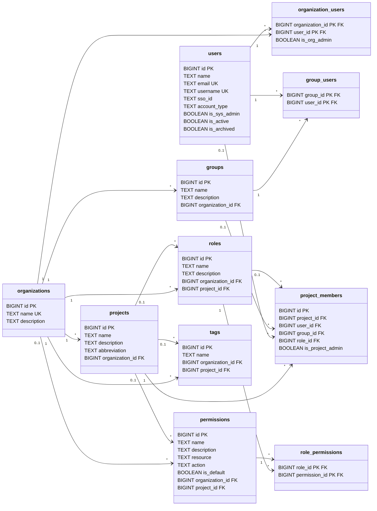

# DeepLynx Schema: Users, Projects & Access Control

This document covers the identity, membership and access-control part of the DeepLynx database. It was derived from `DeeplynxContext.cs` (EF Core + Npgsql) and targets **PostgreSQL**. All tables live in the `deeplynx` schema.

Run the SQL blocks in the order they appear. Each table only references tables defined above it, so the document works as a script from top to bottom. The same SQL is also available as a single file in `schema.sql`.

## Entity diagram

Click a table in the diagram to jump to its section. Renderers that disable Mermaid's interactive features, including GitHub, ignore the clicks; use the [table index](#table-index) below instead. To keep the diagram readable, it leaves out the `last_updated_by` audit links. Nearly every table has one, and they're described in [Conventions](#conventions).



<a id="table-index"></a>
## Table index

| Table | Purpose |
|---|---|
| [users](#users) | Everyone who can sign in |
| [organizations](#organizations) | Top-level tenant that owns everything else |
| [organization_users](#organization_users) | Which users belong to which organization |
| [projects](#projects) | Workspaces inside an organization |
| [groups](#groups) | Named sets of users within an organization |
| [group_users](#group_users) | Which users are in which group |
| [roles](#roles) | Named bundles of permissions, org- or project-scoped |
| [permissions](#permissions) | Resource + action pairs that can be granted |
| [role_permissions](#role_permissions) | Which permissions each role grants |
| [project_members](#project_members) | Which users or groups are in a project, and with what role |
| [tags](#tags) | Labels for data, org- or project-scoped |

Also see [Known issues](#known-issues) for problems found in the source code.

<a id="conventions"></a>
## Conventions

Keys, foreign keys, delete behavior, unique and partial indexes, defaults and check constraints come directly from `DeeplynxContext.cs`. The context doesn't define most column types or whether ordinary columns can be NULL; those live in the entity classes (`Models/*.cs`), which weren't available. Where a column's type or nullability had to be guessed, it's marked `-- inferred` in the SQL.

Types follow Npgsql's defaults: `long` becomes `BIGINT`, `string` becomes `TEXT`, `DateTime` becomes `TIMESTAMPTZ` and `bool` becomes `BOOLEAN`. Primary keys use `GENERATED ALWAYS AS IDENTITY` where the context calls `UseIdentityAlwaysColumn()` and `GENERATED BY DEFAULT AS IDENTITY` otherwise.

Most tables share three audit columns: `last_updated_at` (defaults to the current time), `last_updated_by` (a link to `users` that does nothing when the user is deleted, except on `tags`), and `is_archived` (a soft-delete flag that defaults to `false`). EF also declares an `idx_<table>_id` index on each primary key; those are redundant and left out.

Several tables can be scoped either to a whole organization or to a single project. In those tables, a NULL `project_id` means organization-level. Partial unique indexes keep names unique within whichever scope applies.

```sql
CREATE SCHEMA IF NOT EXISTS deeplynx;
SET search_path TO deeplynx;
```

---

<a id="users"></a>
## users

Everyone who can sign in. `email` and `username` must be unique, and `sso_id` links the account to an external identity provider. `account_type` (the diagram's `type`) defaults to `'standard'`. `is_sys_admin` grants system-wide administration. New accounts start inactive.

The diagram calls the display-name column `display name`. It's called `name` here because the code also has a separate `username`; rename it if the entity class says otherwise.

```sql
CREATE TABLE users (
    id            BIGINT  GENERATED ALWAYS AS IDENTITY,
    name          TEXT    NOT NULL,                       -- inferred (diagram: "display name")
    email         TEXT    NOT NULL,
    username      TEXT    NULL,                           -- inferred nullability
    sso_id        TEXT    NULL,                           -- inferred type
    account_type  TEXT    NOT NULL DEFAULT 'standard',    -- diagram: "type"
    is_sys_admin  BOOLEAN NOT NULL DEFAULT false,
    is_active     BOOLEAN NOT NULL DEFAULT false,
    is_archived   BOOLEAN NOT NULL DEFAULT false,
    CONSTRAINT users_pkey PRIMARY KEY (id)
);
CREATE UNIQUE INDEX idx_users_email    ON users (email);
CREATE UNIQUE INDEX idx_users_username ON users (username);
CREATE        INDEX idx_users_sso_id   ON users (sso_id);
```

<a id="organizations"></a>
## organizations

The top-level tenant. Projects, groups, roles, permissions and tags all belong to an organization, and deleting an organization deletes all of them. Organization names are unique across the system.

```sql
CREATE TABLE organizations (
    id              BIGINT      GENERATED BY DEFAULT AS IDENTITY,
    name            TEXT        NOT NULL,
    description     TEXT        NULL,                     -- inferred
    last_updated_at TIMESTAMPTZ NOT NULL DEFAULT CURRENT_TIMESTAMP,
    last_updated_by BIGINT      NULL,
    is_archived     BOOLEAN     NOT NULL DEFAULT false,
    CONSTRAINT organization_pkey PRIMARY KEY (id),
    CONSTRAINT organizations_last_updated_by_fkey
        FOREIGN KEY (last_updated_by) REFERENCES users (id) ON DELETE NO ACTION
);
CREATE UNIQUE INDEX unique_organization_name          ON organizations (name);
CREATE        INDEX idx_organizations_last_updated_by ON organizations (last_updated_by);
```

<a id="organization_users"></a>
## organization_users

Links users to the organizations they belong to. Each user can appear only once per organization, and `is_org_admin` marks organization administrators. Deleting either the user or the organization removes the membership.

```sql
CREATE TABLE organization_users (
    organization_id BIGINT  NOT NULL,
    user_id         BIGINT  NOT NULL,
    is_org_admin    BOOLEAN NOT NULL DEFAULT false,
    CONSTRAINT organization_user_pkey PRIMARY KEY (organization_id, user_id),
    CONSTRAINT organization_users_organization_id_fkey
        FOREIGN KEY (organization_id) REFERENCES organizations (id) ON DELETE CASCADE,
    CONSTRAINT organization_users_user_id_fkey
        FOREIGN KEY (user_id) REFERENCES users (id) ON DELETE CASCADE
);
CREATE INDEX idx_organization_users_organization_id ON organization_users (organization_id);
CREATE INDEX idx_organization_users_user_id         ON organization_users (user_id);
```

<a id="projects"></a>
## projects

A workspace inside an organization. Every project must belong to an organization, and deleting the organization deletes its projects. Records, data sources, classes and the rest of the data model hang off projects; those tables are outside the scope of this document.

```sql
CREATE TABLE projects (
    id              BIGINT      GENERATED ALWAYS AS IDENTITY,
    name            TEXT        NOT NULL,                 -- inferred
    description     TEXT        NULL,                     -- inferred
    abbreviation    TEXT        NULL,                     -- inferred
    organization_id BIGINT      NOT NULL,
    last_updated_at TIMESTAMPTZ NOT NULL DEFAULT CURRENT_TIMESTAMP,
    last_updated_by BIGINT      NULL,
    is_archived     BOOLEAN     NOT NULL DEFAULT false,
    CONSTRAINT projects_pkey PRIMARY KEY (id),
    CONSTRAINT projects_organization_id_fkey
        FOREIGN KEY (organization_id) REFERENCES organizations (id) ON DELETE CASCADE,
    CONSTRAINT projects_last_updated_by_fkey
        FOREIGN KEY (last_updated_by) REFERENCES users (id) ON DELETE NO ACTION
);
CREATE INDEX idx_projects_organization_id ON projects (organization_id);
CREATE INDEX idx_projects_last_updated_by ON projects (last_updated_by);
```

<a id="groups"></a>
## groups

A named set of users within an organization. A group can be added to a project as a single member (see [project_members](#project_members)), which gives all of its users access at once.

```sql
CREATE TABLE groups (
    id              BIGINT      GENERATED BY DEFAULT AS IDENTITY,
    name            TEXT        NOT NULL,                 -- inferred
    description     TEXT        NULL,                     -- inferred
    organization_id BIGINT      NOT NULL,                 -- inferred nullability
    last_updated_at TIMESTAMPTZ NOT NULL DEFAULT CURRENT_TIMESTAMP,
    last_updated_by BIGINT      NULL,
    is_archived     BOOLEAN     NOT NULL DEFAULT false,
    CONSTRAINT groups_pkey PRIMARY KEY (id),
    CONSTRAINT groups_organization_id_fkey
        FOREIGN KEY (organization_id) REFERENCES organizations (id) ON DELETE CASCADE,
    CONSTRAINT groups_last_updated_by_fkey
        FOREIGN KEY (last_updated_by) REFERENCES users (id) ON DELETE NO ACTION
);
CREATE INDEX idx_groups_organization_id ON groups (organization_id);
CREATE INDEX idx_groups_last_updated_by ON groups (last_updated_by);
```

<a id="group_users"></a>
## group_users

Links users to groups. This is a plain join table: each user appears once per group, and deleting either side removes the link. The constraint names are corrected here; in the source they're swapped (see [Known issues](#known-issues)).

```sql
CREATE TABLE group_users (
    group_id BIGINT NOT NULL,
    user_id  BIGINT NOT NULL,
    CONSTRAINT group_users_pkey PRIMARY KEY (group_id, user_id),
    CONSTRAINT group_users_group_id_fkey
        FOREIGN KEY (group_id) REFERENCES groups (id) ON DELETE CASCADE,
    CONSTRAINT group_users_user_id_fkey
        FOREIGN KEY (user_id)  REFERENCES users (id)  ON DELETE CASCADE
);
CREATE INDEX idx_group_users_group_id ON group_users (group_id);
CREATE INDEX idx_group_users_user_id  ON group_users (user_id);
```

<a id="roles"></a>
## roles

A named bundle of permissions. A role with no `project_id` is organization-level and can be used across all of that organization's projects. A role with a `project_id` exists only in that project. Role names must be unique within their scope.

```sql
CREATE TABLE roles (
    id              BIGINT      GENERATED BY DEFAULT AS IDENTITY,
    name            TEXT        NOT NULL,
    description     TEXT        NULL,                     -- inferred
    organization_id BIGINT      NOT NULL,                 -- inferred nullability
    project_id      BIGINT      NULL,
    last_updated_at TIMESTAMPTZ NOT NULL DEFAULT CURRENT_TIMESTAMP,
    last_updated_by BIGINT      NULL,
    is_archived     BOOLEAN     NOT NULL DEFAULT false,
    CONSTRAINT roles_pkey PRIMARY KEY (id),
    CONSTRAINT roles_organization_id_fkey
        FOREIGN KEY (organization_id) REFERENCES organizations (id) ON DELETE CASCADE,
    CONSTRAINT roles_project_id_fkey
        FOREIGN KEY (project_id) REFERENCES projects (id) ON DELETE CASCADE,
    CONSTRAINT roles_last_updated_by_fkey
        FOREIGN KEY (last_updated_by) REFERENCES users (id) ON DELETE NO ACTION
);
CREATE INDEX idx_roles_organization_id ON roles (organization_id);
CREATE INDEX idx_roles_project_id      ON roles (project_id);
CREATE INDEX idx_roles_last_updated_by ON roles (last_updated_by);
CREATE UNIQUE INDEX unique_organization_role_name
    ON roles (organization_id, name) WHERE project_id IS NULL;
CREATE UNIQUE INDEX unique_project_role_name
    ON roles (organization_id, project_id, name) WHERE project_id IS NOT NULL;
```

<a id="permissions"></a>
## permissions

A permission is a `resource` plus an `action`, such as the right to edit records. It can be defined at three levels. A **default** permission (`is_default = true`) is system-wide and belongs to no organization or project; a check constraint enforces that. An **organization-level** permission has an `organization_id` but no `project_id`. A **project-level** permission has both. Each resource and action pair can be defined only once per scope.

This replaces the diagram's `action_type` column on `role_permissions`: the action now lives on the permission itself.

```sql
CREATE TABLE permissions (
    id              BIGINT      GENERATED BY DEFAULT AS IDENTITY,
    name            TEXT        NOT NULL,                 -- inferred
    description     TEXT        NULL,                     -- inferred
    resource        TEXT        NOT NULL,                 -- inferred type
    action          TEXT        NOT NULL,                 -- inferred type
    is_default      BOOLEAN     NOT NULL DEFAULT false,   -- default inferred
    organization_id BIGINT      NULL,
    project_id      BIGINT      NULL,
    last_updated_at TIMESTAMPTZ NOT NULL DEFAULT CURRENT_TIMESTAMP,
    last_updated_by BIGINT      NULL,
    is_archived     BOOLEAN     NOT NULL DEFAULT false,
    CONSTRAINT permission_pkey PRIMARY KEY (id),
    CONSTRAINT permissions_organization_id_fkey
        FOREIGN KEY (organization_id) REFERENCES organizations (id) ON DELETE CASCADE,
    CONSTRAINT permissions_project_id_fkey
        FOREIGN KEY (project_id) REFERENCES projects (id) ON DELETE CASCADE,
    CONSTRAINT permissions_last_updated_by_fkey
        FOREIGN KEY (last_updated_by) REFERENCES users (id) ON DELETE NO ACTION,
    CONSTRAINT chk_default_permissions_no_org_project_label
        CHECK (is_default = false OR (organization_id IS NULL AND project_id IS NULL))
);
CREATE INDEX idx_permissions_organization_id ON permissions (organization_id);
CREATE INDEX idx_permissions_project_id      ON permissions (project_id);
CREATE INDEX idx_permissions_action          ON permissions (action);
CREATE INDEX idx_permissions_resource        ON permissions (resource);
CREATE INDEX idx_permissions_is_default      ON permissions (is_default);
CREATE INDEX idx_permissions_last_updated_by ON permissions (last_updated_by);
CREATE UNIQUE INDEX permissions_unique_org_resource_action
    ON permissions (organization_id, resource, action) WHERE project_id IS NULL;
CREATE UNIQUE INDEX permissions_unique_project_resource_action
    ON permissions (organization_id, project_id, resource, action) WHERE project_id IS NOT NULL;
```

<a id="role_permissions"></a>
## role_permissions

Says which permissions each role grants. It's a plain join table keyed on the pair, so a role can't grant the same permission twice. Deleting the role or the permission removes the link.

```sql
CREATE TABLE role_permissions (
    role_id       BIGINT NOT NULL,
    permission_id BIGINT NOT NULL,
    CONSTRAINT role_permissions_pkey PRIMARY KEY (role_id, permission_id),
    CONSTRAINT role_permissions_role_id_fkey
        FOREIGN KEY (role_id) REFERENCES roles (id) ON DELETE CASCADE,
    CONSTRAINT role_permissions_permission_id_fkey
        FOREIGN KEY (permission_id) REFERENCES permissions (id) ON DELETE CASCADE
);
CREATE INDEX idx_role_permissions_role_id       ON role_permissions (role_id);
CREATE INDEX idx_role_permissions_permission_id ON role_permissions (permission_id);
```

<a id="project_members"></a>
## project_members

Says who belongs to a project and with what role. It replaces the diagram's `user_projects`. Each row adds either a single user or a whole group to the project, optionally with a role, and `is_project_admin` marks project administrators. Deleting the project, user, group or role removes the membership.

The source doesn't enforce that exactly one of `user_id` and `group_id` is set. If that's the intent, you can add a check like the one on `sensitivity_label_grants`.

```sql
CREATE TABLE project_members (
    id               BIGINT  GENERATED BY DEFAULT AS IDENTITY,
    project_id       BIGINT  NOT NULL,
    user_id          BIGINT  NULL,
    group_id         BIGINT  NULL,
    role_id          BIGINT  NULL,
    is_project_admin BOOLEAN NOT NULL DEFAULT false,
    CONSTRAINT project_members_pkey PRIMARY KEY (id),
    CONSTRAINT project_members_project_id_fkey
        FOREIGN KEY (project_id) REFERENCES projects (id) ON DELETE CASCADE,
    CONSTRAINT project_members_user_id_fkey
        FOREIGN KEY (user_id)    REFERENCES users (id)    ON DELETE CASCADE,
    CONSTRAINT project_members_group_id_fkey
        FOREIGN KEY (group_id)   REFERENCES groups (id)   ON DELETE CASCADE,
    CONSTRAINT project_members_role_id_fkey
        FOREIGN KEY (role_id)    REFERENCES roles (id)    ON DELETE CASCADE
);
CREATE INDEX idx_project_members_project_id ON project_members (project_id);
CREATE INDEX idx_project_members_user_id    ON project_members (user_id);
CREATE INDEX idx_project_members_group_id   ON project_members (group_id);
CREATE INDEX idx_project_members_role_id    ON project_members (role_id);
CREATE UNIQUE INDEX unique_project_member_ids
    ON project_members (project_id, group_id, role_id, user_id);
```

<a id="tags"></a>
## tags

Labels that can be attached to data (records and record collections link to tags through join tables outside this document). Like roles, a tag is organization-level when `project_id` is NULL and project-level otherwise, and names are unique within that scope.

```sql
CREATE TABLE tags (
    id              BIGINT      GENERATED ALWAYS AS IDENTITY,
    name            TEXT        NOT NULL,
    organization_id BIGINT      NOT NULL,
    project_id      BIGINT      NULL,
    last_updated_at TIMESTAMPTZ NOT NULL DEFAULT CURRENT_TIMESTAMP,
    last_updated_by BIGINT      NULL,
    is_archived     BOOLEAN     NOT NULL DEFAULT false,
    CONSTRAINT tags_pkey PRIMARY KEY (id),
    CONSTRAINT tags_organization_id_fkey
        FOREIGN KEY (organization_id) REFERENCES organizations (id) ON DELETE CASCADE,
    CONSTRAINT tags_project_id_fkey
        FOREIGN KEY (project_id) REFERENCES projects (id) ON DELETE CASCADE,
    CONSTRAINT tags_last_updated_by_fkey
        FOREIGN KEY (last_updated_by) REFERENCES users (id) ON DELETE CASCADE  -- see Known issues
);
CREATE INDEX idx_tags_organization_id ON tags (organization_id);
CREATE INDEX idx_tags_project_id      ON tags (project_id);
CREATE INDEX idx_tags_name            ON tags (name);
CREATE INDEX idx_tags_last_updated_by ON tags (last_updated_by);
CREATE UNIQUE INDEX unique_organization_tag_name
    ON tags (organization_id, name) WHERE project_id IS NULL;
CREATE UNIQUE INDEX unique_project_tag_name
    ON tags (organization_id, project_id, name) WHERE project_id IS NOT NULL;
```

---

<a id="known-issues"></a>
## Known issues

These are problems found in `DeeplynxContext.cs` itself.

**Swapped constraint names on `group_users`.** In the context, the constraint named `group_users_group_id_fkey` is put on `user_id` and `group_users_user_id_fkey` on `group_id`. The schema above uses the correct names. If the real database was created from the context, its names are swapped too.

**Deleting a user deletes tags.** Every other `last_updated_by` link does nothing when the user is deleted, but on `tags` it's `CASCADE`. Deleting a user therefore deletes every tag they last edited. The schema keeps this to match the code, but it's probably meant to be `NO ACTION` or `SET NULL`.

**The `project_members` duplicate check is weak.** Postgres treats NULLs as distinct in unique indexes, so `unique_project_member_ids` doesn't catch duplicates when `user_id`, `group_id` or `role_id` is NULL, which is true of every row. On PostgreSQL 15 or later, adding `NULLS NOT DISTINCT` fixes it:

```sql
DROP INDEX unique_project_member_ids;
CREATE UNIQUE INDEX unique_project_member_ids
    ON project_members (project_id, group_id, role_id, user_id) NULLS NOT DISTINCT;
```

**`role_resources` no longer exists.** The diagram's `role_resources` table isn't in the context at all. Per-resource access is now handled by `permissions` (resource + action) and the sensitivity-label tables (`sensitivity_labels`, `sensitivity_label_grants`), which are outside this document.
