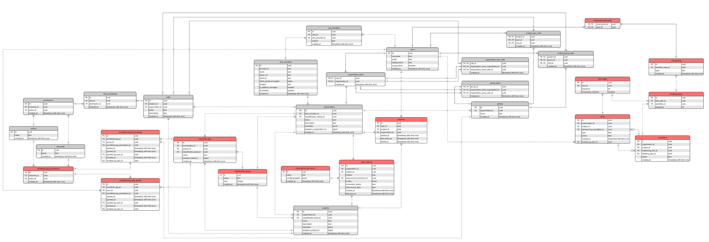

# Database Schema Reference

This document describes each table in the schema, what it is for, its key columns, and how it relates to other tables. Tables marked **non-MVP** appear in the diagram but should not be implemented yet.

**Conventions**

- All primary keys are `uuid` unless noted (join tables use composite PKs).
- Timestamps are `timestamptz`; `created_at` defaults to `now()`.
- `deeplynx_*` columns hold the numeric ID of the matching object in DeepLynx (external system), and are unique when present.
- FK names follow `fk_<table>_<column>`; index names follow `idx_` (non-unique) and `uq_` (unique).

---

## Entity relationship diagram

The diagram is the source of truth for how tables relate. The sections below describe each table's purpose, columns and constraints.

---

## Table of contents

- [Entity relationship diagram](#entity-relationship-diagram)
1. [Identity and tenancy](#1-identity-and-tenancy)
2. [RBAC](#2-rbac)
3. [Sensitivity and classification (non-MVP)](#3-sensitivity-and-classification-non-mvp)
4. [Data sources (non-MVP)](#4-data-sources-non-mvp)
5. [Sessions (non-MVP)](#5-sessions-non-mvp)
6. [Plans and workflows (non-MVP)](#6-plans-and-workflows-non-mvp)
7. [Design notes and open questions](#7-design-notes-and-open-questions)
8. [Planned additions](#8-planned-additions)

---

## 1. Identity and tenancy

### `oidc_providers`
**Purpose:** Registry of OpenID Connect identity providers that users can authenticate through. Each organization is tied to one provider.

| Column | Type | Notes |
|---|---|---|
| `id` | uuid | PK |
| `provider_id` | text | Human/URL-safe identifier; unique |
| `name` | text | Display name. Required |
| `issuer_url` | text | OIDC issuer (discovery base URL). Required |
| `client_id` | text | OAuth client ID. Required |
| `client_secret_encrypted` | bytea | Client secret, stored encrypted. Required |
| `scopes` | text | Requested scopes (e.g. space-separated) |
| `is_platform_managed` | boolean | True if operated by the platform rather than customer-supplied |
| `is_enabled` | boolean | Allows a provider to be disabled without deleting it |
| `created_at` | timestamptz | |

**Constraints:** unique `provider_id`.
**Referenced by:** `user_identities`, `organizations`.

### `users`
**Purpose:** A person known to the platform, independent of any organization or login provider.

| Column | Type | Notes |
|---|---|---|
| `id` | uuid | PK |
| `username` | text | Unique |
| `email` | text | Required, unique |
| `display_name` | text | |
| `is_sys_admin` | boolean | Platform-wide administrator flag. Required, default `false` |
| `created_at` | timestamptz | |

**Referenced by:** `user_identities`, `organization_users`, `project_user_roles`, and (non-MVP) grants, sessions, plans, workflows, approvals.

### `user_identities`
**Purpose:** Links a user to an account at an OIDC provider. One user may have identities at multiple providers.

| Column | Type | Notes |
|---|---|---|
| `id` | uuid | PK |
| `user_id` | uuid | FK → `users.id`. Required |
| `oidc_provider_id` | uuid | FK → `oidc_providers.id`. Required |
| `subject` | text | The OIDC `sub` claim at that provider |
| `created_at` | timestamptz | |

**Constraints:** unique `(oidc_provider_id, subject)`, so one external account maps to exactly one user. Index on `user_id`.

### `classification_levels` (NON-MVP; NOT YET IMPLEMENTED)
**Purpose:** Ordered set of data classification levels (e.g. Public < Internal < Restricted). `rank` provides the ordering for ceiling comparisons.

| Column | Type | Notes |
|---|---|---|
| `id` | uuid | PK |
| `name` | text | Required, unique |
| `rank` | integer | Required; higher means more sensitive |
| `created_at` | timestamptz | |

**Referenced by:** `organizations.classification_ceiling_id`, `projects.classification_level_id`, `sensitivity_tags`.

### `organizations`
**Purpose:** The top-level tenant. Owns projects, groups, users (via membership), and org-scoped roles.

| Column | Type | Notes |
|---|---|---|
| `id` | uuid | PK |
| `oidc_provider_id` | uuid | FK → `oidc_providers.id`. Required |
| `classification_ceiling_id` | uuid | FK → `classification_levels.id`. **Non-MVP, do not implement** (omit from MVP DDL) |
| `name` | text | Required |
| `description` | text | |
| `metadata` | jsonb | Free-form attributes |
| `deeplynx_organization_id` | bigint | Unique link to DeepLynx |
| `created_at` | timestamptz | |

### `organization_users`
**Purpose:** Membership join between users and organizations.

| Column | Type | Notes |
|---|---|---|
| `user_id` | uuid | FK → `users.id` |
| `organization_id` | uuid | FK → `organizations.id` |
| `created_at` | timestamptz | |

**Constraints:** composite PK `(user_id, organization_id)`. This composite key is the target for `group_users` and `organization_user_roles`, which guarantees those rows can only reference real members.

### `projects`
**Purpose:** A workspace within an organization. Project-scoped roles and data live here.

| Column | Type | Notes |
|---|---|---|
| `id` | uuid | PK |
| `organization_id` | uuid | FK → `organizations.id`. Required |
| `classification_level_id` | uuid | FK → `classification_levels.id`. **Non-MVP** (omit from MVP DDL) |
| `name` | text | Required; unique within an organization |
| `description` | text | |
| `metadata` | jsonb | |
| `deeplynx_project_id` | bigint | Unique link to DeepLynx |
| `created_at` | timestamptz | |

**Constraints:** unique `(organization_id, name)`, unique `deeplynx_project_id`.

### `groups`
**Purpose:** Named collections of organization members, used to grant roles to many users at once.

| Column | Type | Notes |
|---|---|---|
| `id` | uuid | PK |
| `organization_id` | uuid | FK → `organizations.id`. Required |
| `name` | text | Required; unique within an organization |
| `created_at` | timestamptz | |

### `group_users`
**Purpose:** Membership join between groups and organization members.

| Column | Type | Notes |
|---|---|---|
| `group_id` | uuid | FK → `groups.id` |
| `organization_users_organization_id` | uuid | Part of composite FK → `organization_users` |
| `organization_users_user_id` | uuid | Part of composite FK → `organization_users` |
| `created_at` | timestamptz | |

**Constraints:** composite PK of all three key columns. The index on `(organization_users_user_id, organization_users_organization_id)` supports "which groups is this user in?" lookups.

---

## 2. RBAC

A **permission** is a (resource, action) pair. A **role** is a named bundle of permissions, scoped to an organization or a project. Roles are **assigned** to users (at org or project level) or to groups (at project level).

### `resources`
**Purpose:** Catalog of things that can be protected (e.g. `project`, `data_source`, `workflow`).
Columns: `id`, `name` (required, unique), `created_at`.

### `actions`
**Purpose:** Catalog of operations (e.g. `read`, `create`, `update`, `delete`, `approve`).
Columns: `id`, `name` (required, unique), `created_at`.

### `permissions`
**Purpose:** The allowed combination of one resource and one action.

| Column | Type | Notes |
|---|---|---|
| `id` | uuid | PK |
| `resource_id` | uuid | FK → `resources.id` |
| `action_id` | uuid | FK → `actions.id` |
| `created_at` | timestamptz | |

**Constraints:** unique `(resource_id, action_id)`.

### `roles`
**Purpose:** A named set of permissions defined at organization scope or project scope.

| Column | Type | Notes |
|---|---|---|
| `id` | uuid | PK |
| `project_id` | uuid | FK → `projects.id`; set for project-scoped roles |
| `organization_id` | uuid | FK → `organizations.id`; set for org-scoped roles |
| `name` | text | Required |
| `description` | text | |
| `created_at` | timestamptz | |

**Constraints:** unique `(organization_id, project_id, name)`. See design note 1 on NULL handling.

### `role_permissions`
**Purpose:** Many-to-many join of roles and permissions.

| Column | Type | Notes |
|---|---|---|
| `id` | uuid | PK |
| `role_id` | uuid | FK → `roles.id` |
| `permission_id` | uuid | FK → `permissions.id` |
| `created_at` | timestamptz | |

**Constraints:** unique `(role_id, permission_id)`.

### `organization_user_roles`
**Purpose:** Assigns a role to an organization member.

Columns: `role_id` (FK → `roles.id`), `organization_users_organization_id` and `organization_users_user_id` (composite FK → `organization_users`), `created_at`. Composite PK across the three key columns.

### `project_user_roles`
**Purpose:** Assigns a role to a user within a specific project.

Columns: `project_id` (FK → `projects.id`), `user_id` (FK → `users.id`), `role_id` (FK → `roles.id`), `created_at`. Composite PK `(project_id, user_id, role_id)`; indexes on `user_id` and `role_id`.

### `project_group_roles`
**Purpose:** Assigns a role to a group within a specific project. Every member of the group inherits it.

Columns: `project_id` (FK → `projects.id`), `group_id` (FK → `groups.id`), `role_id` (FK → `roles.id`), `created_at`. Composite PK `(project_id, group_id, role_id)`; indexes on `group_id` and `role_id`.

---

## 3. Sensitivity and classification (non-MVP)

Fine-grained, tag-based access to sensitive data, layered on top of RBAC. Grants can be time-limited and are auditable. Nothing in this section is implemented yet.

### `sensitivity_tags` (NON-MVP; NOT YET IMPLEMENTED)
**Purpose:** A label applied to data, tied to a classification level. Scoped to an organization and/or project.

| Column | Type | Notes |
|---|---|---|
| `id` | uuid | PK |
| `organization_id` | uuid | FK → `organizations.id` |
| `project_id` | uuid | FK → `projects.id` |
| `classification_level_id` | uuid | FK → `classification_levels.id`. Required |
| `name` | text | Required |
| `deeplynx_label_id` | bigint | Unique link to a DeepLynx label |
| `created_at` | timestamptz | |

**Constraints:** unique `(organization_id, project_id, name)` (see design note 1 on NULLs), unique `deeplynx_label_id`. Indexes on `organization_id`, `project_id`, `classification_level_id`.

### `sensitivity_tag_permissions` (NON-MVP; NOT YET IMPLEMENTED)
**Purpose:** The (resource, action) combinations that can be granted against a tag. Parallels `permissions`.

| Column | Type | Notes |
|---|---|---|
| `id` | uuid | PK |
| `resource_id` | uuid | FK → `resources.id`. Required |
| `action_id` | uuid | FK → `actions.id`. Required |
| `created_at` | timestamptz | |

**Constraints:** unique `(resource_id, action_id)`. Index on `action_id`.

### `sensitivity_tag_group_grants` (NON-MVP; NOT YET IMPLEMENTED)
**Purpose:** Grants a group a tag permission, with an audit trail of who granted and revoked it.

| Column | Type | Notes |
|---|---|---|
| `id` | uuid | PK |
| `sensitivity_tag_id` | uuid | FK → `sensitivity_tags.id`. Required |
| `group_id` | uuid | FK → `groups.id`. Required |
| `sensitivity_tag_permission_id` | uuid | FK → `sensitivity_tag_permissions.id`. Required |
| `expires_at` | timestamptz | Optional expiry for time-limited grants |
| `granted_at` | timestamptz | |
| `granted_by_user_id` | uuid | FK → `users.id` |
| `revoked_at` | timestamptz | |
| `revoked_by_user_id` | uuid | FK → `users.id` |

**Constraints:** indexes on each FK column (`idx_stgg_*`). No unique constraint (see design note 6).

### `sensitivity_tag_user_grants` (NON-MVP; NOT YET IMPLEMENTED)
**Purpose:** Same as `sensitivity_tag_group_grants`, but granted directly to a user.

| Column | Type | Notes |
|---|---|---|
| `id` | uuid | PK |
| `sensitivity_tag_id` | uuid | FK → `sensitivity_tags.id`. Required |
| `user_id` | uuid | FK → `users.id`. Required |
| `sensitivity_tag_permission_id` | uuid | FK → `sensitivity_tag_permissions.id`. Required |
| `expires_at` | timestamptz | Optional expiry for time-limited grants |
| `granted_at` | timestamptz | |
| `granted_by_user_id` | uuid | FK → `users.id` |
| `revoked_at` | timestamptz | |
| `revoked_by_user_id` | uuid | FK → `users.id` |

**Constraints:** indexes on each FK column (`idx_stug_*`). No unique constraint (see design note 6).

---

## 4. Data sources (non-MVP)

### `data_source_connector` (NON-MVP; NOT YET IMPLEMENTED)
**Purpose:** Catalog of connector types (e.g. Postgres, S3).

| Column | Type | Notes |
|---|---|---|
| `id` | uuid | PK |
| `name` | text | Required, unique |
| `config_template` | jsonb | Describes the config a connector of this type expects |
| `created_at` | timestamptz | |

**Constraints:** unique `name`.

### `data_sources` (NON-MVP; NOT YET IMPLEMENTED)
**Purpose:** A configured instance of a connector inside a project.

| Column | Type | Notes |
|---|---|---|
| `id` | uuid | PK |
| `organization_id` | uuid | FK → `organizations.id`. Required |
| `project_id` | uuid | FK → `projects.id`. Required |
| `version` | text | |
| `data_source_connector_id` | uuid | FK → `data_source_connector.id`. Required |
| `config` | jsonb | Connection configuration. Required |
| `connection_status` | text | Required |
| `data_source_type` | text | Required |
| `created_at` | timestamptz | |
| `last_sync_at` | timestamptz | |

**Constraints:** indexes on `organization_id`, `project_id`, `data_source_connector_id`.

---

## 5. Sessions (non-MVP)

### `sessions` (NON-MVP; NOT YET IMPLEMENTED)
**Purpose:** Tracks a user's working session, optionally scoped to a project and/or organization.

| Column | Type | Notes |
|---|---|---|
| `id` | uuid | PK |
| `user_id` | uuid | FK → `users.id`. Required |
| `project_id` | uuid | FK → `projects.id` |
| `organization_id` | uuid | FK → `organizations.id` |
| `started_at` | timestamptz | |
| `ended_at` | timestamptz | |
| `last_active_at` | timestamptz | |

**Constraints:** indexes on `user_id`, `project_id`, `organization_id`.

---

## 6. Plans and workflows (non-MVP)

A **plan** is a proposed sequence of steps. A **workflow** is an execution of a plan. Plans can also be derived from a past workflow.

### `plans` (NON-MVP; NOT YET IMPLEMENTED)
**Purpose:** A proposed sequence of steps, scoped to an organization and/or project.

| Column | Type | Notes |
|---|---|---|
| `id` | uuid | PK |
| `organization_id` | uuid | FK → `organizations.id` |
| `project_id` | uuid | FK → `projects.id` |
| `derived_from_workflow_id` | uuid | FK → `workflows.id`; set when the plan is derived from a past workflow |
| `type` | text | Required |
| `status` | text | Required |
| `created_at` | timestamptz | |
| `created_by_user_id` | uuid | FK → `users.id` |

**Constraints:** indexes on each FK column.

### `plan_steps` (NON-MVP; NOT YET IMPLEMENTED)
**Purpose:** Ordered steps of a plan. (`planned_agent_id` has been removed.)

| Column | Type | Notes |
|---|---|---|
| `id` | uuid | PK |
| `plan_id` | uuid | FK → `plans.id`. Required |
| `sequence` | int | Position within the plan. Required |
| `checkpoint_required` | boolean | Whether execution pauses for review at this step. Required |

**Constraints:** unique `(plan_id, sequence)`.

### `workflows` (NON-MVP; NOT YET IMPLEMENTED)
**Purpose:** An execution instance of a plan.

| Column | Type | Notes |
|---|---|---|
| `id` | uuid | PK |
| `organization_id` | uuid | FK → `organizations.id` |
| `project_id` | uuid | FK → `projects.id` |
| `originating_plan_id` | uuid | FK → `plans.id` |
| `initiating_user_id` | uuid | FK → `users.id`. Required |
| `status` | text | |
| `created_at` | timestamptz | |

**Constraints:** indexes on each FK column.

### `workflow_steps` (NON-MVP; NOT YET IMPLEMENTED)
**Purpose:** Executed steps of a workflow, each tied to the plan step it realizes.

| Column | Type | Notes |
|---|---|---|
| `id` | uuid | PK |
| `plan_step_id` | uuid | FK → `plan_steps.id`. Required |
| `workflow_id` | uuid | FK → `workflows.id`. Required |
| `sequence` | int | Position within the workflow. Required |

**Constraints:** unique `(workflow_id, sequence)`. Index on `plan_step_id`.

### `checkpoints` (NON-MVP; NOT YET IMPLEMENTED)
**Purpose:** A pause point on a workflow step that requires review.

| Column | Type | Notes |
|---|---|---|
| `id` | uuid | PK |
| `workflow_step_id` | uuid | FK → `workflow_steps.id`. Required |
| `type` | text | Required |
| `created_at` | timestamptz | |

**Constraints:** index on `workflow_step_id`.

### `checkpoint_approvals` (NON-MVP; NOT YET IMPLEMENTED)
**Purpose:** One user's decision on a checkpoint.

| Column | Type | Notes |
|---|---|---|
| `id` | uuid | PK |
| `checkpoint_id` | uuid | FK → `checkpoints.id`. Required |
| `user_id` | uuid | FK → `users.id`. Required |
| `status` | text | Required |

**Constraints:** unique `(checkpoint_id, user_id)`. Index on `user_id`.

---

## 7. Design notes and open questions

1. **`roles` uniqueness and NULLs.** In Postgres, NULLs are distinct in unique indexes, so `uq_roles_scope_name` does not prevent duplicates, because one of the two scope columns is always NULL. Use two partial unique indexes: `(organization_id, name) WHERE project_id IS NULL` and `(project_id, name) WHERE organization_id IS NULL`. Also add a `CHECK` that exactly one of the two is set. The same issue applies to `sensitivity_tags`.
2. **Project roles vs. org membership.** `project_user_roles.user_id` references `users`, not `organization_users`, so a user could hold a project role without being an org member. Decide whether that is intended; if not, reference the org membership key (this needs `organization_id` on the table or a trigger).
3. **Role scope mismatch.** Nothing stops a project-scoped role from being assigned in a different project, or an org role in another org. Consider a composite FK or validation in the service layer.
4. **Scope nullability on non-MVP tables.** Several tables (`plans`, `workflows`, `sessions`, `sensitivity_tags`) allow both `organization_id` and `project_id` to be NULL. Add `CHECK` constraints if at least one is required.
5. **Delete behavior.** No `ON DELETE` rules are specified. Decide per FK (typically `CASCADE` for join tables, `RESTRICT` for tenancy parents).
6. **Grant uniqueness.** The sensitivity grant tables have no unique constraint, so duplicate active grants are possible. A partial unique index on active rows (`WHERE revoked_at IS NULL`) would help.
7. **Nullable fields and email case.** `oidc_providers.provider_id`, `is_platform_managed`, `is_enabled`, and `user_identities.subject` are nullable; consider `NOT NULL` (and defaults for the booleans). `email` uniqueness is case-sensitive unless you use `citext` or a lower-cased index.
8. **MVP DDL.** `classification_ceiling_id` and `classification_level_id` appear in the diagram, but their FK target is non-MVP, so omit those columns (and their indexes) in the MVP migration.

---
 
## 8. Planned additions
 
All tables in this section are non-MVP. They come in two groups, matching the colors in the diagram: DeepLynx-derived tables (blue) and optional agent-information tables (pink). Foreign key targets marked _(inferred)_ were not labeled in the diagram and should be confirmed.
 
### 8.1 DeepLynx-derived tables (blue)
 
These records originate in DeepLynx (DL) and are derived from Prometheus application activity. The Prometheus database may hold **reference copies** of these tables, along with their foreign keys and linking tables, so their relationships to other Prometheus tables are represented accurately.
 
**Storage rule:** Columns marked `DL` in the diagram (bold/italic, `DL` in the key column) live **only in DeepLynx**. They must **not** be created in the Prometheus database. In the tables below they are listed under "DL-only columns (not stored in Prometheus)" for documentation purposes only.
 
### `approvals` (NON-MVP; NOT YET IMPLEMENTED; DEEPLYNX-DERIVED)
**Purpose:** A reviewer's approval decision on agent activity. Authoritative record lives in DeepLynx.
 
| Column | Type | Notes |
|---|---|---|
| `id` | uuid | PK |
| `deeplynx_record_id` | bigint | Link to the DeepLynx record |
| `reviewer_id` | uuid | FK → `users.id` _(inferred)_ |
| `created_at` | timestamptz | |
 
**DL-only columns (not stored in Prometheus):** `auth_method` (text), `decision` (text), `decision_timestamp` (timestamptz).
 
### `agencies` (NON-MVP; NOT YET IMPLEMENTED; DEEPLYNX-DERIVED)
**Purpose:** A record of agency (an initiating user's delegation of work to agents). Authoritative record lives in DeepLynx.
 
| Column | Type | Notes |
|---|---|---|
| `id` | uuid | PK |
| `deeplynx_record_id` | bigint | Link to the DeepLynx record |
| `initiating_user_id` | uuid | FK → `users.id` _(inferred)_ |
| `created_at` | timestamptz | |
 
**DL-only columns:** none.
 
### `artifacts` (NON-MVP; NOT YET IMPLEMENTED; DEEPLYNX-DERIVED)
**Purpose:** An output or input item produced or consumed by agent activity, scoped to a project and organization.
 
| Column | Type | Notes |
|---|---|---|
| `id` | uuid | PK |
| `deeplynx_record_id` | bigint | Link to the DeepLynx record |
| `project_id` | uuid | FK → `projects.id` _(inferred)_ |
| `organization_id` | uuid | FK → `organizations.id` _(inferred)_ |
| `created_at` | timestamptz | |
 
**DL-only columns (not stored in Prometheus):** `type` (text), `cde_status` (text).
 
### `activities` (NON-MVP; NOT YET IMPLEMENTED; DEEPLYNX-DERIVED)
**Purpose:** A unit of agent work performed within a workflow step. Activities can nest through `parent_activity_id`.
 
| Column | Type | Notes |
|---|---|---|
| `id` | uuid | PK |
| `parent_activity_id` | uuid | FK → `activities.id` (self-reference) _(inferred)_ |
| `workflow_step_id` | uuid | FK → `workflow_steps.id` _(inferred)_ |
| `agent_id` | uuid | FK → `agents.id` _(inferred)_ |
| `deeplynx_record_id` | bigint | Link to the DeepLynx record |
| `created_at` | timestamptz | |
 
**DL-only columns (not stored in Prometheus):** `prompt_reference` (text), `tool_calls` (text), `execution_status` (text), `start_timestamp` (timestamptz), `end_timestamp` (timestamptz).
 
### 8.2 Optional agent-information tables (pink)
 
Additional tables to work into the schema when we want to store more information about agents. These are regular Prometheus tables (no DL-only columns). `activity_artifacts` is a linking table that supports the DeepLynx-derived tables above.
 
### `agents` (NON-MVP; NOT YET IMPLEMENTED; OPTIONAL)
**Purpose:** Registry of agents that perform activities.
 
| Column | Type | Notes |
|---|---|---|
| `id` | uuid | PK |
| `name` | text | |
| `version` | text | |
| `domain` | text | |
| `status` | text | |
| `owner` | text | |
| `card` | jsonb | Agent card / descriptor |
| `tools` | jsonb | Tools available to the agent |
| `created_at` | timestamptz | |
 
**Referenced by:** `activities.agent_id`, `encapsulation_guarantee.agent_id`.
 
### `encapsulation_guarantee` (NON-MVP; NOT YET IMPLEMENTED; OPTIONAL)
**Purpose:** Records a verification that an agent's behavior is properly encapsulated, and who verified it.
 
| Column | Type | Notes |
|---|---|---|
| `id` | uuid | PK |
| `agent_id` | uuid | FK → `agents.id` _(inferred)_ |
| `verification_method` | text | |
| `result` | text | |
| `verifying_user_id` | uuid | FK → `users.id` _(inferred)_ |
| `verified_at` | timestamptz | |
 
### `models` (NON-MVP; NOT YET IMPLEMENTED; OPTIONAL)
**Purpose:** Registry of models, including their VVUQ (verification, validation, and uncertainty quantification) status.
 
| Column | Type | Notes |
|---|---|---|
| `id` | uuid | PK |
| `version` | text | |
| `domain` | text | |
| `vvuq_status` | text | |
| `card` | jsonb | Model card / descriptor |
| `created_at` | timestamptz | |
 
**Referenced by:** `activity_artifacts.model_id`.
 
### `activity_artifacts` (NON-MVP; NOT YET IMPLEMENTED; OPTIONAL LINKING TABLE)
**Purpose:** Linking table that assists the DeepLynx-derived tables by relating models and artifacts, with a direction (e.g. input or output).
 
| Column | Type | Notes |
|---|---|---|
| `id` | uuid | PK |
| `activity_id` | uuid | FK → `activities.id` _(inferred)_ |
| `artifact_id` | uuid | FK → `artifacts.id` _(inferred)_ |
| `directionality` | text | Whether the artifact is an input to or output of the model/activity |
 
### 8.3 Open questions on these tables
 
1. **`approvals` vs. `checkpoint_approvals`.** Both record a user's decision. Clarify whether `approvals` replaces `checkpoint_approvals` or relates to it (e.g. via a checkpoint FK, which `approvals` currently lacks).
2. **`agencies` relationship.** It has no FK to `workflows`, `activities`, or `agents`. Confirm how it connects to the rest of the model.
3. **`approvals` scope.** There is no link from `approvals` to the thing being approved (an activity, checkpoint, or artifact).
4. **Reference-copy sync.** Decide how reference copies are kept consistent with DeepLynx (`deeplynx_record_id` should be unique per table once defined).
5. **Typing.** `agents.owner` and `agents.status` are free text; consider a FK to `users` for owner and an enum or check constraint for status. `activities.agent_id` should be nullable if activities can be human-performed.
 
### Template for further additions
 
### `table_name`
**Purpose:** _What it represents and why it exists._
 
| Column | Type | Notes |
|---|---|---|
| `id` | uuid | PK |
| | | |
 
**Constraints / indexes:** _..._
**Relationships:** _..._
**MVP status:** _MVP / non-MVP_