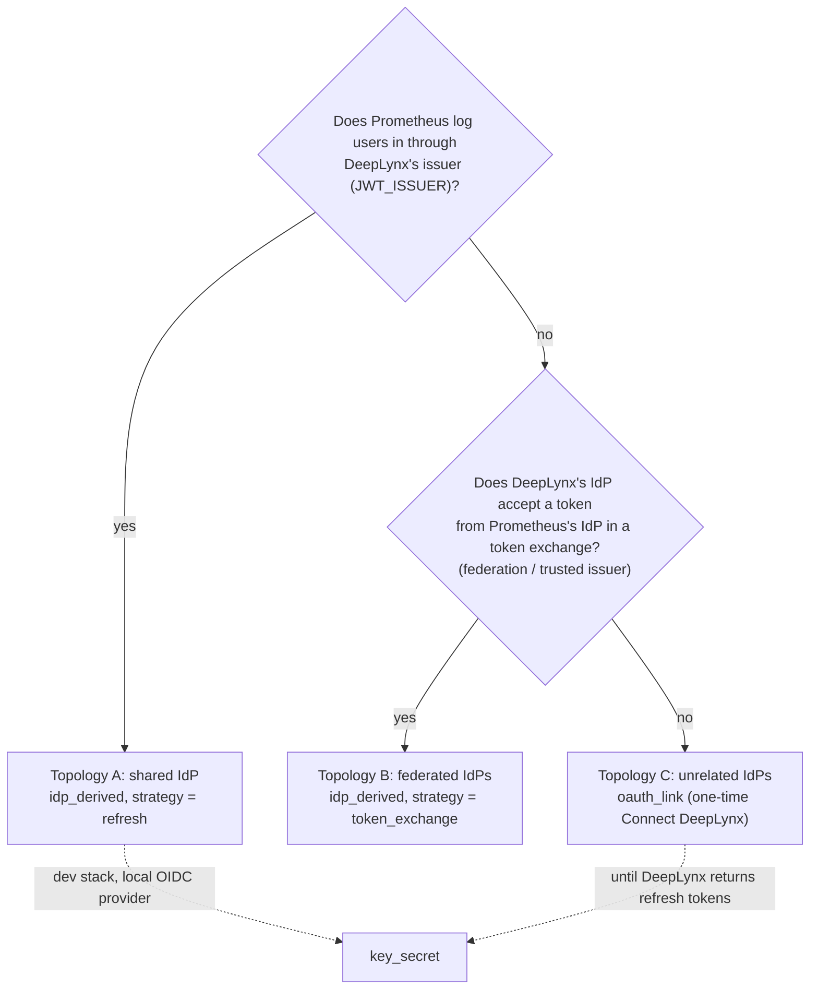
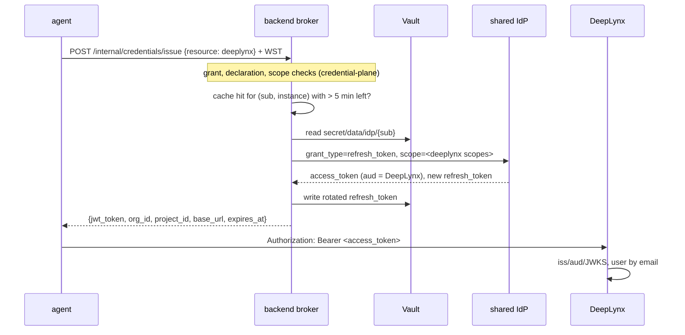
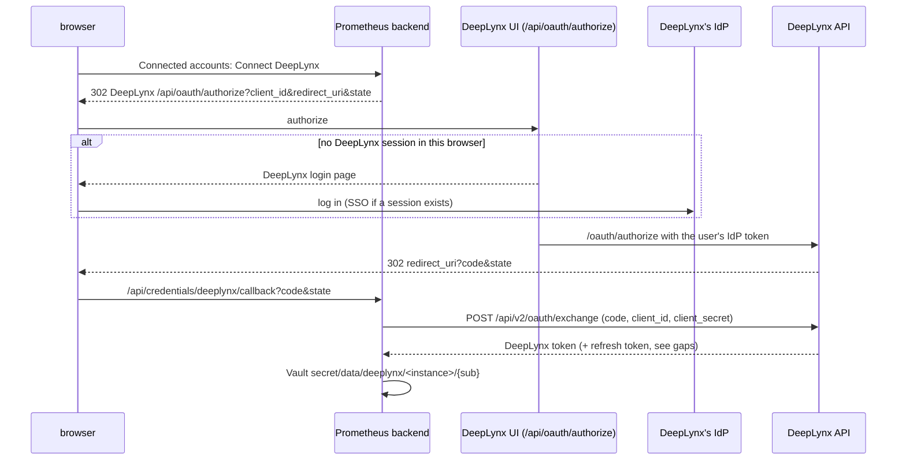

# DeepLynx User Credentials Without a Second Login

| | |
| --- | --- |
| **Status** | Design, not built. |
| **Builds on** | [Credential Plane for Agents](credential-plane.md) (PPLT-31). This document defines the `deeplynx` resource there: its `idp_derived` and `oauth_link` auth modes and how each one gets a DeepLynx token for a user. |
| **Related** | [ADR-003 Agent-Scoped Credentials][adr-003] § 2.6, [User Proof Chain](user-proof-chain.md) |
| **DeepLynx source** | `deeplynx.helpers/Middleware/NexusAuthenticationMiddleware.cs`, `deeplynx.business/TokenBusiness.cs`, `deeplynx.business/OauthHandshakeBusiness.cs`, `deeplynx.business/OauthDeviceAuthorizationBusiness.cs` |

Prometheus uses DeepLynx as its storage engine. Today every agent and the backend
reach DeepLynx with one shared service API key (`DEEPLYNX_KEY` / `DEEPLYNX_SECRET`).
Every read and write runs as that service account. DeepLynx sees no user, and its
project permissions don't apply.

Both systems log users in through OIDC. The goal is to give each Prometheus user a
DeepLynx credential **without a separate DeepLynx login wherever the deployment
allows it**, and with at most a one-time link where it doesn't.

Two kinds of deployment are in scope:

- **Shared IdP.** Prometheus and DeepLynx use the same OIDC provider (for example
  one Okta authorization server, or one Entra tenant).
- **Separate IdPs.** Prometheus and DeepLynx use different providers (for example
  Prometheus on one Okta or Entra tenant, DeepLynx on another).

Readers: the platform developer who builds the `deeplynx` resource in the broker,
and the operator who configures a DeepLynx service instance.

## What DeepLynx accepts

The DeepLynx API takes a bearer token (header, `?token=` query or `access_token`
cookie). `NexusAuthenticationMiddleware` routes on the JWT `alg` and `iss`:

| Token | DeepLynx validates | Who issues it |
| --- | --- | --- |
| HS256 | Signature with `JWT_SECRET_KEY`, `jti` present and not revoked in `OauthTokens`, `apiKey` claim still exists for the user | DeepLynx itself: `POST /oauth/tokens` (key + secret), `POST /api/v2/oauth/exchange` (auth code), `POST /oauth/token` (device code or refresh token) |
| RS256, `iss == JWT_ISSUER` | JWKS from the issuer's discovery document, `aud == JWT_AUDIENCE`, lifetime | The OIDC provider DeepLynx is configured for |
| RS256, Entra issuer | JWKS of that issuer, plus the issuer and audience checks of the next DeepLynx release | Entra |

After validation DeepLynx takes an email from the claims (`ClaimsEmailExtractor`:
nameidentifier, `email`, `preferred_username`, `upn`, ..., `sub` if it looks like an
email). It upserts the `Users` row **by email** and adds the user to the default
organization. DeepLynx has no separate "DeepLynx account" step: a token that it
accepts is a DeepLynx login.

Two facts follow from this:

1. Any access token from DeepLynx's own IdP, with DeepLynx's audience, works at
   DeepLynx. Prometheus doesn't need DeepLynx to mint anything.
2. DeepLynx identifies a user by email. Whatever path is used, the email that
   DeepLynx sees decides whose data and permissions apply.

## The design in one paragraph

The `deeplynx` service instance (an admin-defined row in `service_instances`) gets
one of three auth modes. In `idp_derived`, the backend broker uses the user's
stored Plane 1 refresh token to get an access token for DeepLynx's audience, from
the same IdP or through a federated token exchange. The user does nothing beyond
the Prometheus login. In `oauth_link`, the user clicks **Connect DeepLynx** once.
DeepLynx's own OAuth server runs the consent, and usually SSO makes this one click.
The broker keeps the DeepLynx refresh token in Vault. `key_secret` stays as the
interim and dev mode. In every mode, agents get only a short-lived DeepLynx token
from the broker ([Credential Plane](credential-plane.md) § Agent flow), never a
refresh token or an IdP token for another audience.

## Choosing the mode per deployment

| Topology | Example | Mode | User action | Needs a DeepLynx change? |
| --- | --- | --- | --- | --- |
| A. Shared IdP | Both on Okta auth server `https://idp.example/oauth2/aus123`, or both in one Entra tenant | `idp_derived` (`refresh`) | None | No |
| B. Federated IdPs | Prometheus on Entra tenant X, DeepLynx on Okta, and Okta trusts tenant X as a token-exchange issuer | `idp_derived` (`token_exchange`) | None | No (IdP configuration only) |
| C. Unrelated IdPs | Prometheus on Okta org 1, DeepLynx on Entra tenant Y, no trust between them | `oauth_link` | One click on **Connect DeepLynx**, then a DeepLynx login if the browser has no session there | Yes, for silent renewal: see [DeepLynx gaps](#deeplynx-gaps) |
| Dev | Local OIDC provider, DeepLynx with `DISABLE_BACKEND_AUTHENTICATION` | `key_secret` | Paste key and secret once | No |

The admin picks the mode when registering the instance. The broker never guesses
the topology at run time.

## Topology A: shared IdP

Prometheus and DeepLynx are two clients of one OIDC provider. The token Prometheus
needs is an ordinary access token for DeepLynx's API audience.

### Login (Plane 1)

At login the backend asks for the scopes that the `deeplynx` instance lists, plus
`offline_access`. The backend stores the refresh token in Vault at
`secret/data/idp/{sub}` ([Credential Plane](credential-plane.md) § Plane 1 token
retention). Today the OIDC callback
([`backend/app/security.py`](../../backend/app/security.py)) keeps only the
`id_token`, so this is the one change to the login path.

The `id_token` is never forwarded to DeepLynx. Its `aud` is Prometheus's client ID,
and DeepLynx rejects it.

### Issue

Per IdP:

- **Okta.** The audience belongs to the authorization server, not the client. The
  Prometheus client must use the **same custom authorization server** as DeepLynx
  (`JWT_ISSUER`, not the Okta org server). Then a refresh with DeepLynx's scopes
  returns a token that DeepLynx accepts. If the authorization server serves other
  APIs too, all of them accept that token. See
  [Security notes](#security-notes).
- **Entra.** A token is issued for one resource. The Entra refresh token is
  multi-resource, so the broker asks for `scope=api://<deeplynx-app-id>/.default`
  with the user's refresh token. The Prometheus app registration needs a delegated
  permission on the DeepLynx API, with admin consent. Entra's On-Behalf-Of grant
  does the same thing starting from an access token. The broker uses the refresh
  path, because it already holds the refresh token.

### Identity

Both sides see the same IdP account, so the email matches. DeepLynx normalizes
`@azuregov.inl.gov` to `@inl.gov`. The broker doesn't need to replicate that,
because it passes the IdP's token through unchanged.

## Topology B: federated IdPs

DeepLynx trusts only its own issuer, so a token from Prometheus's IdP can't be
used directly. Some IdP pairs can bridge this without user interaction. DeepLynx's
IdP is configured to accept the other IdP's tokens as a subject token in an RFC 8693
token exchange, and to issue its own access token for the DeepLynx audience in
return:

- Okta: token exchange with a trusted external issuer, on a custom authorization
  server.
- Entra: federated identity credentials or B2B guest accounts, which give a home
  tenant account a token for a resource tenant.
- Keycloak: external-to-internal token exchange with an identity-provider link.

The broker's issue path is topology A's with one more step:

1. Refresh the Plane 1 token at Prometheus's IdP (as in A), with the scope that the
   bridge expects as the subject token audience.
2. `POST <deeplynx-idp>/token` with
   `grant_type=urn:ietf:params:oauth:grant-type:token-exchange`,
   `subject_token=<step 1 token>`, `subject_token_type=...:access_token` (or
   `id_token`, where the bridge needs that), `audience=<JWT_AUDIENCE>`, and the
   broker's client credentials at DeepLynx's IdP.
3. Return the result as in A.

**The email must match.** DeepLynx keys users by email. The exchanged token has to
carry the same email that the user has at DeepLynx. If the two IdPs map users
differently (another domain, a guest UPN such as `alice_example.com#EXT#@...`), the
bridge has to map the claim, or DeepLynx creates a second, empty user. The admin
test of the instance ([Admin setup](#admin-setup)) checks this with the admin's own
account.

Whether B is available depends on the IdP product, license tier and policy of the
deployment, not on Prometheus or DeepLynx. If it isn't available, the deployment is
topology C.

## Topology C: unrelated IdPs

When the IdPs don't trust each other, no protocol lets Prometheus mint a DeepLynx
identity silently, and none should. Something has to establish that Prometheus
user `alice` is DeepLynx user `alice@...`, and only the user can vouch for that,
by logging in to DeepLynx once. The design makes that a **one-time link**, not a
login per session.

DeepLynx already is an OAuth 2.0 authorization server for registered applications
(`OauthApplication`: client ID, client secret hash, callback URL). The admin
registers Prometheus as a DeepLynx OAuth application once. The instance then uses
`oauth_link`:

After the link, the broker issues the same short-lived token shape as in A. If it
holds a DeepLynx refresh token, it renews through `POST /oauth/token`
(`grant_type=refresh_token`). The user sees **Linked as alice@...**, the DeepLynx
email from the token's `sub`, which the broker stores as `external_subject`. A
mismatch with the Prometheus email is shown, not blocked: in this topology the
DeepLynx account is the source of truth.

A **device-code** variant (`POST /oauth/device/code`, user enters the code at
`/oauth/device/verify`) works with no redirect URI. It already returns a refresh
token (30 days, access token 480 min). It is the fallback when the DeepLynx UI
can't redirect back to the Prometheus backend, for example across network zones.

## DeepLynx gaps

These are the DeepLynx changes that would make topology C as smooth as A. None of
them blocks topologies A or B.

| # | Gap | Effect on Prometheus | Proposed DeepLynx change |
| --- | --- | --- | --- |
| G1 | The authorization-code exchange (`/oauth/exchange`) returns only an access token (default 480 min), with no refresh token | The link expires after 8 h; the user has to click Connect again | Return a refresh token, as the device flow already does (`OauthRefreshTokens`) |
| G2 | Each exchange and each refresh runs `CreateApiKey`, so every renewal adds an API key row for the user | Per-user key rows grow without bound under a broker that renews hourly | Reuse one key per (user, application), or delete the previous key on refresh |
| G3 | `/oauth/exchange` takes `client_secret` in the query string | The secret lands in access logs on both sides | Accept form-encoded `POST` bodies (RFC 6749 § 2.3.1) |
| G4 | Only one non-Entra issuer (`JWT_ISSUER`) | A DeepLynx shared by deployments with different Okta servers can't use topology A for all of them | A list of trusted issuers, each with its audience |

Until G1 lands, `oauth_link` works but needs a reconnect every 8 h. The device flow
avoids that today. Until G2 lands, the broker caches a DeepLynx token per
(user, instance) until 5 minutes before expiry, so it renews at most every few
hours, not on every issue.

## Rejected: DeepLynx trusts Prometheus as an issuer

DeepLynx could accept Prometheus's own RS256 identity JWT
([`backend/app/identity.py`](../../backend/app/identity.py)) as a trusted issuer.
Topology C would then work without a link. This is rejected:

- Prometheus would become an identity provider for DeepLynx. A compromised
  Prometheus backend could act as any DeepLynx user, including users who never
  used Prometheus.
- The Prometheus `sub` is a username and not an email. DeepLynx would need a new
  identity mapping.
- It needs G4 and a DeepLynx change anyway, and it removes the user's own consent
  step that topology C relies on.

If a deployment explicitly wants it (one operator runs both systems and accepts
the trust), it can be a fourth mode later. Nothing in this design blocks it.

## Admin setup

The `deeplynx` service instance (`service_instances` +
`service_types.deeplynx`, see [Credential Plane](credential-plane.md) § Data model)
holds:

| Field | `idp_derived` / `refresh` | `idp_derived` / `token_exchange` | `oauth_link` | `key_secret` |
| --- | --- | --- | --- | --- |
| `base_uri` | yes | yes | yes | yes |
| `plane1_provider_id` (the Prometheus `OidcProvider` it derives from) | yes | yes | – | – |
| `scopes` (added to the Plane 1 login) | yes | yes (subject audience) | – | – |
| `token_endpoint`, `audience` | – | DeepLynx IdP's | – | – |
| `client_id`, `client_secret` | – | broker's client at DeepLynx's IdP | Prometheus's DeepLynx OAuth application | – |
| `ui_base_uri` (DeepLynx UI, for `/api/oauth/authorize`) | – | – | yes | – |
| Default `org_id`, `project_id` | yes | yes | yes | user-supplied |

**Test instance** (admin view): the backend runs the mode with the admin's own
account and calls `GET /api/v2/users/current`. It reports the issuer,
the audience and the email that DeepLynx resolved. This catches a wrong
authorization server (A), a claim-mapping mismatch (B) or a bad callback URL (C)
before users see it.

A user who logged in through a different Plane 1 provider than
`plane1_provider_id` can't use an `idp_derived` instance. The Connected accounts
view shows `Available when you sign in with <provider>`. A deployment can register
a second `oauth_link` instance for those users.

## Security notes

- **Audience isolation.** In topology A the agent receives an IdP access token. If
  the IdP authorization server serves several APIs with one audience (for example
  Okta's `api://default`), that token also works at those APIs. Each DeepLynx
  deployment should have its **own audience** (a dedicated Okta authorization server
  or an Entra app ID URI). The admin test warns when `audience` matches a well-known
  shared default.
- **Agents never get refresh tokens** or Plane 1 tokens. They get a DeepLynx-audience
  access token of at most the IdP's lifetime (typically 60 min), or a DeepLynx HS256
  token that the broker requests with `expiration` ≤ 60 min, for one operation.
- **Revocation.** Logout and unlink delete the Vault entry and revoke the upstream
  refresh token (the IdP's `revocation_endpoint`; DeepLynx
  `DELETE /api/v2/oauth/tokens/revoke` for DeepLynx-issued tokens). An IdP account that is
  disabled fails the next refresh, so derived DeepLynx access ends within one token
  lifetime.
- **DeepLynx permissions apply.** The user gets what DeepLynx grants their email.
  The WST `bindings` ([Credential Plane](credential-plane.md) § WST) narrow it to one
  project per run but can't widen it.

## Rollout

Each step is mergeable on its own; the service-key path keeps working until the
last step.

| Step | Area | What | Depends on |
| --- | --- | --- | --- |
| 1 | backend | Plane 1 token retention: request `offline_access` + instance scopes, store the refresh token in Vault, revoke on logout | PPLT-31 step 2 (Vault, tables) |
| 2 | backend | `deeplynx` issuer for `idp_derived` / `refresh`, with the per-(user, instance) token cache and the admin test | 1 |
| 3 | sdk | `ConnectionConfig.from_credential` already passes `jwt_token` through as an opaque bearer, so an RS256 IdP token works unchanged. Add: on a 401, `AsyncStorageClient` asks the broker again, instead of calling `/oauth/tokens` | PPLT-31 step 1 |
| 4 | platform | The first agent on the broker for DeepLynx (PPLT-31 step 4), behind `DEEPLYNX_USER_CREDENTIALS=1` | 2, 3 |
| 5 | backend | `oauth_link` for DeepLynx: the callback route, the Connect button, the device-code fallback | PPLT-31 step 3 (views) |
| 6 | backend | `idp_derived` / `token_exchange` | 2, and a deployment that needs it |
| 7 | platform | Backend DeepLynx calls (`uri_resolver.py`, uploads, mesh service) use the user's credential; remove the shared service key from agents | 4, and [open question 4](#open-questions) |

## Open questions

| # | Question | Who decides | Blocks |
| --- | --- | --- | --- |
| 1 | What are `JWT_ISSUER` and `JWT_AUDIENCE` for each target DeepLynx deployment, and which Plane 1 provider does each Prometheus deployment use? That decides A, B or C per deployment. Is the DeepLynx audience dedicated, or a shared default such as `api://default`? | Deployment owners | Step 2 per deployment |
| 2 | Will the DeepLynx team take G1-G4? G1 and G2 decide whether `oauth_link` uses the redirect flow or the device flow. | DeepLynx team | Step 5 |
| 3 | For topology B: which IdP pairs do the real deployments have, and does their tier or policy allow token exchange from an external issuer? | IdP admins | Step 6 |
| 4 | When a user hasn't linked DeepLynx (C, or a different Plane 1 provider), does an agent fall back to the shared service key, or fail with `not_linked`? The same question applies to the backend's own DeepLynx calls (viewer resolution of `deeplynx://` URIs written by another user's agent). | Platform Technical Lead | Step 7 |
| 5 | DeepLynx keys users by email. In B and C, if the DeepLynx email differs from the Prometheus email, is that allowed (C shows it), or must it match? | ADR-003 owner | Steps 5, 6 |
| 6 | What does the next DeepLynx release change in token validation beyond the Entra issuer and audience fix? Does it support several issuers (G4)? | DeepLynx team | Topology A for a shared DeepLynx |
| 7 | One Prometheus deployment against several DeepLynx instances, each with its own topology: is that a real case? The design supports it (one instance row each) but the UI assumes one DeepLynx. | Product | UI only |

[adr-003]: https://nstinl.atlassian-us-gov-mod.net/wiki/spaces/Prometheus/pages/34866140
