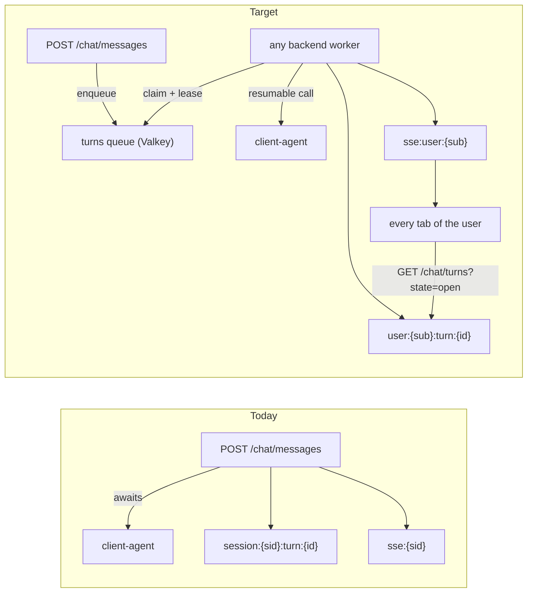

# Durable Turns: Waiting Turns Survive Logout, Reload and Restart

| | |
| --- | --- |
| **Status** | Design, not built. Proposed 2026-11-26. |
| **Approver** | Daniel Schwen |
| **Related** | PR #382 (frontend turn delivery, prerequisite), #381 (backend turn delivery), [background-tasks.md](../dev-docs/background-tasks.md), [`backend/CONTRACT.md`](../../backend/CONTRACT.md) ("Delivery", `GET /api/chat/turns/{turn_id}`) |

A chat turn or a background task belongs to a **user and a conversation**, not to a
browser session or a backend process. Logging out by accident, closing the laptop,
rebooting for an OS update or restarting the stack must not lose a turn the user is
waiting on. After any of these, reconnecting is all it takes: the client asks where
each open turn stands and shows the result when it is ready, without the user doing
anything.

## 1. Problem

Turn delivery (#381, #382) settles a turn once, from its POST reply or its `turn_done`
event, and looks the turn up after a dropped POST or a stream reconnect. That covers a
proxy dropping a long request, or the event stream reconnecting. It does not cover the
cases where the session or the process goes away, because all of the waiting state is
keyed by the login session (`sid`), and the turn itself runs inside the HTTP request.

| State | Where it lives today | Logout | Host reboot, backend restart |
| --- | --- | --- | --- |
| A turn's state and result | `session:{sid}:turn:{turn_id}` (Valkey; running = 60 s lease, done = 1 h) | Kept, but unreachable: the next login has a new `sid`. Expires after 1 h | The lease runs out within 60 s and the lookup answers 404 |
| Background tasks being awaited | `session:{sid}:awaited` (Valkey set) | **Deleted** by `SessionStore.drop()` | Kept |
| Live events (`status`, `turn_done`, `task_done`) | pub/sub channel `sse:{sid}` | Published to a channel nobody listens to | Lost while nobody is connected (pub/sub has no history) |
| The turn's work | The backend's `POST /api/chat/messages` handler awaits the client-agent | Keeps running and writes the transcript | **Killed** with the backend worker; the result has nowhere to go |
| A backgrounded turn's work | `_BACKGROUND_TASKS`, an in-process set in the client-agent | Keeps running | **Killed** with the client-agent |
| What the tab is waiting on | Frontend memory (`turns` map, `awaitedTaskIds`) | `chatStore.clear()` ends every wait | Lost on reload |

Valkey itself is durable: `docker-compose.yml` runs it with `--appendonly yes` on the
`valkey-data` volume, so its keys survive a host reboot. The gaps are the keys it is
told to use, and the processes that hold the work.

### What the user sees today

- **Accidental logout mid-turn, log back in:** the reply reaches the transcript (the
  client-agent writes it), but the tab stopped waiting. The user sees the question
  with no answer until they reopen the conversation. A background task's completion is
  never announced.
- **Reload mid-turn:** the same, plus the transcript only shows the reply if it was
  written before the reload's resume.
- **Backend restart or host reboot mid-turn:** the turn dies. After a minute its lookup
  answers 404 and the tab shows "Error communicating with agent". The client-agent may
  have finished the work, but the result is not delivered.
- **Away longer than an hour:** a finished turn's stored result has expired.

## 2. Goals and non-goals

**Goals**

- A turn or task the user is waiting on survives logout and re-login, a reload, a
  closed tab, a backend or client-agent restart, and a host reboot.
- Every tab and every login of the same user sees the same open turns.
- After a restart, a running turn either continues where it was or ends visibly as
  "interrupted", with a retry. It never silently disappears.
- No tool or specialist agent call runs twice because of a restart.
- No polling: delivery stays event-driven, with one lookup on (re)connect.

**Non-goals (first version)**

- Moving a turn between users, or sharing it with another user.
- Surviving the loss of the Valkey volume itself. That is a backup question.
- Cancelling a turn on the server. Stop stays client-side (Decision D) until a cancel
  endpoint exists.

## 3. Principle: the user and the conversation own the turn

Three changes follow from it:

1. **Key by user.** Turn state, awaited tasks and event delivery move from `sid` to the
   user (`sub`). The session keeps only what is really per-login: the conversation the
   tab has bound, the profile, the bind ordering.
2. **The server holds the truth.** The frontend's `turns` map and `awaitedTaskIds` are
   a cache rebuilt from the server on every login, reload and reconnect. Logout drops
   the cache, not the turns.
3. **Run the work outside the request.** The HTTP request starts a turn and may wait
   for it, but the turn is owned by a durable runner that any worker can resume.

## 4. Design

### 4.1 Turn state keyed by user (step 1)

- A turn is stored at `user:{sub}:turn:{turn_id}`:
  `{state, conversation_id, started_at, response?}`. `state` is `running`, `done` or
  `interrupted`.
- `user:{sub}:turns` is a sorted set of the user's turns that are not yet read, scored
  by start time. A turn leaves it once a client has read its result, or after the
  retention period.
- **Retention:** a finished turn is kept for 7 days (configurable), not 1 h. A turn is
  small: the response body without inline artifact bytes. Large inline `json_body`
  payloads should go by reference first (the review panel's AGENT-5 on #382).
- `GET /api/chat/turns/{turn_id}` checks that the turn belongs to the caller's user,
  not to the same session. Another user's turn still reads 404.
- New: `GET /api/chat/turns?state=open` lists the caller's running turns and the
  finished turns nobody has read, with their `conversation_id`. This is what a client
  rebuilds its state from.
- New: `POST /api/chat/turns/{turn_id}/ack` marks a result read, so it leaves the open
  list. Settling a turn from the POST reply or `turn_done` sends the ack.
- `SessionStore.drop()` on logout no longer touches turns.
- The 409 for a reused `turn_id` stays, now scoped to the user.

### 4.2 Events delivered by user (step 2)

- `turn_done`, `task_done` and `task_progress` are published on `sse:user:{sub}`, so
  every tab and every login of that user receives them. `status` events can stay
  per-session or move too; moving them lets a second tab show progress.
- `/api/events` subscribes to the user channel as well as the session channel.
- The awaited-task set moves from `session:{sid}:awaited` to `user:{sub}:awaited`, so
  logout no longer deletes it. `claim_task`'s exactly-once `SREM` works the same on the
  new key.
- Pub/sub keeps no history, so nothing published while no tab was connected is lost
  only if the client looks the turn up on connect. That is step 4's open-turns read.

### 4.3 Turns run outside the request (step 3)

Today the backend's POST handler awaits the client-agent call, so a worker that exits
takes the turn with it, and `_BACKGROUND_TASKS` in the client-agent does the same for a
backgrounded turn.

- `POST /api/chat/messages` writes the turn (`running`) and pushes it onto a Valkey
  stream, `turns:queue`. It then waits for the result as it does today, so a normal turn
  still answers in its POST reply, but the waiting request owns nothing.
- Any backend worker claims queued turns with `XREADGROUP`, renews a lease while it
  runs the turn, and on finish stores the result, publishes `turn_done` and
  acknowledges the stream entry.
- A worker that dies stops renewing. Another worker reclaims the entry with
  `XAUTOCLAIM` once the lease has run out.
- **No work runs twice.** A reclaimed turn reattaches to the client-agent's A2A task
  by its task id (`tasks/get`, `tasks/resubscribe`) instead of sending the message
  again. That needs LiteLLM to pass those methods through: the same prerequisite as
  background tasks Phase 2b ([background-tasks.md](../dev-docs/background-tasks.md),
  "LiteLLM passthrough is the long-pole"). The client-agent's side then needs its
  durable task store (`RedisTaskStore`) and a durable watcher in place of
  `_BACKGROUND_TASKS`.
- **Until reattach exists:** a reclaimed turn is marked `interrupted`, not run again.
  The client shows "This reply was interrupted by a restart" with a **Retry** button
  that sends the same query as a new turn. That is an honest failure instead of a
  silent 404, and it ships without the LiteLLM work.
- The runner mints the user's token for the agent call (`identity.mint_for_user(sub)`)
  itself, so it doesn't depend on the request's cookie.
- **Graceful shutdown:** on SIGTERM a worker stops claiming and gives running turns a
  grace period (uvicorn `--timeout-graceful-shutdown`). Turns still running at the end
  stay `running` and are reclaimed by the next worker.

### 4.4 The frontend rebuilds from the server (step 4)

PR #382 gives the store the right shape: a map from conversation id to its awaited
turn. This step fills that map from the server instead of only from local sends.

- On bootstrap (login, reload) and on every event-stream (re)connect, the store reads
  `GET /api/chat/turns?state=open`:
  - a `running` turn goes into `turns` under its `conversation_id`;
  - a `done` turn is settled at once (applied if its conversation is on screen, else
    the history list refreshes), then acked;
  - an `interrupted` turn shows the interrupted notice with Retry.
- Awaited background tasks are rebuilt the same way, from the user's awaited set.
- `suspendForReauth()` and `clear()` (logout) stop ending waits. They drop the tab's
  cache; the next bootstrap rebuilds it. This removes `endAllWaits()` from #382.
- The per-turn lookup after a failed POST and the bounded re-checks stay as they are.

### 4.5 Visible across conversations (step 5)

- The history sidebar marks a conversation that has an open turn or task, from the
  open-turns read. That replaces `agent:status:{id}`, which expires after 900 s and so
  hides a long turn.
- A turn that finishes in a conversation that isn't on screen shows a small notice:
  "Reply ready in *conversation title*", which opens it.

### 4.6 Operations (step 6)

- `docker-compose.yml` already gives `backend`, `client-agent`, `redis` and the
  frontends `restart: unless-stopped`, so they come back after a host reboot. Check
  that the system-test and production deployments do the same.
- Set uvicorn's graceful-shutdown timeout in `backend/docker-entrypoint.sh`, and give the
  containers a matching `stop_grace_period`.
- Valkey already persists (`appendonly yes` on a volume). Note in the ops docs that
  the volume holds users' open turns, so it must not be wiped casually.

## 5. Implementation plan

Each step lands on `devel` on its own, stays under ~300 changed lines plus tests, and
leaves the platform working. Steps 1, 2 and 4 together fix logout and reload. Step 3 is
what fixes restarts.

| Step | Scope | Fixes | Depends on |
| --- | --- | --- | --- |
| 1 | Backend: turn state under `user:{sub}`, open-turns list, ack, longer retention; logout leaves turns alone | Turn results reachable after re-login, for days | #382 merged |
| 2 | Backend: `turn_done`/`task_*` on `sse:user:{sub}`; awaited tasks per user | Events reach every tab and every login | 1 |
| 3a | Backend: mark a turn `interrupted` when its lease runs out without a result; frontend shows it with Retry | Restarts end visibly instead of as a 404 | 1 |
| 4 | Frontend: rebuild `turns` and awaited tasks from the open-turns read; logout and re-auth stop ending waits | Logout, reload, closed tab | 1, 2 |
| 5 | Frontend: sidebar marks and "reply ready" notice from open turns | Long turns visible across conversations | 4 |
| 6 | Ops: graceful shutdown; restart policies checked in every deployment | A stopping worker finishes or hands off its turns | none |
| 3b | Backend: turn queue and runner (`XREADGROUP`, `XAUTOCLAIM`, lease) | A worker restart doesn't end the turn | 1, 3a |
| 3c | Reattach to the client-agent's task on reclaim; client-agent durable watcher | A reclaimed turn continues, no work runs twice | 3b, LiteLLM `tasks/get`/`tasks/resubscribe` passthrough, background tasks Phase 2b |
| 7 | E2E tests on the system-test stack (section 6) | Guards all of the above | per scenario |

Step 6 can land at any time. Step 3a is a small, useful stopgap until 3b and 3c.

## 6. Test plan

E2E scenarios on the system-test stack, each with a real chat turn and with a
backgrounded task. Pass means the reply or the task result appears without the user
doing anything, exactly once:

1. Log out mid-turn, log back in.
2. Reload mid-turn; close the tab mid-turn and open a new one.
3. Two tabs on the same user: the turn sent in one shows its reply in both.
4. Restart the backend mid-turn (3a: shows interrupted with Retry; 3b/3c: the reply arrives).
5. Restart the client-agent mid-background-task.
6. Restart the whole stack (`make down`, `make up`) mid-turn.
7. Come back after the old 1 h result TTL: the reply still shows.

Unit tests cover the store's rebuild from the open-turns read, ack after settle, and
the backend's ownership check across sessions of one user.

## 7. Open questions

1. **Retention:** is 7 days right for unread results, and should a read result be kept
   for a while longer for a second tab?
2. **Status events:** per session or per user? Per user shows progress in every tab,
   at the cost of more traffic.
3. **Logout as an intent:** a deliberate logout on a shared machine might mean "stop
   everything". Is a separate "sign out and cancel my running work" needed once a
   server-side cancel exists?
4. **Concurrent turns in one conversation from two tabs:** the frontend allows one turn
   per conversation per tab. Should the backend enforce one running turn per
   conversation, now that it can see them all?
5. **Interrupted turns that had side effects:** before reattach (3c), Retry runs the
   query again. Should Retry warn when the interrupted turn had already called a
   specialist agent?
