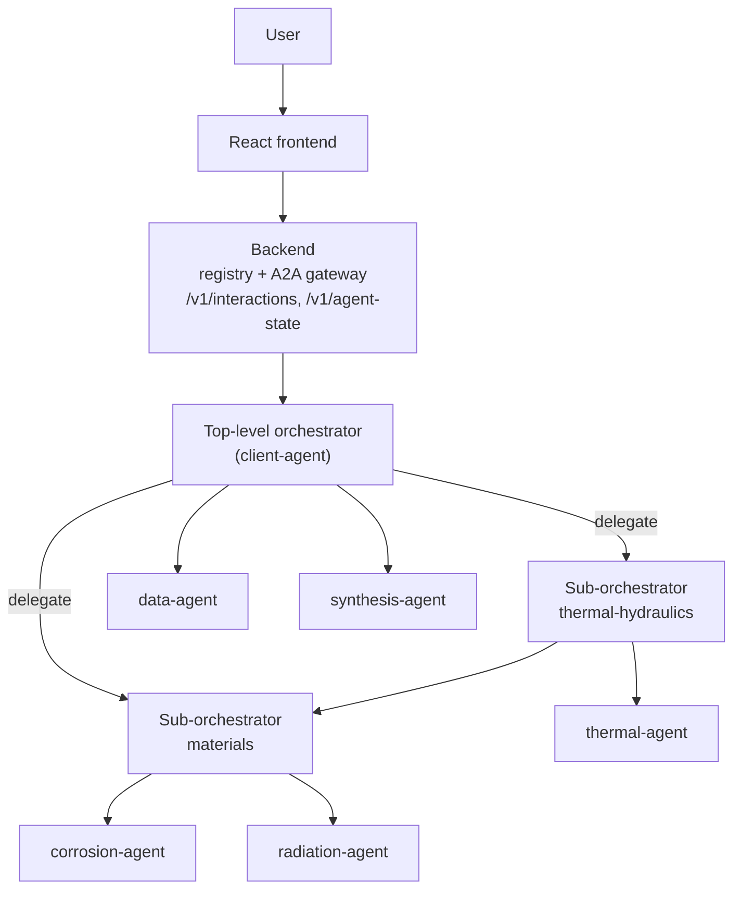
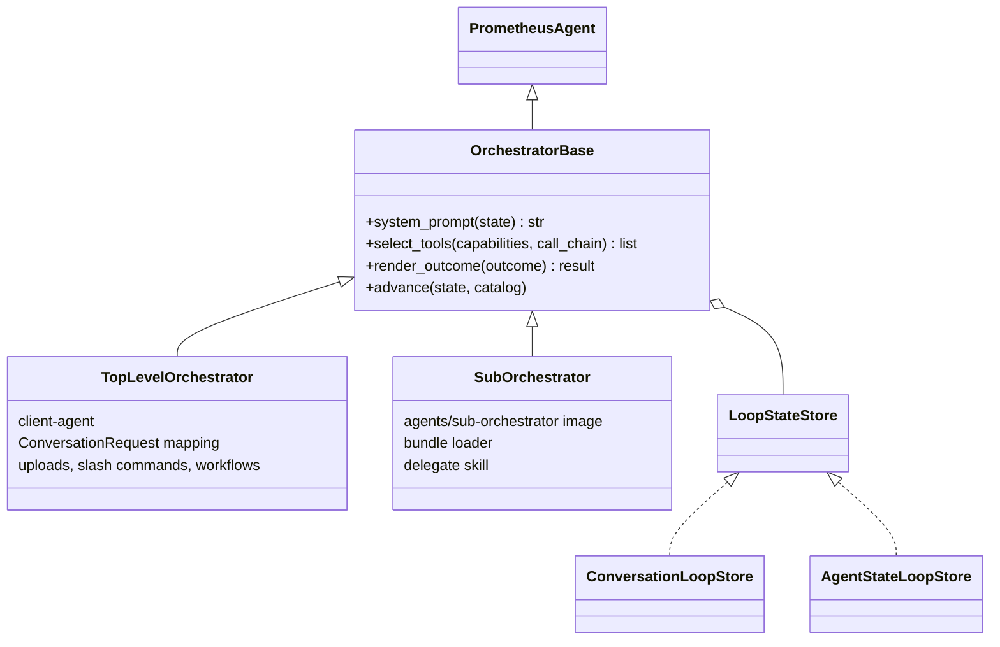
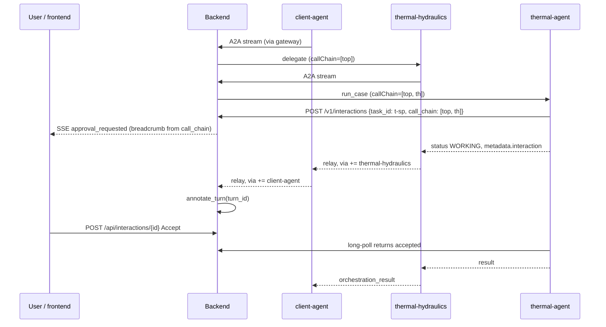
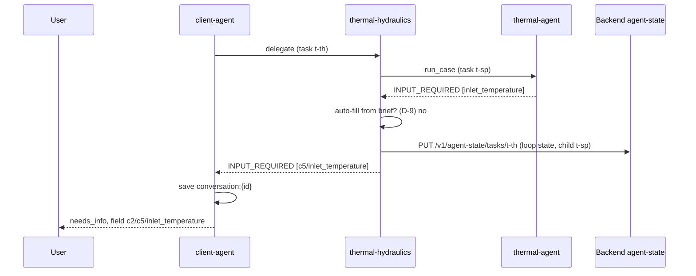
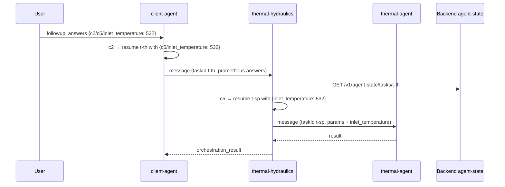

# Hierarchical Orchestration: Sub-Orchestrators as Agents

| | |
| --- | --- |
| **Status** | Design, not built. Proposed 2026-11-18. |
| **Approver** | Daniel Schwen |
| **Jira** | Not yet filed. Tasks are listed in [section 13](#13-implementation-plan). |
| **Related** | [Mid-Execution User Approval](user-approval.md) (the approval record that this design carries across levels), [Request-Scoped Agent Objects and Backend Task State](request-scoped-agent.md) (the per-task state store that sub-orchestrators use), [agent-loop-orchestration.md](../docs/dev-docs/agent-loop-orchestration.md) (today's loop) |
| **Depends on** | The user-approval build (PPLT-390 to PPLT-395) and the agent-state API with its SDK client (branches `feat/agent-state-api`, `feat/agent-state-sdk-client`, `feat/agent-state-sdk-context`). None of these is merged to `devel` yet. |

Today the platform has a single orchestrator, the client-agent. It sees every
specialist skill as one flat list of tools. This document proposes
**sub-orchestrators**: agents that run the same tool-calling loop but have a
domain-specific agent card, a system prompt carrying specialist knowledge, and a
curated set of agents they may call. Each one registers like any other agent, so
any orchestrator can call it, and the nesting can go to any depth.

The hard parts are not the loop itself. They are:

1. **Context going down.** What a parent tells a child, and what it leaves out.
2. **Pauses going up and answers coming back down.** A specialist three levels
   down can pause for a form (`INPUT_REQUIRED`) or for an approval. The user must
   see that request with its origin, and the answer must arrive at exactly the
   paused agent, with the right parameters, through every level in between.

Readers: SDK, client-agent, backend and frontend developers, and authors of
sub-orchestrator bundles.

## 1. Problem today

- **The orchestration code belongs to the client-agent alone.** The loop
  (`agents/client-agent/orchestrator/agent_loop.py`), skill dispatch
  (`orchestrator/skills.py`, `tool_discovery.call_a2a_agent`) and Task Graph
  tracking (`orchestrator/task_tracking.py`) are generic. They are tangled
  with code that only makes sense at the top level: the `ConversationRequest`
  mapping in `chat_flow.chat`/`_respond`, uploads, slash commands, workflow
  endpoints, title generation, background detach, and the conversation
  ownership check.
- **One flat tool list does not scale.** Each new specialist adds tools to the one
  prompt. Domain knowledge (which code to run first, which assumptions are
  standard for a given reactor type) has nowhere to live except the single,
  general system prompt (`prompts/orchestrator_system.txt`).
- **Pause state is keyed by conversation.** It lives in `conversation:{id}`
  (`conversation_store.py`). Two instances of the same sub-orchestrator in one
  conversation, or the same orchestrator at two depths, would overwrite each
  other.
- **Form answers are routed by field name only.** `apply_answers`
  (`agent_loop.py:717`) and `_form_questions` (`agent_loop.py:1155`)
  deliberately merge questions by name: "one field answers all calls sharing
  it". Across levels this goes wrong. Two different thermal runs that each ask
  for `inlet_temperature` get the same answer, without the user knowing they
  were two questions.
- **Nothing links the levels.** Task Graph nesting uses a process-local
  `ContextVar` (`task_tracking._nested_parent`, line 113) that never crosses A2A.
  Each agent's DeepLynx execution record (`prometheus-execution:{producer}:{task_id}`)
  has no parent. A specialist cannot tell who called it.
- **There is no guard against cycles.** The client-agent hides only itself from
  its tool list (`tool_discovery.is_self_agent`, line 88). An orchestrator that
  can call orchestrators could loop.
- **The approval relay exists in one place and covers streaming calls only.**
  The client-agent forwards a specialist's `metadata.interaction` pause event
  (`orchestrator/skills.py`, `_interaction_callback`), but only when the skill
  streams. An intermediate agent has no SDK helper to forward it further up.

## 2. Goals and non-goals

**Goals**

- G-1. The generic loop lives in the SDK as a base class, and the client-agent
  becomes one subclass of it.
- G-2. A new domain orchestrator is configuration only (a card, a prompt and an
  agent allowlist) and needs no new Python.
- G-3. Hierarchies of any depth, with no cycles.
- G-4. `INPUT_REQUIRED` from any depth reaches the user as one form that shows
  where each question came from. Each answer reaches exactly the agent that
  asked, on its original A2A task.
- G-5. Approvals from any depth reach the user as one card that shows the path
  the request took. The answer reaches the waiting agent directly, and no level
  in between asks again.
- G-6. Every level is traceable: its Task Graph node and its DeepLynx execution
  record point to the caller's.

**Non-goals (first version)**

- Propagating an LLM-turn or token budget, or a wall-clock deadline (see
  [section 12](#12-open-questions)).
- Moving the client-agent's own state from `conversation:{id}` to the agent-state
  API ([request-scoped Q-4](request-scoped-agent.md#11-open-questions)).
- Changing how specialists are written. A specialist that works today works
  unchanged as a leaf.
- Running sub-orchestrators in parallel inside one parent turn beyond what the
  loop's existing batch execution already does.

## 3. Decisions (2026-11-18)

| # | Decision | Rationale |
| --- | --- | --- |
| D-1 | **One generic sub-orchestrator image configured by a bundle.** A bundle is `agent_card.json` + `system_prompt.md` + `agents.yaml` (allowlist). Each bundle is one registered agent (its own container or replica). | A new domain needs no code; the hard logic is tested once. |
| D-2 | **Any depth, with two guards: a call chain in A2A metadata and a maximum depth (default 4).** An orchestrator refuses, and hides from its tools, any agent already in the chain; past the maximum depth, only leaf specialists stay callable. | Allows real DAG-shaped domain structure while ruling out loops and runaway nesting. |
| D-3 | **The top level sees sub-orchestrators and general agents; domain specialists are hidden by card tags.** | Stops the top level from bypassing the domain expert, while general agents (data, synthesis) stay one hop away. |
| D-4 | **Approvals bubble up to the user as the same approval card, with a breadcrumb.** Levels in between never ask again. | One decision per action; the user sees who is asking and why. |
| D-5 | **Context down is a structured brief plus artifact references, not a transcript.** A child that needs more asks back up with `request_context`. | Keeps each level's prompt focused on its specialty; nothing leaks that the parent didn't pass on deliberately. |
| D-6 | **A sub-orchestrator's own `requires_approval` pause is an in-flight `request_user_approval`**, not a final `INPUT_REQUIRED`. | No state to persist; reuses the approval card and record as they are. |
| D-7 | **Answers route down by path-prefixed question ids** (`c2/c5/inlet_temperature`). | Deterministic, no name clashes, no new backend store. |
| D-8 | **The orchestrator base class lives in the SDK** (`prometheus_api.orchestration`). | Reusable by any agent, including outside the platform (for example `bim_agent`). |
| D-9 | **A level in between may fill a child's missing inputs only from what it already holds** (its brief, its own earlier results, artifacts), recorded as `inputSource=context`. It never fills inputs marked user-only and never invents a value; everything else goes up unchanged. | Fewer interruptions without hiding guesses from the user. |
| D-10 | **A sub-orchestrator's paused loop state lives in the backend agent-state API, keyed by its own A2A `taskId`.** | Agents never touch Valkey ([request-scoped RS-5](request-scoped-agent.md#2-decisions-2026-11-06)); state is owner-checked and versioned; it survives a restart. |

## 4. Architecture



Every arrow is an A2A call through the backend gateway (`/a2a/{agent_name}`), as
today. A sub-orchestrator is just an agent whose card is tagged as an
orchestrator. `TH → MAT` shows one domain using another, which D-2 allows as long
as there is no cycle.

### 4.1 Layering



- **`prometheus_api.orchestration.OrchestratorBase(PrometheusAgent)`** holds:
  - the tool catalog (`build_tool_catalog`, `_skill_spec`);
  - the loop and its pause/resume state machine (`advance`, `_drive_batch`,
    `_refresh_status`, `_settle_skill_item`, `apply_answers`, `apply_reply`);
  - skill dispatch (`invoke_skill`, `call_a2a_agent`);
  - Task Graph tracking;
  - the relay that forwards a child's interaction event upward
    ([section 8](#8-approvals-across-levels));
  - call-chain handling ([section 6](#6-call-chain-metadata)).
- **Hooks for subclasses:**
  - `system_prompt(state)`: the prompt template, rendered with the artifact
    catalog and recent skill inputs (today's `_system_prompt`, `agent_loop.py:496`).
  - `select_tools(capabilities, call_chain)`: filtering for visibility, cycles
    and depth ([section 5.2](#52-visibility-and-allowlists)).
  - `LoopStateStore`: where paused state lives.
  - `render_outcome(outcome)`: how a finished, paused or failed loop is
    returned to the caller.
- **`TopLevelOrchestrator`** is the client-agent. It keeps:
  - the `ConversationRequest` ↔ loop mapping (`chat_flow.chat`, `_respond`);
  - the `conversation:{id}` store (`ConversationLoopStore`);
  - uploads, workflow endpoints, slash commands and titles;
  - background detach and the ownership check.
  Its `render_outcome` produces `needs_info`, `plan_ready`, `completed`, `answer`
  and `error`.
- **`SubOrchestrator`** is the new `agents/sub-orchestrator` image. It:
  - loads one bundle at startup;
  - exposes a single `delegate` skill;
  - stores paused state through `AgentStateLoopStore`
    (`/v1/agent-state/tasks/{task_id}`);
  - turns its outcome into A2A: a result artifact on completion, a final
    `INPUT_REQUIRED` on a form pause, and a failed task on error.

The loop is shared code; only where it gets its input and where it sends its
output differ between the two subclasses.

## 5. Sub-orchestrator bundles and cards

### 5.1 Bundle

A bundle is a directory, mounted read-only and named by `ORCHESTRATOR_BUNDLE`:

```
bundles/thermal-hydraulics/
  agent_card.json      # name, description, tags, the delegate skill
  system_prompt.md     # domain knowledge; may use {artifact_catalog}, {recent_skill_inputs}, {brief}
  agents.yaml          # what this orchestrator may call
```

```yaml
# agents.yaml
allow:
  agents: [thermal-agent, materials-orchestrator]
  skills: [data-agent/query_properties]      # one skill of an otherwise hidden agent
  tags: ["scope:thermal-hydraulics"]          # everything tagged with this scope
deny:
  skills: [thermal-agent/debug_dump]
model: medium                                 # semantic flavor for the loop
max_llm_turns: 12
```

Without a mounted bundle the image starts, reports itself healthy and **does not
register**, so the service can ship before any bundle exists.

### 5.2 Visibility and allowlists

Card tags (in the skill or agent `tags` the registry already stores):

| Tag | Meaning |
| --- | --- |
| `prometheus:orchestrator` | This agent is an orchestrator. The call-chain and depth guards apply to it. |
| `scope:<domain>` | The agent belongs to a domain. Only an orchestrator whose `agents.yaml` allows that scope (or the agent by name) sees it. |
| `scope:general` | Visible to every orchestrator, the top level included (data, synthesis). |

Rules applied by `select_tools`:

1. An agent with no `scope:` tag is visible everywhere. This keeps today's
   behaviour until specialists are tagged.
2. The top level (client-agent) sees agents without a scope, `scope:general`,
   and orchestrators.
3. A sub-orchestrator sees exactly its allowlist, minus its denylist.
4. Remove every agent already in the call chain (no cycles), and the
   orchestrator itself (replacing today's `is_self_agent`).
5. If `len(call_chain) + 1 >= MAX_ORCHESTRATION_DEPTH` (default 4), remove
   every `prometheus:orchestrator` agent, so only leaves remain.

The allowlist is applied when the catalog is built **and checked again at
dispatch**, so a tool call the model invents for a skill outside the catalog
fails with a tool error rather than reaching the agent.

### 5.3 The `delegate` skill

Each sub-orchestrator card declares one skill, `delegate`, whose `inputSchema`
is the brief ([section 7.1](#71-the-brief)). The card's `description` and the
skill's `usage_notes` are what the parent's LLM reads to decide when to delegate,
so they describe the domain and say when **not** to delegate. The card declares
`capabilities.streaming: true`. That is required, because the approval relay
only exists on streaming calls.

## 6. Call-chain metadata

Each A2A message an orchestrator sends carries the chain of callers in message
metadata:

```json
{
  "prometheus.callChain": [
    {"agent": "client-agent", "skill": null, "task_id": "t-top", "call_id": "c2"},
    {"agent": "thermal-hydraulics", "skill": "delegate", "task_id": "t-th", "call_id": "c5"}
  ]
}
```

- **Who appends:** the dispatching orchestrator appends its own entry (its name,
  the skill it is running, its own A2A task id, and the call id it gave this
  tool call) to the chain it received, then sends the result.
- **Who reads:**
  - `select_tools`, for the cycle and depth rules;
  - `request_user_approval`, which copies the chain into the interaction record
    for the breadcrumb ([section 8](#8-approvals-across-levels));
  - the SDK's execution-record code, which sets `parent_execution` to the
    caller's `prometheus-execution:{agent}:{task_id}`;
  - Task Graph tracking, which sets the parent node across the A2A boundary
    (replacing the process-local `_nested_parent` link for remote calls).
- **Specialists** receive the chain and ignore it, except for the execution
  record and approvals, which are both handled in the base class.
- **Identity:** the user's JWT (`USER_TOKEN_METADATA_KEY`) is forwarded unchanged
  at every hop, as the client-agent already does. Each level verifies it and checks
  conversation ownership in `PrometheusAgent`, as every agent does today.
- **`contextId`** is the conversation id at every level. The conversation's
  artifact catalog is shared, so an `artifact_id` means the same thing at every
  depth.

## 7. Context down, results up

### 7.1 The brief

The parent's LLM fills the `delegate` input:

```json
{
  "objective": "Peak clad temperature for the HTGR core at 105% power",
  "constraints": ["Use RELAP5-3D", "Report in SI units"],
  "known_facts": {"coolant": "helium", "inlet_temperature_K": 532},
  "artifact_ids": ["a-mesh-17", "a-props-3"],
  "success_criteria": "Single value with uncertainty, plus the input deck as an artifact"
}
```

- `objective` is required; the rest is optional.
- `known_facts` is the only channel through which the parent passes values it
  already holds. An intermediate level fills its children's inputs from these
  values (D-9).
- `artifact_ids` names the artifacts relevant to the task. The child's prompt
  artifact summary lists these plus anything the child itself produces, not the
  whole conversation catalog. The child can still resolve any artifact in the
  conversation by id, which the existing catalog lookup already allows.
- **What is not passed down:** the parent's transcript, its other tool results,
  and the user's chat history.

### 7.2 Asking back up: `request_context`

A sub-orchestrator's loop has a `request_context(question, fields)` tool in place
of the top level's `ask_user`. It ends the child's turn with a final
`INPUT_REQUIRED` whose missing inputs have `kind: "question"`. The parent handles
it like any other `INPUT_REQUIRED` ([section 9](#9-input_required-up-and-down)):

1. It answers from what it already holds, if it can (D-9).
2. Otherwise it passes the question up.

At the top level, a question that has bubbled all the way up becomes a form field,
just like `ask_user`. The top level keeps `ask_user`, because there the user is
the next hop.

### 7.3 The result

A finished `delegate` call returns one JSON artifact (`json_type:
"orchestration_result"`):

```json
{
  "summary": "Peak clad temperature 1243 K ± 18 K at 105% power.",
  "artifact_ids": ["a-deck-22", "a-plot-23"],
  "assumptions": ["Bypass flow 10% (standard for prismatic HTGR)"],
  "decisions": [{"what": "Skipped mesh refinement", "why": "user declined approval"}]
}
```

The parent's LLM sees this as an ordinary tool result. `assumptions` and
`decisions` are listed so that a guess made deep down is visible at the top, and
the top level's final answer can repeat it to the user.

## 8. Approvals across levels

The approval record from [user-approval](user-approval.md) already has the right
shape for nesting:

- It is keyed by the **innermost** agent's `task_id`.
- The innermost agent's coroutine stays alive while it waits.
- The backend delivers the answer directly to that agent (by long-poll), not back
  down the chain.

So the answer never travels down through the levels in between. What still has
to work is the request going **up**.



Changes:

1. **The relay moves into the SDK base.** `OrchestratorBase` forwards every
   child `metadata.interaction` status upward as its own non-final WORKING
   status, adding itself to a `via` list. This generalises today's
   `_interaction_callback` in `orchestrator/skills.py`. The top level still
   reports the relay to the backend, which calls `annotate_turn` (once, as today)
   so the card is placed under the right turn.
2. **The breadcrumb comes from the record, not the relay.**
   `request_user_approval` copies `prometheus.callChain` into a new
   `call_chain` field on the interaction record. The backend includes it in
   `approval_requested`, and the card shows it as a breadcrumb: *client-agent ›
   thermal-hydraulics › thermal-agent · run_case*. The card has the full path
   even when an intermediate relay is missing (for example a non-streaming hop).
3. **A sub-orchestrator's own `requires_approval` pause** (today the
   `plan_ready` status at the top level) becomes an in-flight
   `request_user_approval` inside the sub-orchestrator's loop (D-6). The message
   lists the planned calls and their arguments. Accept continues the batch;
   Decline, expiry or cancellation becomes a `{"status": "rejected", "reason":
   ...}` tool result in that loop, and its LLM decides what to do next. The top
   level keeps `plan_ready`, because there the user is the next hop.
4. **Streams must stay open.** Each hop is held open by the 15-second heartbeats
   ([user-approval §4.1](user-approval.md#41-flow)). Every hop's HTTP timeout must
   be per read, not per call, and above the interaction's maximum timeout (1 h).
   This is user-approval Q-1, now multiplied by depth. The depth-3 integration
   test ([section 13](#13-implementation-plan), step 10) must pause longer than
   the longest per-hop timeout.
5. **Levels in between do not ask again.** An orchestrator never creates a
   second approval for an action its child is already asking about. The "one
   pending approval per task" guard in the backend applies per level, so the
   levels do not interfere with each other.

## 9. INPUT_REQUIRED up and down

`INPUT_REQUIRED` is a **final** state. The asking agent's turn ends, and it is
resumed later on the same A2A `taskId` with the answers merged into its
parameters (`_a2a_resume_fields`, `agent_loop.py:892`). Every level in between
ends its own turn too, saves its state, and is resumed the same way. The answer
travels down hop by hop, guided by the question id.

### 9.1 Question ids

- Each tool call in a loop has a **call id** that is short, stable, and unique
  within its `pending_calls` (`c1`, `c2`, …). It is assigned when the call is
  recorded and kept in saved state.
- A leaf's `MissingInput` gets a new `id` field. It defaults to `name`, so
  specialists do not change.
- On the way up, each orchestrator prefixes every question id from a child with
  that child's call id: `inlet_temperature` → `c5/inlet_temperature` (at
  thermal-hydraulics) → `c2/c5/inlet_temperature` (at the top level).
- Each question also carries an `origin` list, built the same way (agent and
  skill at each level). The form uses it for a breadcrumb. When the chain is too
  long to show, the form groups questions by their origin.

### 9.2 Going up



At each orchestrator, when one or more children return `INPUT_REQUIRED`:

1. **Fill what it can, from what it holds.** For each missing input not marked
   user-only, look in `known_facts`, earlier tool results and artifacts (D-9;
   this generalises today's `resolvable_from_context` auto-fill in
   `_settle_skill_item`). If every input is filled, resume the child at once,
   as today.
2. **Wait for the rest of the batch.** Calls still running in the same batch
   finish first, so the user gets one form per turn, not one per child.
3. **Collect.** Build one list from every blocked call (`needs_args`,
   `waiting_input`, `request_context` questions), with prefixed ids and origins.
4. **Save.** Store the loop state (transcript, `pending_calls` with each child's
   `a2a_task_id` and `a2a_context_id`, call ids, brief) under the orchestrator's
   **own** `taskId` (D-10).
5. **End the turn** with a final `INPUT_REQUIRED` carrying the list
   (`build_input_required_payload`, with `id` and `origin` added).

The top level does steps 1–4 the same way, except that it stores state in
`conversation:{id}` and returns `needs_info` with one question per prefixed id
(`_form_questions`). Questions are no longer merged by bare name across calls.
The form may still pre-fill a field from an answer to an earlier field with the
same name, as a convenience, but each one is submitted separately.

### 9.3 Coming down



At each orchestrator, on a resume:

1. **Load** state by the incoming `taskId`. If it is missing, fail the task
   (see [section 10](#10-failure-and-restart)).
2. **Split** each answer id at its first `/`: the call id and the rest.
3. **Apply** the answers to the matching calls:
   - **A child orchestrator** (rest still contains `/`): pass the rest under
     `prometheus.answers` in message metadata, on the child's `taskId` and
     `contextId`.
   - **A leaf** (rest is a bare name): merge the answer into the call's
     arguments by name, exactly as `apply_answers` does today for
     `waiting_input`, and resume on the leaf's `taskId`.
   - **The orchestrator's own `needs_args` or `request_context` call**: fill it
     locally.
4. **Partial answers** resume only the calls whose questions are all answered.
   The others stay blocked, and the next `INPUT_REQUIRED` from this level lists
   only what is still missing.
5. **Continue** the loop (`advance`) with the resumed calls marked `resume`.

Leaves receive their answers merged into the parameters, as today, so no
specialist changes. Only orchestrators read `prometheus.answers`.

### 9.4 Rejection and free text

- **Reply in text instead of the form.** The top level handles this as today
  (`apply_reply`): it answers `ask_user` and closes every other open call as
  `not_executed`. Closing a call that points to a child orchestrator also sends
  `tasks/cancel` on that child's `taskId`, and the child deletes its saved
  state. Until `tasks/cancel` exists ([request-scoped follow-ups](request-scoped-agent.md#12-implementation-plan)),
  the child's state expires by its TTL instead.
- **Plan rejected at the top level.** `reject_pending` closes the calls, with
  the same cascade.

## 10. Failure and restart

| Event | Behaviour |
| --- | --- |
| A level restarts while waiting on `INPUT_REQUIRED` | Nothing is lost: its state is in the agent-state API (or `conversation:{id}` at the top level) and the resume carries its `taskId`. |
| A level restarts while a child waits on an approval | The stream is lost. The backend's gateway cancels the pending interaction (existing behaviour, [user-approval §7](user-approval.md#7-restart-behaviour)). The parent sees a failed call, and its LLM can retry. |
| Resume reaches a level whose state is gone (TTL, deleted) | The level fails the task with `state_missing`. Its parent marks the call failed with that reason, and its LLM re-plans (usually by delegating again with the same brief). |
| Version conflict on save (409) | The level reloads, applies its change again, and retries once; then fails the task. Only one resume per task should be in flight, so this signals a bug. |
| A child returns a call id the parent doesn't know | The parent discards that answer and logs it. The user sees the field again on the next form. |

## 11. Security

- **Identity at every level.** Each level verifies the user JWT and checks
  conversation ownership in `PrometheusAgent`, as every agent does today. An
  orchestrator gains no rights from being called by another orchestrator.
- **State is owner-checked.** The agent-state API checks user, agent and
  conversation on every read and write
  ([request-scoped §6.3](request-scoped-agent.md#63-authorization)). One
  orchestrator cannot read another's state.
- **Filling inputs is limited.** A level in between never fills an input marked
  user-only (a new `MissingInput.user_only` flag, false by default), and every
  value it fills is recorded as `inputSource=context`. That value is listed in
  the leaf's execution record and in the result's `assumptions`.
- **Allowlists are enforced twice:** when the catalog is built and at dispatch.
- **Approvals are attributed to the innermost agent.** The breadcrumb is
  informational; the record's agent and task are what the backend checks.
- **Bounded depth and no cycles.** These guard against runaway cost and against
  a prompt-injected brief making orchestrators call each other forever.

## 12. Open questions

| # | Question | Proposed answer |
| --- | --- | --- |
| Q-1 | Propagate a remaining LLM-turn or token budget down the chain? | Not in the first version. Revisit once the depth-3 debug setup shows real costs. A budget would go into `prometheus.callChain` as `budget_remaining`. |
| Q-2 | Propagate an absolute deadline, so an inner approval's timeout is capped below the outer stream's? | Not in the first version. Per-read timeouts plus heartbeats make it unnecessary unless a hop has a total-duration limit (see [section 8](#8-approvals-across-levels), item 4). |
| Q-3 | Should the client-agent move its state onto the agent-state API too? | Open, as in request-scoped Q-4. `LoopStateStore` makes it a later swap. |
| Q-4 | Should a parent's LLM see that a child is waiting on an approval? | No, as in user-approval Q-2. It sees a long-running call. |
| Q-5 | Nested progress: should a child's status updates appear under the parent's Task Graph node? | Yes, once the call chain gives Task Graph a parent across A2A. The display is a frontend follow-up. |
| Q-6 | Reload a bundle without a restart? | No. A bundle change is a redeploy; the card is registered at startup. |
| Q-7 | Can workflow templates call sub-orchestrators? | Yes, without changes: a workflow step names a skill, and `delegate` is a skill. Prefixed question ids apply to workflow steps too (the step id acts as the call id). |

## 13. Implementation plan

Each step stays under about 300 changed lines (not counting tests, lockfiles and
fixtures), merges to `devel` on its own and leaves the build green. The new
behaviour stays inactive until step 8 ships an image and a bundle is mounted.
Expand → migrate → contract applies to the loop move (steps 4–6).

| # | Step | Where | Depends on | Details |
| --- | --- | --- | --- | --- |
| 1 | **Call chain.** `CallChainEntry` model and `prometheus.callChain` constants in the SDK. The client-agent appends its entry on every dispatch (`call_a2a_agent`). `PrometheusAgent` reads the chain and writes `parent_execution` into its DeepLynx execution record. | sdk, client-agent | – | Unit tests: chain appended once per hop, parent execution set, an empty chain is the same as today. Base-image bump in its own PR. |
| 2 | **Question ids at the top level.** Stable call ids in `pending_calls`; `MissingInput.id` (defaulting to `name`) and `user_only`. `_form_questions` and `apply_answers` key by `{call_id}/{field}`; questions are no longer merged across calls. The frontend form submits by id. | sdk, client-agent, frontend | 1 | Fixes today's name clash on its own. Tests: two calls asking for the same field get separate answers; old conversations with no call ids get them assigned on load. |
| 3 | **Approval breadcrumb.** `request_user_approval` copies the chain into the create body; the backend stores `call_chain` on the record and includes it in `approval_requested`, `GET /api/interactions` and `CONTRACT.md`; the card renders the breadcrumb. | sdk, backend, frontend | 1, user-approval build merged | The field is optional, so older agents are unaffected. |
| 4a | **Expand: loop state store.** In the SDK, create `prometheus_api.orchestration` with the `LoopStateStore` protocol, `InMemoryLoopStore` and the state types (`pending_calls`, call statuses). No callers. | sdk | 2 | Pure addition. |
| 4b | **Expand: catalog and dispatch.** Copy `build_tool_catalog`, `_skill_spec`, `invoke_skill`, `call_a2a_agent` and the capability cache into `prometheus_api.orchestration`, with `select_tools` as a hook. No callers. | sdk | 4a | Mechanical copy plus the hook; tests move with the code. |
| 4c | **Expand: loop.** Copy `advance`, `_drive_batch`, `_refresh_status`, `_settle_skill_item`, `apply_answers`, `apply_reply`, `approve_pending`, `reject_pending` and Task Graph tracking into `OrchestratorBase`, using `LoopStateStore`, `system_prompt` and `render_outcome`. Include the generic interaction relay. No callers. | sdk | 4b | May split further per module to stay under 300 lines. |
| 5 | **Migrate the client-agent.** Base-image bump. `OrchestratorAgent` becomes `TopLevelOrchestrator(OrchestratorBase)` with `ConversationLoopStore` (`conversation:{id}`); `chat_flow` calls into the base. | client-agent | 4c | Behaviour unchanged: the existing client-agent tests must pass unmodified, apart from import paths. |
| 6 | **Contract.** Delete the client-agent's copies of the moved modules and their now-duplicate tests. | client-agent | 5 | Only deletions. |
| 7a | **A2A pause/resume in the base.** `render_outcome` for agent mode: prefixed question ids and origins on the way up; split answers by call id and forward `prometheus.answers` on the way down; partial resume. | sdk | 6 | Tests with fake children: depth-2 and depth-3 routing, partial answers, an unknown call id. |
| 7b | **Agent-state store and in-flight approval.** `AgentStateLoopStore` on the SDK's backend task-state client; `requires_approval` in agent mode through `request_user_approval`; Decline becomes a rejected tool result; `request_context` tool; filling inputs from the brief (D-9). | sdk | 7a, agent-state API merged | Tests: state saved and loaded by `taskId`, 409 retry, `state_missing`, user-only inputs never filled. |
| 8 | **Sub-orchestrator image.** `agents/sub-orchestrator`: Dockerfile, compose file with healthcheck, bundle loader (`ORCHESTRATOR_BUNDLE`), `delegate` skill and brief schema, result artifact. Does not register without a bundle. | agents | 7b | `tests/infrastructure/test_healthchecks.py` covers the healthcheck. |
| 9 | **Visibility.** `scope:` and `prometheus:orchestrator` tags; `agents.yaml` allow and deny lists; cycle and depth guards in `select_tools`; `MAX_ORCHESTRATION_DEPTH`; check at dispatch. The top level's `select_tools` applies rule 2. | sdk, client-agent | 8 | Until specialists are tagged, nothing is hidden (rule 1). |
| 10 | **Depth-3 debug setup and end-to-end test.** Two debug bundles (`debug-outer` → `debug-inner`) and a `nested-input-debug` agent that asks for an input and then an approval. Playwright test: form with breadcrumb, answer routed to the leaf, approval card with breadcrumb, Accept and Decline, a pause longer than the longest per-hop timeout. Included with `DEBUG_AGENTS=true`. | agents/debug-agents, frontend e2e | 9 | Settles user-approval Q-1 at depth. |
| 11 | **First domain bundle.** For example thermal-hydraulics: card, prompt, allowlist; tag the specialists it owns with `scope:thermal-hydraulics`. | agents | 10 | Domain-owner review of the system prompt. |
| 12 | **Docs.** Agent-author guide section "Writing a sub-orchestrator bundle"; update `agent-loop-orchestration.md`, the root and platform `CLAUDE.md`, and this document's status. | docs, sdk/docs | 11 | – |

```mermaid
flowchart LR
  S1["1 Call chain"] --> S2["2 Question ids"]
  S1 --> S3["3 Approval breadcrumb"]
  S2 --> S4a["4a Loop store"]
  S4a --> S4b["4b Catalog + dispatch"]
  S4b --> S4c["4c Loop"]
  S4c --> S5["5 Migrate client-agent"]
  S5 --> S6["6 Delete old modules"]
  S6 --> S7a["7a A2A pause/resume"]
  S7a --> S7b["7b Agent-state + approval"]
  S7b --> S8["8 Sub-orchestrator image"]
  S8 --> S9["9 Visibility"]
  S9 --> S10["10 Depth-3 e2e"]
  S3 --> S10
  S10 --> S11["11 First domain bundle"]
  S11 --> S12["12 Docs"]
```



Steps 1–3 are useful on their own:

- step 1 links execution records;
- step 2 fixes today's answer clash;
- step 3 improves approval attribution.

They can merge before the refactor starts. Steps 4a–6 are a pure refactor with
no change in behaviour. Every SDK change reaches the agents only through a
base-image bump (`PROMETHEUS_API_BASE_IMAGE_HASH`), which is its own small PR
after the SDK change is published.
