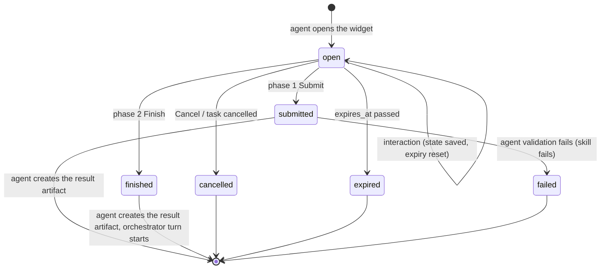
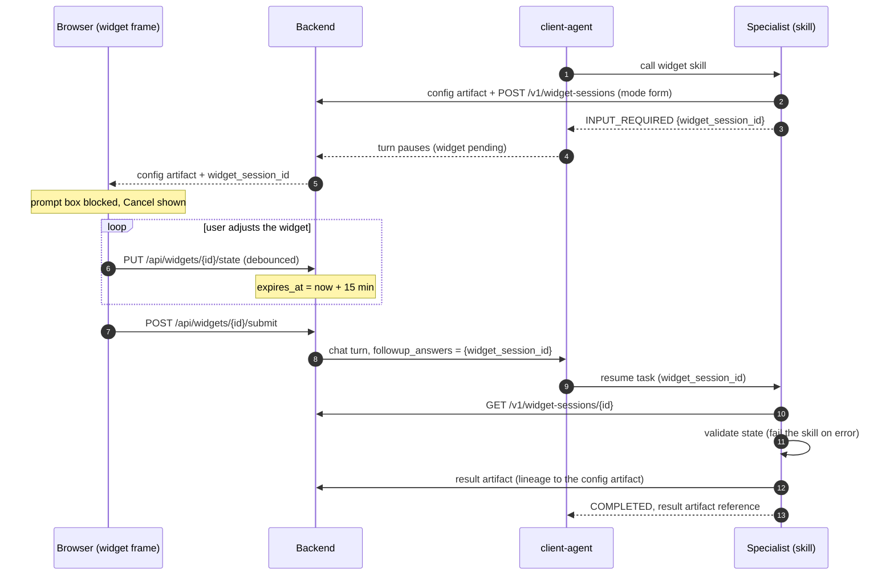
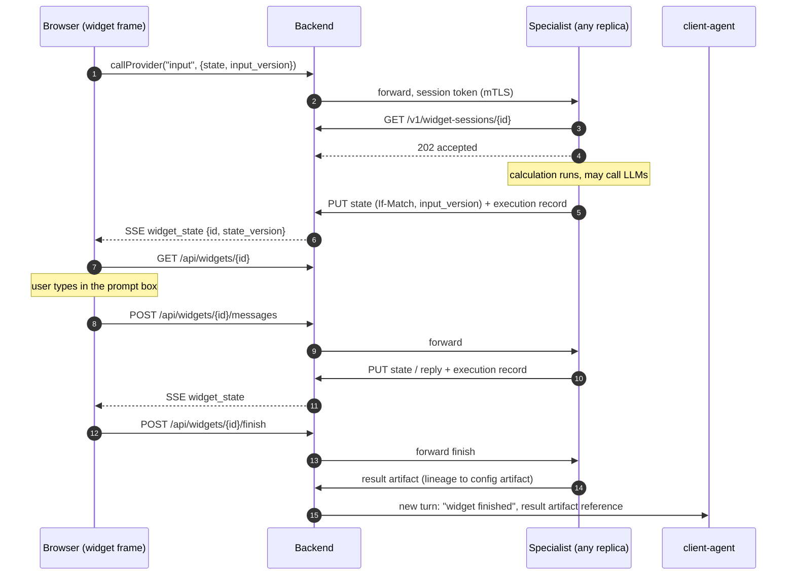
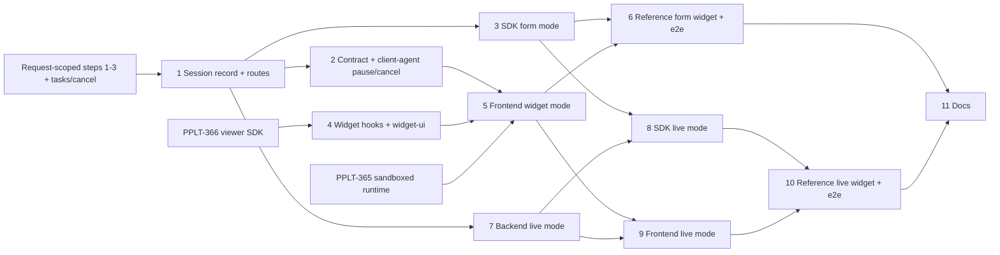

# Interactive Agent Widgets

| | |
| --- | --- |
| **Status** | Design, not built. Proposed 2026-11-12. |
| **Approver** | Daniel Schwen |
| **Jira** | Not created yet. The tasks in [section 10](#10-implementation-plan) will go under epic PPLT-358. |
| **Builds on** | [Viewer Registry and Agent-Provided Viewers](viewer-registry.md) (PPLT-358), [Request-Scoped Agent Objects and Backend Task State](request-scoped-agent.md) |
| **Related** | [Mid-execution user approval](user-approval.md), [Credential Plane for Agents](credential-plane.md) |

An agent can show an **interactive widget** in the Prometheus UI: a sandboxed
viewer that the user manipulates, and whose state goes back to the agent. There
are two phases:

- **Phase 1, widget form.** A variant of INPUT_REQUIRED. The agent opens a widget.
  The user adjusts it and presses **Submit**, and the agent continues with the
  resulting state.
- **Phase 2, live session.** The user and the agent exchange state back and forth
  in the same widget. For example, the user changes a setting, the agent runs a
  calculation and pushes the result into the widget. The session ends with
  **Finish**.

Readers: frontend, backend and SDK developers, and agent authors who want to ship
a widget.

## 1. Decisions (2026-11-12)

| # | Decision |
| --- | --- |
| W-1 | **A widget is a PPLT-358 viewer.** Same manifest, registry, sandboxed runtime, viewer SDK, permissions and viewer frame (including **Fullscreen**, which every viewer and widget gets, also for small screens). |
| W-2 | **`artifact_type` lookup is the only trigger.** The agent emits a JSON artifact with the widget's initial configuration and a widget-specific `artifact_type`. The registry resolves it to the widget like any other viewer. There is no separate "open this viewer" request. The config artifact also records the use of the widget in the digital thread. |
| W-3 | **The orchestrator opens widgets through skills.** An agent offers a skill that opens its widget. The client-agent's LLM calls the skill; the agent opens the widget. |
| W-4 | **The orchestrator LLM sees references only.** Submitted and final state become artifacts **created by the agent**. The client-agent's context gets the artifact ID and a meaningful description, never the state itself. |
| W-5 | **The agent validates** the submitted state against its own schema. A validation failure fails the skill: the widget and the agent are written by the same developer in the same repository, so the schemas stay in sync. |
| W-6 | **Phase 1 blocks the prompt box** while the widget is open, and offers an explicit **Cancel** button. Typing no longer silently cancels the pending call. |
| W-7 | **Phase 1 expires after 15 minutes without interaction.** Every interaction with the widget resets the timer. |
| W-8 | **Phase 2 has no held A2A task.** The widget calls its agent through `callProvider`, and session state lives in the backend. Any replica of the agent can serve any call, so no sticky routing is needed, and everything is recoverable. |
| W-9 | **Agents can push** state to an open widget without being asked. |
| W-10 | **Phase 2 routes typed messages to the widget's agent.** While a session is active, the prompt box sends to the agent, not to the orchestrator, and the UI says so. The orchestrator LLM is not involved during the session; the agent may make its own LLM calls. |
| W-11 | **One widget per conversation.** A phase 1 widget and a phase 2 session never exist at the same time. |
| W-12 | **Users can reconnect** after a network problem or browser restart, and a restored conversation reattaches its open widget. |
| W-13 | **Finish starts a new orchestrator turn** with a reference to the result artifact. |
| W-14 | **The digital thread records computed states.** Every state the agent computed on is an execution record in DeepLynx, and so is every message the user sent to the agent. Intermediate UI states (every slider position) are not recorded. |
| W-15 | **Finished widgets are read-only.** The transcript shows a read-only snapshot, drawn by the widget. If that widget is no longer registered, the generic JSON viewer shows the result artifact. A finished session can't be resumed, but **"Start a new session from this result"** calls the same skill with the result artifact as the initial configuration. |
| W-16 | **A newer input cancels a running calculation** for an older one. |
| W-17 | **The viewer SDK and a widget UI toolkit ship with the Prometheus SDK**, are served by the platform, and update automatically for every agent. |

## 2. The widget session record

Both phases use one backend record, the **widget session**. It is the session
scope of the backend state API from the request-scoped design (that design's
first version is per task only; this adds the `sessions/{id}` scope).

| Field | Content |
| --- | --- |
| `id` | `ws_` + random id |
| `mode` | `form` (phase 1) or `live` (phase 2) |
| `user_id`, `conversation_id`, `agent`, `skill` | Owner and origin. Checked on every call, as in the request-scoped design §6.3 |
| `task_id` | Phase 1: the paused A2A task of the skill. Phase 2: the task that opened the session (already finished) |
| `config_artifact_id` | The artifact that opened the widget |
| `state`, `state_version` | The current widget state (JSON object, size-capped) and its version |
| `input_version` | Phase 2: the version of the newest user input (for cancellation, [section 5.3](#53-cancellation-and-stale-results)) |
| `status` | `open` → `submitted` \| `finished` \| `cancelled` \| `expired` \| `failed` |
| `expires_at` | Phase 1: last interaction + 15 min. Phase 2: last interaction + 24 h |
| `result_artifact_id` | The artifact the agent created from the final state |

- **One per conversation (W-11).** Creating a session while another one in the
  same conversation is `open` returns 409.
- **Storage.** Today the record is in Valkey with a 24 h TTL, like task state.
  Valkey is planned to become a cache layer only, with all data persisted in the
  platform database. The design doesn't depend on the TTL as a limit; expiry is
  the `expires_at` field.
- Agents never touch Valkey. They use the agent routes in [section 6](#6-api).

## 3. How a widget opens

1. The orchestrator LLM calls the agent's widget skill (W-3).
2. The agent writes the initial configuration as a JSON artifact with the widget's
   `artifact_type` (for example `inl.thermal.bc_editor.v1`) (W-2).
3. The agent creates the widget session (`POST /v1/widget-sessions`) with that
   artifact.
4. The frontend receives the artifact. The registry resolves it to the widget, and
   the frame opens it in **widget mode** with the session ID.

Steps 2 and 3 are one SDK call: `await req.open_widget(config, mode="form"|"live")`.

## 4. Phase 1: widget form

- **State goes to the backend, not through the orchestrator (W-4).** Today a
  form's answers travel as `followup_answers` through the client-agent, which saves
  them in its history (`provided_inputs`). A widget's state would land in the
  orchestrator's context that way. Instead the widget saves its state in the
  session, and the resume carries only `widget_session_id`. The agent reads the
  state, validates it and creates the artifact (W-5).
- **The resume** uses the request-scoped `State` (keyed by the A2A task id), so it
  survives an agent restart.
- **Blocked prompt box (W-6).** The chat response gets a new pending kind,
  `widget`, next to `needs_info`. While it is pending, the composer is disabled and
  shows "Finish or cancel the widget to continue".
- **Cancel** sends `widget_cancelled` on the chat route. The client-agent closes the
  pending call (as `plan_rejected` does today). The backend marks the session
  `cancelled` and sends `tasks/cancel` to the specialist, which deletes its task
  state and runs `on_cancel()`. This is the `tasks/cancel` follow-up of the
  request-scoped design, which becomes a prerequisite here.
- **Expiry (W-7).** Every saved state change resets `expires_at`. A widget that only
  changes local UI state sends a debounced `touch` through the bridge. Five minutes
  before expiry the frame shows "This widget will expire at 3:21 PM", like the
  approval card. On expiry the backend handles it like Cancel.
- **A validation failure fails the skill (W-5).** The session is `failed`, and the
  orchestrator sees an ordinary skill failure.

## 5. Phase 2: live session

The widget skill opens the session with `mode="live"` and **completes
immediately**, returning the config artifact reference. The orchestrator turn ends
normally. From then on the widget talks to its agent directly, through the
backend.

### 5.1 Calls and pushes

- **Input** goes through `callProvider` (PPLT-358 §6) to an agent endpoint that the
  SDK registers for the widget (`add_http_endpoint`). It carries the new state and
  an `input_version`. The agent answers `202` and computes in the background.
- **Push (W-9)** is a state write: the agent PUTs the new state to the session
  (`If-Match` on `state_version`). The backend sends a `widget_state` SSE event,
  and the widget reads the new state. Pushing works the same way whether the agent
  is answering an input or acting on its own, for example when a long run
  finishes.
- **Lost events cost nothing.** The state is stored and versioned, so a widget that
  missed an event, or reconnected, just reads the current state.

### 5.2 Messages to the agent (W-10)

- While a live session is open, the composer shows a chip **"To thermal-agent"**
  and posts to `/api/widgets/{id}/messages`. The orchestrator doesn't receive the
  message.
- The agent's reply is a state update (it can include a `messages` list that the
  widget shows). It is not a chat message in the main transcript.
- The SDK base class records every message and every computed state as a DeepLynx
  execution record, linked to the session's config artifact (W-14).
- The user can leave agent mode with **Finish** or **Cancel** on the widget. There
  is no third "pause and talk to the orchestrator" state in v1.

### 5.3 Cancellation and stale results

- Every input increments `input_version` in the session (backend-assigned).
- **Same replica:** the SDK cancels the running calculation task when a newer input
  for the same session arrives (W-16).
- **Other replica:** the newer input can land on another replica, which can't
  cancel the first replica's calculation. The backend rejects a state write whose
  `input_version` is older than the session's current one (409), so a stale result
  never reaches the widget. The SDK also checks the session's `input_version`
  between calculation steps and stops early.
- **Debouncing.** The viewer SDK's `useWidgetState` hook debounces inputs
  (default 300 ms) and coalesces them, so dragging a slider sends a handful of
  inputs, not hundreds. The bridge also rate-limits per session.

### 5.4 Finish (W-13)

1. **Finish** posts to `/api/widgets/{id}/finish`, which forwards to the agent's
   finish endpoint.
2. The agent validates the final state and creates the **result artifact**, with
   lineage to the config artifact. A validation failure marks the session `failed`
   and shows the error in the widget.
3. The backend marks the session `finished` and starts a new orchestrator turn. Its
   input is a short, generated user message such as "Finished the boundary
   condition editor session; result: artifact `art_…` (description)". The
   transcript shows it as a marked system item, not as text the user typed.

### 5.5 Agent restarts

Losing a calculation that was running when its replica restarted is accepted in
v1. The session and its last saved state survive. The widget shows that the
calculation stopped and offers to resend the last input.

## 6. API

**Agent routes** (agent auth + the user identity JWT, owner checks as in the
request-scoped design §6.3):

| Method | Path | Purpose |
| --- | --- | --- |
| `POST` | `/v1/widget-sessions` | Create (`mode`, `conversation_id`, `task_id`, `skill`, `config_artifact_id`). 409 if the conversation already has an open session. |
| `GET` | `/v1/widget-sessions/{id}` | Read the state, `state_version` and `input_version` |
| `PUT` | `/v1/widget-sessions/{id}/state` | Push new state. `If-Match: <state_version>`; refused with 409 if `input_version` is stale |
| `POST` | `/v1/widget-sessions/{id}/result` | Attach the result artifact and close the session |
| `DELETE` | `/v1/widget-sessions/{id}` | Cancel |

**Browser routes** (session cookie, `claims.sub` = owner):

| Method | Path | Purpose |
| --- | --- | --- |
| `GET` | `/api/widgets?conversation_id=` | The conversation's open session, for reattaching after a reload or restore |
| `GET` | `/api/widgets/{id}` | Current state |
| `PUT` | `/api/widgets/{id}/state` | Phase 1: save state, reset expiry. Phase 2: an input (forwarded to the agent) |
| `POST` | `/api/widgets/{id}/touch` | Reset expiry without a state change |
| `POST` | `/api/widgets/{id}/submit` | Phase 1 Submit |
| `POST` | `/api/widgets/{id}/messages` | Phase 2 message to the agent |
| `POST` | `/api/widgets/{id}/finish` | Phase 2 Finish |
| `POST` | `/api/widgets/{id}/cancel` | Cancel (both phases) |

**SSE events:** `widget_state` (`id`, `state_version`), `widget_closed` (`id`,
`status`, `result_artifact_id`).

**Session token.** Calls forwarded to the agent carry a token scoped to
`(user, agent, widget session, conversation)`. It is short-lived and refreshed by
every forwarded call. The agent uses it for pushes from background calculations,
and the backend accepts it only while the session is `open`. This replaces, for
widgets, the per-call token of PPLT-358 §6. The credential plane's `once` grants
are per turn, so a live session that uses DeepLynx or HPC credentials needs its
grants bound to the session id instead (open question Q-3).

## 7. Frontend

- **Widget mode** in the viewer frame: the frame gets `mode: "widget"` and the
  session ID in `init`, and shows Submit and Cancel (phase 1) or Finish and Cancel
  (phase 2) as **host controls**, so every widget has them in the same place.
- **Placement:** inline by default, movable to the side panel (PPLT-358 §9), and
  Fullscreen on every viewer and widget.
- **Reattach (W-12):** on page load, SSE reconnect or conversation restore, the
  frontend calls `GET /api/widgets?conversation_id=` and reopens the open widget
  from its stored state. Phase 1 also restores the blocked composer, and phase 2
  restores the "To agent" chip.
- **Snapshot (W-15):** a finished widget renders in **snapshot mode**: the viewer
  API's `init` passes `mode: "snapshot"` with the result artifact, and all inputs
  are disabled. If the widget is no longer registered, the result artifact opens in
  the generic JSON viewer. The snapshot has a **"Start a new session from this
  result"** button. It posts a chat turn that calls the same skill with the result
  artifact as the initial configuration; this needs the chat request to name a
  skill directly, the way `workflow_id` names a workflow today.

## 8. SDK

**Agent side** (`prometheus_api`, on `PrometheusRequest`):

- `open_widget(config, *, artifact_type, mode)`: emits the config artifact, creates
  the session, and in `form` mode returns INPUT_REQUIRED.
- `widget_result()`: on resume, loads the submitted state from the session.
- A `WidgetSession` handler class for live mode, with `on_input(state)`,
  `on_message(text)` and `on_finish(state)`, plus `push(state)`. It manages
  cancellation of running calculations, version checks and execution records.

**Widget side**, shipped with the Prometheus SDK (W-17):

- `@prometheus/viewer-sdk` gains widget hooks: `useWidgetState` (debounced,
  versioned), `useWidgetMessages`, `submit()`, `finish()`.
- `@prometheus/widget-ui`: a small React component toolkit (inputs, sliders,
  tables, layout, theme tokens) so every widget looks the same.
- **Served by the platform.** The backend serves both packages at a versioned path
  that the sandboxed iframe may load (`script-src` allows it). A widget's
  manifest names the **major version** it needs. Minor and patch updates reach
  every widget automatically, without the agent rebuilding, so they must stay
  backward compatible. `bundle_hash` covers only the agent's own bundle.

## 9. Prerequisites

| Prerequisite | From |
| --- | --- |
| Viewer registry, resolver by `artifact_type`, sandboxed runtime, bridge, permissions, viewer SDK | PPLT-358 steps 1–3, 7, 7a, 8 (PPLT-359, 360, 361, 365, 371, 366) |
| `PrometheusRequest` and per-task `State` | Request-scoped design steps 1–3 |
| `tasks/cancel` from the client-agent to the specialist, and `on_cancel()` | Request-scoped design follow-up, pulled forward |

## 10. Implementation plan

Each step merges on its own. Phase 1 (steps 1–6) is useful without phase 2. Each
step becomes one Jira task under PPLT-358 once this design is approved.

| Step | Change | Where | Depends on |
| --- | --- | --- | --- |
| 1 | Widget session record and agent/browser routes (create, read, state, touch, submit, cancel), one-per-conversation, expiry, owner checks | backend | Request-scoped step 2 |
| 2 | Contract: `widget` pending kind in the chat response, `widget_cancelled` request; client-agent pauses on it and closes it on cancel; `tasks/cancel` to the specialist | sdk contract, backend, client-agent | 1, `tasks/cancel` |
| 3 | SDK agent side, form mode: `open_widget`, `widget_result`, validation-failure path | sdk | 1, request-scoped step 3 |
| 4 | Viewer SDK widget hooks and `@prometheus/widget-ui`, served by the platform at a versioned path | sdk, backend | PPLT-366 |
| 5 | Frontend widget mode (Submit, Cancel, expiry notice, touch), blocked composer, reattach, snapshot mode with JSON fallback | frontend | 2, 4, PPLT-365 |
| 6 | Reference form widget on a debug agent; end-to-end test (submit, cancel, expiry, reload) | agents, frontend | 3, 5 |
| 7 | Live mode in the backend: input forwarding, session token, state push with `input_version` check, `widget_state` SSE events, finish → orchestrator turn | backend | 1 |
| 8 | SDK live mode: `WidgetSession` (`on_input`, `on_message`, `on_finish`, `push`), cancellation, execution records per computed state and message | sdk | 3, 7 |
| 9 | Frontend live mode: "To agent" composer chip, widget messages, Finish, "Start a new session from this result" | frontend | 5, 7 |
| 10 | Reference live widget on a debug agent; end-to-end test (inputs, push, cancel of stale calculation, reconnect, finish) | agents, frontend | 8, 9 |
| 11 | Docs: agent-author guide for widgets | docs, sdk/docs | 6, 10 |

## 11. Open questions

| # | Question | Notes |
| --- | --- | --- |
| Q-1 | Is a phase 2 session a **conversation branch**? | Messages to the agent are kept out of the orchestrator's context (W-10) and recorded as execution records (W-14). A planned conversation-branching feature would let a branch talk to one agent directly, which needs an API that passes the whole prompt instead of extracted skill parameters. Phase 2 could later become the first user of that API. Not needed for v1. |
| Q-2 | Can the user talk to the orchestrator while a live session is open? | v1: no. The composer goes to the agent until Finish or Cancel (W-10). A "pause" toggle could come later. |
| Q-3 | Credential grants for long sessions | The credential plane's `once` grant is per turn. A live session needs grants bound to the session, or the agent re-requests per calculation. Decide with the credential-plane work. |
| Q-4 | Phase 2 expiry | Proposed: 24 h after the last interaction, the same as the session record lifetime. Once Valkey is cache-only, should sessions have no expiry at all until Finish or Cancel? |
| Q-5 | Size cap for widget state | Proposed: 256 KB, the same as task state. Larger data belongs in artifacts the state refers to. |

## 12. Future considerations

- **Screenshots as snapshot previews.** Capture the widget as an image at Finish
  (for example with `html-to-image`) as a placeholder when the widget is gone. A
  sandboxed iframe with an opaque origin can't be captured by the host page, so
  the widget would capture itself through the viewer SDK and return the image.
- **Frontend on the same UI library.** Refactor the built-in viewers and the app to
  use `@prometheus/widget-ui`, so built-ins and widgets look the same.
- More than one widget per conversation.
- Checkpointing of running calculations, so a replica restart can resume them.
