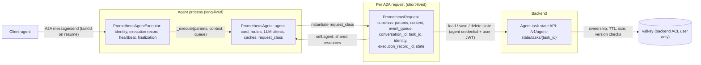
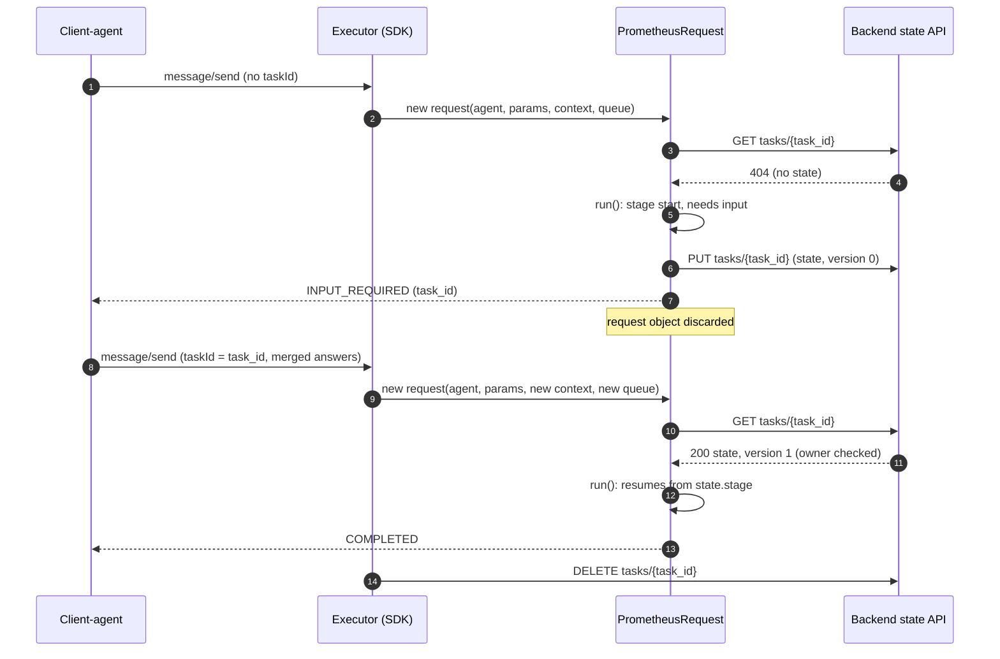
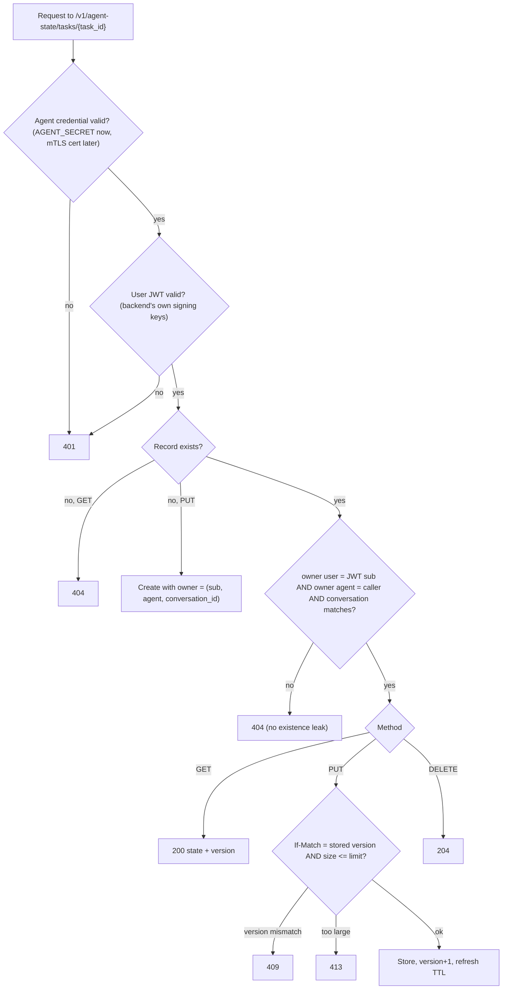
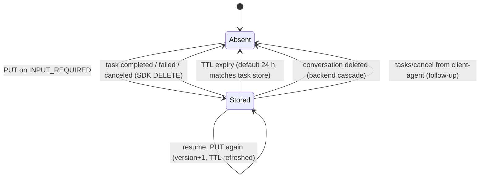
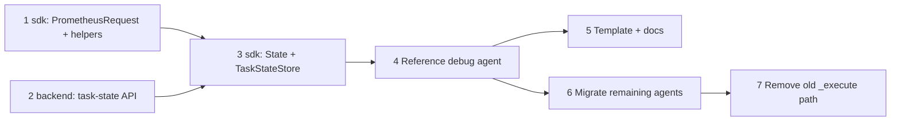

# Request-Scoped Agent Objects and Backend Task State

| | |
| --- | --- |
| **Status** | Design, not built. Proposed 2026-11-06. |
| **Approver** | Daniel Schwen |
| **Related** | [ADR-004 Agent Registry and A2A Gateway][adr-004] (§7, no agent Valkey access), [ADR-005 Agent Workload Identity (mTLS)][adr-005], [Credential Plane for Agents](credential-plane.md), [Mid-execution user approval](user-approval.md), Jira epic PPLT-347, SDK specs [009](../../../sdk/specs/009-agent-execution-events-and-workers.md) (agent execution, events and workers), [010](../../../sdk/specs/010-agent-artifacts-input-and-context-state.md) (artifacts, input and context state) and [012](../../../sdk/specs/012-redis-backed-state-and-degradation.md) (Redis-backed state) |
| **Origin** | Moved from [Confluence page 44335895][origin] (version 1, 2026-11-06). This file is now the source of truth. |

This document proposes a **per-request object** for specialist agents, so the
parameters, request context and event queue no longer have to be passed through
every helper call. It adds **per-task state** that survives an `INPUT_REQUIRED`
pause. Agents store that state through a **backend API** that checks
authorization, never in Redis/Valkey directly.

Readers: SDK and backend developers, and agent authors.

## 1. Problem today

- Every agent implements `PrometheusAgent._execute(params, context, event_queue)`.
  Every helper needs `context` and `event_queue` again
  (`send_status_update(context, event_queue, ...)` appears 30 times across the
  platform agents), and every private helper in an agent has to thread them
  through.
- The agent object is **shared by all concurrent requests**. Anything an agent
  author stores on `self` during a request can be overwritten by another request.
  Nothing in the API prevents this.
- Request-scoped values that do exist are hidden in `ContextVar`s (verified
  identity, `execution_record_id`), and are lost when work moves to a thread.
- A request that ends in `INPUT_REQUIRED` loses everything it had computed. The
  resume arrives as a new request. The only way to keep state is
  `ContextStateStore`, which is keyed per conversation (not per task) and talks to
  Redis from the agent, which ADR-004 §7 is removing.

## 2. Decisions (2026-11-06)

| # | Decision |
| --- | --- |
| RS-1 | **Composition, not a per-request agent subclass.** The long-lived `PrometheusAgent` stays one instance per process (card, routes, registries, clients, caches). A new class, **`PrometheusRequest`**, is instantiated once per A2A request and holds a reference to the agent. |
| RS-2 | **Runs alongside the current API.** An agent opts in by setting `request_class`. Agents that override `_execute` keep working unchanged. The old signature is removed only after every agent has migrated. |
| RS-3 | **The A2A `taskId` is the key between a request and its resume.** The client-agent already echoes the specialist's task ID on resume ([`agents/client-agent/tool_discovery.py`](../../agents/client-agent/tool_discovery.py), `_a2a_task_id`). `contextId` is the whole conversation and is not specific enough. |
| RS-4 | **Request objects are not kept in memory between requests.** Only a declared, serializable `State` model is persisted. Every resume builds a fresh request object with the new context, queue and params. Reasons: restarts and multiple replicas, no cancel signal for abandoned forms, closed event queues, and per-user worker isolation. |
| RS-5 | **Task state is stored through a backend API, not in Valkey.** The backend checks the agent and user credentials and the owner on every call, and enforces TTL, size and version limits. This is consistent with ADR-004 §7 (agents get no direct Valkey access). |
| RS-6 | **First version: per-task state only.** The route is `tasks/{task_id}`. Conversation-scoped state (the replacement for `ContextStateStore`) is a separate later change under `conversations/{id}`. |
| RS-7 | **Ship on the shared `AGENT_SECRET` first.** Until ADR-005 mTLS is in place, the backend can't tell agents apart and trusts the agent name in the request. The user-ownership check works from day one. After mTLS, the agent name comes from the client certificate. |
| RS-8 | **The explicit-argument helpers on `PrometheusAgent` stay the one implementation.** Request methods are thin wrappers that pass the request's context and queue. A test checks that every public agent helper has a request wrapper. |

## 3. Architecture



- The executor is unchanged: identity check, execution record, the "working"
  status, heartbeat and finalization still happen in `PrometheusAgentExecutor`.
- The base `PrometheusAgent._execute` gains one branch: when `request_class` is
  set, it instantiates it and calls `run()`.
- Agents that override `create_executor()` skip the base `_execute` and must opt
  in explicitly.

## 4. The request object

### 4.1 Agent-author view

```python
class ThermalRequest(PrometheusRequest):
    class State(BaseModel):              # survives an INPUT_REQUIRED pause
        stage: str = "start"
        mesh_id: str | None = None
        partial: dict = {}

    async def run(self) -> dict:
        if self.state.stage == "start":
            await self.status("Loading mesh…")      # no context / event_queue
            self.state.mesh_id = await self._load(self.params["mesh_id"])
            self.state.stage = "need_bc"
            return await self.input_required([MissingInput(...)], hint="...")
        if self.state.stage == "need_bc":            # restored on resume
            reply = await self.llm().chat(...)       # self.agent.llm_client(self.context)
            return {"status": "success", ...}

    async def _load(self, mesh_id):                  # private helpers just use self
        await self.status(f"Fetching {mesh_id}")
        ...

class ThermalAgent(PrometheusAgent):
    request_class = ThermalRequest                   # process-wide resources stay here
```

### 4.2 Members

| Member | Meaning |
| --- | --- |
| `agent` | The long-lived `PrometheusAgent`. Expensive resources (models, clients, caches) live here, never on the request. |
| `params` | Extracted parameters. On resume they already contain the merged answers (unchanged from today). |
| `context`, `event_queue` | The A2A `RequestContext` and the tracked event queue of **this** request. |
| `task_id`, `conversation_id` | From the context. `task_id` is stable across an INPUT_REQUIRED resume. |
| `identity`, `user_id` | The verified identity. A property over the existing `ContextVar` at first, a plain attribute in the final cleanup step. |
| `execution_record_id` | The DeepLynx execution record of this request. Same treatment as identity. |
| `input_sources` | Who supplied each param (`get_input_sources(context)` today). |
| `state` | An instance of the subclass's `State` model (pydantic). Loaded before `run()`, saved on INPUT_REQUIRED, deleted on a terminal state. Subclasses without `State` make no state calls. |

### 4.3 Request-bound helpers

Thin wrappers over the existing agent helpers
([`sdk/prometheus_api/agent/base.py`](../../../sdk/prometheus_api/agent/base.py)),
with context, queue and conversation ID filled in:

| Request method | Wraps |
| --- | --- |
| `status(msg, ...)` | `send_status_update` |
| `json_artifact(...)`, `text_artifact(...)`, `artifact_reference(...)`, `deeplynx_artifact(...)` | `send_json_artifact`, `send_text_artifact`, `send_artifact_reference`, `send_deeplynx_artifact` |
| `message(...)` | `send_conversation_message` |
| `input_required(missing, hint=...)` | `send_input_required`, and saves `state` first |
| `long_running(...)`, `run_worker(worker)` | `declare_long_running`, `run_worker` |
| `llm(**kw)` | `llm_client(context, **kw)` |
| `artifact(id)`, `artifact_by_name(name)`, `artifacts()`, `artifact_path(id)` | `resolve_artifact_reference`, `resolve_artifact_by_name`, `list_artifact_references`, `get_artifact_file_path` |
| `credential(resource, scope)` | `get_credential` |
| `pending_hint(...)` | `pending_hint` |

After `run()` returns, the request is **closed**. Any later helper call (for
example from a leftover background task) raises instead of writing into a finished
stream.

## 5. Request lifecycle with INPUT_REQUIRED



- The state load happens **only** when the subclass declares `State`. To avoid a
  backend round trip on every first request, the SDK can skip the GET when the
  incoming message has no `taskId` (a new task can't have state).
- Only the declared `State` carries over. Clients, file handles and the event
  queue are rebuilt on every request, so a resource can't end up with the wrong
  lifetime.
- A short approve/reject that keeps the request open (an in-flight wait, as
  described for `request_user_approval` in [Mid-execution user
  approval](user-approval.md)) needs no persisted state: the same instance stays
  alive. That pattern suits only short waits. It holds a connection open and does
  not survive a restart.

## 6. Backend task-state API

### 6.1 Endpoints

| Method | Path | Purpose |
| --- | --- | --- |
| `GET` | `/v1/agent-state/tasks/{task_id}` | Returns `state` and `version` (as an `ETag`). 404 when absent or not owned by the caller. |
| `PUT` | `/v1/agent-state/tasks/{task_id}` | Creates or replaces the record. `If-Match: <version>` is required on replace, and `If-None-Match: *` on create. Refreshes the TTL. |
| `DELETE` | `/v1/agent-state/tasks/{task_id}` | Removes the record. Idempotent. |

Callers send:

- the agent credential: `Authorization: Bearer <AGENT_SECRET>` now, the mTLS client
  certificate later;
- the forwarded user token (`X-User-Token`), the same platform JWT that reaches the
  agent in `message.metadata.userToken`;
- `X-Agent-Name` and `X-Conversation-Id`.

### 6.2 Record

```json
{
  "owner_user_id": "u-123",
  "agent": "thermal-agent",
  "conversation_id": "c-456",
  "version": 3,
  "state": { "stage": "need_bc", "mesh_id": "m-9", "partial": {} },
  "created_at": "2026-11-06T17:00:00Z",
  "updated_at": "2026-11-06T17:02:10Z"
}
```

Stored by the backend under `agent_state:task:{task_id}`, using its own Valkey ACL
user.

### 6.3 Authorization



- **User:** the backend verifies the user JWT against its own signing keys, the
  same keys it publishes at `/.well-known/jwks.json`
  ([`backend/app/routers/jwks.py`](../../backend/app/routers/jwks.py)). It never
  trusts a `user_id` the agent reports. Access requires `sub == owner_user_id`.
- **Agent:** the caller's agent name must equal `agent`. Until mTLS this name is
  self-declared (RS-7). Afterwards it is taken from the certificate, and only the
  auth layer changes.
- **Conversation:** must equal `conversation_id`, so a task ID can't be reused from
  another conversation.
- A record that exists but isn't the caller's returns **404, not 403**, so that
  knowing a task ID doesn't reveal that the task exists.
- **Limits:** state must be a JSON object, at most 256 KB (configurable). Large
  data belongs in artifacts or DeepLynx. The version check (409 on mismatch) stops
  two racing resumes from overwriting each other silently.

## 7. Record lifetime



- **Terminal state:** the SDK deletes the record when the task completes, fails or
  is canceled. The executor already knows this point (`seen_final_status` and the
  terminal emit).
- **TTL:** otherwise the record expires after the backend TTL. The default is 24 h,
  the same as `TASK_STORE_TTL_SECONDS`: once the task record is gone a resume
  can't succeed, so both expire together.
- **Conversation deleted:** the backend owns conversations, so deleting a
  conversation also deletes its task state. An agent-side store couldn't do this.
- **Abandoned forms:** today the client-agent closes a dropped pending call on its
  own side only and sends nothing to the specialist. A follow-up adds
  `tasks/cancel` to the specialist, which deletes the state right away and calls an
  optional `on_cancel()` hook.

## 8. SDK store abstraction

- `TaskStateStore` protocol: `load(task_id) -> (state, version) | None`,
  `save(task_id, state, version)`, `delete(task_id)`.
- `BackendTaskStateStore`: the HTTP client for [section 6](#6-backend-task-state-api).
  It adds the agent credential, the user token from the current identity and the
  conversation ID. The base URL comes from configuration, defaulting to the
  backend registry URL.
- `InMemoryTaskStateStore`: for unit tests and local single-process runs only. It
  is never the silent fallback in a deployment. If the backend can't be reached,
  the request fails, as the execution record does today.

## 9. Pros and cons

| Pros | Cons and mitigations |
| --- | --- |
| No more threading `context` and `event_queue` through every call and private helper. | Two lifetimes to understand (agent vs request). Loading a model in a request is a silent performance bug. *Mitigation:* docs, template, and a reference agent. |
| Per-request state can safely live on `self`; the cross-request overwrite bug goes away. | Instance attributes do **not** survive INPUT_REQUIRED, only `State` does. *Mitigation:* one explicit `State` model, prominent in the docs. |
| Request-scoped values become explicit and easy to test: construct a request with fakes and call `run()`. | Two APIs during the migration. *Mitigation:* keep the transition short, migrate one agent per PR, and update the template early. |
| Persisted per-task state with backend-enforced ownership; prompt cleanup is possible. | One backend round trip per state load or save. *Mitigation:* only for agents that declare `State`, and skipped on new tasks. |
| The same model as `PrometheusWorker` (bound context, `run()`), so the SDK reads consistently. | Helper wrappers could drift from the agent helpers. *Mitigation:* a parity test (RS-8). |

## 10. What the first version does not cover

- Conversation-scoped state through the backend (replacing `ContextStateStore`),
  RS-6.
- Agent identity from the mTLS certificate (ADR-005, PPLT-347), RS-7.
- `tasks/cancel` from the client-agent and the `on_cancel()` hook
  ([section 7](#7-record-lifetime)).
- Routing request classes into `UserWorkerPool` for `requires_user_isolation`.
  Serializing `(request class path, params, context data, state)` would be cleaner
  than the current callback signature, but that pool isn't wired into the base
  execution path yet.
- Typed `params` (a pydantic model on the request class) and per-skill request
  classes (`request_classes = {skill_id: cls}`).
- Removing `RedisTaskStore` and `ArtifactRegistry` Redis access from agents, which
  stays with PPLT-347.

## 11. Open questions

| # | Question | Status |
| --- | --- | --- |
| Q-1 | Class name. | Proposed `PrometheusRequest`. "Task" clashes with the A2A Task and "Worker" with `PrometheusWorker`. |
| Q-2 | Should state be saved on **every** exit (also on success or failure, for debugging), or only on INPUT_REQUIRED? | Proposed: only on INPUT_REQUIRED; delete on a terminal state. |
| Q-3 | Where is the root CLAUDE.md's `request_user_approval`? It is not in `sdk/` on `devel`. | **Answered (2026-11-10):** it was prototyped in June 2026 and never merged. [Mid-execution user approval](user-approval.md) is the new design (Jira PPLT-390 to PPLT-395); its request-scoped form is `await req.request_user_approval(message)`. |
| Q-4 | Should the client-agent use the same state API? | Open. The client-agent is a trusted platform component with its own ACL user (ADR-004 §7.3a), so it isn't required to. |

## 12. Implementation plan

Each step stays under about 300 changed lines, merges to `devel` on its own and
leaves the build green. Steps 1 and 2 are independent and can be built in
parallel. Jira tickets are added later.

| Step | Change | Where | Depends on |
| --- | --- | --- | --- |
| 1 | `PrometheusRequest` class, `request_class` dispatch in `PrometheusAgent._execute`, request-bound helper wrappers, close guard, helper parity test, spec 009 update. | sdk | – |
| 2 | Backend agent task-state API: router, JWT and ownership checks, TTL, size limit, version check, conversation-delete cascade, tests, spec. | backend | – |
| 3 | `State` on `PrometheusRequest`; `TaskStateStore`, `BackendTaskStateStore`, `InMemoryTaskStateStore`; load on resume by `taskId`, save on INPUT_REQUIRED, delete on terminal; spec 010 update. | sdk | 1, 2 |
| 4 | Migrate one debug agent (corrosion or thermal) as the reference example, using `State`. | agents | 3 |
| 5 | Update the agent template ([`agent-template/`](../../../agent-template/)), [`sdk/CLAUDE.md`](../../../sdk/CLAUDE.md) and the agent README. | template, sdk | 4 |
| 6 | Migrate the remaining agents, one PR each. | agents | 4 |
| 7 | Final cleanup: remove the old `_execute(params, context, event_queue)` override path; identity and execution record become request attributes instead of `ContextVar`s. | sdk | 6 |



**Follow-ups** (outside this sequence): `tasks/cancel` from the client-agent and
`on_cancel()`; conversation-scoped state API replacing `ContextStateStore`; agent
name from the mTLS certificate (after PPLT-347); `UserWorkerPool` integration.

[origin]: https://nstinl.atlassian-us-gov-mod.net/wiki/spaces/Prometheus/pages/44335895
[adr-004]: https://nstinl.atlassian-us-gov-mod.net/wiki/spaces/Prometheus/pages/42041369
[adr-005]: https://nstinl.atlassian-us-gov-mod.net/wiki/spaces/Prometheus/pages/43319553
