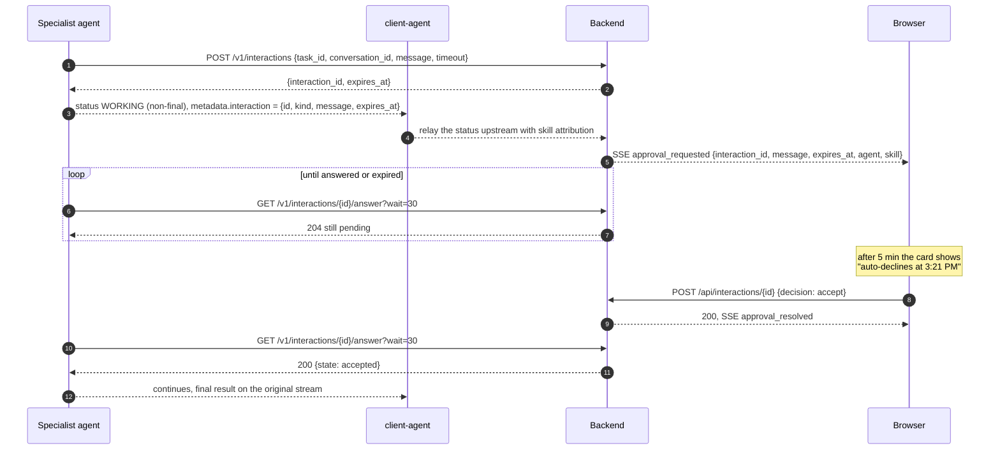
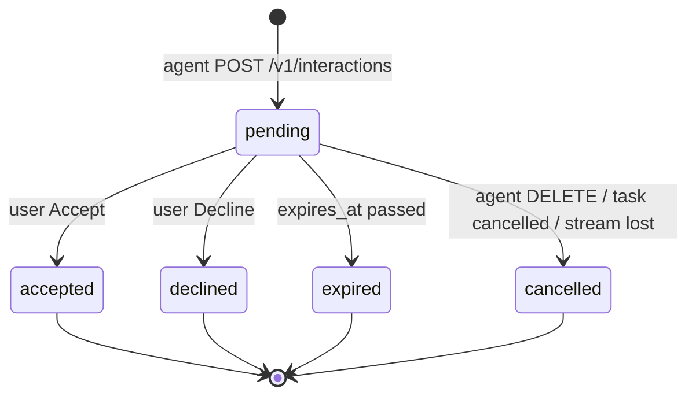
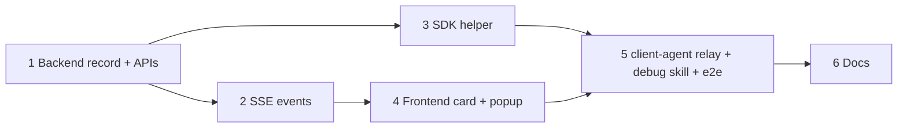

# Mid-Execution User Approval (`request_user_approval`)

| | |
| --- | --- |
| **Status** | Design, not built. Proposed 2026-11-10. |
| **Approver** | Daniel Schwen |
| **Jira** | Epic PPLT-5 (Initial Multi-Agent Workflow Orchestration); tasks PPLT-390 to PPLT-395 ([section 10](#10-implementation-plan)). PPLT-279 (passkey-signed approvals) is blocked by PPLT-390. |
| **Related** | [User Proof Chain](user-proof-chain.md) (signed approvals build on this record), [Request-Scoped Agent Objects and Backend Task State][request-scoped], [background-tasks.md](../dev-docs/background-tasks.md) |
| **Prior art** | June 2026 prototype, never merged: `prometheus_api` branch `user_approval` (commits `b0171ab`, `87bf797`, `ff2c989`) and platform branch `user_approval` (`b23ebbce`, `68f7fa7c`). See [section 3](#3-lessons-from-the-june-prototype). |

A specialist agent can stop partway through `_execute`, ask the user a yes/no
question, and carry on with the answer, all within the same turn and the same
coroutine:

```python
if not await self.request_user_approval(
    context,
    event_queue,
    message="Delete **3 volumes** (`vol-a`, `vol-b`, `vol-c`) from the test cluster?",
):
    return {"status": "skipped", "reason": "declined by user"}
```

The user sees the message in a card with two buttons, **Accept** and **Decline**.

## 1. Problem

Approvals exist today only at the client-agent level:

- **Plan approval:** the chat request carries `plan_approved`
  ([`backend/app/routers/chat.py`](../../backend/app/routers/chat.py)).
- **Gated skills:** skills with `requires_approval` are released by `approved` on
  the tool call
  ([`agents/client-agent/orchestrator/agent_loop.py`](../../agents/client-agent/orchestrator/agent_loop.py)).

Both happen *before* a skill runs. A specialist that finds something worth asking
about *while* running (a destructive step, a cost it only learns at run time, an
ambiguous match) can only return `INPUT_REQUIRED`
([`send_input_required`](../../../sdk/prometheus_api/agent/base.py)). That ends
the task. The resume is a new `_execute` call, so all in-process state is lost:
open sessions, handles, partial results, the position in a loop.

## 2. Goals and non-goals

**Goals**

- `await self.request_user_approval(context, event_queue, message=...) -> bool`
  pauses `_execute` in place, and the coroutine keeps all its state.
- The question reaches the user wherever they are: in the chat as an inline card,
  or as a popup notification if the run is in the background.
- The UI shows exactly two buttons, **Accept** and **Decline**.
- Default timeout of 15 minutes, which auto-declines. After 5 minutes the card
  tells the user when that will happen.
- Agents never touch Valkey. The approval record and the wait both go through a
  typed backend API that checks ownership.
- The approval record is the hook that [User Proof Chain](user-proof-chain.md) L3
  signs later, without another redesign.

**Non-goals (first version)**

- Surviving an agent process restart. When a restart happens the request fails
  visibly; [section 7](#7-restart-behaviour) covers this and a later replay option.
- Rich content beyond markdown, such as a diff or a table as structured A2A parts.
  `message` is a markdown string.
- Questions other than yes/no. Free-form input stays with `INPUT_REQUIRED` and
  `ask_user`.
- Passkey or IdP signatures on the answer (User Proof Chain step 5).

## 3. Lessons from the June prototype

The June spike worked end to end. It is the basis of this design, apart from how
the answer gets back to the agent.

1. **The pause must not be a final status.** A final `INPUT_REQUIRED` while the
   coroutine is still waiting deadlocks: a blocking `message/send` waits for the
   producer to finish before returning. The pause is a **non-final**
   `TASK_STATE_WORKING` status tagged with interaction metadata, so every stream in
   the chain stays open while the agent waits.
2. **The answer must not go back in band as `message/send`.** When *any*
   `message/send` for a task with a live producer finishes, the A2A SDK's
   `DefaultRequestHandler` closes that task's shared event queue. The original
   stream dies ("Queue is closed", `-32603`). The spike's tests passed only because
   of event-loop timing; the gateway hop made it fail at once.
3. **The prototype's fix, a Redis pub/sub answer channel the agent subscribes to,
   is no longer allowed.** Agents get no direct Valkey access; all state goes
   through typed backend APIs (ADR-004 §7, ADR-005). This design replaces the
   channel with a backend long-poll ([section 5](#5-backend-api)).
4. **The client-agent relay is easy.** It re-emits the pause event upstream with
   skill attribution and never handles the answer itself.

## 4. Design

### 4.1 Flow



The wait happens on a backend call the agent makes, not on the A2A stream. The
A2A stream only carries the pause event (for display) and the base-class
heartbeats (every 15 s, `PROMETHEUS_HEARTBEAT_INTERVAL`), which keep every hop
open.

The backend learns about the request at step 1, from the agent, before the event
is relayed. The record therefore exists even if the relay is slow or the browser
is closed, and the popup path ([section 6.3](#63-background-runs-popup-notification))
works from the record, not from the stream.

### 4.2 SDK API

```python
async def request_user_approval(
    self,
    context: RequestContext,
    event_queue: EventQueue,
    *,
    message: str,                       # markdown, shown verbatim in the card
    timeout_seconds: float = 900.0,     # 15 min
) -> bool:
    """Ask the user to Accept or Decline; return True only on Accept.

    Declined, expired, and cancelled requests all return False. Raises
    ApprovalUnavailable if the backend can't create the request (agent
    misconfiguration), so a gated step never runs silently unapproved.
    """
```

- **Expiry returns `False`.** The default is Decline, with no other setting. A
  skill that wants another fallback catches it itself.
- **One pending request per task.** A second call while one is pending raises,
  the same guard the prototype had.
- **Cancellation.** If the A2A task is cancelled, or the coroutine is cancelled,
  the SDK sends `DELETE /v1/interactions/{id}` (best effort), and the card shows
  "cancelled".
- **Request-scoped form.** When `PrometheusRequest` lands ([Request-Scoped Agent
  Objects][request-scoped]), the call becomes
  `await req.request_user_approval(message)`. `context` and `event_queue` drop
  out; nothing else changes.

### 4.3 Pause event (A2A)

A non-final status on the specialist's task:

```json
{
  "status": {
    "state": "TASK_STATE_WORKING",
    "message": {"role": "ROLE_AGENT", "parts": [{"text": "Waiting for your approval"}]}
  },
  "metadata": {
    "interaction": {
      "id": "ia_7f3c…",
      "kind": "approval",
      "message": "Delete **3 volumes** …",
      "expires_at": "2026-11-10T22:21:00Z"
    }
  }
}
```

The status text is a fallback for consumers that don't know about interactions:
they show "Waiting for your approval" in the running step list and nothing breaks.

## 5. Backend API

### 5.1 Record

Stored by the backend in Valkey (`interaction:{id}`, TTL = `expires_at` + 24 h,
so answered records stay readable for the conversation history), and indexed per
user (`user:interactions:{sub}`, a set of pending ids) so a reconnecting browser
can list what is waiting.

| Field | Content |
| --- | --- |
| `id` | `ia_` + random 128-bit id (see [section 7](#7-restart-behaviour) for the replay variant) |
| `kind` | `approval` (the only kind in v1) |
| `user_id` | `sub` from the identity JWT on the create call |
| `conversation_id`, `task_id` | From the create call. `task_id` is the specialist's A2A task id. |
| `agent`, `skill` | The calling agent (from its auth) and the skill id |
| `message` | Markdown, size-capped (16 KiB) |
| `state` | `pending` → `accepted` \| `declined` \| `expired` \| `cancelled` |
| `created_at`, `expires_at`, `resolved_at` | UTC timestamps |
| `resolved_by` | `user` \| `timeout` \| `agent` (cancel) \| `system` (stream lost) |

State changes are one atomic compare-and-set from `pending`, so an Accept that
arrives at the same moment as the expiry gets exactly one winner. The loser gets
409.



### 5.2 Agent-facing routes (`/v1/interactions`)

Authenticated like the other agent routes: Bearer `AGENT_SECRET` today, mTLS
later (ADR-005), **plus** the user identity JWT the agent received for this
turn. The backend takes `user_id` from that JWT and checks that it owns
`conversation_id`, so an agent can only ask the user it is working for.

| Route | Purpose |
| --- | --- |
| `POST /v1/interactions` | Create. Body `{kind, conversation_id, task_id, skill, message, timeout_seconds}`. Returns `{id, expires_at}`. `timeout_seconds` is clamped to a server maximum (default 3600). |
| `GET /v1/interactions/{id}/answer?wait=30` | Long-poll. `200 {state}` once the record leaves `pending`; `204` after `wait` seconds while still pending. Only the creating agent may read it. |
| `DELETE /v1/interactions/{id}` | Cancel (task cancelled or coroutine cancelled). |

The long-poll waits on a per-id Valkey pub/sub notification inside the backend,
with a timer as the safety net. That part is internal: Valkey stays behind the
backend. Each poll is a short HTTP request, so no connection is held for 15
minutes and a backend restart costs at most one retry.

The backend checks expiry itself: a poll after `expires_at` moves the record to
`expired` and returns it. The agent's own `timeout_seconds` is only the bound on
its loop, so agent and backend clocks don't have to agree.

### 5.3 Browser-facing routes (`/api/interactions`)

Session-cookie auth like every other `/api` route. The backend checks that
`claims.sub == record.user_id`.

| Route | Purpose |
| --- | --- |
| `GET /api/interactions?state=pending` | Pending requests for the user, for page load and SSE reconnect. |
| `POST /api/interactions/{id}` | Body `{decision: "accept" \| "decline"}`. `200` with the record; `409` if no longer pending (with the actual state, so the card can show it). |

### 5.4 SSE events (added to [`backend/CONTRACT.md`](../../backend/CONTRACT.md))

| Event | When | Payload |
| --- | --- | --- |
| `approval_requested` | The record is created, and again on every SSE (re)connect for still-pending records | `interaction_id`, `conversation_id`, `turn_id` (if known), `agent`, `skill`, `message`, `expires_at` |
| `approval_resolved` | The record leaves `pending` | `interaction_id`, `state`, `resolved_by` |

Events go to every session of the user, not only the session that started the
turn, so a second tab or a second device can answer, and all open cards update
together. This needs a per-user session index (`user:sids:{sub}`, maintained on
login and logout), which doesn't exist yet; today only `user:convs:{sub}` does.
If the index is deferred, v1 publishes to the turn's session only, and other
sessions pick the request up through `GET /api/interactions?state=pending` on
their next load.

## 6. Frontend

### 6.1 Approval card

Rendered inline in the conversation, at the point in the turn where the pause
happened, under the running step list:

```
┌────────────────────────────────────────────────────────────┐
│ ⏸  thermal-agent · run_transient asks for your approval    │
│                                                            │
│  Delete **3 volumes** (vol-a, vol-b, vol-c) from the test  │
│  cluster?                          (rendered markdown)     │
│                                                            │
│  This prompt will expire and auto-decline at 3:21 PM.      │  ← only after 5 min
│                                                            │
│                              [ Decline ]   [ Accept ]      │
└────────────────────────────────────────────────────────────┘
```

- `message` is rendered with the same sanitized markdown renderer as agent chat
  messages: no raw HTML, and links open in a new tab.
- Exactly two buttons, **Accept** (primary) and **Decline**. No timeout picker,
  no "always allow" (that belongs to credential grants, not here).
- While the POST is in flight, both buttons are disabled.
- After resolution the card collapses to one read-only line: "Accepted by you at
  3:09 PM", "Declined", "Expired: auto-declined at 3:21 PM", or "Cancelled: the
  agent stopped waiting". This line stays in the conversation history.

### 6.2 Expiry notice

- The card works out `notice_at = created_at + 5 min` and shows nothing before
  it. A request answered within 5 minutes never shows a timer.
- From `notice_at` on, it shows **"This prompt will expire and auto-decline at
  {time}"**, with `expires_at` formatted in the browser's local time and locale
  (`Intl.DateTimeFormat`, hour and minute, for example "3:21 PM").
- The notice is a fixed time, not a countdown, so it doesn't redraw every second
  and stays correct if the tab sleeps.
- The 5-minute delay is a frontend constant (`APPROVAL_EXPIRY_NOTICE_DELAY_MS`).
  It is measured from `created_at`, not from when the card mounted, so reopening
  the page after 7 minutes shows the notice straight away.
- If the timeout is shorter than 5 minutes, the notice shows from the start.

### 6.3 Background runs: popup notification

When the conversation that owns the request isn't on screen (another
conversation is open, the turn was backgrounded, or the tab was hidden), the
`approval_requested` event also raises a popup:

- **In-app toast** in the corner, persistent (no auto-dismiss) until the request
  resolves. It shows the agent, the first line of `message`, the expiry time, and
  **Accept** / **Decline** buttons, plus **Open conversation**, which navigates to
  the card.
- **Browser notification** (Notification API) when the tab is hidden and the user
  has granted permission. Clicking it focuses the tab and opens the conversation.
  The platform asks for permission the first time a request arrives while the tab
  is visible, never on page load.
- On `approval_resolved` the toast closes and any browser notification for that
  id is closed (`notification.close()`, tagged by `interaction_id`).
- **No browser open:** the request waits in the backend until it expires. On the
  next page load, `GET /api/interactions?state=pending` brings back the cards and
  toasts. Email or chat notifications are out of scope here (Approval Queue
  follow-up).

## 7. Restart behaviour

The coroutine can't survive a restart of the agent process. This design makes
that failure **visible and safe**, and leaves room to make it **recoverable**
later.

**v1: fail visibly.**

| What restarts | Effect |
| --- | --- |
| Backend | Records are in Valkey and survive. The agent's next long-poll is retried (the SDK retries with backoff until `expires_at`). SSE reconnects re-send `approval_requested` for pending records, so cards come back. |
| Browser / tab | Same as above: cards and toasts come back from `GET /api/interactions?state=pending`. |
| Specialist agent | The coroutine is gone, and the A2A stream to the client-agent drops. The client-agent reports the skill as failed (today's behaviour). The backend, which relays that stream, marks pending interactions for that `task_id` `cancelled` with `resolved_by = system`, and the card shows "The agent restarted; this request is no longer pending." An Accept clicked at that moment gets 409 and the same message. |
| client-agent | The turn is lost (today's behaviour). Specialists still waiting see their stream to the client-agent close, the A2A SDK cancels their task, and the SDK's cancel handler cancels the interaction. |

Nothing is ever approved by default. An approval can't outlive its task, so a
late Accept can't release a different run.

**Later: deterministic replay.** Derive the id from
`(task_id, sequence number of the approval within the task)` instead of a random
id. If the same A2A task is executed again after a restart, for example by a
client-agent retry on a dropped stream or by the backend task-state work in
[Request-Scoped Agent Objects][request-scoped], `request_user_approval` first
looks up that id. If an answer is already recorded it returns it straight away,
without asking the user again. This works only if the skill is safe to re-run up
to the approval point, so it would be opt-in per skill. v1 keeps random ids but
stores `task_id` and the sequence number on the record, so the switch is a local
change.

## 8. Security

| Concern | Handling |
| --- | --- |
| An agent asks a user it isn't working for | The create call needs the turn's user identity JWT; the backend checks that the user owns `conversation_id`. |
| Another agent reads or cancels the request | Answer and cancel routes check that the caller is the creating agent. |
| Another user answers | `/api/interactions/{id}` checks `claims.sub == record.user_id`. |
| Markdown injection (scripts, tracking pixels, deceptive links) | Sanitized renderer without raw HTML; remote images are not loaded in the card; link targets are shown. |
| Race between Accept and expiry | Atomic compare-and-set from `pending`; exactly one outcome. |
| Approval spam from a buggy agent | One pending request per task; per-user cap on pending requests (default 20); `message` capped at 16 KiB. |
| The identity JWT expires during the wait | `USER_IDENTITY_TTL` defaults to 2 h, longer than the 1 h maximum timeout. Polls after create need agent auth plus the `interaction_id`, not a fresh user JWT. |
| Non-repudiation | Out of scope for v1. [User Proof Chain](user-proof-chain.md) step 5 signs the canonical form of this record (`kind`, `message`, `task_id`, `skill`, `expires_at`) with a passkey or IdP step-up. |

## 9. Open questions

| # | Question | Proposal |
| --- | --- | --- |
| Q-1 | The client-agent's specialist call and the backend's client-agent call use `httpx` timeouts of 900 s (`agents/client-agent/tool_discovery.py`, `backend/app/a2a_client.py`). Are they per-read or whole-call limits in practice? | They are httpx per-operation timeouts, so heartbeats keep them alive. Confirm with an integration test that pauses for 16 minutes; if any hop has a total-duration limit (gateway, nginx), raise it above the 1 h maximum. |
| Q-2 | Should the client-agent's own LLM loop see that a skill is waiting (for example, to tell the user in chat)? | No. The card is enough; the loop just sees a long-running skill. |
| Q-3 | Does a declined approval show up in the Task Graph? | Yes, as a status message on the skill node ("Declined by user"). What the skill does next is its own business. |
| Q-4 | Should `requires_approval` skills and plan approval move onto this record too? | Yes, as a follow-up. This is step 4 of [User Proof Chain](user-proof-chain.md) ("the backend becomes the single place approvals are recorded"). Out of scope here. |

## 10. Implementation plan

All tasks go under epic **PPLT-5**. Each merges on its own. The SDK helper is
unused until the debug skill (task 5) calls it, so tasks 1–4 can merge in any
state.

| # | Jira | Task | Repo area | Depends on |
| --- | --- | --- | --- | --- |
| 1 | PPLT-390 | Backend: interaction record, `/v1/interactions` (create, long-poll, cancel) and `/api/interactions` (list, answer), atomic resolve, expiry, ownership checks, tests | `backend/` | – |
| 2 | PPLT-391 | Backend: `approval_requested` / `approval_resolved` SSE events, `user:sids` index and fan-out to all of the user's sessions, re-send on reconnect, cancel on lost specialist stream; `CONTRACT.md` | `backend/` | 1 |
| 3 | PPLT-392 | SDK: `request_user_approval(message=..., timeout_seconds=900)`: create, non-final pause event, long-poll with retry, cancel on task cancellation; base-image bump | `sdk/` | 1 |
| 4 | PPLT-393 | Frontend: approval card (markdown, Accept/Decline, 5-minute expiry notice, read-only result line), in-app toast and browser notification for background runs, reload of pending requests | `frontend/` | 2 |
| 5 | PPLT-394 | client-agent: relay `metadata.interaction` status events upstream with skill attribution; debug skill `request_approval_demo` on artifact-debug-agent; end-to-end Playwright test (accept, decline, expiry with a short timeout) | `agents/` | 3, 4 |
| 6 | PPLT-395 | Docs: agent-author guide for `request_user_approval`; update `user-proof-chain.md` to point at this record | `docs/`, `sdk/docs/` | 5 |



[request-scoped]: https://nstinl.atlassian-us-gov-mod.net/wiki/spaces/Prometheus/pages/44335895
