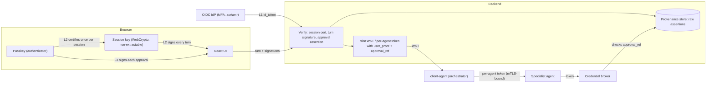
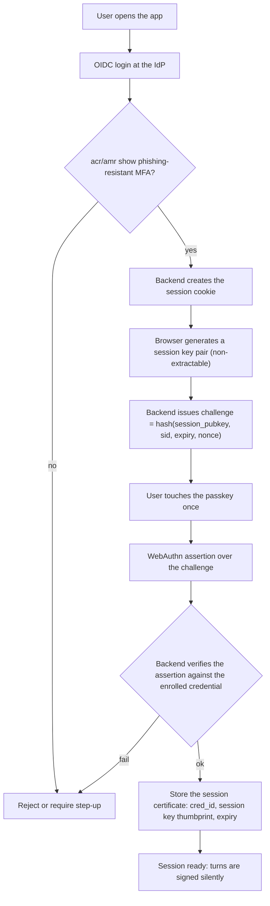
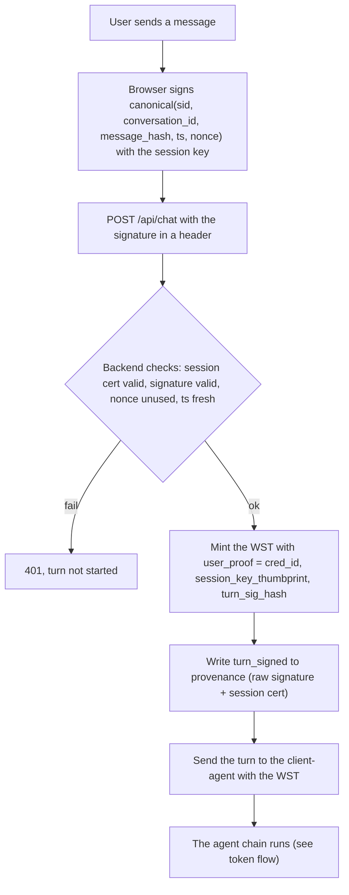
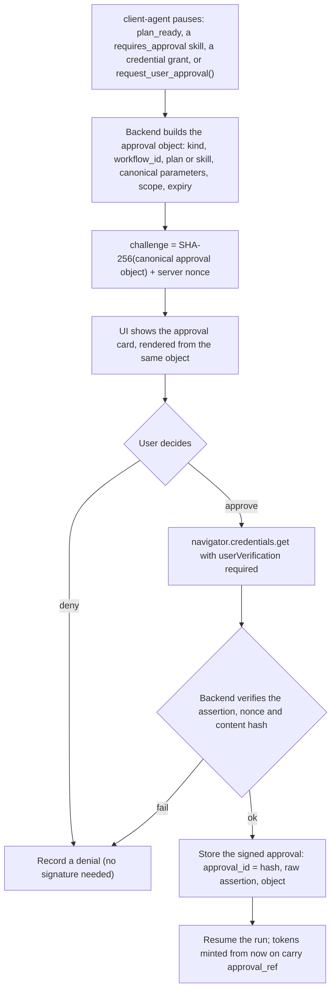
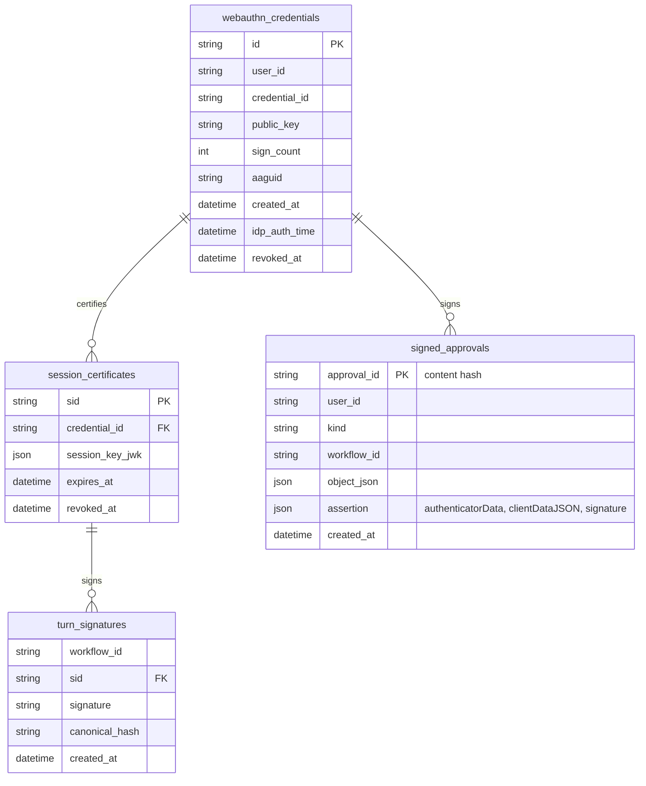
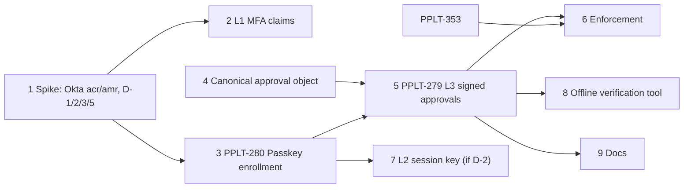

# User Proof Chain: Passkey-Signed Approvals and Session-Bound Turns

| | |
| --- | --- |
| **Status** | Design, not built. Proposed 2026-11-04. |
| **Approver** | Daniel Schwen |
| **Related** | [ADR-001 IAM (WST)][adr-001], [ADR-003 Agent-Scoped Credentials][adr-003], [ADR-005 Agent Workload Identity (mTLS)][adr-005], [Credential Plane for Agents (Design)][cred-plane], Jira epic PPLT-347 |
| **Origin** | Moved from [Confluence page 43810817][origin] (version 9, 2026-11-05). This file is now the source of truth. |

This document describes how the platform proves **which user is behind an agent
action**, and **that the user approved it**, without the user touching a passkey
for every agent call.

Readers: platform developers (backend, frontend, client-agent), agent authors, and
auditors who need to check provenance.

## 1. Problem

- Agents receive a user claim (`sub`) in a platform-minted JWT
  (`USER_IDENTITY_*`, RS256). The backend is the only thing vouching for it. A
  compromised or buggy platform component, for example the client-agent or a
  prompt-injected agent that reaches the backend, could in principle create a
  turn or an approval that the user never made, and nothing would show it.
- Approvals are booleans today. The chat request carries `plan_approved`
  ([`backend/app/routers/chat.py`](../../backend/app/routers/chat.py)). Skills with
  `requires_approval` are released by `approved` on the tool call
  ([`agents/client-agent/orchestrator/agent_loop.py`](../../agents/client-agent/orchestrator/agent_loop.py)).
  `request_user_approval()` in the SDK returns a bool. No approval carries a
  signature, so we have no non-repudiable evidence for licensing or audit.
- The obvious fix, signing every agent invocation with the user's passkey,
  doesn't work ([section 2](#2-why-not-sign-every-agent-invocation-with-a-passkey)).

## 2. Why not sign every agent invocation with a passkey

1. **WebAuthn can't sign silently.** Every assertion needs a user gesture (touch,
   biometric or PIN). One chat turn can cause a dozen agent calls.
2. **The user doesn't author invocations.** The client-agent's LLM loop picks each
   next tool call itself. A user signature can prove *who started the session* and
   *what the user approved*, not "the user chose this exact tool call."
3. **Long runs have no browser.** Background tasks and runs of 72 hours or more
   (PPLT-34 Q-9) keep invoking agents after the tab closes.

## 3. Design: three layers of user proof

| Layer | Proves | Mechanism | User friction |
| --- | --- | --- | --- |
| L1 Login | The person is who the IdP says | OIDC login; the backend requires phishing-resistant MFA through the `acr` / `amr` claims (for example Okta FastPass or a passkey at the IdP) | Normal login |
| L2 Session key | Each turn came from this user's enrolled device, in this session | A non-extractable WebCrypto key in the browser, certified once by a passkey assertion. Every turn request is signed silently with it | One touch per session (8–12 h) |
| L3 Approvals | The user approved this exact plan or action | The passkey signs a challenge that contains the hash of the approval content | One touch per approval, replacing today's click |

Rollout order: **L1, then L3, then L2.** L3 is where non-repudiation matters most.
L2 adds the most complexity and is needed only if per-turn proof must be
impossible for the platform itself to forge (open decision [D-2](#7-open-decisions)).

### 3.1 Overview: where each proof lives

### 3.2 Session start (L1 and L2)

**Passkey enrollment** happens once per device. It requires a fresh IdP login
(`max_age`, step-up `acr`). The enrollment record (credential ID, public key, user,
time, IdP `auth_time`) goes in an append-only table, and every enrollment is
audited and notified to the user. A backend that can silently add credentials
could otherwise forge everything below.

### 3.3 One chat turn (L2)

### 3.4 Approval (L3)

The approval card is rendered from the same canonical object that gets hashed. The
signature therefore covers exactly what the UI was given to show. (WebAuthn can't
prove what the screen displayed; that is the usual limit of web signing.)

Approvals that this covers:

- Plan approval (today's `plan_approved`)
- Skills with `requires_approval` (today's `approved` on the tool call)
- Mid-execution `request_user_approval()` from the SDK
- Credential-plane grants (Allow once / Always allow), [Credential Plane for Agents (Design)][cred-plane]

#### Which authenticator signs, given INL's IdP policy

INL's Okta requires an HSPD-12 PIV card or a YubiKey at login. That affects L3:

- **YubiKey users:** a YubiKey 5 is a FIDO2 authenticator, so the same key can be
  enrolled as the platform passkey. No new hardware is needed.
- **PIV-only users:** a PIV card is a smartcard with X.509 certificates, not a
  FIDO2 authenticator. Browsers expose no web API that lets a page sign arbitrary
  data with it. PIV-only users therefore need either a platform authenticator
  (Windows Hello or Touch ID, if INL device policy allows) enrolled as their
  passkey, or the IdP step-up option below.

**Option: IdP step-up approval.** The platform can get the approval signed by the
IdP instead of by a platform-enrolled passkey. The backend starts an OIDC
authorization request with `prompt=login` (or `max_age=0`), the
phishing-resistant `acr_values`, and `nonce` = the approval content hash. The user
re-authenticates at Okta with their PIV card or YubiKey. Okta returns an
`id_token`, signed by Okta, that contains the approval hash as its `nonce`, a fresh
`auth_time` and the `amr` of the hardware factor. Stored with the approval, that
token is proof that the platform can't forge: it doesn't depend on platform-held
credential enrollment, which closes the "compromised backend enrolls a fake
passkey" gap. The costs are a redirect or pop-up and a card PIN per approval, so
the extra friction fits plan approvals and high-consequence actions, not frequent
ones. (OAuth Rich Authorization Requests, RFC 9396, is the standard way to put the
approval content into the request. The `nonce` binding works with any OIDC
provider.)

### 3.5 Token flow to agents

```mermaid
flowchart LR
  WST["WST (platform-held): sub, workflow_id, scope, bindings, user_proof, approval_refs"]
  subgraph Orchestrator["client-agent (trusted, ADR-004 7.3)"]
    D["Dispatch a tool call"]
  end
  EX["Backend /internal/tokens/exchange"]
  AT["Per-agent token: aud = agent, act = node, scope cut down, approval_ref if gated, cnf.x5t = agent cert, exp = minutes"]
  AG["Specialist agent (mTLS identity)"]
  BR["Credential broker / backend APIs"]
  PROV[("Provenance")]
  WST --> D
  D -->|"WST + call (agent, skill, params hash)"| EX
  EX -->|"gated skill without matching approval: refuse"| D
  EX --> AT
  AT -->|"A2A over mTLS"| AG
  AG -->|"token over the same mTLS cert"| BR
  BR -->|"verify cnf, scope, approval_ref matches skill + params"| PROV
```

Under the alternative where the WST itself is passed to agents ([ADR-001][adr-001],
decision D-4 in [ADR-005][adr-005]), the same claims go in the WST, and approval
matching happens only at the broker and the backend APIs. The per-agent token
variant is the target.

### 3.6 Background and long runs

A signed plan approval authorizes the whole run that it describes (its
`workflow_id`). Turn signatures aren't needed after the user leaves, because the
run continues under the approval. Steps that need a **new** approval pause the run
and notify the user (Approval Queue). There is no silent fallback. The approval
object can carry an expiry (`not_after`) so that an old approval can't release a
run weeks later.

## 4. Data and claims

**New claims in the WST and per-agent tokens:**

| Claim | Content |
| --- | --- |
| `user_proof.level` | `L1`, `L2` (per-turn signature present) |
| `user_proof.cred_id` | WebAuthn credential ID that certified the session |
| `user_proof.skt` | Thumbprint of the session key |
| `user_proof.turn` | Hash of the turn signature |
| `approval_refs` | IDs (content hashes) of the signed approvals that apply to this run |
| `acr`, `amr`, `auth_time` | Copied from the IdP login |

**New admin-db tables** (append-only where noted):

- `webauthn_credentials`: `id`, `user_id`, `credential_id`, `public_key`,
  `sign_count`, `aaguid`, `created_at`, `idp_auth_time`, `revoked_at`
  (append-only plus revoke)
- `session_certificates`: `sid`, `credential_id`, `session_key_jwk`, `expires_at`,
  `revoked_at`
- `signed_approvals`: `approval_id` (hash), `user_id`, `kind`, `workflow_id`,
  `object_json`, `assertion` (raw `authenticatorData`, `clientDataJSON`,
  `signature`), `created_at` (append-only)
- `turn_signatures`: `workflow_id`, `sid`, `signature`, `canonical_hash`,
  `created_at` (append-only; could go straight to the [ADR-002][adr-002] audit log)

**Provenance:** every agent action records `approval_ref` and `user_proof`. The raw
assertions are kept, so an auditor can re-verify signatures offline against the
enrolled public key without trusting the platform.

## 5. Security analysis

| Threat | Covered? | How |
| --- | --- | --- |
| A component other than the backend (client-agent, injected agent) forges a turn or an approval | Yes | It can't produce a session-key or passkey signature. Every forged action shows up as unsigned in provenance, and the broker refuses gated actions without a matching `approval_ref`. |
| The LLM substitutes parameters after approval | Yes | `approval_ref` is the hash of the canonical parameters; the token exchange and the broker compare it with the actual call. |
| Replay of a turn or approval | Yes | Nonce, timestamp and `workflow_id` in the signed data; nonces are single-use. |
| Stolen session cookie | Mostly | Without the non-extractable session key, the attacker can't sign turns (L2). With L1 only, cookie theft is still a risk, which is why L2 exists. |
| XSS in the frontend | Partly | Script can use the session key while the tab is open, but can't extract it, so turn forging is limited to the session lifetime. It **can't** create approvals without a physical touch. Strict CSP and a short session-key lifetime limit the damage. |
| A compromised backend forges actions | Partly | It could enroll a fake credential. Mitigations: enrollment needs a fresh step-up IdP login; append-only enrollment log; user notification on every enrollment; offline re-verification by auditors. The backend stays the trust root for routine operations. |
| A malicious frontend build shows one thing and signs another | No | This is the usual limit of web signing. Mitigated by supply-chain controls on the frontend build (SBOM, signed images, SR-6/SR-9). |
| Lost passkey | n/a | Re-enroll after a fresh IdP login. No platform-held backup codes. |

## 6. Non-browser clients

External API clients and the Python system test client have no passkey:

- They authenticate with OAuth device flow or a client certificate
  ([ADR-005][adr-005]) and run at `user_proof.level = L1` (or an explicit `service`
  level).
- They can't produce L3 approvals. Gated actions from them pause until a user
  approves in the browser, or the deployment marks them as non-gated for that
  client (an admin-visible policy).

## 7. Open decisions

| # | Decision | Notes |
| --- | --- | --- |
| D-1 | Which `acr` / `amr` values does the INL Okta tenant return for PIV and YubiKey logins, and do they let the platform enforce L1? | **Policy known (2026-11-05):** INL Okta already requires an HSPD-12 PIV card or a YubiKey, so L1 is met by IdP policy at INL. Remaining spike: confirm the claim values (for example `amr` `sc` / `hwk`, and the phishing-resistant `acr_values`), so the platform *checks* them instead of trusting them. Make the required values a per-provider admin setting, because other deployments may not enforce hardware MFA. |
| D-2 | Is L2 (per-turn proof) required, or are L1 and L3 enough? | With hardware MFA mandatory at INL, L1 is strong. L2 is needed only if auditors or ECI rules require per-turn proof the platform can't forge. |
| D-3 | Which approvals require L3? All approvals, or only plan approvals, high-consequence skills (PPLT-34 `high_consequence_skills`) and credential grants? | Proposed: plan approvals, high-consequence skills and credential grants. |
| D-4 | Session-key lifetime and re-certification | Proposed: 8 h, re-certified on the next turn after expiry with one touch. |
| D-5 | Is passkey enrollment mandatory for all users, or only for roles that approve? | Proposed: mandatory for anyone who can approve. |
| D-6 | WST in the chain vs per-agent tokens ([ADR-005][adr-005] D-4) | [Section 3.5](#35-token-flow-to-agents) assumes per-agent tokens. |
| D-7 | L3 signer: platform passkey (WebAuthn), IdP step-up (Okta `id_token` with `nonce` = approval hash), or both | Step-up uses the PIV card or YubiKey users already have, and can't be forged by the platform. A passkey is faster for each approval. PIV-only users can't use a passkey unless a platform authenticator is allowed on INL devices. Proposed: step-up for plan approvals and high-consequence actions; a passkey, where available, for credential grants. |

## 8. Proposed epic

**Epic:** User-proof chain: passkey-signed approvals and session-bound turns.
**Parent:** PPM-3 (Platform MVP). **Related:** PPLT-347 (workload identity),
PPLT-31 (credential plane), PPLT-35 (audit), PPLT-34.

**Existing tickets to move under this epic:** PPLT-280 *Add interface for users to
create passkeys for signing approvals* becomes step 3, and PPLT-279 *Implement
passkey signed approvals* becomes step 5. Both are To Do.

| Step | Task | Depends on |
| --- | --- | --- |
| 1 | Spike: Okta `acr` / `amr` and passkey policy (D-1); decide D-2, D-3, D-5 | – |
| 2 | L1: enforce phishing-resistant MFA claims at login; copy `acr`, `amr`, `auth_time` into the WST | 1 |
| 3 | **PPLT-280** Passkey enrollment: WebAuthn registration routes, `webauthn_credentials` table, step-up requirement, enrollment audit and notification, settings UI | 1 |
| 4 | Canonical approval object and content hash for all approval kinds (plan, gated skill, `request_user_approval`, credential grant); the backend becomes the single place approvals are recorded | – |
| 5 | **PPLT-279** L3: passkey-signed approvals (challenge, verify, `signed_approvals`), the approval card renders from the canonical object, `approval_refs` in tokens | 3, 4 |
| 6 | Enforcement: token exchange and broker refuse gated actions without a matching `approval_ref`; provenance records `approval_ref` | 5, PPLT-353 |
| 7 | L2: session key, certification ceremony, signed turn requests, `turn_signatures`, `user_proof` claims (only if D-2 says yes) | 3 |
| 8 | Offline verification tool for auditors (re-verify approvals and turn signatures from provenance) | 5 |
| 9 | Docs: user guide (enroll a passkey, what approvals mean), agent-author guide (`approval_ref`), [`encryption-and-keys.md`](../docs/dev-docs/encryption-and-keys.md) | 5 |

Each step merges on its own. Steps 4 and 5 can go behind a flag
(`APPROVAL_SIGNING=off|optional|required`), so `required` is switched on only
after enrollment is rolled out.

[origin]: https://nstinl.atlassian-us-gov-mod.net/wiki/spaces/Prometheus/pages/43810817
[adr-001]: https://nstinl.atlassian-us-gov-mod.net/wiki/spaces/Prometheus/pages/34866090
[adr-002]: https://nstinl.atlassian-us-gov-mod.net/wiki/spaces/Prometheus/pages/34866115
[adr-003]: https://nstinl.atlassian-us-gov-mod.net/wiki/spaces/Prometheus/pages/34866140
[adr-005]: https://nstinl.atlassian-us-gov-mod.net/wiki/spaces/Prometheus/pages/43319553
[cred-plane]: https://nstinl.atlassian-us-gov-mod.net/wiki/spaces/Prometheus/pages/38338709
