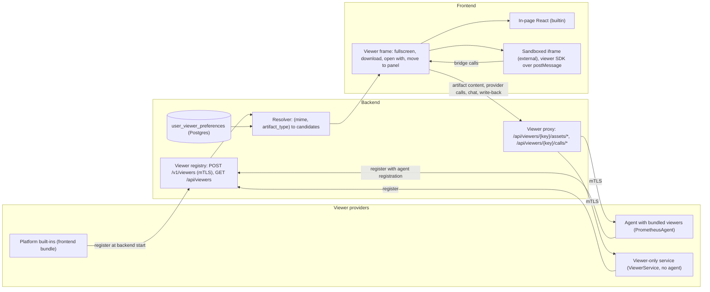
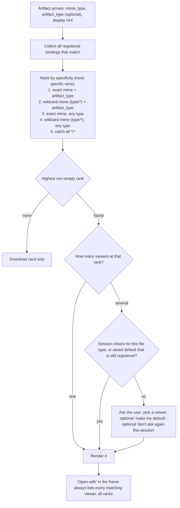
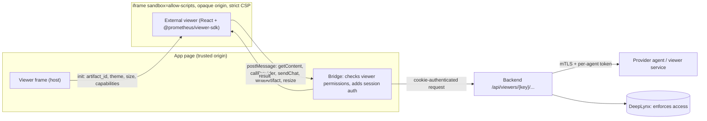
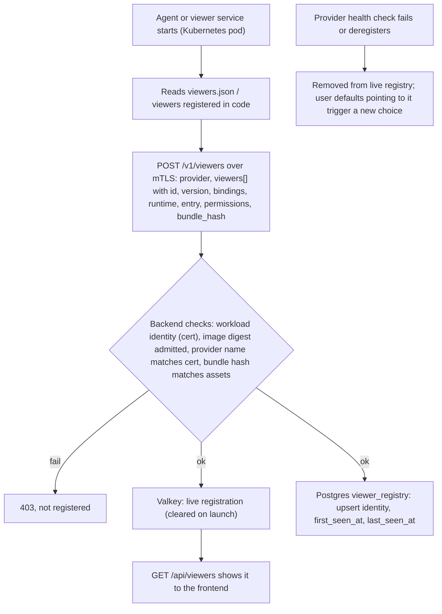
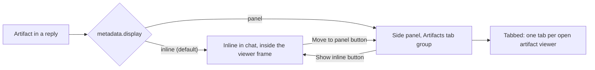
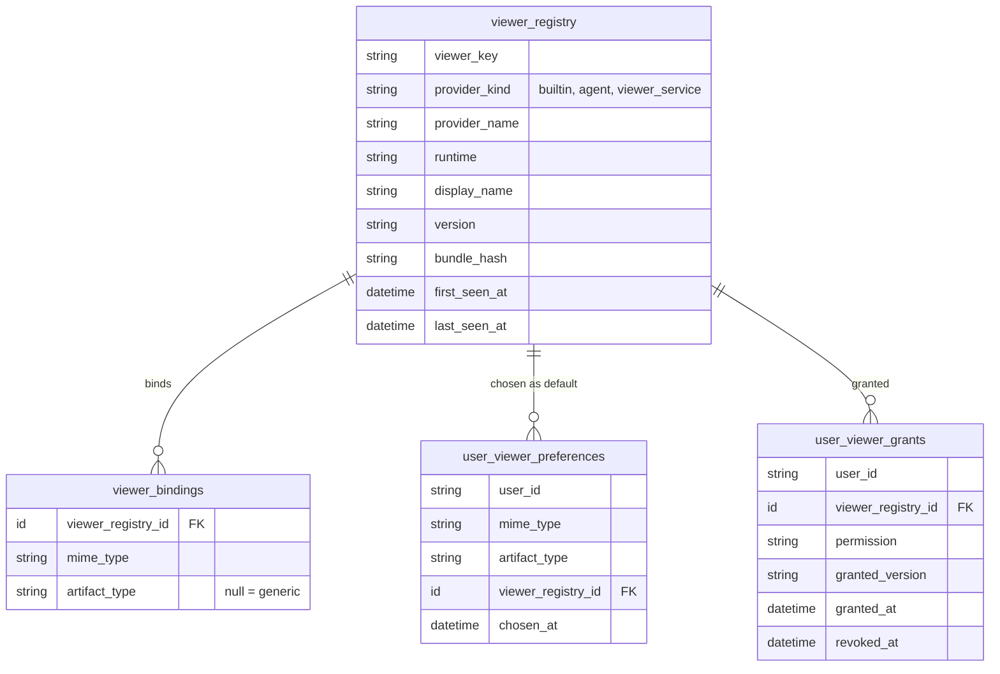
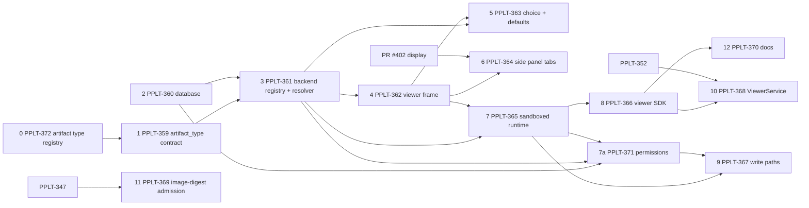

# Viewer Registry and Agent-Provided Viewers

| | |
| --- | --- |
| **Status** | Design, not built. Proposed 2026-11-05. |
| **Approver** | Daniel Schwen |
| **Jira** | Epic PPLT-358, tasks PPLT-359 to PPLT-372 ([section 14](#14-proposed-epic)) |
| **Related** | Agent Custom Endpoints, Prometheus Artifact Contract, [ADR-004 Agent Registry and A2A Gateway][adr-004], [ADR-005 Agent Workload Identity (mTLS)][adr-005], Draft Platform Database Schema (section 9), [artifacts.md](../docs/dev-docs/artifacts.md), prometheus_core PR [#402](https://github.com/idaholab/prometheus_core/pull/402) (artifact `display`) |
| **Origin** | Moved from [Confluence page 44040235][origin] (version 15, 2026-11-05). This file is now the source of truth. |

This document describes one **viewer registry** for every artifact viewer on the
platform. Built-in viewers and viewers that agents or viewer-only services provide
all register the same way, bind to file types the same way, and appear in the same
viewer frame. Nothing binds a viewer to a file type in code.

Readers: frontend and backend developers, agent authors who want to ship a viewer,
and anyone packaging a viewer-only service.

## 1. Problem today

- Bindings are hard-coded twice:
  - in the backend, in `classify_render_hint()`
    ([`backend/app/services/artifacts.py`](../../backend/app/services/artifacts.py)):
    one `json_type`, then MIME tables, tags, extensions;
  - in the frontend, in `classifyElement()` plus the `VIEWER_REGISTRY` map
    ([`frontend/src/features/artifacts/elements.ts`](../../frontend/src/features/artifacts/elements.ts)).
- Only one semantic type is recognised
  (`json_type == prometheus.thermal_analysis.result.v1`). There is no general way to
  have two viewers for two meanings of `application/json`.
- Agents can serve HTTP and static assets (`add_http_endpoint`,
  `add_static_endpoint`, `purpose: viewer_plugin`), but the platform has no way to
  show an agent-provided viewer.
- Each viewer draws its own controls; fullscreen exists in some (mesh) and not
  others.

## 2. Decisions (2026-11-05)

| # | Decision |
| --- | --- |
| R-1 | **Hybrid runtime.** Built-in viewers are in-page React components. External viewers (from agents or viewer services) run in **sandboxed iframes**; their authors still write React, using `@prometheus/viewer-sdk`. One registry and one viewer frame for both. |
| R-2 | **Every registered agent or viewer service may offer viewers.** No per-viewer approval step. The gate is workload admission: a Kubernetes **image-digest** policy and the ADR-005 mTLS identity ([section 8](#8-registration)). |
| R-3 | A generic **`artifact_type`** on every artifact replaces `json_type` and applies to any MIME type. |
| R-4 | Viewers bind to **`(mime_type, artifact_type)`**. Generic bindings are allowed (`artifact_type` omitted, or a MIME wildcard). **The most specific binding always wins.** |
| R-5 | Artifacts **without** `artifact_type` are matched through MIME only. |
| R-6 | Per-user default viewers are stored **server-side** (`user_viewer_preferences`, Draft Platform Database Schema section 9). |
| R-7 | v1 has **"don't ask again this session"** only. Detecting "new choices since you were last asked" is deferred ([section 12](#12-deferred)). |
| R-8 | Viewers may (a) call their provider's endpoints through the backend, (b) send chat messages, (c) write back annotations or derived artifacts. |
| R-9 | Viewers show only artifacts the user owns; access control is enforced by DeepLynx and is out of scope here. A viewer can show **any** artifact of its file type, not only ones its own agent produced. |
| R-10 | A viewer-only repository ships a **running container** that registers through a dedicated viewer registration API. |
| R-11 | Chat UI elements (follow-up suggestions, plan viewer, approval cards) stay **outside** this registry for now. |
| R-12 | Placement: **inline in chat by default**, or per the artifact's `display` hint (PR #402: `inline` / `panel`). A button moves an inline viewer into the **tabbed side panel** (and back). |

## 3. Architecture



## 4. Binding and resolution

### 4.1 Binding key

- **`mime_type`**: an IANA media type, exact (`application/json`) or wildcard
  (`image/*`, `*/*`). Parameters (`; charset=utf-8`) are stripped before matching.
- **`artifact_type`**: optional. Reverse-DNS plus a version suffix, for example
  `prometheus.thermal_analysis.result.v1`, `inl.bim.structural_model.v1`. Omitted
  in a binding means "any or none".
- An artifact always has one `mime_type` and at most one `artifact_type`.

### 4.2 Specificity ranking

The resolver ranks every binding that matches the artifact and keeps only the
**highest non-empty rank**:

| Rank | Binding | Example |
| --- | --- | --- |
| 1 | Exact mime + artifact_type | `(application/json, prometheus.thermal_analysis.result.v1)` |
| 2 | Wildcard mime + artifact_type | `(application/*, inl.bim.structural_model.v1)` |
| 3 | Exact mime, any type | `(application/json, *)` |
| 4 | Wildcard mime, any type | `(image/*, *)` |
| 5 | Catch-all | `(*/*, *)` |

An untyped artifact (R-5) can only match ranks 3–5. If nothing matches, the frame
shows the download card.



### 4.3 Choosing among several viewers

- **One** viewer at the winning rank: it renders.
- **Several** at the winning rank: the platform uses, in order, the user's choice
  for this file type in this session, then the user's saved default (if that
  viewer is currently registered), otherwise it asks.
- The choice dialog lists the candidates (name, provider, version) with two
  checkboxes: **"Make this my default"** (saved server-side) and **"Don't ask again
  this session"**.
- A saved default whose viewer is no longer registered is ignored, and the user is
  asked again.
- The frame's **Open with** menu always lists **all** matching viewers, of every
  rank, so a user can switch for one artifact without changing the default.

### 4.4 Where file types come from

Binding uses only `mime_type` and `artifact_type`. The tag and file-extension
heuristics in `classify_render_hint()` move to **artifact ingestion**: when an
artifact is registered (or uploaded) with a missing or generic MIME type, the
backend sniffs it from the extension or tags *once* and stores the result.
Producers set `artifact_type` explicitly; the backend never guesses it.
`render_hint` is removed from the contract after migration
([section 11](#11-migration-of-todays-viewers)).

## 5. Viewer manifest

A provider declares its viewers in `viewers.json` next to `agent_card.json` (or in
code with `add_viewer(...)`). Built-ins use the same format, compiled into the
frontend bundle.

```json
{
  "viewers": [
    {
      "id": "structural-model",
      "name": "Structural model viewer",
      "version": "1.2.0",
      "runtime": "sandboxed",
      "entry": "/viewers/structural-model/index.html",
      "bindings": [
        {"mime_type": "application/json", "artifact_type": "inl.bim.structural_model.v1"},
        {"mime_type": "model/ifc"}
      ],
      "permissions": ["content.read", "provider.call", "chat.send", "artifact.write"],
      "provider_calls": ["/viewers/structural-model/api/*"],
      "bundle_hash": "sha256:9f2c..."
    }
  ]
}
```

- `viewer_key` = `<provider>/<id>` (for example `bim-agent/structural-model`,
  `platform/mesh`) is the stable identity used for defaults.
- `permissions` lists what the viewer may ask the host for
  ([section 6](#6-viewer-api-host--viewer-contract)). The host refuses anything else.
- `provider_calls` restricts which provider endpoints the viewer may call through
  the proxy.
- `entry` and its assets are served by the provider's
  `add_static_endpoint(purpose="viewer_plugin")`.

## 6. Viewer API (host ↔ viewer contract)

The same contract for both runtimes: built-ins get it as React props and hooks;
sandboxed viewers get it over `postMessage` through `@prometheus/viewer-sdk` (React
hooks with the same names).

| Call | Permission | What it does |
| --- | --- | --- |
| `init` (host → viewer) | – | `artifact_id`, `mime_type`, `artifact_type`, artifact metadata, theme, locale, available size, granted permissions |
| `getContent(range?)` | `content.read` | Bytes of **the artifact the frame was opened for** (streamed, optional byte range) through `/api/artifacts/{id}/content` |
| `getOtherArtifact(artifact_id)` / `listArtifacts(filter)` | `artifact.read_other` | Content or metadata of a **different** artifact the user owns (for example to overlay two results) |
| `callProvider(path, req)` | `provider.call` | An HTTP call to the viewer's **own** provider, through `/api/viewers/{key}/calls/{path}`; only paths in `provider_calls` |
| `sendChat(text)` | `chat.send` | Posts a user-visible chat message in the current conversation (like today's `onSend`); the host shows it as coming from the viewer |
| `writeArtifact(body, meta)` | `artifact.write` | Creates an annotation or derived artifact; the backend registers it with lineage to the source artifact and the viewer as producer |
| `resize(height)`, `setTitle`, `reportError` | – | Layout and status |
| `theme`, `visibility` events (host → viewer) | – | Theme changes, inline/panel/fullscreen changes |

Rules:

- A viewer receives **only an artifact ID** and fetches content through the host.
  It never gets the user's cookie, session key or token.
- `callProvider` is how a viewer reaches server-side helpers (for example a mesh
  conversion, the way the mesh viewer uses `/api/artifacts/mesh/...` today). The
  backend forwards over mTLS (ADR-005) with a per-agent token for the current user,
  **scoped to the frame's artifact**.
- Access to the artifact itself is checked by DeepLynx (R-9). Viewer permissions
  ([6.1](#61-viewer-permissions-android-style-decided-2026-11-05)) are an
  additional, platform-side limit on what a viewer may do with that access.

### 6.1 Viewer permissions (Android-style, decided 2026-11-05)

- A viewer declares every permission it needs in its manifest (`permissions`).
  Anything not declared is refused.
- **The first time a viewer is triggered** for a user, the frame shows a permission
  prompt instead of the viewer: the viewer's name, provider and version, and one
  line per requested permission in plain language ("Send messages in this chat",
  "Create new artifacts", "Read your other artifacts"). The user can allow all and
  open, or cancel. A cancelled viewer isn't shown, and the frame falls back to the
  next candidate or the download card.
- `content.read` for the opened artifact is implied by opening the viewer and
  isn't prompted. `provider.call`, `chat.send`, `artifact.write` and
  `artifact.read_other` are prompted.
- Grants are stored per user and viewer (`user_viewer_grants`, Draft Platform
  Database Schema section 9), survive restarts, and can be revoked in user settings
  (a "Viewer permissions" list).
- When a new version of a viewer declares a permission the user hasn't granted, the
  user is asked again for **the new permissions only**. A version that drops a
  permission keeps working.
- Built-in viewers are platform code. They declare permissions too (for consistency
  and display), but the platform's own built-ins are pre-granted.

### 6.2 Enforcement

For sandboxed viewers, every permission is enforced **server-side**, because the
iframe has no network access of its own (opaque origin, `connect-src 'none'`). All
its I/O goes through the bridge to the backend:

- **Frame token.** When the frame opens, the backend issues a short-lived frame
  token bound to `(user, viewer_key, artifact_id, granted permissions)`. The bridge
  attaches it to every proxied call. The sandbox never sees it.
- **`artifact.read_other`.** The content route serves only the frame's own
  `artifact_id` unless the frame token carries `artifact.read_other`. Then it
  serves any artifact the user can read (DeepLynx still decides that).
- **`provider.call`.** The per-agent token forwarded to the provider is scoped to
  the frame's artifact. A provider can't fetch other artifacts for the viewer
  unless the grant includes `artifact.read_other`.
- **`chat.send`, `artifact.write`.** The backend refuses the route without the
  grant.

Limits, stated plainly:

- A viewer with `provider.call` can always send **the artifact it was opened with**
  to its own provider. That is inherent in server-side viewing and is what the user
  accepts by granting `provider.call`.
- For **built-in** (in-page) viewers, permissions are not technically enforced.
  They are reviewed platform code.

## 7. Runtimes and isolation



- **`builtin`**: React components in the frontend bundle, lazy-loaded, rendered
  in-page. Only code built and reviewed with the platform.
- **`sandboxed`**: an `<iframe sandbox="allow-scripts">` with **no
  `allow-same-origin`** (opaque origin), so the viewer can't read the app's
  cookies, storage or DOM, and can't call the API directly.
  - Assets come from `/api/viewers/{key}/assets/*` with a strict CSP
    (`connect-src 'none'`; all I/O goes through the bridge).
  - `bundle_hash` is checked when the backend first fetches assets.
  - Download and fullscreen are host controls, so the sandbox doesn't need
    `allow-downloads` or `allow-fullscreen`.
- WebGL and WASM viewers (VTK.js, IFC) work in the sandbox; they need
  `'wasm-unsafe-eval'` in the iframe CSP.
- Moving a viewer between inline and the panel moves the same frame and keeps its
  state.

## 8. Registration

### 8.1 Two registration paths, one registry

- **Agents**: the SDK sends the viewer manifest with the agent registration (or a
  follow-up `POST /v1/viewers`) at start.
- **Viewer-only services** (R-10): a slim SDK `ViewerService` (no A2A, no skills)
  with its own workload identity, `spiffe://prometheus/viewer/<name>`. It serves its
  assets and provider endpoints and calls `POST /v1/viewers`.
- **Built-ins**: the backend registers the platform's built-in viewers at start,
  from the same manifest format, with `provider = platform`, `runtime = builtin`.



### 8.2 Endpoints

| Method | Path | Caller | Purpose |
| --- | --- | --- | --- |
| `POST` | `/v1/viewers` | Agent / viewer service (mTLS) | Register or update the caller's viewers (replaces the caller's previous set) |
| `DELETE` | `/v1/viewers/{provider}` | The provider itself or admin | Deregister |
| `GET` | `/api/viewers` | Frontend (session) | All live viewers and their bindings |
| `GET` | `/api/viewers/resolve?artifact_id=` | Frontend (session) | Candidates for one artifact, ranked, plus the user's default |
| `GET` / `PUT` / `DELETE` | `/api/viewers/preferences` | Frontend (session) | The user's saved defaults |
| `GET` | `/api/viewers/{key}/assets/{path}` | Sandboxed iframe | Proxied viewer assets |
| `*` | `/api/viewers/{key}/calls/{path}` | Host bridge (session) | Proxied provider calls, restricted to `provider_calls` |

### 8.3 Trust: workload admission by image digest

- The registry accepts `POST /v1/viewers` only from a workload with a valid
  platform certificate (ADR-005), and only for the provider name in that
  certificate.
- In Kubernetes, an admission policy allows only **approved image digests**
  (`image@sha256:…`) for platform workloads, so only an approved build can obtain a
  certificate (SPIRE workload attestation by image digest, or a Kyverno / Sigstore
  policy-controller rule). Approval is stored by digest, so it survives restarts; a
  new build needs a new approval, or a trusted cosign signature if signed images
  are adopted later.
- Live registrations stay in Valkey (cleared on launch, ADR-004). The **identity**
  of each viewer is kept in Postgres (`viewer_registry`), so saved defaults survive
  restarts.
- Admins can **disable** a viewer by `viewer_key` (it is hidden from resolution)
  without stopping its provider.

## 9. Frontend: the viewer frame and placement

Every viewer, built-in or sandboxed, renders inside one **viewer frame** that the
platform owns:

- Title, provider and version; **Fullscreen**; **Download** (original artifact);
  **Open with** (all matching viewers); **Move to panel** / **Show inline**; error
  and loading states.
- Viewers no longer draw their own fullscreen or download buttons; the existing
  ones are removed during migration.



- Default placement is inline under the reply that produced the artifact
  (Prometheus Artifact Contract, "viewer ownership").
- `metadata.display = "panel"` (PR #402) opens the artifact in the side panel
  instead.
- The side panel has **tabs**, one per open viewer; closing a tab doesn't delete
  anything.

## 10. Data model

Added to Draft Platform Database Schema, section 9 (Registries):

- **`viewer_registry`**: stable viewer identity: `viewer_key`, `provider_kind`
  (builtin, agent, viewer_service), `provider_name`, `runtime`, `display_name`,
  `version`, `bundle_hash`, `first_seen_at`, `last_seen_at`.
- **`viewer_bindings`**: `(viewer_registry_id, mime_type, artifact_type)`;
  `artifact_type` null = generic.
- **`user_viewer_preferences`**: `(user_id, mime_type, artifact_type) →
  viewer_registry_id`, `chosen_at`.
- **`user_viewer_grants`**: `(user_id, viewer_registry_id, permission)`,
  `granted_version`, `granted_at`, `revoked_at`
  ([section 6.1](#61-viewer-permissions-android-style-decided-2026-11-05)).



On `artifact_references` ([section 11](#11-migration-of-todays-viewers)), per Q-1:

- **`artifact_type`** (optional): the format/schema identifier, used for viewer
  binding.
- **`mime_type`**: the content's media type.
- **No `record_class`.** Every artifact is stored in DeepLynx under one fixed class,
  **`prometheus_artifact`**, with `artifact_type` and `mime_type` as record
  metadata. That class separates artifact records from execution and approval
  records, which have their own fixed classes (`deeplynx_mappings`).
- `output_policies` (sensitivity labels) are keyed on `(mime_type, artifact_type)`
  with the same most-specific-wins rule as viewers.
- UI registry filters (Reports / Meshes / Results) use a `category` that the
  artifact type registry (PPLT-372) assigns to each type, with MIME-based groups
  for untyped artifacts.

The per-session "don't ask again" and the inline/panel placement are kept in the
browser only, for the current view.

## 11. Migration of today's viewers

Each current viewer becomes a built-in registry entry. The bindings below are
today's hard-coded rules, moved into manifests:

| Viewer key | Bindings (mime, artifact_type) |
| --- | --- |
| `platform/ifc` | `model/ifc`, `application/ifc` |
| `platform/mesh` | `application/x-exodus`, `application/exodus`, `application/x-hdf5`, `application/x-netcdf`, `application/netcdf`, STL MIME types |
| `platform/mermaid` | `text/x-mermaid`, `application/vnd.mermaid`, `text/mermaid` |
| `platform/image` | `image/*` |
| `platform/pdf` | `application/pdf` |
| `platform/json` | `application/json` (generic) |
| `platform/thermal` | `(application/json, prometheus.thermal_analysis.result.v1)` |
| `platform/code` | YAML, TOML, XML, MOOSE input and the other code MIME types |
| `platform/table` | `text/csv`, `application/csv`, `text/tab-separated-values` |
| `platform/report` | `text/markdown`, `text/plain` |
| `platform/reference` | `artifact_type` for citations (to be defined; today a tag) |
| `platform/download` | `*/*` (catch-all, rank 5) |

The SDK maps `json_type` to `artifact_type` during a transition release, then
removes `json_type`.

## 12. Deferred

- **"Ask again when new choices appear"**: needs a per-user "last asked" record
  against `viewer_registry.first_seen_at` (and a rule for whether a new version
  counts). v1 asks only when there is no session choice and no valid saved default.
- Organisation-wide default viewers set by an admin.
- Promoting a reviewed external viewer to `builtin`.
- Chat UI elements in the registry (R-11).

## 13. Open questions

| # | Question | Status |
| --- | --- | --- |
| Q-1 | Align `artifact_references.artifact_type` with the optional, reverse-DNS `artifact_type` of R-3. | **Decided (2026-11-05):** `artifact_type` is the format/schema identifier (reverse-DNS + version, e.g. `prometheus.thermal_analysis.result.v1`). It is optional, and it is the same field on `artifact_references`, the contract and `viewer_bindings`. **No separate category field:** `output_policies.artifact_type` and the Glossary's `record_class` were dropped. In DeepLynx, every artifact uses one fixed class, `prometheus_artifact`, with the format as metadata; execution and approval records have their own classes. Output policies key on `(mime_type, artifact_type)`. UI filter groups come from the artifact type registry. Schema and Glossary updated. |
| Q-2 | Who owns the `artifact_type` namespace? | **Decided:** a registry of artifact types, kept as a reviewed document. Each entry gives the type name, MIME types, schema (or a link), filter `category`, owner, and status (active, deprecated). New types are added by pull request or page edit. **Still to choose:** a markdown file in the platform repository (reviewed by PR, can be checked in CI against `viewers.json` bindings and SDK constants), or a Confluence page. The repository file is the better fit if CI checks are wanted. |
| Q-3 | Should `writeArtifact` from a viewer require a user approval? | **Decided:** yes, through declared permissions approved by the user the first time the viewer is triggered (Android-style, [section 6.1](#61-viewer-permissions-android-style-decided-2026-11-05)). The same applies to `provider.call`, `chat.send` and `artifact.read_other`. |
| Q-4 | Is "Move to panel" remembered per artifact? | **Decided:** no. Placement follows the artifact's `display` hint each time; a move lasts for the current view only. |
| Q-5 | May a viewer read *other* artifacts? | **Decided:** only with the separate `artifact.read_other` permission. It is enforceable server-side for sandboxed viewers ([section 6.2](#62-enforcement)), not for built-ins. |

## 14. Proposed epic

**Epic: PPLT-358** Viewer registry and agent-provided viewers
(<https://nstinl.atlassian-us-gov-mod.net/browse/PPLT-358>). **Parent:** PPM-3.
**Related:** PPLT-347 (workload identity), PPLT-281 (database design phase 2),
prometheus_core PR #402.

| Step | Jira | Task | Depends on |
| --- | --- | --- | --- |
| 0 | PPLT-372 | Artifact type registry document (Q-2); decide repository markdown vs Confluence | – |
| 1 | PPLT-359 | Contract: `artifact_type` on `ArtifactReference` and `ArtifactMeta`; SDK maps `json_type`; MIME sniffing moves to ingestion | 0 |
| 2 | PPLT-360 | Database: `viewer_registry`, `viewer_bindings`, `user_viewer_preferences`, `user_viewer_grants` (Alembic); align with PPLT-281 | – |
| 3 | PPLT-361 | Backend viewer registry: manifest model, `POST /v1/viewers`, `GET /api/viewers`, resolver with specificity ranking, built-ins registered at start | 1, 2 |
| 4 | PPLT-362 | Frontend: one viewer frame (fullscreen, download, open with); route all built-in viewers through `/api/viewers/resolve`; remove `classifyElement` / `VIEWER_REGISTRY` and `render_hint` | 3 |
| 5 | PPLT-363 | Choice dialog, saved defaults (`/api/viewers/preferences`), "don't ask again this session" | 3, 4 |
| 6 | PPLT-364 | Side panel tabs and "Move to panel" / "Show inline" (not remembered), honouring `display` from PR #402 | 4, PR #402 |
| 7 | PPLT-365 | Sandboxed runtime: iframe host, bridge, asset and call proxy, CSP, `bundle_hash` check | 3, 4 |
| 7a | PPLT-371 | Android-style permission prompt, `user_viewer_grants`, frame token and server-side enforcement (6.1, 6.2) | 2, 3, 7 |
| 8 | PPLT-366 | `@prometheus/viewer-sdk` (React hooks over postMessage) and the SDK `add_viewer` / `viewers.json` support | 7 |
| 9 | PPLT-367 | Viewer API write paths: `sendChat`, `writeArtifact` with lineage | 7, 7a |
| 10 | PPLT-368 | Viewer-only service: SDK `ViewerService`, template repo, Helm/compose example | 8, PPLT-352 |
| 11 | PPLT-369 | Admission by image digest for agent and viewer workloads (Kubernetes policy) | PPLT-347 |
| 12 | PPLT-370 | Docs: agent-author guide for viewers, update Agent Custom Endpoints and `artifacts.md` | 8 |



Each step merges on its own. Steps 4–6 change only built-in viewers and can land
before any external viewer exists.

**Also under PPLT-358** (added after this plan was written): PPLT-382, type each
viewer's props so the adapter and the viewer are checked against each other.

[origin]: https://nstinl.atlassian-us-gov-mod.net/wiki/spaces/Prometheus/pages/44040235
[adr-004]: https://nstinl.atlassian-us-gov-mod.net/wiki/spaces/Prometheus/pages/42041369
[adr-005]: https://nstinl.atlassian-us-gov-mod.net/wiki/spaces/Prometheus/pages/43319553
