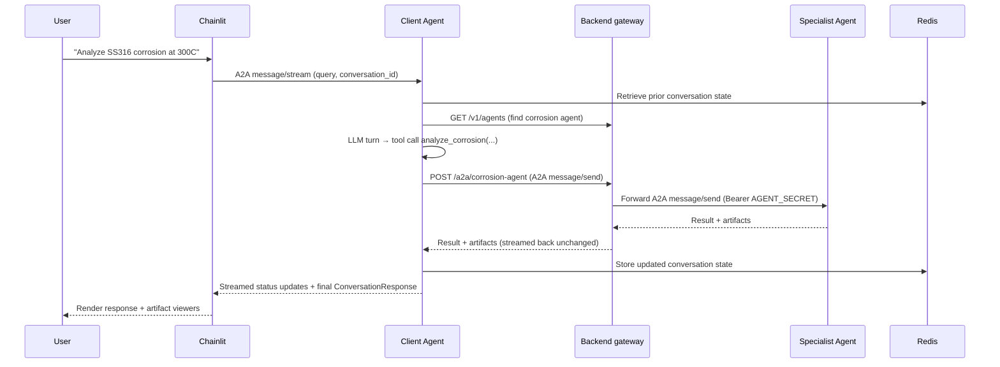

# Architecture

## System overview

Prometheus is a multi-agent platform for nuclear engineering analysis. A Chainlit chat frontend communicates with a central client-agent orchestrator, which dynamically routes queries to specialist agents using the A2A (Agent-to-Agent) JSON-RPC 2.0 protocol. Redis provides conversation state and status persistence.

## Architecture diagram

```mermaid
graph TD
  subgraph Frontend
    CL[Chainlit UI<br/>Python + custom JSX elements]
  end

  subgraph Orchestration
    CA[Client Agent<br/>tool-calling loop + Prometheus LLMClient]
    GW["Backend Agent Registry + A2A Gateway<br/>/v1/agents + /a2a/{agent_name}"]
    RED[(Redis<br/>conversation state + status)]
  end

  subgraph Specialists
    CORR[Corrosion Agent]
    RAD[Radiation Agent]
    THERM[Thermal Agent]
    DATA[Data Agent]
    SYNTH[Synthesis Agent]
    OSTI[OSTI Research Agent]
    FF[Form Filler Agent]
    REQ[Requirements Agent]
  end

  CL -->|A2A JSON-RPC<br/>Bearer token| CA
  CA -->|GET /v1/agents + A2A via /a2a/{agent}| GW
  CA -->|store/retrieve conversation state<br/>status updates| RED
  GW -->|A2A JSON-RPC| CORR
  GW -->|A2A JSON-RPC| RAD
  GW -->|A2A JSON-RPC| THERM
  GW -->|A2A JSON-RPC| DATA
  GW -->|A2A JSON-RPC| SYNTH
  GW -->|A2A JSON-RPC| OSTI
  GW -->|A2A JSON-RPC| FF
  GW -->|A2A JSON-RPC| REQ

  CORR -.->|register| GW
  RAD -.->|register| GW
  THERM -.->|register| GW
  DATA -.->|register| GW
  SYNTH -.->|register| GW
  OSTI -.->|register| GW
  FF -.->|register| GW
  REQ -.->|register| GW
```

## Component responsibilities

### Chainlit frontend

The frontend is a Python Chainlit application that provides:

- Chat interface with streaming status updates during long-running agent calls
- File upload handling (Exodus, STL, IFC, PDF) with local processing
- Custom React elements for visualization (MeshViewer, IFCViewer, MermaidViewer, PlanViewer)
- Authentication (password-based, OAuth-ready)
- Settings panel with agent toggles and debug tools
- Follow-up suggestion cards and DynamicForm for structured input
- Conversation history browser backed by Redis state

The frontend communicates with the client-agent via A2A JSON-RPC `message/stream`. Streamed `status-update` events update a Chainlit `cl.Step`; the frontend does not poll a side-channel status endpoint.

### Client-agent (orchestrator)

The client-agent is a tool-calling loop (`orchestrator/agent_loop.py`). It:

1. **Discovers agents** from the backend's agent registry and specialist agent cards, and
   advertises every skill and workflow template as an LLM tool
2. **Lets the model decide each next call** with the whole transcript (earlier calls,
   results, artifact ids) in context, so multi-skill chains need no up-front plan
3. **Pauses for the user** with typed forms (missing inputs, `ask_user`, specialist
   `INPUT_REQUIRED`) or an approval gate (`requires_approval`), and resumes later
4. **Dispatches work** to specialist agents via A2A and answers once no tool call remains

```
user turn → LLM ──tool calls──► validate → [form / approval pause] → invoke via A2A
             ▲                                                          │
             └────────── tool results (summary + artifact ids) ◄────────┘
           LLM ──no tool calls──► final answer
```

See [agent-loop-orchestration.md](agent-loop-orchestration.md) for the full design.

### Agent registry and A2A gateway (backend)

The FastAPI backend (`backend/app/routers/agent_registry.py`) serves as the shared A2A gateway and agent directory at `REGISTRY_URL` (default `http://backend:8000`). Its API is wire-compatible with the subset of LiteLLM's agent API that the SDK's `AgentRegistryClient` uses. It provides:

- Runtime agent registration (`POST /v1/agents`), persisted in one Valkey hash (`prometheus:agent-registry`) so it survives a backend restart; a re-registering agent overwrites its own entry
- Agent listing via `GET /v1/agents` and removal via `DELETE /v1/agents/{agent_id}`
- A2A request routing via `POST /a2a/{agent_name}`: the backend forwards the JSON-RPC call to the agent's card URL with its registered `static_headers` (Bearer `AGENT_SECRET`) and streams SSE/NDJSON back unchanged
- A single in-cluster endpoint that the client-agent uses for specialist dispatch

Every registry route requires `Authorization: Bearer <AGENT_SECRET>`. The client-agent still fetches each specialist's direct well-known agent-card endpoint when it needs full per-skill metadata (`inputSchema` etc.), because the registry listing can be a lossy summary.

### Redis

Serves three purposes:

1. **Conversation state**: Multi-turn conversation state persistence (keyed by `conversation:{id}`)
2. **Status history**: Short-lived progress updates rendered in the frontend during long-running execution
3. **Agent registrations**: The backend registry's `prometheus:agent-registry` hash (cleared by `make clear-agent-registry` on every launch)

### Specialist agents

Each specialist agent is a standalone container built on the `PrometheusAgent` base class from `prometheus_api`. Agents:

- Load metadata from `agent_card.json`
- Register with the backend's agent registry on startup
- Accept A2A JSON-RPC requests with Bearer token auth
- Execute domain-specific analysis
- Return results as artifacts

Current specialists: corrosion, radiation, thermal, data retrieval, synthesis, OSTI literature search, form filler, requirements.

## Data flow for a typical request



## A2A protocol

All inter-agent communication uses JSON-RPC 2.0 over HTTP POST:

```json
{
  "jsonrpc": "2.0",
  "id": "request-uuid",
  "method": "message/send",
  "params": {
    "message": {
      "messageId": "msg-uuid",
      "role": "user",
      "parts": [{"type": "text", "text": "{\"query\": \"...\", \"conversation_id\": \"...\"}"}]
    },
    "configuration": {"blocking": true},
    "context": {"skillId": "analyze_corrosion", "conversationId": "conv-uuid"}
  }
}
```

Authentication uses Bearer tokens via the `Authorization` header, validated by `BearerTokenMiddleware` in the PrometheusAgent base class.

The client-agent streams frontend-facing status updates as A2A task events. Downstream specialist calls still use `message/send` unless the target agent advertises streaming support.

## LLM configuration

There is no LLM proxy in the platform: each agent calls the provider its LLM config selects directly. An installed profile (e.g. `prometheus_api/llm_configs/anthropic.yaml`) maps semantic flavors to provider models:

```yaml
model_list:
  - model_name: medium
    litellm_params:
      model: claude-sonnet-5-5
      api_key: os.environ/LLM_API_KEY
      api_base: https://api.anthropic.com/v1
```

Agents call the provider-independent `prometheus_api.llm_client` interface and
select semantic flavors such as `medium` in code. The deployment selects an
installed or custom YAML that maps those flavors to provider models.
`LLM_CONFIG_PROFILE` is required (there is no default), and the provider
profiles use their environment-sourced credentials in the agent container. The
SDK's `registry` profile is not supported on this platform, since it needs an
LLM proxy at `REGISTRY_URL`.

## Deployment

All services are containerized via Docker Compose:

| Service | Container | Port | Role |
|---------|-----------|------|------|
| Client Agent | client-agent | 8001 | Orchestration |
| Corrosion Agent | corrosion-agent | 8002 | Specialist |
| Radiation Agent | radiation-agent | 8003 | Specialist |
| Thermal Agent | thermal-agent | 8004 | Specialist |
| Data Agent | data-agent | 8005 | Specialist |
| Form Filler | form-filler-agent | 8006 | Specialist |
| OSTI Research | osti-research-agent | 8007 | Specialist |
| Artifact Debug | artifact-debug-agent | 8008 | Testing |
| Synthesis Agent | synthesis-agent | 8009 | Specialist |
| Code Render Debug | code-render-debug-agent | 8010 | Testing |
| Redis | agent-redis | 6379 | State/status |
| React Frontend (dev) | frontend-dev | 5150 | UI (dev profile) |
| React Frontend (prod) | frontend-prod | 8080 | UI (prod profile) |
| Backend | backend | 8600 | JSON/SSE API + auth; agent registry + A2A gateway |
| Admin DB | admin-db | (internal) | Backend admin plane (users, OIDC config, signing keys) |

Both frontend services start only after the backend healthcheck (`/healthz`) passes, so the first page load can reach `/api`. Every agent (client-agent included) also waits for a healthy backend, since it hosts the registry they register with.

All containers share the `agent-network` bridge network. Environment variables
for secrets, LLM profile selection, and host mappings are passed via `.env`.
Independently deployed agents use their own environment and provider keys.
