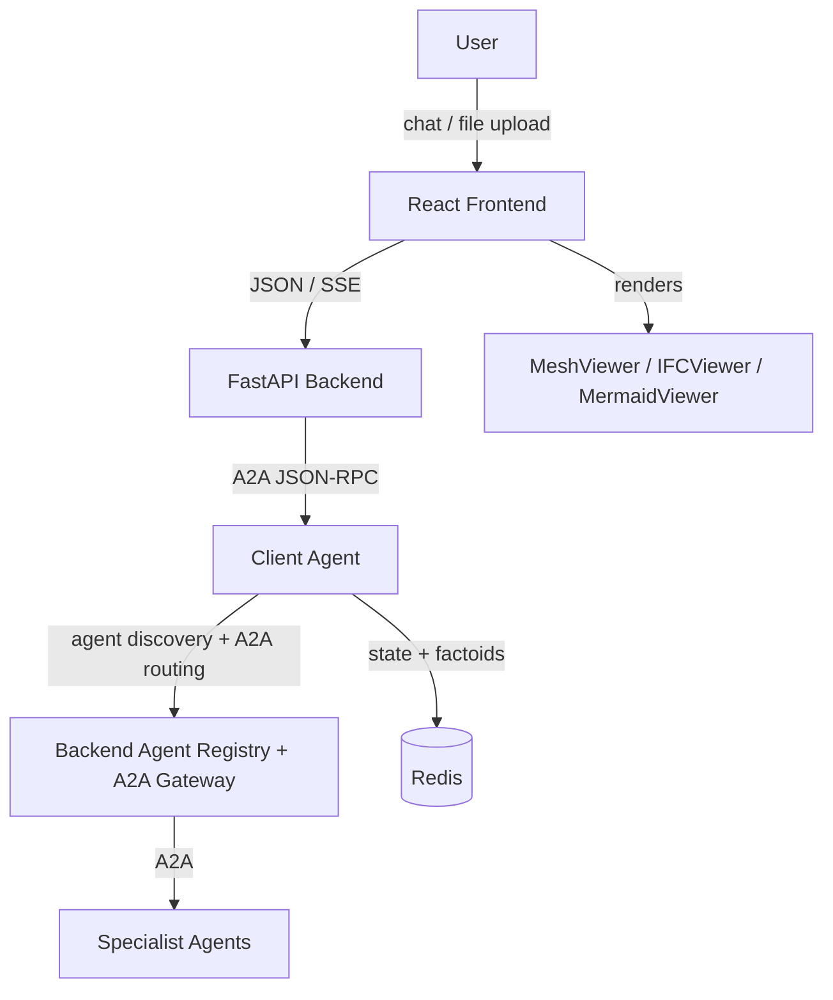

# Prometheus Platform

A multi-agent analysis platform for nuclear engineering. Users interact through a React chat UI (served by a FastAPI backend) that routes queries to specialist agents via a central client-agent orchestrator using the A2A (Agent-to-Agent) JSON-RPC 2.0 protocol.

## Architecture



The React frontend communicates with the FastAPI backend over its JSON/SSE contract; the backend relays to the client-agent via the A2A protocol. The client-agent discovers specialist agents from the backend's agent registry (`/v1/agents`), manages multi-turn conversation state in Redis, and dispatches analysis work through the backend's A2A gateway (`/a2a/{agent_name}`).

| Service | Port | Stack |
|---------|------|-------|
| React Frontend | 5150 (dev) / 8080 (prod) | React, Vite, VTK.js |
| Backend | 8600 | FastAPI, A2A client, agent registry + A2A gateway |
| Client Agent | 8001 | LangGraph, Prometheus LLMClient, A2A SDK |
| Redis | 6379 | Factoids, conversation state |

The client-agent also maintains a workflow library for reusable multi-step analyses. Workflow templates can be
platform-owned or published by specialist agents through their agent cards. See [Workflow Templates](workflow-templates.md)
for the schema, ownership model, and authoring rules.

## Getting started

### Prerequisites

- Python 3.12+ for development, and Python 3.10+ to run `./platformctl` (it finds one itself)
- [uv](https://docs.astral.sh/uv/) package manager
- Docker and Docker Compose (for multi-agent deployment)

### Docker Compose (recommended)

```bash
cd platform
./platformctl config init     # creates .env, generates all secrets, asks for the LLM provider and key
make up
```

`config init` asks for `LLM_CONFIG_PROFILE` (required, no default) and the `LLM_API_KEY` for that provider. If the
platform does not come up, run `./platformctl doctor`. See the [platformctl guide](platformctl/index.md) for setup,
checking that the platform is ready, and troubleshooting.

### Local development

```bash
cd platform/frontend && make install
make dev        # React dev server (http://localhost:5150)
```

Log in with `prometheus` / `prometheus`.

### Common commands

From `frontend/`:

```bash
make dev        # Start the Vite dev server (port 5150)
make build      # Production bundle → dist/
make lint       # eslint
make typecheck  # tsc
make check      # lint + typecheck
```

## Configuration

The backend reads `backend/app/config.yml`:

```yaml
chat-intro: "Welcome to the Prometheus Platform."
chat-suggestion-title: "What would you like to do today?"

workflow-suggestions:
  - "Design a Rankine cycle based power generation system"
  - "Run FTL Safety Analysis"

agent-url: "http://localhost:8001"
agent-secret: ""
redis-url: "redis://localhost:6379"
debug: true
auto-approve-steps: false
```

Override the config path with `PROMETHEUS_CONFIG_PATH=/path/to/config.yml`.

Local user accounts are no longer configured here — they live in a
Postgres-backed admin plane, created via a first-run setup wizard and managed
through an in-app admin UI (users, RS256 signing keys, OIDC identity
providers). See `docs/docs/dev-docs/multi-user-setup.md` and
`docs/docs/dev-docs/encryption-and-keys.md`.

## Data flow

### Chat flow

1. User sends a message in the React UI
2. The React frontend posts it to the FastAPI backend, which relays an A2A JSON-RPC request to the client-agent
3. Client-agent classifies the query, discovers relevant agents through the backend's agent registry, and collects parameters if needed
4. Specialist agents execute analysis and return results with artifacts
5. The backend streams the response back over SSE and the frontend renders any visualization elements

### Multi-turn conversations

The client-agent maintains conversation state in Redis. Each turn can:

- Ask follow-up questions (`status: "needs_info"`)
- Present an execution plan for approval (`status: "plan_ready"`)
- Return final results (`status: "completed"` or `status: "answer"`)

### File upload

Uploads are sent to the backend; the frontend renders each type with the matching viewer:

- `.e` / `.exo` (Exodus) -- rendered client-side with MeshViewer (VTK.js)
- `.stl` (STL) -- rendered client-side with MeshViewer (VTK.js)
- `.ifc` -- rendered with IFCViewer
- `.pdf` -- displayed inline

## Frontend components

### Viewers and custom elements

React viewers live in `frontend/src/viewers/`; some custom-element JSX remains in `frontend/public/elements/`. They are driven by the backend's artifact/event payloads (no Chainlit `cl.CustomElement` coupling):

| Component | Purpose |
|-----------|---------|
| `DynamicForm.jsx` | Configurable forms with validation, timeout countdown, help text |
| `IFCViewer.jsx` | 3D building model viewer (ThatOpen engine, THREE.js) |
| `MeshViewer.jsx` | VTK-based mesh visualization (Exodus + STL) with playback controls and color presets |
| `FollowUpSuggestions.jsx` | Clickable workflow suggestion cards |
| `MermaidViewer.jsx` | Diagram renderer |

### Message handler

`components/message_handler.py` routes incoming messages: file uploads are processed locally, text queries are forwarded to the client-agent via A2A.

## Code style

- Line length: 120
- Linter/formatter: ruff (rules: E, F; E501 ignored)
- Type checker: mypy
- Tests: pytest with pytest-asyncio (`asyncio_mode = "auto"`)
